# Development showcase - 14 October 2026

**Recorded development build, 14 October 2026.** These are prototype results, beyond the smaller [public alpha feature set](#download-and-current-feature-set). Groups, services and CQC starts remain disabled in that download.

- The altered platform appearance, red decals and unfinished open interiors come from the **optional Command Platform 1 v9.1 experiment**. The standard core keeps the normal platform and does not add these WIP spaces.
- Children, doctors, some other NPCs and helicopters visible here come from the separately enabled **Infinite Heaven Mother Base NPCs** configuration; they are not included as features of this mod. The test mattress and radio are also excluded from the standard download.
- Reused animations still need pose/alignment/recovery fixes. Shower footage shows a queue only; NPC entry, washing and exit are unfinished. Room work still has doorway/floor/inside-wall collision failures, backface culling and textures popping in and out at certain angles.

## Captioned video

https://github.com/user-attachments/assets/87f7cc30-23a1-49b6-bf4b-e100d5d832e4

[Full-resolution captioned MP4](Immersive-Mother-Base-Showcase-CAPTIONED.mp4) · [Captions](video-captions.txt) · [Hashes and provenance](manifest.json)

## Muster - wider formation view

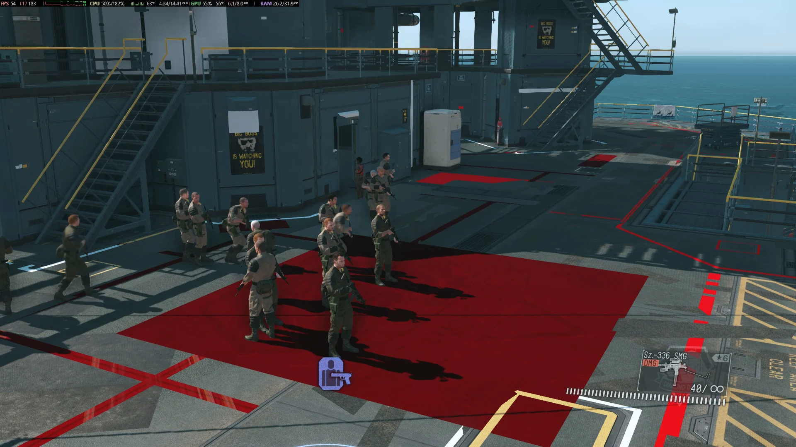

## Muster - opposite angle

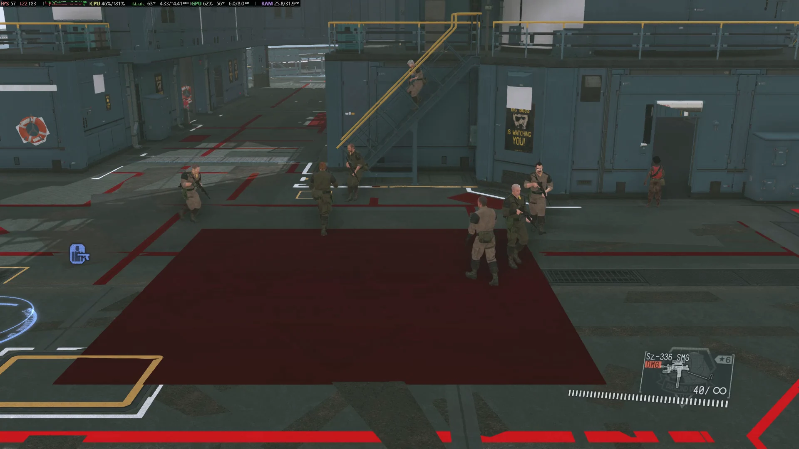

## CQC training - fixed pairs, wider view

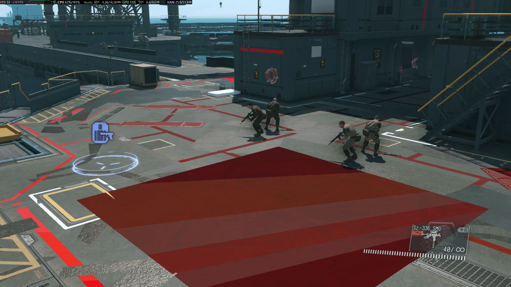

## CQC training - opposite angle

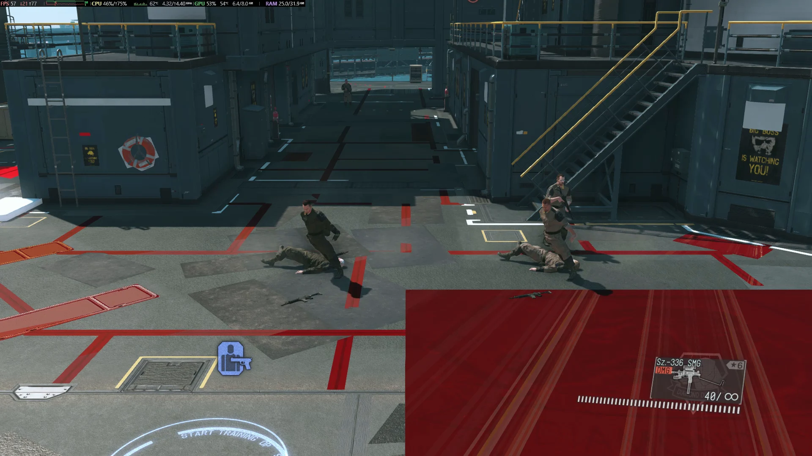

## Social gathering - first angle

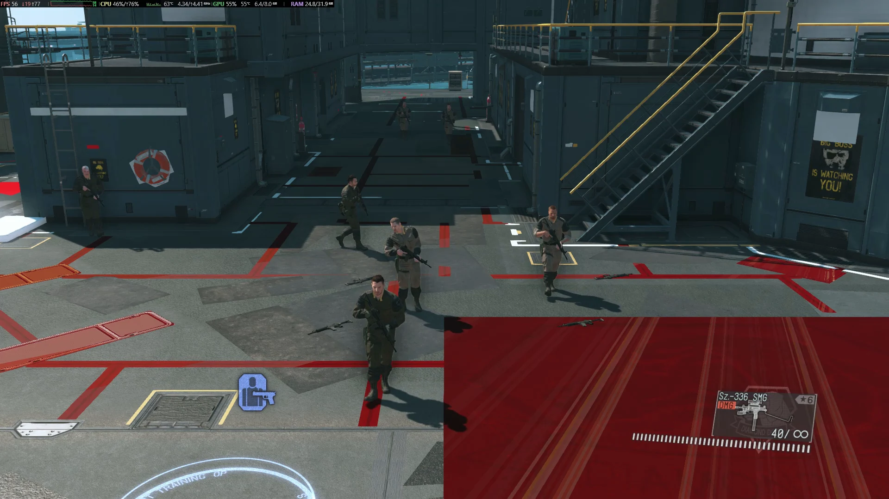

## Social gathering - opposite angle

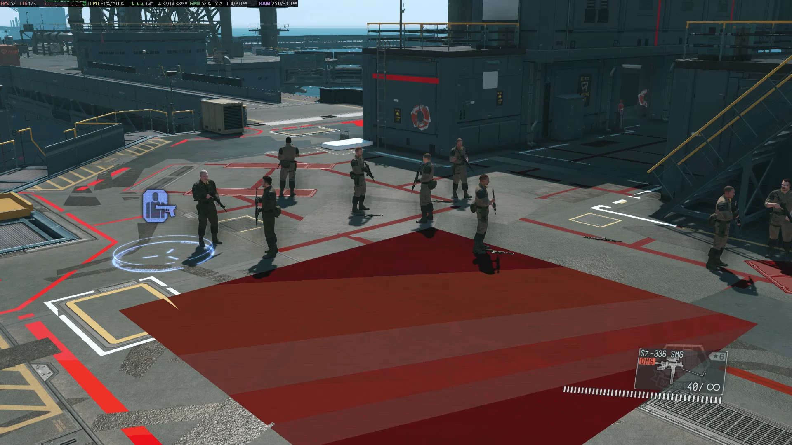

## Shower queue prototype - first angle

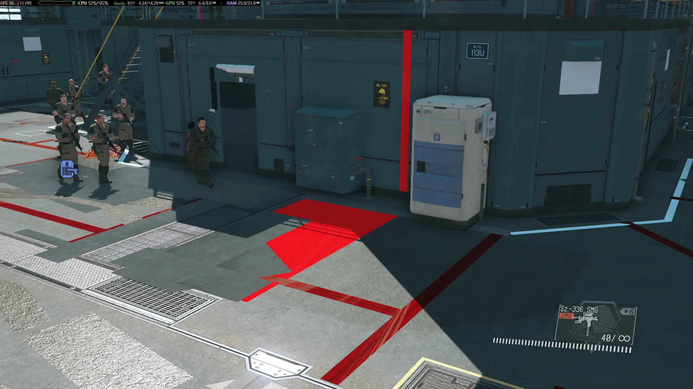

## Shower queue prototype - opposite angle

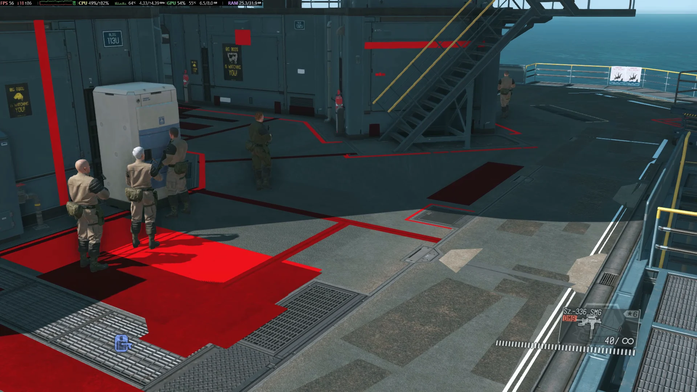

## Lower shared bay (WIP) - eastward

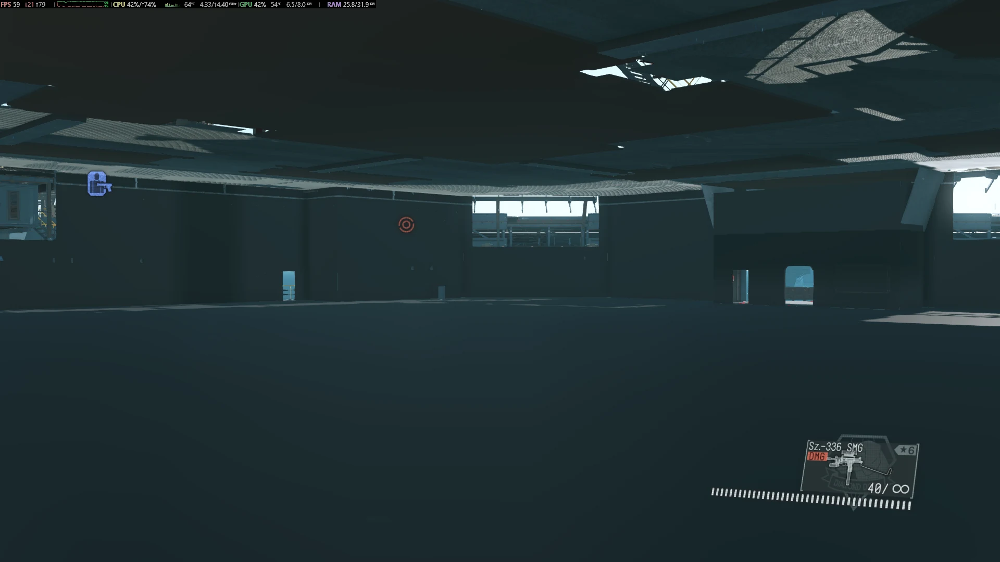

## Lower shared bay (WIP) - westward

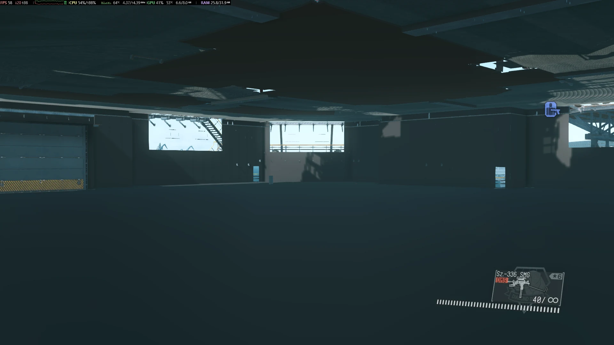

## Main-level interior (WIP) - inward view

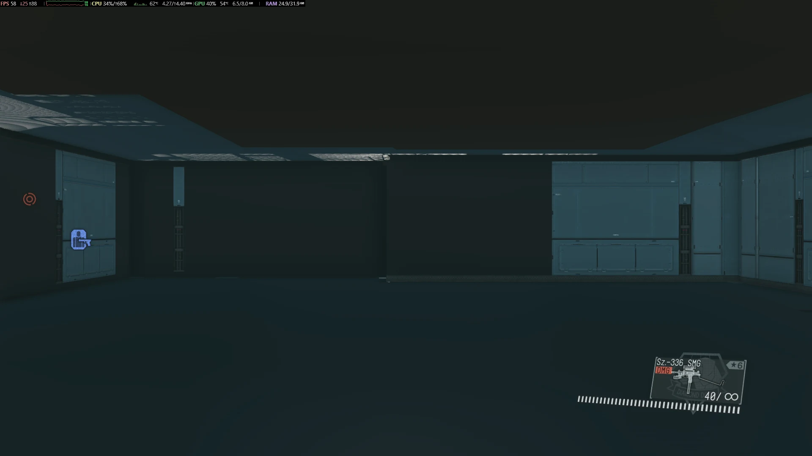

## Main-level interior (WIP) - reverse view

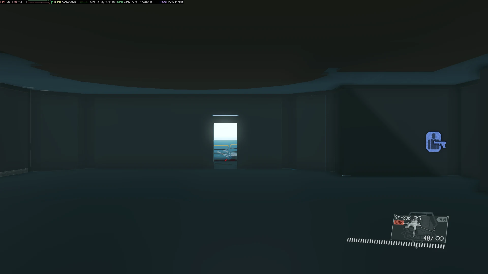

## West interior (WIP)

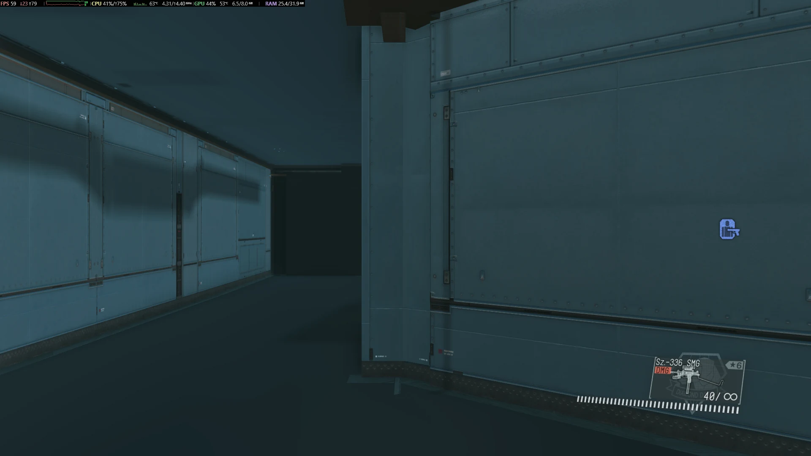

## Upper interior (WIP) - level 12

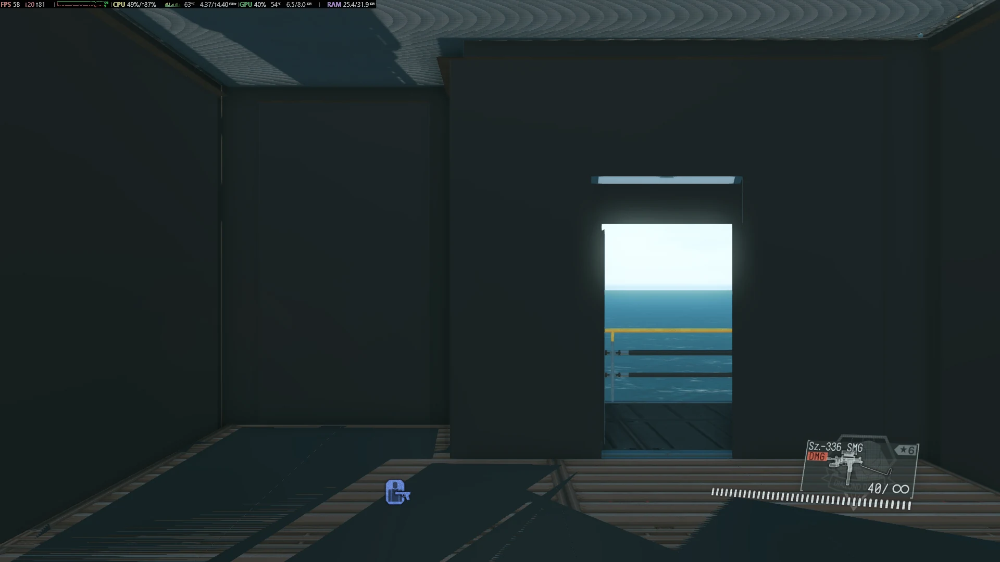

## Upper command interior (WIP) - level 20

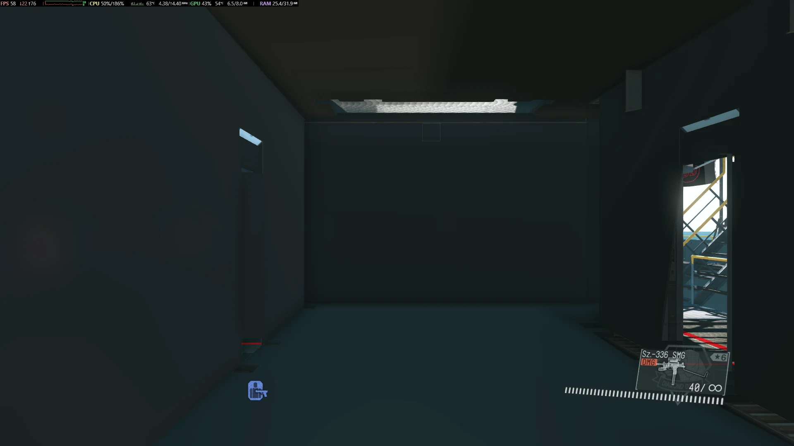

## Companion dashboard - map and testing controls

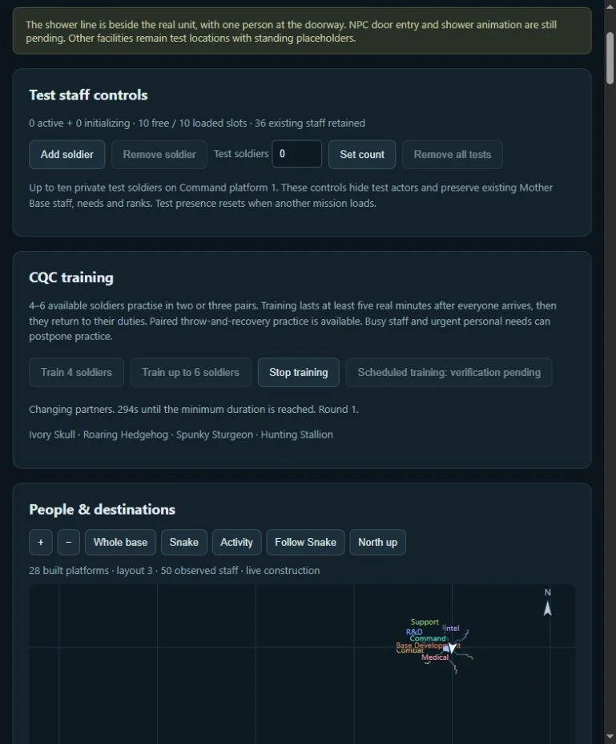

## Companion dashboard - staff needs

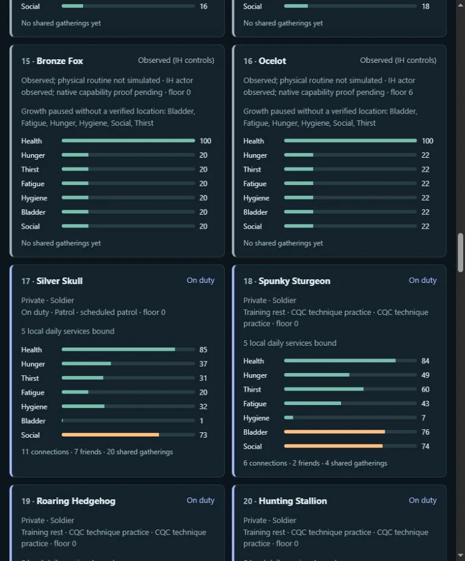

## Recording and reuse notes

Installed development versions: NpcLife 0.1.21, IH provider 0.2.6, paired CQC coordinator 0.2.3 and optional Command Platform 1 v9.1. The full CQC capture completed 305.07 real seconds with the game clock held at noon for lighting; the short montage is not five minutes of continuous footage or proof of normal-clock/public-alpha readiness. Audio is effectively silent; no microphone, desktop audio, music or voiceover was added.

Screenshots are web-sized format conversions at their original dimensions; labels are in Markdown so clean private originals stay unaltered. No new gameplay was recorded for this publication.

Gameplay depicts Konami game content and separately enabled upstream mods. See [project credits](../../../CREDITS.md) for their authors. The code license does not grant ownership or new redistribution rights to underlying game assets. These are illustrative recordings, not extracted reusable models or textures. The release builder excludes this showcase directory from mod and code-source archives.
