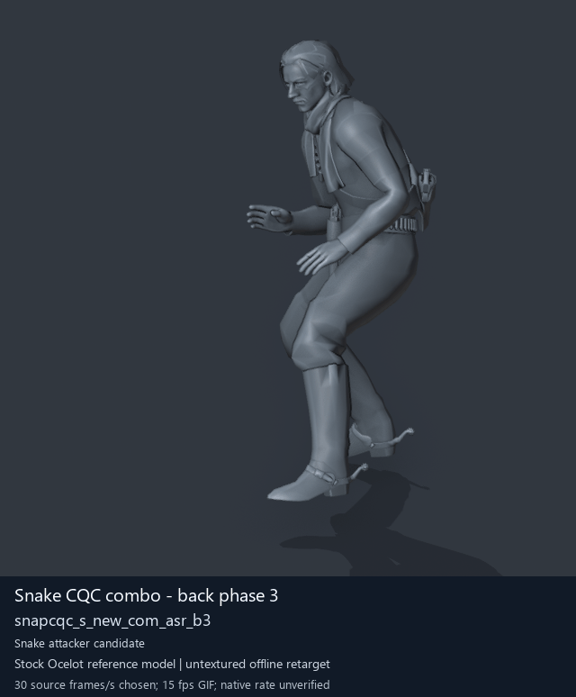

# Snake CQC combo - back phase 3

[Back to animation library](../README.md) · [Complete library data](../catalogue.json)

Click the image to open the original full-size GIF. Its visible character is a reference model; source identity is recorded separately below.

[](../../../media/animation-previews/2026-10-15/player2_cqc-0085-snapcqc_s_new_com_asr_b3.gif)

[Open full-size GIF](../../../media/animation-previews/2026-10-15/player2_cqc-0085-snapcqc_s_new_com_asr_b3.gif) · [Still image](../../../media/animation-previews/2026-10-15/player2_cqc-0085-snapcqc_s_new_com_asr_b3.png)

## Classification and descriptions

**Category:** Snake CQC combo and transition candidates. **Tags:** `offline-reference`, `source-player`, `cqc`, `combo-candidate`, `back-family`, `phase-3`.

**Authored preview description:** Snake CQC combo - back phase 3 on an untextured reference character. Credit: arsenal-pt / OpenAI Codex. Previously reviewed titled offline preview; source meanings/native use remain unverified.

**Community source description:** Unavailable. No verified exact source-description match for this entry. The reviewed BossQuiet2_layers list has zero matching paths among the current 27 clips.

Match status: `unavailable-no-verified-exact-match`. [Description sources and matching rules](../description-sources.md).

The source directory is a virtual game-asset directory. The retained clip stem and the .gani file path are separate fields. [Container provenance](../container-provenance.json) joins retained FPK/MTAR hashes and historical extraction logs; recorded DAT origins do not verify current DAT contents.

## Technical data

| Field | Value |
| --- | --- |
| Game | Metal Gear Solid V: The Phantom Pain |
| Library ID | `mgsv-tpp-player2_cqc-102647d14d3f3` |
| Category | Snake CQC combo and transition candidates |
| Tags (authored retrieval labels) | offline-reference, source-player, cqc, combo-candidate, back-family, phase-3 |
| Source archive | `player2_cqc` |
| Exact clip stem (retained) | `/Assets/tpp/motion/SI_game/fani/bodies/snap/snapcqc/snapcqc_s_new_com_asr_b3` |
| Virtual GANI file | `/Assets/tpp/motion/SI_game/fani/bodies/snap/snapcqc/snapcqc_s_new_com_asr_b3.gani` |
| Virtual GANI directory | `/Assets/tpp/motion/SI_game/fani/bodies/snap/snapcqc` |
| MTAR file | `player2_cqc.mtar` |
| Recorded container label | player2_mtbs_motion |
| Virtual MTAR path | /Assets/tpp/motion/mtar/player2/player2_cqc.mtar |
| Virtual FPK path | /Assets/tpp/pack/player/motion/player2_mtbs_motion.fpk |
| Recorded DAT origin | chunk0.dat |
| DAT version limit | Historical source-receipt origin; entire DAT content/version not rechecked by this metadata task |
| Clip hash ID | `102647d14d3f3` |
| Original source role | player |
| Role interpretation | snake_combo_initiator_candidate |
| Family / phase | back / 3 |
| Raw source frames | 90 |
| Native frame rate / duration | Unmeasured / unknown |
| Chosen preview speed | 30 source frames/s; every second source frame sampled |
| Full GIF duration | 3000 ms |
| Reference character | Stock Ocelot oce0_main0_def (untextured) |
| Offline preview | Actual decoded motion on a mapped reference rig |
| Native gameplay / paired alignment | Unverified / unverified |
| Ordinary soldier attacker proof | Unverified |
| Archive SHA-256 | `e75addc327f7602041f3e309317f5cc580be65189f31350bd9e3c45d1146aa85` |
| GANI SHA-256 | `82216f953952a36e69fd0b8be93d754c085e212f6e334af98bb8552050f80675` |
| Dictionary snapshot SHA-256 | `30c11a1f6478db700bdb7df5327ddf8a21bab35111c3aec01e84cf8572fad591` |

## Credits and evidence

- **Konami / Kojima Productions** — original game animation.
- **mctrollin and contributors** — community motion decoder, reference rig and mappings.
- **arsenal-pt / OpenAI Codex** — authored catalogue category, tags and preview summary.

Categories/tags and preview summaries are project-authored. Candidate roles/families come from retained naming metadata; posture labels come from the already reviewed offline preview. An unavailable community description has no attributed per-entry source author. [Full tool/model credits](../../../CREDITS.md).

## Interpretation and limits

Equal front/back phase suffix is a proposed attacker/receiver correspondence; native contact/timing not proved.

Preview speed is a presentation choice. Individual clips have no matched partner or held weapon. Labels alone do not prove native weapon handling, interaction contact or actor compatibility. Hair, scarf and holster motion uses mapped-ancestor fallbacks; native Fox cloth/twist and timing remain unverified.

Historical extraction confidence fields below are unchanged. Original visualConfirmed=false predates the later offline preview; offline visualization and native gameplay proof remain separate fields.

<details>
<summary>Classification, location and description provenance</summary>

```json
{
  "category": {
    "id": "snake-cqc",
    "label": "Snake CQC combo and transition candidates"
  },
  "tags": [
    "offline-reference",
    "source-player",
    "cqc",
    "combo-candidate",
    "back-family",
    "phase-3"
  ],
  "classificationProvenance": {
    "kind": "project-authored",
    "credit": "arsenal-pt / OpenAI Codex",
    "categoryAndCandidateTags": "Retained source namespace, role, family and phase metadata; interpretations remain candidates",
    "postureTags": null,
    "extractionRecordPath": "research/mtar-punch-combos/animations-metadata.json",
    "nativeGameplayProof": false
  },
  "locations": {
    "ganiVirtualPath": "/Assets/tpp/motion/SI_game/fani/bodies/snap/snapcqc/snapcqc_s_new_com_asr_b3.gani",
    "ganiDirectory": "/Assets/tpp/motion/SI_game/fani/bodies/snap/snapcqc",
    "archiveFile": "player2_cqc.mtar",
    "recordedContainerLabel": "player2_mtbs_motion",
    "archiveVirtualPath": "/Assets/tpp/motion/mtar/player2/player2_cqc.mtar",
    "containerVirtualPath": "/Assets/tpp/pack/player/motion/player2_mtbs_motion.fpk",
    "containerLocationStatus": "known historical virtual paths; exact retained FPK/MTAR hashes verified",
    "provenance": {
      "kind": "retained-extraction-record",
      "recordPath": "research/mtar-punch-combos/animations-metadata.json",
      "archiveSha256": "e75addc327f7602041f3e309317f5cc580be65189f31350bd9e3c45d1146aa85",
      "dictionarySha256": "30c11a1f6478db700bdb7df5327ddf8a21bab35111c3aec01e84cf8572fad591",
      "pathRule": "Exact resolved member stem plus the extracted .gani payload extension; no extraction ordinal used",
      "containerReview": "research/animation-library/container-provenance.json",
      "containerEvidence": [
        {
          "kind": "source-provenance receipt",
          "sha256": "e4ae0bf6f27d42630865662a89e5a387748fdf1cfbf91c718f4254c0855bffc8"
        },
        {
          "kind": "successful Gzs command receipt",
          "sha256": "5cbcac1e19cdb652353306f15b39c1878ead289b907ee462d72be516343ee615",
          "commandTag": "gzs-player2_mtbs_motion",
          "exitCode": 0
        },
        {
          "kind": "retained Gzs extracted-path log",
          "sha256": "4687080553bc422d29792c873684ae8b74859cf31ec7543bc432acf91c2e021f"
        },
        {
          "kind": "immutable private library receipt",
          "sha256": "b640d528849cdf79327353cf6c37d2f15244659a6e3039f2cee18e8cb431cbb8",
          "libraryZipSha256": "299795a7378d55f18d059f02a2946763d8c546c2a4db5da6bdb5baed84646c2d"
        }
      ],
      "containerVerification": "Exact retained FPK and original MTAR member bytes match recorded hashes; pack label joins the successful extraction log. No new extraction or current DAT verification."
    },
    "datArchive": "chunk0.dat",
    "datArchiveSha256": null,
    "containerSha256": "0e70cfcbe8273672e501d16349e001add83c8b28bf1d001292f6ea6ef9bfb0ff",
    "datOriginStatus": "Historical source-receipt origin; entire DAT content/version not rechecked by this metadata task"
  },
  "authoredDescription": {
    "text": "Snake CQC combo - back phase 3 on an untextured reference character.",
    "kind": "project-authored preview summary",
    "credit": "arsenal-pt / OpenAI Codex",
    "basis": "Previously reviewed titled offline preview; source meanings/native use remain unverified"
  },
  "sourceDescription": {
    "status": "unavailable-no-verified-exact-match",
    "text": null,
    "credit": null,
    "sourceUrl": null,
    "reason": "No verified exact source-description match for this entry. The reviewed BossQuiet2_layers list has zero matching paths among the current 27 clips.",
    "reviewRecord": "research/animation-library/metadata-source-review.json"
  },
  "credits": [
    {
      "name": "Konami / Kojima Productions",
      "role": "original game animation"
    },
    {
      "name": "mctrollin and contributors",
      "role": "community motion decoder, reference rig and mappings"
    },
    {
      "name": "arsenal-pt / OpenAI Codex",
      "role": "authored catalogue category, tags and preview summary"
    }
  ]
}
```

</details>

<details>
<summary>Complete original extraction and preview records</summary>

```json
{
  "extraction": {
    "id": "player2_cqc-0085-snapcqc_s_new_com_asr_b3",
    "sourceArchive": "player2_cqc",
    "sourceRole": "player",
    "archiveOrdinalZeroBased": 85,
    "ordinalNote": "Ordinal in first MtarTool extraction XML; tool may renumber on repack",
    "name": "/Assets/tpp/motion/SI_game/fani/bodies/snap/snapcqc/snapcqc_s_new_com_asr_b3",
    "hashId": "102647d14d3f3",
    "role": "snake_combo_initiator_candidate",
    "sequenceFamily": "back",
    "phase": 3,
    "phaseKind": "phase",
    "frameCount": 90,
    "frameCountMethod": "GANI2 mini-header uint32 at offset0, consistent with mctrollin reader/previous adapter",
    "frameRate": null,
    "durationSeconds": null,
    "timingNote": "Raw frame count only. Runtime rate and transitions not measured.",
    "namingConfidence": "dictionary-resolved exact archive member",
    "interpretationConfidence": "candidate inferred from family names; not visual confirmation",
    "visualConfirmed": false,
    "nativePlaybackConfirmed": false,
    "relationshipNote": "Equal front/back phase suffix is a proposed attacker/receiver correspondence; native contact/timing not proved.",
    "sourceMtarSha256": "e75addc327f7602041f3e309317f5cc580be65189f31350bd9e3c45d1146aa85",
    "payloads": [
      {
        "extension": ".gani",
        "bytes": 17264,
        "sha256": "82216f953952a36e69fd0b8be93d754c085e212f6e334af98bb8552050f80675"
      },
      {
        "extension": ".exchnk",
        "bytes": 2608,
        "sha256": "f7718afc042da600e24036c4d4f8be16e4c0cabe54a336067c60152ede425762"
      },
      {
        "extension": ".enchnk",
        "bytes": 704,
        "sha256": "0513b5b8aa30cecef1c289be4760e648724423ea445949610cba8db0a2c1d3e0"
      }
    ],
    "displayTitle": "Snake CQC combo - back phase 3",
    "offlinePreviewConfirmed": true,
    "preview": {
      "status": "offline-reference-character",
      "referenceCharacter": "Stock Ocelot oce0_main0_def",
      "gif": "../../media/animation-previews/2026-10-15/player2_cqc-0085-snapcqc_s_new_com_asr_b3.gif",
      "thumbnail": "../../media/animation-previews/2026-10-15/player2_cqc-0085-snapcqc_s_new_com_asr_b3.png",
      "manifest": "../../media/animation-previews/2026-10-15/preview-manifest.json",
      "chosenSourceFramesPerSecond": 30,
      "nominalGifFramesPerSecond": 15,
      "durationSeconds": 3.0,
      "nativeTimingVerified": false,
      "nativeGameplayProof": false
    }
  },
  "preview": {
    "id": "player2_cqc-0085-snapcqc_s_new_com_asr_b3",
    "title": "Snake CQC combo - back phase 3",
    "shortIdentifier": "snapcqc_s_new_com_asr_b3",
    "sourceName": "/Assets/tpp/motion/SI_game/fani/bodies/snap/snapcqc/snapcqc_s_new_com_asr_b3",
    "sourceArchive": "player2_cqc",
    "sourceArchiveSha256": "e75addc327f7602041f3e309317f5cc580be65189f31350bd9e3c45d1146aa85",
    "hashId": "102647d14d3f3",
    "sourceGaniSha256": "82216f953952a36e69fd0b8be93d754c085e212f6e334af98bb8552050f80675",
    "sourceRole": "player",
    "role": "snake_combo_initiator_candidate",
    "sequenceFamily": "back",
    "phase": 3,
    "phaseKind": "phase",
    "rawFrameCount": 90,
    "decodedTrackCount": 18,
    "headerIndex": 22,
    "sourceFramesSampled": [
      0,
      2,
      4,
      6,
      8,
      10,
      12,
      14,
      16,
      18,
      20,
      22,
      24,
      26,
      28,
      30,
      32,
      34,
      36,
      38,
      40,
      42,
      44,
      46,
      48,
      50,
      52,
      54,
      56,
      58,
      60,
      62,
      64,
      66,
      68,
      70,
      72,
      74,
      76,
      78,
      80,
      82,
      84,
      86,
      88
    ],
    "endpointFrameSavedPrivately": 90,
    "chosenSourceFramesPerSecond": 30,
    "gifFrameDurationsMilliseconds": [
      70,
      60,
      70,
      70,
      60,
      70,
      70,
      60,
      70,
      70,
      60,
      70,
      70,
      60,
      70,
      70,
      60,
      70,
      70,
      60,
      70,
      70,
      60,
      70,
      70,
      60,
      70,
      70,
      60,
      70,
      70,
      60,
      70,
      70,
      60,
      70,
      70,
      60,
      70,
      70,
      60,
      70,
      70,
      60,
      70
    ],
    "gifDurationMilliseconds": 3000,
    "nativeFrameRate": null,
    "rawLayoutFrameRateField": "5",
    "rawLayoutRateMeaning": "Unverified enum/value; not assumed to be frames per second",
    "referenceCharacter": "Stock Ocelot oce0_main0_def",
    "visualStatus": "actual decoded motion rendered on offline stock reference character",
    "nativeGameplayProof": false,
    "pairedAlignmentProof": false,
    "ordinarySoldierAttackProof": false,
    "cameraFixedForFullClip": true,
    "camera": {
      "fixedForEntireClip": true,
      "location": [
        -4.714016437530518,
        9.616241455078125,
        3.704050064086914
      ],
      "rotation": [
        1.2772102355957031,
        9.18613878297947e-08,
        -2.613518238067627
      ],
      "orthographicScale": 2.086519241333008,
      "projectedMin": [
        -1.3103681802749634,
        -0.4449039101600647,
        0.41437605023384094
      ],
      "projectedMax": [
        -0.23658637702465057,
        1.3538196086883545,
        2.178475856781006
      ]
    },
    "worldBounds": {
      "min": [
        -0.5079578757286072,
        0.5838890671730042,
        -0.018938183784484863
      ],
      "max": [
        0.5386414527893066,
        2.0083653926849365,
        1.6868691444396973
      ]
    },
    "titledGif": {
      "path": "player2_cqc-0085-snapcqc_s_new_com_asr_b3.gif",
      "bytes": 3816869,
      "sha256": "62d0e26d8f4ddf0f5c7dbd4539bec848577f014bd95b9975070e6c84a6b3ffe5"
    },
    "thumbnail": {
      "path": "player2_cqc-0085-snapcqc_s_new_com_asr_b3.png",
      "bytes": 120397,
      "sha256": "d2584eb03d556d8a06f67461621da5ea1071fe5ad593912ecba9ecd27ba5f3b8"
    },
    "privateCleanGifSha256": "172c807bb946c0727a255cc5ebfa431cf4cef97a1f363610050a19adfff7f37e",
    "privateRenderReceiptSha256": "de23f12474684f2f63cdd8514091a72d106f398591c3bb46f9f88c8c7735e0b8",
    "cleanPngFrameCount": 46,
    "maximumPerVertexWeightSumError": 1.4901161193847656e-07
  }
}
```

</details>

[Exact extraction catalogue](../../mtar-punch-combos/animations-metadata.json) · [Full-character recipe](../../mtar-punch-combos/full-character-preview-recipe.md) · [Credits](../../../CREDITS.md)
