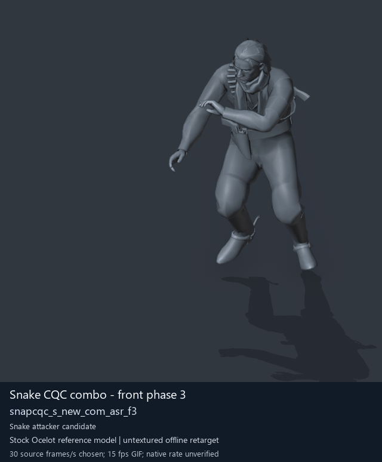

# Snake CQC combo - front phase 3

[Back to animation library](../README.md) · [Complete library data](../catalogue.json)

Click the image to open the original full-size GIF. Its visible character is a reference model; the source archive below identifies the original animation.

[](../../../media/animation-previews/2026-10-15/player2_cqc-0088-snapcqc_s_new_com_asr_f3.gif)

[Open full-size GIF](../../../media/animation-previews/2026-10-15/player2_cqc-0088-snapcqc_s_new_com_asr_f3.gif) · [Still image](../../../media/animation-previews/2026-10-15/player2_cqc-0088-snapcqc_s_new_com_asr_f3.png)

## Technical data

| Field | Value |
| --- | --- |
| Game | Metal Gear Solid V: The Phantom Pain |
| Library ID | `mgsv-tpp-player2_cqc-138b1932095af` |
| Source archive | `player2_cqc` |
| Exact clip name | `/Assets/tpp/motion/SI_game/fani/bodies/snap/snapcqc/snapcqc_s_new_com_asr_f3` |
| Clip hash ID | `138b1932095af` |
| Original source role | player |
| Role interpretation | snake_combo_initiator_candidate |
| Family / phase | front / 3 |
| Raw source frames | 83 |
| Native frame rate / duration | Unmeasured / unknown |
| Chosen preview speed | 30 source frames/s; every second source frame sampled |
| Full GIF duration | 2770 ms |
| Reference character | Stock Ocelot oce0_main0_def (untextured) |
| Offline preview | Actual decoded motion on a mapped reference rig |
| Native gameplay / paired alignment | Unverified / unverified |
| Ordinary soldier attacker proof | Unverified |
| Archive SHA-256 | `e75addc327f7602041f3e309317f5cc580be65189f31350bd9e3c45d1146aa85` |
| GANI SHA-256 | `579f9cc712f18c352ba34c620a5ca62b273aecc8ddeb1bc5cbdbbdb4666680b3` |

## Interpretation and limits

Equal front/back phase suffix is a proposed attacker/receiver correspondence; native contact/timing not proved.

The preview speed is a presentation choice. Individual clips have no matched partner or held weapon; names alone do not prove unarmed punching. Hair, scarf and holster motion uses mapped-ancestor fallbacks. Native Fox cloth/twist behavior, timing, interaction contact and actor compatibility remain unverified.

The historical extraction record below keeps its original confidence fields. Its original visualConfirmed=false predates the later offline preview; it is not a claim that the library has no GIF. Offline visualization and native gameplay proof are separate fields.

<details>
<summary>Complete extraction and preview records</summary>

```json
{
  "extraction": {
    "id": "player2_cqc-0088-snapcqc_s_new_com_asr_f3",
    "sourceArchive": "player2_cqc",
    "sourceRole": "player",
    "archiveOrdinalZeroBased": 88,
    "ordinalNote": "Ordinal in first MtarTool extraction XML; tool may renumber on repack",
    "name": "/Assets/tpp/motion/SI_game/fani/bodies/snap/snapcqc/snapcqc_s_new_com_asr_f3",
    "hashId": "138b1932095af",
    "role": "snake_combo_initiator_candidate",
    "sequenceFamily": "front",
    "phase": 3,
    "phaseKind": "phase",
    "frameCount": 83,
    "frameCountMethod": "GANI2 mini-header uint32 at offset0, consistent with mctrollin reader/previous adapter",
    "frameRate": null,
    "durationSeconds": null,
    "timingNote": "Raw frame count only. Runtime rate and transitions not measured.",
    "namingConfidence": "dictionary-resolved exact archive member",
    "interpretationConfidence": "candidate inferred from family names; not visual confirmation",
    "visualConfirmed": false,
    "nativePlaybackConfirmed": false,
    "relationshipNote": "Equal front/back phase suffix is a proposed attacker/receiver correspondence; native contact/timing not proved.",
    "sourceMtarSha256": "e75addc327f7602041f3e309317f5cc580be65189f31350bd9e3c45d1146aa85",
    "payloads": [
      {
        "extension": ".gani",
        "bytes": 16592,
        "sha256": "579f9cc712f18c352ba34c620a5ca62b273aecc8ddeb1bc5cbdbbdb4666680b3"
      },
      {
        "extension": ".exchnk",
        "bytes": 2720,
        "sha256": "09dfe0a24fede8cf0e3eaf1ab2bc0ec2a5d2e1b4ba2486a81dfb853ad2a7957c"
      },
      {
        "extension": ".enchnk",
        "bytes": 640,
        "sha256": "70724c2142d17501e98a1044c8487490e4873fcf0c7e9ac50a8ae697aae47f6c"
      }
    ],
    "displayTitle": "Snake CQC combo - front phase 3",
    "offlinePreviewConfirmed": true,
    "preview": {
      "status": "offline-reference-character",
      "referenceCharacter": "Stock Ocelot oce0_main0_def",
      "gif": "../../media/animation-previews/2026-10-15/player2_cqc-0088-snapcqc_s_new_com_asr_f3.gif",
      "thumbnail": "../../media/animation-previews/2026-10-15/player2_cqc-0088-snapcqc_s_new_com_asr_f3.png",
      "manifest": "../../media/animation-previews/2026-10-15/preview-manifest.json",
      "chosenSourceFramesPerSecond": 30,
      "nominalGifFramesPerSecond": 15,
      "durationSeconds": 2.77,
      "nativeTimingVerified": false,
      "nativeGameplayProof": false
    }
  },
  "preview": {
    "id": "player2_cqc-0088-snapcqc_s_new_com_asr_f3",
    "title": "Snake CQC combo - front phase 3",
    "shortIdentifier": "snapcqc_s_new_com_asr_f3",
    "sourceName": "/Assets/tpp/motion/SI_game/fani/bodies/snap/snapcqc/snapcqc_s_new_com_asr_f3",
    "sourceArchive": "player2_cqc",
    "sourceArchiveSha256": "e75addc327f7602041f3e309317f5cc580be65189f31350bd9e3c45d1146aa85",
    "hashId": "138b1932095af",
    "sourceGaniSha256": "579f9cc712f18c352ba34c620a5ca62b273aecc8ddeb1bc5cbdbbdb4666680b3",
    "sourceRole": "player",
    "role": "snake_combo_initiator_candidate",
    "sequenceFamily": "front",
    "phase": 3,
    "phaseKind": "phase",
    "rawFrameCount": 83,
    "decodedTrackCount": 18,
    "headerIndex": 26,
    "sourceFramesSampled": [
      0,
      2,
      4,
      6,
      8,
      10,
      12,
      14,
      16,
      18,
      20,
      22,
      24,
      26,
      28,
      30,
      32,
      34,
      36,
      38,
      40,
      42,
      44,
      46,
      48,
      50,
      52,
      54,
      56,
      58,
      60,
      62,
      64,
      66,
      68,
      70,
      72,
      74,
      76,
      78,
      80,
      82
    ],
    "endpointFrameSavedPrivately": 83,
    "chosenSourceFramesPerSecond": 30,
    "gifFrameDurationsMilliseconds": [
      70,
      60,
      70,
      70,
      60,
      70,
      70,
      60,
      70,
      70,
      60,
      70,
      70,
      60,
      70,
      70,
      60,
      70,
      70,
      60,
      70,
      70,
      60,
      70,
      70,
      60,
      70,
      70,
      60,
      70,
      70,
      60,
      70,
      70,
      60,
      70,
      70,
      60,
      70,
      70,
      60,
      40
    ],
    "gifDurationMilliseconds": 2770,
    "nativeFrameRate": null,
    "rawLayoutFrameRateField": "5",
    "rawLayoutRateMeaning": "Unverified enum/value; not assumed to be frames per second",
    "referenceCharacter": "Stock Ocelot oce0_main0_def",
    "visualStatus": "actual decoded motion rendered on offline stock reference character",
    "nativeGameplayProof": false,
    "pairedAlignmentProof": false,
    "ordinarySoldierAttackProof": false,
    "cameraFixedForFullClip": true,
    "camera": {
      "fixedForEntireClip": true,
      "location": [
        -4.889246463775635,
        11.419061660766602,
        3.5966625213623047
      ],
      "rotation": [
        1.2772102355957031,
        9.18613878297947e-08,
        -2.613518238067627
      ],
      "orthographicScale": 2.278846263885498,
      "projectedMin": [
        -2.2868804931640625,
        -1.106791615486145,
        1.6913331747055054
      ],
      "projectedMax": [
        -0.7741326093673706,
        0.8577309250831604,
        3.989612102508545
      ]
    },
    "worldBounds": {
      "min": [
        -0.45557916164398193,
        1.9459693431854248,
        -0.02571558952331543
      ],
      "max": [
        0.5145754814147949,
        4.415735244750977,
        1.7015328407287598
      ]
    },
    "titledGif": {
      "path": "player2_cqc-0088-snapcqc_s_new_com_asr_f3.gif",
      "bytes": 3444501,
      "sha256": "f5aa4d57a2ec1ffad333dfd8805bae76e3f5c7e28a228425be0220e1407fb46b"
    },
    "thumbnail": {
      "path": "player2_cqc-0088-snapcqc_s_new_com_asr_f3.png",
      "bytes": 122987,
      "sha256": "932fc04f9e2cbfe99c6483bc1894da99541be55a9f5f9a5401cc9e56e5e8a6b1"
    },
    "privateCleanGifSha256": "0807167b9370a14b3aca6190c75dc7dd3c600531a4ab523b597788d36831611f",
    "privateRenderReceiptSha256": "e5e7e9ff86b9330c6f5deee15e5127fa8d8374885fb203758692ee172d25a257",
    "cleanPngFrameCount": 43,
    "maximumPerVertexWeightSumError": 1.4901161193847656e-07
  }
}
```

</details>

[Extraction method](../../mtar-punch-combos/README.md) · [Full-character recipe](../../mtar-punch-combos/full-character-preview-recipe.md) · [Credits](../../../CREDITS.md)
