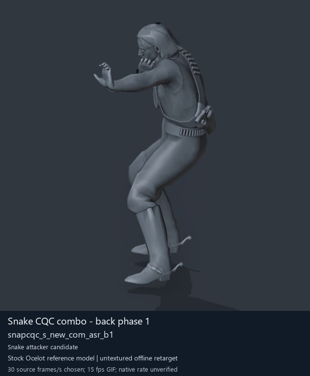

# Snake CQC combo - back phase 1

[Back to animation library](../README.md) · [Complete library data](../catalogue.json)

Click the image to open the original full-size GIF. Its visible character is a reference model; the source archive below identifies the original animation.

[](../../../media/animation-previews/2026-10-15/player2_resident-0226-snapcqc_s_new_com_asr_b1.gif)

[Open full-size GIF](../../../media/animation-previews/2026-10-15/player2_resident-0226-snapcqc_s_new_com_asr_b1.gif) · [Still image](../../../media/animation-previews/2026-10-15/player2_resident-0226-snapcqc_s_new_com_asr_b1.png)

## Technical data

| Field | Value |
| --- | --- |
| Game | Metal Gear Solid V: The Phantom Pain |
| Library ID | `mgsv-tpp-player2_resident-36c8fbcb8b28a` |
| Source archive | `player2_resident` |
| Exact clip name | `/Assets/tpp/motion/SI_game/fani/bodies/snap/snapcqc/snapcqc_s_new_com_asr_b1` |
| Clip hash ID | `36c8fbcb8b28a` |
| Original source role | player |
| Role interpretation | snake_combo_initiator_candidate |
| Family / phase | back / 1 |
| Raw source frames | 60 |
| Native frame rate / duration | Unmeasured / unknown |
| Chosen preview speed | 30 source frames/s; every second source frame sampled |
| Full GIF duration | 2000 ms |
| Reference character | Stock Ocelot oce0_main0_def (untextured) |
| Offline preview | Actual decoded motion on a mapped reference rig |
| Native gameplay / paired alignment | Unverified / unverified |
| Ordinary soldier attacker proof | Unverified |
| Archive SHA-256 | `18c4a35c524dcc46f19e712f61a261c94283720a0f119340cecc17eef37fc0d0` |
| GANI SHA-256 | `f7e125ce5691396a5234a049322500c55f5f7fc697f14422a9656ec6638f7237` |

## Interpretation and limits

Equal front/back phase suffix is a proposed attacker/receiver correspondence; native contact/timing not proved.

The preview speed is a presentation choice. Individual clips have no matched partner or held weapon; names alone do not prove unarmed punching. Hair, scarf and holster motion uses mapped-ancestor fallbacks. Native Fox cloth/twist behavior, timing, interaction contact and actor compatibility remain unverified.

The historical extraction record below keeps its original confidence fields. Its original visualConfirmed=false predates the later offline preview; it is not a claim that the library has no GIF. Offline visualization and native gameplay proof are separate fields.

<details>
<summary>Complete extraction and preview records</summary>

```json
{
  "extraction": {
    "id": "player2_resident-0226-snapcqc_s_new_com_asr_b1",
    "sourceArchive": "player2_resident",
    "sourceRole": "player",
    "archiveOrdinalZeroBased": 226,
    "ordinalNote": "Ordinal in first MtarTool extraction XML; tool may renumber on repack",
    "name": "/Assets/tpp/motion/SI_game/fani/bodies/snap/snapcqc/snapcqc_s_new_com_asr_b1",
    "hashId": "36c8fbcb8b28a",
    "role": "snake_combo_initiator_candidate",
    "sequenceFamily": "back",
    "phase": 1,
    "phaseKind": "phase",
    "frameCount": 60,
    "frameCountMethod": "GANI2 mini-header uint32 at offset0, consistent with mctrollin reader/previous adapter",
    "frameRate": null,
    "durationSeconds": null,
    "timingNote": "Raw frame count only. Runtime rate and transitions not measured.",
    "namingConfidence": "dictionary-resolved exact archive member",
    "interpretationConfidence": "candidate inferred from family names; not visual confirmation",
    "visualConfirmed": false,
    "nativePlaybackConfirmed": false,
    "relationshipNote": "Equal front/back phase suffix is a proposed attacker/receiver correspondence; native contact/timing not proved.",
    "sourceMtarSha256": "18c4a35c524dcc46f19e712f61a261c94283720a0f119340cecc17eef37fc0d0",
    "payloads": [
      {
        "extension": ".gani",
        "bytes": 8928,
        "sha256": "f7e125ce5691396a5234a049322500c55f5f7fc697f14422a9656ec6638f7237"
      },
      {
        "extension": ".exchnk",
        "bytes": 1920,
        "sha256": "29bc77f36773d77f152b64d5395780e4968d18ddc471a36a820559283da7c5e1"
      },
      {
        "extension": ".enchnk",
        "bytes": 496,
        "sha256": "3254a3fef38026d34c55ef3ba8d964c6aa821e8a046bb5cba3372badcef8a9b3"
      }
    ],
    "displayTitle": "Snake CQC combo - back phase 1",
    "offlinePreviewConfirmed": true,
    "preview": {
      "status": "offline-reference-character",
      "referenceCharacter": "Stock Ocelot oce0_main0_def",
      "gif": "../../media/animation-previews/2026-10-15/player2_resident-0226-snapcqc_s_new_com_asr_b1.gif",
      "thumbnail": "../../media/animation-previews/2026-10-15/player2_resident-0226-snapcqc_s_new_com_asr_b1.png",
      "manifest": "../../media/animation-previews/2026-10-15/preview-manifest.json",
      "chosenSourceFramesPerSecond": 30,
      "nominalGifFramesPerSecond": 15,
      "durationSeconds": 2.0,
      "nativeTimingVerified": false,
      "nativeGameplayProof": false
    }
  },
  "preview": {
    "id": "player2_resident-0226-snapcqc_s_new_com_asr_b1",
    "title": "Snake CQC combo - back phase 1",
    "shortIdentifier": "snapcqc_s_new_com_asr_b1",
    "sourceName": "/Assets/tpp/motion/SI_game/fani/bodies/snap/snapcqc/snapcqc_s_new_com_asr_b1",
    "sourceArchive": "player2_resident",
    "sourceArchiveSha256": "18c4a35c524dcc46f19e712f61a261c94283720a0f119340cecc17eef37fc0d0",
    "hashId": "36c8fbcb8b28a",
    "sourceGaniSha256": "f7e125ce5691396a5234a049322500c55f5f7fc697f14422a9656ec6638f7237",
    "sourceRole": "player",
    "role": "snake_combo_initiator_candidate",
    "sequenceFamily": "back",
    "phase": 1,
    "phaseKind": "phase",
    "rawFrameCount": 60,
    "decodedTrackCount": 18,
    "headerIndex": 1087,
    "sourceFramesSampled": [
      0,
      2,
      4,
      6,
      8,
      10,
      12,
      14,
      16,
      18,
      20,
      22,
      24,
      26,
      28,
      30,
      32,
      34,
      36,
      38,
      40,
      42,
      44,
      46,
      48,
      50,
      52,
      54,
      56,
      58
    ],
    "endpointFrameSavedPrivately": 60,
    "chosenSourceFramesPerSecond": 30,
    "gifFrameDurationsMilliseconds": [
      70,
      60,
      70,
      70,
      60,
      70,
      70,
      60,
      70,
      70,
      60,
      70,
      70,
      60,
      70,
      70,
      60,
      70,
      70,
      60,
      70,
      70,
      60,
      70,
      70,
      60,
      70,
      70,
      60,
      70
    ],
    "gifDurationMilliseconds": 2000,
    "nativeFrameRate": null,
    "rawLayoutFrameRateField": "5",
    "rawLayoutRateMeaning": "Unverified enum/value; not assumed to be frames per second",
    "referenceCharacter": "Stock Ocelot oce0_main0_def",
    "visualStatus": "actual decoded motion rendered on offline stock reference character",
    "nativeGameplayProof": false,
    "pairedAlignmentProof": false,
    "ordinarySoldierAttackProof": false,
    "cameraFixedForFullClip": true,
    "camera": {
      "fixedForEntireClip": true,
      "location": [
        -4.775484561920166,
        9.152005195617676,
        3.676102638244629
      ],
      "rotation": [
        1.2772102355957031,
        9.18613878297947e-08,
        -2.613518238067627
      ],
      "orthographicScale": 1.9985706806182861,
      "projectedMin": [
        -0.8817446827888489,
        -0.3266662061214447,
        0.33184555172920227
      ],
      "projectedMax": [
        -0.09119054675102234,
        1.3962395191192627,
        1.5364450216293335
      ]
    },
    "worldBounds": {
      "min": [
        -0.29031094908714294,
        0.460475891828537,
        -0.009550929069519043
      ],
      "max": [
        0.42935359477996826,
        1.4182288646697998,
        1.6926910877227783
      ]
    },
    "titledGif": {
      "path": "player2_resident-0226-snapcqc_s_new_com_asr_b1.gif",
      "bytes": 2537531,
      "sha256": "671711cc7ab07f51e40286ec016f86c84c0bc46463eb237de111c79870e7649f"
    },
    "thumbnail": {
      "path": "player2_resident-0226-snapcqc_s_new_com_asr_b1.png",
      "bytes": 130456,
      "sha256": "f3abd94cba61ad39500a05106a805efaeca99fd13649a976515dd297119862d9"
    },
    "privateCleanGifSha256": "75b536b54d657d2000614921b04e51369c0fa7a4d2c82eac930ffdbdef8be45e",
    "privateRenderReceiptSha256": "543fbe0acc45a1642ce3c3ac477d6eb58a660319b8054f633265fdebd416b88b",
    "cleanPngFrameCount": 31,
    "maximumPerVertexWeightSumError": 1.4901161193847656e-07
  }
}
```

</details>

[Extraction method](../../mtar-punch-combos/README.md) · [Full-character recipe](../../mtar-punch-combos/full-character-preview-recipe.md) · [Credits](../../../CREDITS.md)
