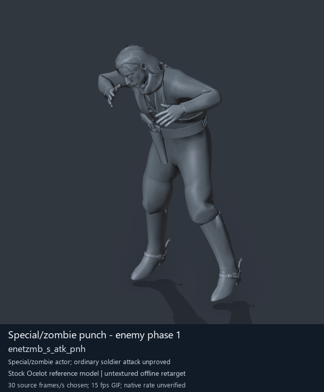

# Special/zombie punch - enemy phase 1

[Back to animation library](../README.md) · [Complete library data](../catalogue.json)

Click the image to open the original full-size GIF. Its visible character is a reference model; the source archive below identifies the original animation.

[](../../../media/animation-previews/2026-10-15/Soldier_common-1311-enetzmb_s_atk_pnh.gif)

[Open full-size GIF](../../../media/animation-previews/2026-10-15/Soldier_common-1311-enetzmb_s_atk_pnh.gif) · [Still image](../../../media/animation-previews/2026-10-15/Soldier_common-1311-enetzmb_s_atk_pnh.png)

## Technical data

| Field | Value |
| --- | --- |
| Game | Metal Gear Solid V: The Phantom Pain |
| Library ID | `mgsv-tpp-soldier_common-17e48d5c5ad12` |
| Source archive | `Soldier_common` |
| Exact clip name | `/Assets/tpp/motion/SI_game/fani/bodies/enet/enetzmb/enetzmb_s_atk_pnh` |
| Clip hash ID | `17e48d5c5ad12` |
| Original source role | Soldier2Common archive (membership does not prove actor use) |
| Role interpretation | special_actor_punch_candidate |
| Family / phase | zombie_melee / None |
| Raw source frames | 60 |
| Native frame rate / duration | Unmeasured / unknown |
| Chosen preview speed | 30 source frames/s; every second source frame sampled |
| Full GIF duration | 2000 ms |
| Reference character | Stock Ocelot oce0_main0_def (untextured) |
| Offline preview | Actual decoded motion on a mapped reference rig |
| Native gameplay / paired alignment | Unverified / unverified |
| Ordinary soldier attacker proof | Unverified |
| Archive SHA-256 | `6f535a29e1c5b6da70514984a47f8a5c988aa468f1d5c87c37f212263dcc001e` |
| GANI SHA-256 | `c8a81595aeb312f72b88d167586d51d585f9b6e77d69e4a3693556bd4e335b6a` |

## Interpretation and limits

Distinct special-actor/transition candidate; not an ordinary soldier combo proof.

The preview speed is a presentation choice. Individual clips have no matched partner or held weapon; names alone do not prove unarmed punching. Hair, scarf and holster motion uses mapped-ancestor fallbacks. Native Fox cloth/twist behavior, timing, interaction contact and actor compatibility remain unverified.

The historical extraction record below keeps its original confidence fields. Its original visualConfirmed=false predates the later offline preview; it is not a claim that the library has no GIF. Offline visualization and native gameplay proof are separate fields.

<details>
<summary>Complete extraction and preview records</summary>

```json
{
  "extraction": {
    "id": "Soldier_common-1311-enetzmb_s_atk_pnh",
    "sourceArchive": "Soldier_common",
    "sourceRole": "Soldier2Common archive (membership does not prove actor use)",
    "archiveOrdinalZeroBased": 1311,
    "ordinalNote": "Ordinal in first MtarTool extraction XML; tool may renumber on repack",
    "name": "/Assets/tpp/motion/SI_game/fani/bodies/enet/enetzmb/enetzmb_s_atk_pnh",
    "hashId": "17e48d5c5ad12",
    "role": "special_actor_punch_candidate",
    "sequenceFamily": "zombie_melee",
    "phase": null,
    "phaseKind": "attack",
    "frameCount": 60,
    "frameCountMethod": "GANI2 mini-header uint32 at offset0, consistent with mctrollin reader/previous adapter",
    "frameRate": null,
    "durationSeconds": null,
    "timingNote": "Raw frame count only. Runtime rate and transitions not measured.",
    "namingConfidence": "dictionary-resolved exact archive member",
    "interpretationConfidence": "candidate inferred from family names; not visual confirmation",
    "visualConfirmed": false,
    "nativePlaybackConfirmed": false,
    "relationshipNote": "Distinct special-actor/transition candidate; not an ordinary soldier combo proof.",
    "sourceMtarSha256": "6f535a29e1c5b6da70514984a47f8a5c988aa468f1d5c87c37f212263dcc001e",
    "payloads": [
      {
        "extension": ".gani",
        "bytes": 9984,
        "sha256": "c8a81595aeb312f72b88d167586d51d585f9b6e77d69e4a3693556bd4e335b6a"
      },
      {
        "extension": ".enchnk",
        "bytes": 416,
        "sha256": "d799dcdf9ef24935d2ab093c3762c6bcce3d669309e294e7317a0d551020c375"
      }
    ],
    "displayTitle": "Special/zombie punch - enemy phase 1",
    "offlinePreviewConfirmed": true,
    "preview": {
      "status": "offline-reference-character",
      "referenceCharacter": "Stock Ocelot oce0_main0_def",
      "gif": "../../media/animation-previews/2026-10-15/Soldier_common-1311-enetzmb_s_atk_pnh.gif",
      "thumbnail": "../../media/animation-previews/2026-10-15/Soldier_common-1311-enetzmb_s_atk_pnh.png",
      "manifest": "../../media/animation-previews/2026-10-15/preview-manifest.json",
      "chosenSourceFramesPerSecond": 30,
      "nominalGifFramesPerSecond": 15,
      "durationSeconds": 2.0,
      "nativeTimingVerified": false,
      "nativeGameplayProof": false
    }
  },
  "preview": {
    "id": "Soldier_common-1311-enetzmb_s_atk_pnh",
    "title": "Special/zombie punch - enemy phase 1",
    "shortIdentifier": "enetzmb_s_atk_pnh",
    "sourceName": "/Assets/tpp/motion/SI_game/fani/bodies/enet/enetzmb/enetzmb_s_atk_pnh",
    "sourceArchive": "Soldier_common",
    "sourceArchiveSha256": "6f535a29e1c5b6da70514984a47f8a5c988aa468f1d5c87c37f212263dcc001e",
    "hashId": "17e48d5c5ad12",
    "sourceGaniSha256": "c8a81595aeb312f72b88d167586d51d585f9b6e77d69e4a3693556bd4e335b6a",
    "sourceRole": "Soldier2Common archive (membership does not prove actor use)",
    "role": "special_actor_punch_candidate",
    "sequenceFamily": "zombie_melee",
    "phase": null,
    "phaseKind": "attack",
    "rawFrameCount": 60,
    "decodedTrackCount": 18,
    "headerIndex": 505,
    "sourceFramesSampled": [
      0,
      2,
      4,
      6,
      8,
      10,
      12,
      14,
      16,
      18,
      20,
      22,
      24,
      26,
      28,
      30,
      32,
      34,
      36,
      38,
      40,
      42,
      44,
      46,
      48,
      50,
      52,
      54,
      56,
      58
    ],
    "endpointFrameSavedPrivately": 60,
    "chosenSourceFramesPerSecond": 30,
    "gifFrameDurationsMilliseconds": [
      70,
      60,
      70,
      70,
      60,
      70,
      70,
      60,
      70,
      70,
      60,
      70,
      70,
      60,
      70,
      70,
      60,
      70,
      70,
      60,
      70,
      70,
      60,
      70,
      70,
      60,
      70,
      70,
      60,
      70
    ],
    "gifDurationMilliseconds": 2000,
    "nativeFrameRate": null,
    "rawLayoutFrameRateField": "5",
    "rawLayoutRateMeaning": "Unverified enum/value; not assumed to be frames per second",
    "referenceCharacter": "Stock Ocelot oce0_main0_def",
    "visualStatus": "actual decoded motion rendered on offline stock reference character",
    "nativeGameplayProof": false,
    "pairedAlignmentProof": false,
    "ordinarySoldierAttackProof": false,
    "cameraFixedForFullClip": true,
    "camera": {
      "fixedForEntireClip": true,
      "location": [
        -4.792443752288818,
        7.964847564697266,
        3.7368083000183105
      ],
      "rotation": [
        1.2772102355957031,
        9.18613878297947e-08,
        -2.613518238067627
      ],
      "orthographicScale": 2.0230331420898438,
      "projectedMin": [
        -0.432677686214447,
        0.015174448490142822,
        -0.7663649320602417
      ],
      "projectedMax": [
        0.6853891015052795,
        1.7591686248779297,
        0.7230193018913269
      ]
    },
    "worldBounds": {
      "min": [
        -0.48743417859077454,
        -0.8881893157958984,
        -0.011905789375305176
      ],
      "max": [
        0.5065838694572449,
        0.35229748487472534,
        1.7017450332641602
      ]
    },
    "titledGif": {
      "path": "Soldier_common-1311-enetzmb_s_atk_pnh.gif",
      "bytes": 2848248,
      "sha256": "f8e048c639dcaf08712c728b77078f108d4111a9caae3c1f4e17cc56ad116de0"
    },
    "thumbnail": {
      "path": "Soldier_common-1311-enetzmb_s_atk_pnh.png",
      "bytes": 142959,
      "sha256": "a57fb7f1c6ee52c1ca276726da5269120bbfb15361a3a1da6ca9bf484439064b"
    },
    "privateCleanGifSha256": "f43eb8c50dca2bac81df2a87a53ec38fd72d479de06d3f7001353038e5bc10c0",
    "privateRenderReceiptSha256": "d886cad49d5cee8dd1b949ca2121dc78c30f00d6afd3fb57c32326c3588659f8",
    "cleanPngFrameCount": 31,
    "maximumPerVertexWeightSumError": 1.4901161193847656e-07
  }
}
```

</details>

[Extraction method](../../mtar-punch-combos/README.md) · [Full-character recipe](../../mtar-punch-combos/full-character-preview-recipe.md) · [Credits](../../../CREDITS.md)
