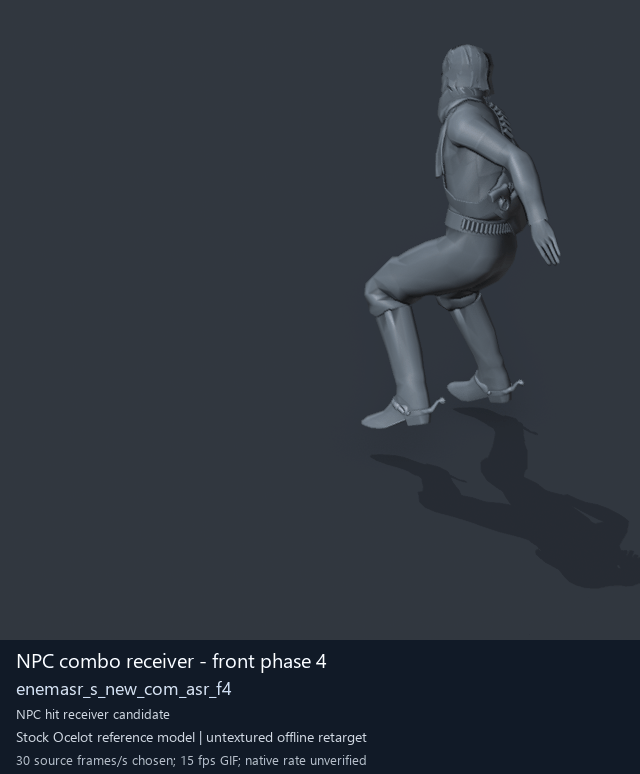

# NPC combo receiver - front phase 4

[Back to animation library](../README.md) · [Complete library data](../catalogue.json)

Click the image to open the original full-size GIF. Its visible character is a reference model; the source archive below identifies the original animation.

[](../../../media/animation-previews/2026-10-15/Soldier_common-0120-enemasr_s_new_com_asr_f4.gif)

[Open full-size GIF](../../../media/animation-previews/2026-10-15/Soldier_common-0120-enemasr_s_new_com_asr_f4.gif) · [Still image](../../../media/animation-previews/2026-10-15/Soldier_common-0120-enemasr_s_new_com_asr_f4.png)

## Technical data

| Field | Value |
| --- | --- |
| Game | Metal Gear Solid V: The Phantom Pain |
| Library ID | `mgsv-tpp-soldier_common-2d551b46a321c` |
| Source archive | `Soldier_common` |
| Exact clip name | `/Assets/tpp/motion/SI_game/fani/bodies/enem/enemasr/enemasr_s_new_com_asr_f4` |
| Clip hash ID | `2d551b46a321c` |
| Original source role | Soldier2Common archive (membership does not prove actor use) |
| Role interpretation | npc_combo_receiver_candidate |
| Family / phase | front / 4 |
| Raw source frames | 93 |
| Native frame rate / duration | Unmeasured / unknown |
| Chosen preview speed | 30 source frames/s; every second source frame sampled |
| Full GIF duration | 3100 ms |
| Reference character | Stock Ocelot oce0_main0_def (untextured) |
| Offline preview | Actual decoded motion on a mapped reference rig |
| Native gameplay / paired alignment | Unverified / unverified |
| Ordinary soldier attacker proof | Unverified |
| Archive SHA-256 | `6f535a29e1c5b6da70514984a47f8a5c988aa468f1d5c87c37f212263dcc001e` |
| GANI SHA-256 | `579c52165299015fe149f278ce37732379efe1cf7efe7ee978a6d599fa9e9ef6` |

## Interpretation and limits

Equal front/back phase suffix is a proposed attacker/receiver correspondence; native contact/timing not proved.

The preview speed is a presentation choice. Individual clips have no matched partner or held weapon; names alone do not prove unarmed punching. Hair, scarf and holster motion uses mapped-ancestor fallbacks. Native Fox cloth/twist behavior, timing, interaction contact and actor compatibility remain unverified.

The historical extraction record below keeps its original confidence fields. Its original visualConfirmed=false predates the later offline preview; it is not a claim that the library has no GIF. Offline visualization and native gameplay proof are separate fields.

<details>
<summary>Complete extraction and preview records</summary>

```json
{
  "extraction": {
    "id": "Soldier_common-0120-enemasr_s_new_com_asr_f4",
    "sourceArchive": "Soldier_common",
    "sourceRole": "Soldier2Common archive (membership does not prove actor use)",
    "archiveOrdinalZeroBased": 120,
    "ordinalNote": "Ordinal in first MtarTool extraction XML; tool may renumber on repack",
    "name": "/Assets/tpp/motion/SI_game/fani/bodies/enem/enemasr/enemasr_s_new_com_asr_f4",
    "hashId": "2d551b46a321c",
    "role": "npc_combo_receiver_candidate",
    "sequenceFamily": "front",
    "phase": 4,
    "phaseKind": "phase",
    "frameCount": 93,
    "frameCountMethod": "GANI2 mini-header uint32 at offset0, consistent with mctrollin reader/previous adapter",
    "frameRate": null,
    "durationSeconds": null,
    "timingNote": "Raw frame count only. Runtime rate and transitions not measured.",
    "namingConfidence": "dictionary-resolved exact archive member",
    "interpretationConfidence": "candidate inferred from family names; not visual confirmation",
    "visualConfirmed": false,
    "nativePlaybackConfirmed": false,
    "relationshipNote": "Equal front/back phase suffix is a proposed attacker/receiver correspondence; native contact/timing not proved.",
    "sourceMtarSha256": "6f535a29e1c5b6da70514984a47f8a5c988aa468f1d5c87c37f212263dcc001e",
    "payloads": [
      {
        "extension": ".gani",
        "bytes": 15024,
        "sha256": "579c52165299015fe149f278ce37732379efe1cf7efe7ee978a6d599fa9e9ef6"
      },
      {
        "extension": ".exchnk",
        "bytes": 1136,
        "sha256": "b357569e7c40a9d584d39e799986ac00be1c8378fb31539952f4aa5a33834e08"
      },
      {
        "extension": ".enchnk",
        "bytes": 624,
        "sha256": "62c3c6663f9b7491706301c440afe559332028216ed3867d89464e2ac0f9e0cf"
      }
    ],
    "displayTitle": "NPC combo receiver - front phase 4",
    "offlinePreviewConfirmed": true,
    "preview": {
      "status": "offline-reference-character",
      "referenceCharacter": "Stock Ocelot oce0_main0_def",
      "gif": "../../media/animation-previews/2026-10-15/Soldier_common-0120-enemasr_s_new_com_asr_f4.gif",
      "thumbnail": "../../media/animation-previews/2026-10-15/Soldier_common-0120-enemasr_s_new_com_asr_f4.png",
      "manifest": "../../media/animation-previews/2026-10-15/preview-manifest.json",
      "chosenSourceFramesPerSecond": 30,
      "nominalGifFramesPerSecond": 15,
      "durationSeconds": 3.1,
      "nativeTimingVerified": false,
      "nativeGameplayProof": false
    }
  },
  "preview": {
    "id": "Soldier_common-0120-enemasr_s_new_com_asr_f4",
    "title": "NPC combo receiver - front phase 4",
    "shortIdentifier": "enemasr_s_new_com_asr_f4",
    "sourceName": "/Assets/tpp/motion/SI_game/fani/bodies/enem/enemasr/enemasr_s_new_com_asr_f4",
    "sourceArchive": "Soldier_common",
    "sourceArchiveSha256": "6f535a29e1c5b6da70514984a47f8a5c988aa468f1d5c87c37f212263dcc001e",
    "hashId": "2d551b46a321c",
    "sourceGaniSha256": "579c52165299015fe149f278ce37732379efe1cf7efe7ee978a6d599fa9e9ef6",
    "sourceRole": "Soldier2Common archive (membership does not prove actor use)",
    "role": "npc_combo_receiver_candidate",
    "sequenceFamily": "front",
    "phase": 4,
    "phaseKind": "phase",
    "rawFrameCount": 93,
    "decodedTrackCount": 18,
    "headerIndex": 970,
    "sourceFramesSampled": [
      0,
      2,
      4,
      6,
      8,
      10,
      12,
      14,
      16,
      18,
      20,
      22,
      24,
      26,
      28,
      30,
      32,
      34,
      36,
      38,
      40,
      42,
      44,
      46,
      48,
      50,
      52,
      54,
      56,
      58,
      60,
      62,
      64,
      66,
      68,
      70,
      72,
      74,
      76,
      78,
      80,
      82,
      84,
      86,
      88,
      90,
      92
    ],
    "endpointFrameSavedPrivately": 93,
    "chosenSourceFramesPerSecond": 30,
    "gifFrameDurationsMilliseconds": [
      70,
      60,
      70,
      70,
      60,
      70,
      70,
      60,
      70,
      70,
      60,
      70,
      70,
      60,
      70,
      70,
      60,
      70,
      70,
      60,
      70,
      70,
      60,
      70,
      70,
      60,
      70,
      70,
      60,
      70,
      70,
      60,
      70,
      70,
      60,
      70,
      70,
      60,
      70,
      70,
      60,
      70,
      70,
      60,
      70,
      70,
      30
    ],
    "gifDurationMilliseconds": 3100,
    "nativeFrameRate": null,
    "rawLayoutFrameRateField": "5",
    "rawLayoutRateMeaning": "Unverified enum/value; not assumed to be frames per second",
    "referenceCharacter": "Stock Ocelot oce0_main0_def",
    "visualStatus": "actual decoded motion rendered on offline stock reference character",
    "nativeGameplayProof": false,
    "pairedAlignmentProof": false,
    "ordinarySoldierAttackProof": false,
    "cameraFixedForFullClip": true,
    "camera": {
      "fixedForEntireClip": true,
      "location": [
        -4.720932483673096,
        13.717613220214844,
        3.615248441696167
      ],
      "rotation": [
        1.2772102355957031,
        9.18613878297947e-08,
        -2.613518238067627
      ],
      "orthographicScale": 2.598799467086792,
      "projectedMin": [
        -3.842446804046631,
        -1.7769298553466797,
        3.1213552951812744
      ],
      "projectedMax": [
        -1.8256862163543701,
        0.46341443061828613,
        6.208963871002197
      ]
    },
    "worldBounds": {
      "min": [
        -0.634059488773346,
        3.9362621307373047,
        -0.026810407638549805
      ],
      "max": [
        0.8556194305419922,
        7.222825527191162,
        1.669439673423767
      ]
    },
    "titledGif": {
      "path": "Soldier_common-0120-enemasr_s_new_com_asr_f4.gif",
      "bytes": 3705091,
      "sha256": "3df661aadd7770dce53560e9c010c90b33c7fc01787d782892dc86c062c2fcad"
    },
    "thumbnail": {
      "path": "Soldier_common-0120-enemasr_s_new_com_asr_f4.png",
      "bytes": 111275,
      "sha256": "6b348f1eab019503de4b9a7966b37cd8f3c706f68c26261f8b210f58d4fca20c"
    },
    "privateCleanGifSha256": "b8d21c36fd308bd8abba08828f0a36e7e1cda3a744b447f96a96e2981b5c5727",
    "privateRenderReceiptSha256": "1d50bcd4ca0e53433937f4a733ad109a5e563058744648bed539bbf472291b89",
    "cleanPngFrameCount": 48,
    "maximumPerVertexWeightSumError": 1.4901161193847656e-07
  }
}
```

</details>

[Extraction method](../../mtar-punch-combos/README.md) · [Full-character recipe](../../mtar-punch-combos/full-character-preview-recipe.md) · [Credits](../../../CREDITS.md)
