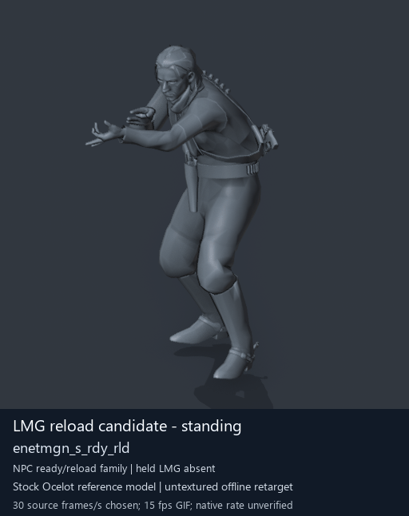

# LMG reload candidate - standing

[Back to animation library](../README.md) · [Complete library data](../catalogue.json)

Click the image to open the original full-size GIF. Its visible character is a reference model; the source archive below identifies the original animation.

[](../../../media/animation-previews/2026-10-15-lmg-reloads/Soldier_common-0939-enetmgn_s_rdy_rld.gif)

[Open full-size GIF](../../../media/animation-previews/2026-10-15-lmg-reloads/Soldier_common-0939-enetmgn_s_rdy_rld.gif) · [Still image](../../../media/animation-previews/2026-10-15-lmg-reloads/Soldier_common-0939-enetmgn_s_rdy_rld.png)

## Technical data

| Field | Value |
| --- | --- |
| Game | Metal Gear Solid V: The Phantom Pain |
| Library ID | `mgsv-tpp-soldier_common-380f6573688d2` |
| Source archive | `Soldier_common` |
| Exact clip name | `/Assets/tpp/motion/SI_game/fani/bodies/enet/enetmgn/enetmgn_s_rdy_rld` |
| Clip hash ID | `380f6573688d2` |
| Original source role | enemy |
| Role interpretation | lmg_ready_reload_candidate |
| Family / phase | lmg_ready_reload / None |
| Raw source frames | 337 |
| Native frame rate / duration | Unmeasured / unknown |
| Chosen preview speed | 30 source frames/s; every second source frame sampled |
| Full GIF duration | 11230 ms |
| Reference character | Stock Ocelot oce0_main0_def (untextured) |
| Offline preview | Actual decoded motion on a mapped reference rig |
| Native gameplay / paired alignment | Unverified / unverified |
| Ordinary soldier attacker proof | Unverified |
| Archive SHA-256 | `6f535a29e1c5b6da70514984a47f8a5c988aa468f1d5c87c37f212263dcc001e` |
| GANI SHA-256 | `d7f6ce2b28008468f5c1a643eef67ceaab47f2c3f7016ae999a850aa0f75d3d7` |

## Interpretation and limits

Alternative posture candidates in the same LMG ready/reload namespace, not paired phases. Isolated reference-body previews omit held weapon; no reload mechanics/contact or native compatibility proof.

The preview speed is a presentation choice. Individual clips have no matched partner or held weapon; names alone do not prove unarmed punching. Hair, scarf and holster motion uses mapped-ancestor fallbacks. Native Fox cloth/twist behavior, timing, interaction contact and actor compatibility remain unverified.

The historical extraction record below keeps its original confidence fields. Its original visualConfirmed=false predates the later offline preview; it is not a claim that the library has no GIF. Offline visualization and native gameplay proof are separate fields.

<details>
<summary>Complete extraction and preview records</summary>

```json
{
  "extraction": {
    "id": "Soldier_common-0939-enetmgn_s_rdy_rld",
    "sourceArchive": "Soldier_common",
    "sourceMtarSha256": "6f535a29e1c5b6da70514984a47f8a5c988aa468f1d5c87c37f212263dcc001e",
    "sourceRole": "enemy",
    "archiveOrdinalZeroBased": 939,
    "ordinalNote": "Historical MtarTool extraction XML order; select actual MTAR header by full hash",
    "name": "/Assets/tpp/motion/SI_game/fani/bodies/enet/enetmgn/enetmgn_s_rdy_rld",
    "hashId": "380f6573688d2",
    "libraryGroup": "lmg-reloads",
    "role": "lmg_ready_reload_candidate",
    "sequenceFamily": "lmg_ready_reload",
    "phase": null,
    "phaseKind": "posture_variant",
    "frameCount": 337,
    "frameCountMethod": "GANI2 uint32 miniheader, verified against community decoder during render",
    "frameRate": null,
    "durationSeconds": null,
    "timingNote": "Raw frame count only; native playback rate unmeasured",
    "namingConfidence": "Exact dictionary-resolved archive member; matches selected source workbook filename",
    "interpretationConfidence": "Ready/reload and q/s posture inferred from identifiers/category; no native weapon/contact test",
    "visualConfirmed": false,
    "nativePlaybackConfirmed": false,
    "relationshipNote": "Alternative posture candidates in the same LMG ready/reload namespace, not paired phases. Isolated reference-body previews omit held weapon; no reload mechanics/contact or native compatibility proof.",
    "payloads": [
      {
        "extension": ".gani",
        "cataloguePath": "catalogue/clips/Soldier_common-0939-enetmgn_s_rdy_rld/enetmgn_s_rdy_rld.gani",
        "bytes": 25760,
        "sha256": "d7f6ce2b28008468f5c1a643eef67ceaab47f2c3f7016ae999a850aa0f75d3d7",
        "freshMatchesRetainedExtraction": true
      },
      {
        "extension": ".exchnk",
        "cataloguePath": "catalogue/clips/Soldier_common-0939-enetmgn_s_rdy_rld/enetmgn_s_rdy_rld.exchnk",
        "bytes": 2864,
        "sha256": "2d66f3815047427960dd54ef2a4130892982201b368119adf34645e2cf1a9c06",
        "freshMatchesRetainedExtraction": true
      },
      {
        "extension": ".enchnk",
        "cataloguePath": "catalogue/clips/Soldier_common-0939-enetmgn_s_rdy_rld/enetmgn_s_rdy_rld.enchnk",
        "bytes": 624,
        "sha256": "ffe38f167553408901d34dc09bb40da95a43b185bddffcb61776121514cbd39c",
        "freshMatchesRetainedExtraction": true
      }
    ],
    "sharedFiles": [
      {
        "path": "mtars/Soldier_common/Soldier_common.trk",
        "sha256": "8d883f9d76434597b7756d32ecc1428d1a833117249b3e37bbb18e9cf5e63348"
      },
      {
        "path": "mtars/Soldier_common/Soldier_common.chnk",
        "sha256": "7d7826aacf1cf9f898c7e9ca6fc97baf0cd21a7f2ae1205f28778a08f105718c"
      }
    ],
    "discoverySource": {
      "workbookCredit": "KnochenGott (human supplied)",
      "workbookSha256": "849e9052875866d392354ab856df8c77c0f794fa83ed422d190a07b1741ad7cd",
      "sourceCell": "Sheet1!L5",
      "guideReferenceCommit": "2301912bd8694e5abd81044b0e9b15c811cb5772"
    }
  },
  "preview": {
    "id": "Soldier_common-0939-enetmgn_s_rdy_rld",
    "title": "LMG reload candidate - standing",
    "shortIdentifier": "enetmgn_s_rdy_rld",
    "sourceName": "/Assets/tpp/motion/SI_game/fani/bodies/enet/enetmgn/enetmgn_s_rdy_rld",
    "sourceArchive": "Soldier_common",
    "sourceArchiveSha256": "6f535a29e1c5b6da70514984a47f8a5c988aa468f1d5c87c37f212263dcc001e",
    "hashId": "380f6573688d2",
    "sourceGaniSha256": "d7f6ce2b28008468f5c1a643eef67ceaab47f2c3f7016ae999a850aa0f75d3d7",
    "sourceRole": "enemy",
    "role": "lmg_ready_reload_candidate",
    "sequenceFamily": "lmg_ready_reload",
    "phase": null,
    "phaseKind": "posture_variant",
    "rawFrameCount": 337,
    "decodedTrackCount": 18,
    "headerIndex": 1173,
    "sourceFramesSampled": [
      0,
      2,
      4,
      6,
      8,
      10,
      12,
      14,
      16,
      18,
      20,
      22,
      24,
      26,
      28,
      30,
      32,
      34,
      36,
      38,
      40,
      42,
      44,
      46,
      48,
      50,
      52,
      54,
      56,
      58,
      60,
      62,
      64,
      66,
      68,
      70,
      72,
      74,
      76,
      78,
      80,
      82,
      84,
      86,
      88,
      90,
      92,
      94,
      96,
      98,
      100,
      102,
      104,
      106,
      108,
      110,
      112,
      114,
      116,
      118,
      120,
      122,
      124,
      126,
      128,
      130,
      132,
      134,
      136,
      138,
      140,
      142,
      144,
      146,
      148,
      150,
      152,
      154,
      156,
      158,
      160,
      162,
      164,
      166,
      168,
      170,
      172,
      174,
      176,
      178,
      180,
      182,
      184,
      186,
      188,
      190,
      192,
      194,
      196,
      198,
      200,
      202,
      204,
      206,
      208,
      210,
      212,
      214,
      216,
      218,
      220,
      222,
      224,
      226,
      228,
      230,
      232,
      234,
      236,
      238,
      240,
      242,
      244,
      246,
      248,
      250,
      252,
      254,
      256,
      258,
      260,
      262,
      264,
      266,
      268,
      270,
      272,
      274,
      276,
      278,
      280,
      282,
      284,
      286,
      288,
      290,
      292,
      294,
      296,
      298,
      300,
      302,
      304,
      306,
      308,
      310,
      312,
      314,
      316,
      318,
      320,
      322,
      324,
      326,
      328,
      330,
      332,
      334,
      336
    ],
    "endpointFrameSavedPrivately": 337,
    "chosenSourceFramesPerSecond": 30,
    "gifFrameDurationsMilliseconds": [
      70,
      60,
      70,
      70,
      60,
      70,
      70,
      60,
      70,
      70,
      60,
      70,
      70,
      60,
      70,
      70,
      60,
      70,
      70,
      60,
      70,
      70,
      60,
      70,
      70,
      60,
      70,
      70,
      60,
      70,
      70,
      60,
      70,
      70,
      60,
      70,
      70,
      60,
      70,
      70,
      60,
      70,
      70,
      60,
      70,
      70,
      60,
      70,
      70,
      60,
      70,
      70,
      60,
      70,
      70,
      60,
      70,
      70,
      60,
      70,
      70,
      60,
      70,
      70,
      60,
      70,
      70,
      60,
      70,
      70,
      60,
      70,
      70,
      60,
      70,
      70,
      60,
      70,
      70,
      60,
      70,
      70,
      60,
      70,
      70,
      60,
      70,
      70,
      60,
      70,
      70,
      60,
      70,
      70,
      60,
      70,
      70,
      60,
      70,
      70,
      60,
      70,
      70,
      60,
      70,
      70,
      60,
      70,
      70,
      60,
      70,
      70,
      60,
      70,
      70,
      60,
      70,
      70,
      60,
      70,
      70,
      60,
      70,
      70,
      60,
      70,
      70,
      60,
      70,
      70,
      60,
      70,
      70,
      60,
      70,
      70,
      60,
      70,
      70,
      60,
      70,
      70,
      60,
      70,
      70,
      60,
      70,
      70,
      60,
      70,
      70,
      60,
      70,
      70,
      60,
      70,
      70,
      60,
      70,
      70,
      60,
      70,
      70,
      60,
      70,
      70,
      60,
      70,
      30
    ],
    "gifDurationMilliseconds": 11230,
    "nativeFrameRate": null,
    "rawLayoutFrameRateField": "5",
    "rawLayoutRateMeaning": "Unverified enum/value; not assumed to be frames per second",
    "referenceCharacter": "Stock Ocelot oce0_main0_def",
    "visualStatus": "actual decoded motion rendered on offline stock reference character",
    "nativeGameplayProof": false,
    "pairedAlignmentProof": false,
    "ordinarySoldierAttackProof": false,
    "cameraFixedForFullClip": true,
    "camera": {
      "fixedForEntireClip": true,
      "location": [
        -4.793392658233643,
        8.467853546142578,
        3.686687469482422
      ],
      "rotation": [
        1.2772102355957031,
        9.18613878297947e-08,
        -2.613518238067627
      ],
      "orthographicScale": 1.952492356300354,
      "projectedMin": [
        -0.6963801980018616,
        -0.12826921045780182,
        -0.3164747953414917
      ],
      "projectedMax": [
        0.4438307285308838,
        1.554913878440857,
        1.0768259763717651
      ]
    },
    "worldBounds": {
      "min": [
        -0.43831729888916016,
        -0.35037025809288025,
        -0.01435863971710205
      ],
      "max": [
        0.40222108364105225,
        0.9198798537254333,
        1.667781114578247
      ]
    },
    "titledGif": {
      "path": "Soldier_common-0939-enetmgn_s_rdy_rld.gif",
      "bytes": 8826938,
      "sha256": "b5cc2eee0e6e3e8fba5d554e02fbd836939caf76b332b237b01a6b04af6df812"
    },
    "thumbnail": {
      "path": "Soldier_common-0939-enetmgn_s_rdy_rld.png",
      "bytes": 106777,
      "sha256": "47e4df1a59b5c2ac9af61ea7db21ddc487f294d8a22c4bdb08c6dd92f1a0ed7e"
    },
    "privateCleanGifSha256": "a254197b2efad46d06d123a9b25c04366846c7f40d75060d83ff8f88c296eae4",
    "privateRenderReceiptSha256": "8027311fe8a6f866756a21d741df432cff1aa54236227ef5dda020d3081bdf5c",
    "cleanPngFrameCount": 170,
    "maximumPerVertexWeightSumError": 1.4901161193847656e-07
  }
}
```

</details>

[Extraction method](../../mtar-punch-combos/README.md) · [Full-character recipe](../../mtar-punch-combos/full-character-preview-recipe.md) · [Credits](../../../CREDITS.md)
