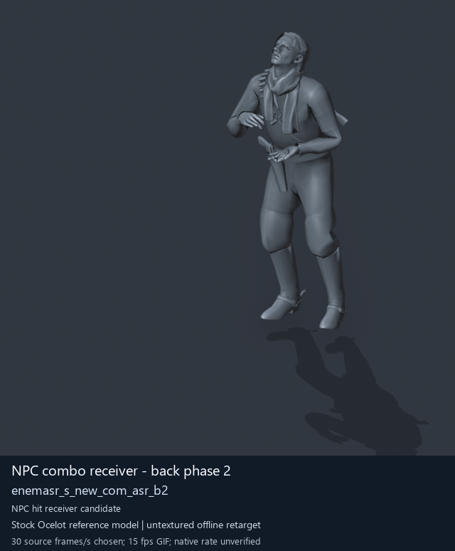

# NPC combo receiver - back phase 2

[Back to animation library](../README.md) · [Complete library data](../catalogue.json)

Click the image to open the original full-size GIF. Its visible character is a reference model; the source archive below identifies the original animation.

[](../../../media/animation-previews/2026-10-15/Soldier_common-0115-enemasr_s_new_com_asr_b2.gif)

[Open full-size GIF](../../../media/animation-previews/2026-10-15/Soldier_common-0115-enemasr_s_new_com_asr_b2.gif) · [Still image](../../../media/animation-previews/2026-10-15/Soldier_common-0115-enemasr_s_new_com_asr_b2.png)

## Technical data

| Field | Value |
| --- | --- |
| Game | Metal Gear Solid V: The Phantom Pain |
| Library ID | `mgsv-tpp-soldier_common-3996cc2687e1f` |
| Source archive | `Soldier_common` |
| Exact clip name | `/Assets/tpp/motion/SI_game/fani/bodies/enem/enemasr/enemasr_s_new_com_asr_b2` |
| Clip hash ID | `3996cc2687e1f` |
| Original source role | Soldier2Common archive (membership does not prove actor use) |
| Role interpretation | npc_combo_receiver_candidate |
| Family / phase | back / 2 |
| Raw source frames | 98 |
| Native frame rate / duration | Unmeasured / unknown |
| Chosen preview speed | 30 source frames/s; every second source frame sampled |
| Full GIF duration | 3270 ms |
| Reference character | Stock Ocelot oce0_main0_def (untextured) |
| Offline preview | Actual decoded motion on a mapped reference rig |
| Native gameplay / paired alignment | Unverified / unverified |
| Ordinary soldier attacker proof | Unverified |
| Archive SHA-256 | `6f535a29e1c5b6da70514984a47f8a5c988aa468f1d5c87c37f212263dcc001e` |
| GANI SHA-256 | `3f726e03a8295ab57a49977e87e3e5eead38d411c4230cc83894411c64a4b561` |

## Interpretation and limits

Equal front/back phase suffix is a proposed attacker/receiver correspondence; native contact/timing not proved.

The preview speed is a presentation choice. Individual clips have no matched partner or held weapon; names alone do not prove unarmed punching. Hair, scarf and holster motion uses mapped-ancestor fallbacks. Native Fox cloth/twist behavior, timing, interaction contact and actor compatibility remain unverified.

The historical extraction record below keeps its original confidence fields. Its original visualConfirmed=false predates the later offline preview; it is not a claim that the library has no GIF. Offline visualization and native gameplay proof are separate fields.

<details>
<summary>Complete extraction and preview records</summary>

```json
{
  "extraction": {
    "id": "Soldier_common-0115-enemasr_s_new_com_asr_b2",
    "sourceArchive": "Soldier_common",
    "sourceRole": "Soldier2Common archive (membership does not prove actor use)",
    "archiveOrdinalZeroBased": 115,
    "ordinalNote": "Ordinal in first MtarTool extraction XML; tool may renumber on repack",
    "name": "/Assets/tpp/motion/SI_game/fani/bodies/enem/enemasr/enemasr_s_new_com_asr_b2",
    "hashId": "3996cc2687e1f",
    "role": "npc_combo_receiver_candidate",
    "sequenceFamily": "back",
    "phase": 2,
    "phaseKind": "phase",
    "frameCount": 98,
    "frameCountMethod": "GANI2 mini-header uint32 at offset0, consistent with mctrollin reader/previous adapter",
    "frameRate": null,
    "durationSeconds": null,
    "timingNote": "Raw frame count only. Runtime rate and transitions not measured.",
    "namingConfidence": "dictionary-resolved exact archive member",
    "interpretationConfidence": "candidate inferred from family names; not visual confirmation",
    "visualConfirmed": false,
    "nativePlaybackConfirmed": false,
    "relationshipNote": "Equal front/back phase suffix is a proposed attacker/receiver correspondence; native contact/timing not proved.",
    "sourceMtarSha256": "6f535a29e1c5b6da70514984a47f8a5c988aa468f1d5c87c37f212263dcc001e",
    "payloads": [
      {
        "extension": ".gani",
        "bytes": 14432,
        "sha256": "3f726e03a8295ab57a49977e87e3e5eead38d411c4230cc83894411c64a4b561"
      },
      {
        "extension": ".exchnk",
        "bytes": 912,
        "sha256": "4054747278e4205bd2b9d7e04bf4f8579ce9dcc168c5fbaa82af06f9282e3162"
      },
      {
        "extension": ".enchnk",
        "bytes": 560,
        "sha256": "7bffdce08c32cd5d21278a12299d29c23519eb6d0c021a249945503e19fe622a"
      }
    ],
    "displayTitle": "NPC combo receiver - back phase 2",
    "offlinePreviewConfirmed": true,
    "preview": {
      "status": "offline-reference-character",
      "referenceCharacter": "Stock Ocelot oce0_main0_def",
      "gif": "../../media/animation-previews/2026-10-15/Soldier_common-0115-enemasr_s_new_com_asr_b2.gif",
      "thumbnail": "../../media/animation-previews/2026-10-15/Soldier_common-0115-enemasr_s_new_com_asr_b2.png",
      "manifest": "../../media/animation-previews/2026-10-15/preview-manifest.json",
      "chosenSourceFramesPerSecond": 30,
      "nominalGifFramesPerSecond": 15,
      "durationSeconds": 3.27,
      "nativeTimingVerified": false,
      "nativeGameplayProof": false
    }
  },
  "preview": {
    "id": "Soldier_common-0115-enemasr_s_new_com_asr_b2",
    "title": "NPC combo receiver - back phase 2",
    "shortIdentifier": "enemasr_s_new_com_asr_b2",
    "sourceName": "/Assets/tpp/motion/SI_game/fani/bodies/enem/enemasr/enemasr_s_new_com_asr_b2",
    "sourceArchive": "Soldier_common",
    "sourceArchiveSha256": "6f535a29e1c5b6da70514984a47f8a5c988aa468f1d5c87c37f212263dcc001e",
    "hashId": "3996cc2687e1f",
    "sourceGaniSha256": "3f726e03a8295ab57a49977e87e3e5eead38d411c4230cc83894411c64a4b561",
    "sourceRole": "Soldier2Common archive (membership does not prove actor use)",
    "role": "npc_combo_receiver_candidate",
    "sequenceFamily": "back",
    "phase": 2,
    "phaseKind": "phase",
    "rawFrameCount": 98,
    "decodedTrackCount": 18,
    "headerIndex": 1210,
    "sourceFramesSampled": [
      0,
      2,
      4,
      6,
      8,
      10,
      12,
      14,
      16,
      18,
      20,
      22,
      24,
      26,
      28,
      30,
      32,
      34,
      36,
      38,
      40,
      42,
      44,
      46,
      48,
      50,
      52,
      54,
      56,
      58,
      60,
      62,
      64,
      66,
      68,
      70,
      72,
      74,
      76,
      78,
      80,
      82,
      84,
      86,
      88,
      90,
      92,
      94,
      96
    ],
    "endpointFrameSavedPrivately": 98,
    "chosenSourceFramesPerSecond": 30,
    "gifFrameDurationsMilliseconds": [
      70,
      60,
      70,
      70,
      60,
      70,
      70,
      60,
      70,
      70,
      60,
      70,
      70,
      60,
      70,
      70,
      60,
      70,
      70,
      60,
      70,
      70,
      60,
      70,
      70,
      60,
      70,
      70,
      60,
      70,
      70,
      60,
      70,
      70,
      60,
      70,
      70,
      60,
      70,
      70,
      60,
      70,
      70,
      60,
      70,
      70,
      60,
      70,
      70
    ],
    "gifDurationMilliseconds": 3270,
    "nativeFrameRate": null,
    "rawLayoutFrameRateField": "5",
    "rawLayoutRateMeaning": "Unverified enum/value; not assumed to be frames per second",
    "referenceCharacter": "Stock Ocelot oce0_main0_def",
    "visualStatus": "actual decoded motion rendered on offline stock reference character",
    "nativeGameplayProof": false,
    "pairedAlignmentProof": false,
    "ordinarySoldierAttackProof": false,
    "cameraFixedForFullClip": true,
    "camera": {
      "fixedForEntireClip": true,
      "location": [
        -4.720573425292969,
        10.740219116210938,
        3.6748430728912354
      ],
      "rotation": [
        1.2772102355957031,
        9.18613878297947e-08,
        -2.613518238067627
      ],
      "orthographicScale": 2.6202361583709717,
      "projectedMin": [
        -2.0350725650787354,
        -0.9848242998123169,
        1.038420557975769
      ],
      "projectedMax": [
        -0.6332341432571411,
        1.2740000486373901,
        3.402505397796631
      ]
    },
    "worldBounds": {
      "min": [
        -0.39658594131469727,
        1.3555054664611816,
        -0.054860830307006836
      ],
      "max": [
        0.49116232991218567,
        3.950486183166504,
        1.746417760848999
      ]
    },
    "titledGif": {
      "path": "Soldier_common-0115-enemasr_s_new_com_asr_b2.gif",
      "bytes": 3868038,
      "sha256": "aa63cb4993d59d40ee38f52ad8076d80c30f6255debe4fdc2ce3d99409b4f7f7"
    },
    "thumbnail": {
      "path": "Soldier_common-0115-enemasr_s_new_com_asr_b2.png",
      "bytes": 112806,
      "sha256": "31cf95f74d6975f1cfba2613f631ae281d2fa5e752bc38f5b1b9be829701eb4d"
    },
    "privateCleanGifSha256": "1bdac473ab1b396e8bedf5fbefccb159b2ea2fb500c3c4d6f62ecff0eeb5a7b0",
    "privateRenderReceiptSha256": "c7f91f565427cadc34bc061a9b8bb72b527bd57ab967654eda4672906354db44",
    "cleanPngFrameCount": 50,
    "maximumPerVertexWeightSumError": 1.4901161193847656e-07
  }
}
```

</details>

[Extraction method](../../mtar-punch-combos/README.md) · [Full-character recipe](../../mtar-punch-combos/full-character-preview-recipe.md) · [Credits](../../../CREDITS.md)
