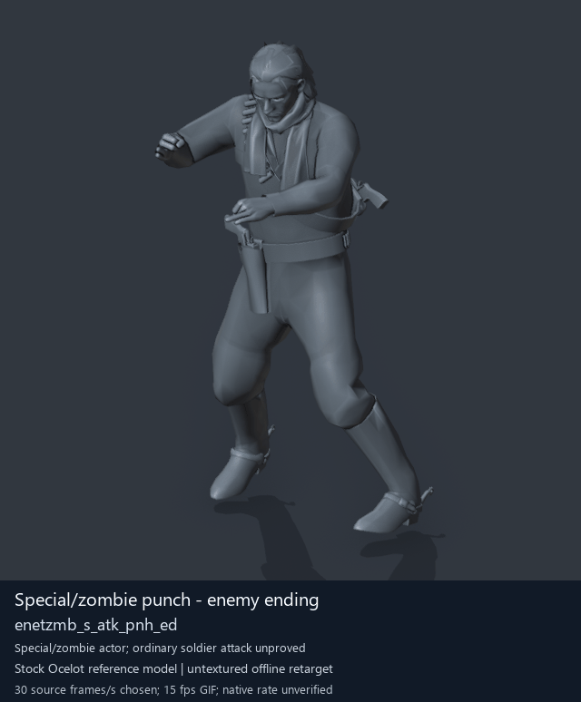

# Special/zombie punch - enemy ending

[Back to animation library](../README.md) · [Complete library data](../catalogue.json)

Click the image to open the original full-size GIF. Its visible character is a reference model; source identity is recorded separately below.

[](../../../media/animation-previews/2026-10-15/Soldier_common-1313-enetzmb_s_atk_pnh_ed.gif)

[Open full-size GIF](../../../media/animation-previews/2026-10-15/Soldier_common-1313-enetzmb_s_atk_pnh_ed.gif) · [Still image](../../../media/animation-previews/2026-10-15/Soldier_common-1313-enetzmb_s_atk_pnh_ed.png)

## Classification and descriptions

**Category:** Special / zombie actor candidates. **Tags:** `zombie motion`, `punch`, `melee`, `enemy`, `ending`.

**Description:** Ending movement after the enemy zombie-style punch.

Description basis: project-authored action description; credit: arsenal-pt / OpenAI Codex. Retained source family/phase and already reviewed offline preview; native use remains unverified.

**Community source description:** Unavailable. No verified exact source-description match for this entry. The reviewed BossQuiet2_layers list has zero matching paths among the current 27 clips.

Match status: `unavailable-no-verified-exact-match`. [Description sources and matching rules](../description-sources.md).

The source directory is a virtual game-asset directory. The retained clip stem and the .gani file path are separate fields. [Container provenance](../container-provenance.json) records direct FPK index/member-byte and selected GANI content/path checks on our retained assets. Our extraction receipts/logs identify historical outer origins; community description notes were not used for these locations. Current DAT membership/content/version remains unverified.

## Technical data

| Field | Value |
| --- | --- |
| Game | Metal Gear Solid V: The Phantom Pain |
| Library ID | `mgsv-tpp-soldier_common-3f61b4434967` |
| Category | Special / zombie actor candidates |
| Tags (authored retrieval labels) | zombie motion, punch, melee, enemy, ending |
| Source archive | `Soldier_common` |
| Exact clip stem (retained) | `/Assets/tpp/motion/SI_game/fani/bodies/enet/enetzmb/enetzmb_s_atk_pnh_ed` |
| Virtual GANI file | `/Assets/tpp/motion/SI_game/fani/bodies/enet/enetzmb/enetzmb_s_atk_pnh_ed.gani` |
| Virtual GANI directory | `/Assets/tpp/motion/SI_game/fani/bodies/enet/enetzmb` |
| MTAR file | `Soldier_common.mtar` |
| Recorded container label | Soldier2Common |
| Virtual MTAR path | /Assets/tpp/motion/mtar/soldier2/Soldier_common.mtar |
| Virtual FPK path | /Assets/tpp/pack/soldier/common/Soldier2Common.fpk |
| Recorded DAT origin | a_chunk7.dat |
| DAT version limit | Unverified historical DAT name from our saved extraction receipt; current DAT/index/content/version not checked |
| Clip hash ID | `3f61b4434967` |
| Original source role | Soldier2Common archive (membership does not prove actor use) |
| Motion-origin label | enemy zombie-motion set |
| Motion-origin basis | snapzmb/enetzmb namespace and retained source role; no specific original character identified |
| MTAR path verification | verified-retained-FPK-index-and-contained-MTAR-bytes |
| Outer FPK path verification | historical-first-party-extraction-receipt; enclosing DAT member/index not rechecked |
| Role interpretation | special_actor_punch_candidate |
| Family / phase | zombie_melee / None |
| Raw source frames | 15 |
| Native frame rate / duration | Unmeasured / unknown |
| Chosen preview speed | 30 source frames/s; every second source frame sampled |
| Full GIF duration | 500 ms |
| Reference character | Stock Ocelot oce0_main0_def (untextured) |
| Offline preview | Actual decoded motion on a mapped reference rig |
| Native gameplay / paired alignment | Unverified / unverified |
| Ordinary soldier attacker proof | Unverified |
| Archive SHA-256 | `6f535a29e1c5b6da70514984a47f8a5c988aa468f1d5c87c37f212263dcc001e` |
| GANI SHA-256 | `63afcbd0f9485e3097bd3a67a30abb26c9d48387a2205168df5b66ceff5d490f` |
| Dictionary snapshot SHA-256 | `30c11a1f6478db700bdb7df5327ddf8a21bab35111c3aec01e84cf8572fad591` |

## Credits and evidence

- **Konami / Kojima Productions** — original game animation.
- **mctrollin and contributors** — community motion decoder, reference rig and mappings.
- **arsenal-pt / OpenAI Codex** — authored catalogue category, tags and preview summary.

Categories/tags and preview summaries are project-authored. Candidate roles/families come from retained naming metadata; posture labels come from the already reviewed offline preview. An unavailable community description has no attributed per-entry source author. [Full tool/model credits](../../../CREDITS.md).

## Interpretation and limits

Distinct special-actor/transition candidate; not an ordinary soldier combo proof.

Preview speed is a presentation choice. Individual clips have no matched partner or held weapon. Labels alone do not prove native weapon handling, interaction contact or actor compatibility. Hair, scarf and holster motion uses mapped-ancestor fallbacks; native Fox cloth/twist and timing remain unverified.

Historical extraction confidence fields below are unchanged. Original visualConfirmed=false predates the later offline preview; offline visualization and native gameplay proof remain separate fields.

<details>
<summary>Classification, location and description provenance</summary>

```json
{
  "category": {
    "id": "special-actors",
    "label": "Special / zombie actor candidates"
  },
  "tags": [
    "zombie motion",
    "punch",
    "melee",
    "enemy",
    "ending"
  ],
  "motionOrigin": {
    "actor": "enemy zombie-motion set",
    "basis": "snapzmb/enetzmb namespace and retained source role; no specific original character identified",
    "kind": "source-family interpretation",
    "referenceModelIsMotionOrigin": false
  },
  "classificationProvenance": {
    "kind": "project-authored",
    "credit": "arsenal-pt / OpenAI Codex",
    "categoryAndCandidateTags": "Semantic search terms from retained source namespace/role/family/phase and reviewed offline preview; confidence stays in detail data",
    "postureTags": null,
    "extractionRecordPath": "research/mtar-punch-combos/animations-metadata.json",
    "nativeGameplayProof": false
  },
  "locations": {
    "ganiVirtualPath": "/Assets/tpp/motion/SI_game/fani/bodies/enet/enetzmb/enetzmb_s_atk_pnh_ed.gani",
    "ganiDirectory": "/Assets/tpp/motion/SI_game/fani/bodies/enet/enetzmb",
    "archiveFile": "Soldier_common.mtar",
    "recordedContainerLabel": "Soldier2Common",
    "archiveVirtualPath": "/Assets/tpp/motion/mtar/soldier2/Soldier_common.mtar",
    "containerVirtualPath": "/Assets/tpp/pack/soldier/common/Soldier2Common.fpk",
    "containerLocationStatus": "verified-retained-FPK-index-and-contained-MTAR-bytes; outer FPK/DAT location is historical",
    "provenance": {
      "kind": "retained-extraction-record",
      "recordPath": "research/mtar-punch-combos/animations-metadata.json",
      "archiveSha256": "6f535a29e1c5b6da70514984a47f8a5c988aa468f1d5c87c37f212263dcc001e",
      "dictionarySha256": "30c11a1f6478db700bdb7df5327ddf8a21bab35111c3aec01e84cf8572fad591",
      "pathRule": "Exact resolved member stem plus the extracted .gani payload extension; no extraction ordinal used",
      "directFpkIndexCheck": {
        "status": "verified-retained-index-and-contained-bytes",
        "memberVirtualPath": "/Assets/tpp/motion/mtar/soldier2/Soldier_common.mtar",
        "fileEntryCount": 10,
        "indexRowOffset": 240,
        "payloadOffset": 484768,
        "payloadBytes": 15897168,
        "payloadSha256": "6f535a29e1c5b6da70514984a47f8a5c988aa468f1d5c87c37f212263dcc001e",
        "matchesOriginalMtarBytes": true
      },
      "selectedClipCheck": {
        "libraryId": "mgsv-tpp-soldier_common-3f61b4434967",
        "ganiVirtualPath": "/Assets/tpp/motion/SI_game/fani/bodies/enet/enetzmb/enetzmb_s_atk_pnh_ed.gani",
        "hashId": "3f61b4434967",
        "ganiSha256": "63afcbd0f9485e3097bd3a67a30abb26c9d48387a2205168df5b66ceff5d490f",
        "payloadBytes": 3888,
        "payloadOffsetInMtar": 14899952,
        "retainedMtarXmlSha256": "c782c00c7a391b13daeb21417a595fa2a5dea63b1eb7059afdaedde3db4d100e",
        "pathMatch": "Exact saved Gzs/MtarTool XML directory and filename, removing only the tool-added four-digit filename prefix; payload SHA256 and original MTAR bytes both checked. No ordinal-only match.",
        "dictionarySha256": "30c11a1f6478db700bdb7df5327ddf8a21bab35111c3aec01e84cf8572fad591",
        "status": "verified-selected-retained-payload-and-path"
      },
      "containerReview": "research/animation-library/container-provenance.json",
      "containerEvidence": [
        {
          "kind": "source-provenance receipt",
          "sha256": "e4ae0bf6f27d42630865662a89e5a387748fdf1cfbf91c718f4254c0855bffc8"
        },
        {
          "kind": "successful Gzs command receipt",
          "sha256": "5cbcac1e19cdb652353306f15b39c1878ead289b907ee462d72be516343ee615",
          "commandTag": "gzs-Soldier2Common",
          "exitCode": 0
        },
        {
          "kind": "retained Gzs extracted-path log",
          "sha256": "6b7541bd463e4172c0c1d640d325f978e22242830dd972e394c6934f05a4452a"
        },
        {
          "kind": "immutable private library receipt",
          "sha256": "b640d528849cdf79327353cf6c37d2f15244659a6e3039f2cee18e8cb431cbb8",
          "libraryZipSha256": "299795a7378d55f18d059f02a2946763d8c546c2a4db5da6bdb5baed84646c2d"
        }
      ],
      "containerVerification": "Original FPK index directly names this MTAR path; its byte range equals the retained MTAR and SHA256. Every selected GANI payload/hash matches bytes inside that MTAR plus the saved extraction XML path. Outer FPK/DAT origins remain qualified historical extraction evidence."
    },
    "datArchive": "a_chunk7.dat",
    "datArchiveSha256": null,
    "containerSha256": "7b44821cda5ecb657abb44fed05e856dbe99373cf7bfd53e9c1e126523d0be36",
    "datOriginStatus": "Unverified historical DAT name from our saved extraction receipt; current DAT/index/content/version not checked",
    "archiveVirtualPathStatus": "verified-retained-FPK-index-and-contained-MTAR-bytes",
    "containerVirtualPathStatus": "historical-first-party-extraction-receipt; enclosing DAT member/index not rechecked"
  },
  "description": {
    "text": "Ending movement after the enemy zombie-style punch.",
    "kind": "project-authored action description",
    "credit": "arsenal-pt / OpenAI Codex",
    "basis": "Retained source family/phase and already reviewed offline preview; native use remains unverified"
  },
  "authoredDescription": {
    "text": "Ending movement after the enemy zombie-style punch.",
    "kind": "project-authored action description",
    "credit": "arsenal-pt / OpenAI Codex",
    "basis": "Retained source family/phase and already reviewed offline preview; native use remains unverified"
  },
  "sourceDescription": {
    "status": "unavailable-no-verified-exact-match",
    "text": null,
    "credit": null,
    "sourceUrl": null,
    "reason": "No verified exact source-description match for this entry. The reviewed BossQuiet2_layers list has zero matching paths among the current 27 clips.",
    "reviewRecord": "research/animation-library/metadata-source-review.json"
  },
  "credits": [
    {
      "name": "Konami / Kojima Productions",
      "role": "original game animation"
    },
    {
      "name": "mctrollin and contributors",
      "role": "community motion decoder, reference rig and mappings"
    },
    {
      "name": "arsenal-pt / OpenAI Codex",
      "role": "authored catalogue category, tags and preview summary"
    }
  ]
}
```

</details>

<details>
<summary>Complete original extraction and preview records</summary>

```json
{
  "extraction": {
    "id": "Soldier_common-1313-enetzmb_s_atk_pnh_ed",
    "sourceArchive": "Soldier_common",
    "sourceRole": "Soldier2Common archive (membership does not prove actor use)",
    "archiveOrdinalZeroBased": 1313,
    "ordinalNote": "Ordinal in first MtarTool extraction XML; tool may renumber on repack",
    "name": "/Assets/tpp/motion/SI_game/fani/bodies/enet/enetzmb/enetzmb_s_atk_pnh_ed",
    "hashId": "3f61b4434967",
    "role": "special_actor_punch_candidate",
    "sequenceFamily": "zombie_melee",
    "phase": null,
    "phaseKind": "ending",
    "frameCount": 15,
    "frameCountMethod": "GANI2 mini-header uint32 at offset0, consistent with mctrollin reader/previous adapter",
    "frameRate": null,
    "durationSeconds": null,
    "timingNote": "Raw frame count only. Runtime rate and transitions not measured.",
    "namingConfidence": "dictionary-resolved exact archive member",
    "interpretationConfidence": "candidate inferred from family names; not visual confirmation",
    "visualConfirmed": false,
    "nativePlaybackConfirmed": false,
    "relationshipNote": "Distinct special-actor/transition candidate; not an ordinary soldier combo proof.",
    "sourceMtarSha256": "6f535a29e1c5b6da70514984a47f8a5c988aa468f1d5c87c37f212263dcc001e",
    "payloads": [
      {
        "extension": ".gani",
        "bytes": 3888,
        "sha256": "63afcbd0f9485e3097bd3a67a30abb26c9d48387a2205168df5b66ceff5d490f"
      },
      {
        "extension": ".enchnk",
        "bytes": 384,
        "sha256": "8f9a9d2ebb5b89b0bb98c9fbcec6553fc35c17d3dc5e4a51eda0fadfd7f0a0dd"
      }
    ],
    "displayTitle": "Special/zombie punch - enemy ending",
    "offlinePreviewConfirmed": true,
    "preview": {
      "status": "offline-reference-character",
      "referenceCharacter": "Stock Ocelot oce0_main0_def",
      "gif": "../../media/animation-previews/2026-10-15/Soldier_common-1313-enetzmb_s_atk_pnh_ed.gif",
      "thumbnail": "../../media/animation-previews/2026-10-15/Soldier_common-1313-enetzmb_s_atk_pnh_ed.png",
      "manifest": "../../media/animation-previews/2026-10-15/preview-manifest.json",
      "chosenSourceFramesPerSecond": 30,
      "nominalGifFramesPerSecond": 15,
      "durationSeconds": 0.5,
      "nativeTimingVerified": false,
      "nativeGameplayProof": false
    }
  },
  "preview": {
    "id": "Soldier_common-1313-enetzmb_s_atk_pnh_ed",
    "title": "Special/zombie punch - enemy ending",
    "shortIdentifier": "enetzmb_s_atk_pnh_ed",
    "sourceName": "/Assets/tpp/motion/SI_game/fani/bodies/enet/enetzmb/enetzmb_s_atk_pnh_ed",
    "sourceArchive": "Soldier_common",
    "sourceArchiveSha256": "6f535a29e1c5b6da70514984a47f8a5c988aa468f1d5c87c37f212263dcc001e",
    "hashId": "3f61b4434967",
    "sourceGaniSha256": "63afcbd0f9485e3097bd3a67a30abb26c9d48387a2205168df5b66ceff5d490f",
    "sourceRole": "Soldier2Common archive (membership does not prove actor use)",
    "role": "special_actor_punch_candidate",
    "sequenceFamily": "zombie_melee",
    "phase": null,
    "phaseKind": "ending",
    "rawFrameCount": 15,
    "decodedTrackCount": 18,
    "headerIndex": 92,
    "sourceFramesSampled": [
      0,
      2,
      4,
      6,
      8,
      10,
      12,
      14
    ],
    "endpointFrameSavedPrivately": 15,
    "chosenSourceFramesPerSecond": 30,
    "gifFrameDurationsMilliseconds": [
      70,
      60,
      70,
      70,
      60,
      70,
      70,
      30
    ],
    "gifDurationMilliseconds": 500,
    "nativeFrameRate": null,
    "rawLayoutFrameRateField": "5",
    "rawLayoutRateMeaning": "Unverified enum/value; not assumed to be frames per second",
    "referenceCharacter": "Stock Ocelot oce0_main0_def",
    "visualStatus": "actual decoded motion rendered on offline stock reference character",
    "nativeGameplayProof": false,
    "pairedAlignmentProof": false,
    "ordinarySoldierAttackProof": false,
    "cameraFixedForFullClip": true,
    "camera": {
      "fixedForEntireClip": true,
      "location": [
        -4.855048656463623,
        7.939146518707275,
        3.70546555519104
      ],
      "rotation": [
        1.2772102355957031,
        9.18613878297947e-08,
        -2.613518238067627
      ],
      "orthographicScale": 1.9474152326583862,
      "projectedMin": [
        -0.28748610615730286,
        0.015062302350997925,
        -0.7593134045600891
      ],
      "projectedMax": [
        0.6742512583732605,
        1.6938685178756714,
        0.7157175540924072
      ]
    },
    "worldBounds": {
      "min": [
        -0.48272350430488586,
        -0.8005032539367676,
        -0.008784174919128418
      ],
      "max": [
        0.5065838694572449,
        0.3301178216934204,
        1.697941780090332
      ]
    },
    "titledGif": {
      "path": "Soldier_common-1313-enetzmb_s_atk_pnh_ed.gif",
      "bytes": 760089,
      "sha256": "92660f98619ed178975bd22d34db8ab92b6b91f986818e26a8b7d93400121773"
    },
    "thumbnail": {
      "path": "Soldier_common-1313-enetzmb_s_atk_pnh_ed.png",
      "bytes": 145407,
      "sha256": "885fbfc70ea780ac4e878af7af99c93e7dd2b65441e08bcf034b5d30e6521727"
    },
    "privateCleanGifSha256": "0d253a053cac91768c2f0789d6c63b96c44b3d2b3105a8a185b485036a949fc8",
    "privateRenderReceiptSha256": "f64178397890f86f0e2df94359f25202af7a6de47e3f5a1346514f8af09273a9",
    "cleanPngFrameCount": 9,
    "maximumPerVertexWeightSumError": 1.4901161193847656e-07
  }
}
```

</details>

[Exact extraction catalogue](../../mtar-punch-combos/animations-metadata.json) · [Full-character recipe](../../mtar-punch-combos/full-character-preview-recipe.md) · [Credits](../../../CREDITS.md)
