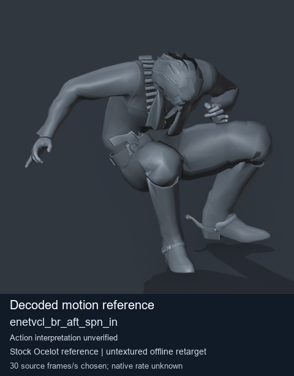

# Stock reference: enetvcl_br_aft_spn_in

[Library index](../README.md) · [Complete catalogue](../catalogue.json)

Decoded stock reference enetvcl_br_aft_spn_in; action interpretation unverified.

[](../../../media/animation-previews/animation-post500-720-20261031/mgsv-tpp-soldier_common-payloadsha256-00e8561f6f2bbeaffe68b1f131bbfe2c8fd3c3fcc6f4b12025e7ade8a6549b82.gif)

[Full GIF](../../../media/animation-previews/animation-post500-720-20261031/mgsv-tpp-soldier_common-payloadsha256-00e8561f6f2bbeaffe68b1f131bbfe2c8fd3c3fcc6f4b12025e7ade8a6549b82.gif) · [Still image](../../../media/animation-previews/animation-post500-720-20261031/mgsv-tpp-soldier_common-payloadsha256-00e8561f6f2bbeaffe68b1f131bbfe2c8fd3c3fcc6f4b12025e7ade8a6549b82.png)

**Exact identifier:** `enetvcl_br_aft_spn_in`. **Tags:** stock animation reference, Soldier_common, source-derived label, Ocelot reference mesh.

Source-derived motion label; shared pipeline approved. Per-clip visual review status is in provenance; no action or native compatibility is inferred.

## Technical data

| Field | Value |
| --- | --- |
| Virtual GANI | /Assets/tpp/motion/SI_game/fani/bodies/enet/enetvcl/enetvcl_br_aft_spn_in.gani |
| MTAR | Unverified |
| Historical FPK | Unverified |
| Historical DAT | Unverified |
| Source archive SHA256 | 6f535a29e1c5b6da70514984a47f8a5c988aa468f1d5c87c37f212263dcc001e |
| GANI SHA256 | 00e8561f6f2bbeaffe68b1f131bbfe2c8fd3c3fcc6f4b12025e7ade8a6549b82 |
| Source identity limit | Payload SHA256 identity; name PathCode64 not independently recomputed; exporter prefix is not an ordinal |
| Source header / decoded body tracks / raw frames | 581 / 18 / 60 |
| Chosen source rate / native rate | 30 source frames/s / unknown |
| GIF frames / duration | 30 / 2000 ms; separate endpoint60 excluded |
| Reference character | Stock Ocelot full-character community reference, untextured |
| Actual reference scene SHA256 | 68e793fb833999c2489d9de1811d6f9b27df471c2e418b4b872a1200ea0b105c |
| Weight audit | 21 meshes; max per-vertex sum error 1.4901161193847656e-07 |
| Secondary ancestor fallbacks | 18; hair/cloth/holster are approximate |
| Root motion | Retained root travel; GIF restart is not native continuity |
| Root visual QA | Shared pipeline sampled/approved; this clip has not been visually reviewed |
| DAT limit | Unverified outer DAT/FPK membership; no installed-currentness or whole-DAT hash claim |

Native timing, floor/contact, paired motion, cloth/twist and arbitrary actor compatibility remain unverified. This is not a training-posture fix.

## Credits

- Konami / Kojima Productions: original game content.
- mctrollin and contributors: community decoder/reference rig/maps.
- BobDoleOwndU and contributors: MtarTool/FMDL tooling.
- Blender / Pillow contributors: rendering/encoding tools.
- arsenal-pt / OpenAI Codex: authored pipeline/integration.

[Full credits](../../../CREDITS.md) · [License scope](../../../LICENSE-SCOPE.md) · [Exact reviewed source/provenance](../reviewed/animation-post500-720-4853ac82d3398e7921a2.json)

<details>
<summary>Complete source and preview provenance</summary>

```json
{
  "id": "mgsv-tpp-soldier_common-payloadsha256-00e8561f6f2bbeaffe68b1f131bbfe2c8fd3c3fcc6f4b12025e7ade8a6549b82",
  "title": "Stock reference: enetvcl_br_aft_spn_in",
  "shortIdentifier": "enetvcl_br_aft_spn_in",
  "group": "stock-soldier",
  "source": {
    "game": "MGSV TPP",
    "archive": "Soldier_common",
    "archiveSha256": "6f535a29e1c5b6da70514984a47f8a5c988aa468f1d5c87c37f212263dcc001e",
    "path": "/Assets/tpp/motion/SI_game/fani/bodies/enet/enetvcl/enetvcl_br_aft_spn_in",
    "hashId": "1b370992f4a48",
    "payloadSha256": "00e8561f6f2bbeaffe68b1f131bbfe2c8fd3c3fcc6f4b12025e7ade8a6549b82",
    "originalCatalogueId": "mgsv-tpp-soldier_common-payloadsha256-00e8561f6f2bbeaffe68b1f131bbfe2c8fd3c3fcc6f4b12025e7ade8a6549b82"
  },
  "identityBasis": "Exact retained archive plus full payload SHA256; header index and textual name retained separately",
  "rawFrameCount": 60,
  "nativeFrameRate": null,
  "previewDurationMilliseconds": 2000,
  "detailPage": "research/animation-library/clips/mgsv-tpp-soldier_common-payloadsha256-00e8561f6f2bbeaffe68b1f131bbfe2c8fd3c3fcc6f4b12025e7ade8a6549b82.md",
  "media": {
    "fullGif": {
      "path": "media/animation-previews/animation-post500-720-20261031/mgsv-tpp-soldier_common-payloadsha256-00e8561f6f2bbeaffe68b1f131bbfe2c8fd3c3fcc6f4b12025e7ade8a6549b82.gif",
      "sha256": "9c7a31a7af266d83489cf99f2b74a1ed1ed3f5ed9830507760e3077f28fe4c8b",
      "bytes": 2804333
    },
    "animatedThumbnail": {
      "path": "media/animation-previews/animation-post500-720-20261031/mgsv-tpp-soldier_common-payloadsha256-00e8561f6f2bbeaffe68b1f131bbfe2c8fd3c3fcc6f4b12025e7ade8a6549b82.gif",
      "sha256": "9c7a31a7af266d83489cf99f2b74a1ed1ed3f5ed9830507760e3077f28fe4c8b",
      "bytes": 2804333,
      "width": 480,
      "height": 614,
      "displayWidth": 160,
      "displayHeight": 205,
      "kind": "Full GIF displayed small; download bytes unchanged",
      "encodedFrames": 30,
      "durationMilliseconds": 2000,
      "loop": 0
    },
    "stillThumbnail": {
      "path": "media/animation-previews/animation-post500-720-20261031/mgsv-tpp-soldier_common-payloadsha256-00e8561f6f2bbeaffe68b1f131bbfe2c8fd3c3fcc6f4b12025e7ade8a6549b82.png",
      "sha256": "9a404691158a96b936469860eb9dca46fb24a73e92c37338b4b0e14b208ac174",
      "bytes": 143206,
      "width": 480,
      "height": 614
    }
  },
  "evidence": {
    "offlineDecodedPreview": true,
    "nativeGameplay": false,
    "nativeTiming": false,
    "pairedAlignment": false,
    "ordinarySoldierAttacker": false,
    "sampledRootVisualAcceptance": false,
    "continuousHumanVisualReview": false,
    "rootApprovedPipeline": true,
    "perClipVisualReviewPending": true
  },
  "originalRecords": {
    "extraction": {
      "headerIndex": 581,
      "fullArchivePathHash": "0xfc51b370992f4a48",
      "hashId": "1b370992f4a48",
      "payloadSha256": "00e8561f6f2bbeaffe68b1f131bbfe2c8fd3c3fcc6f4b12025e7ade8a6549b82",
      "payloadBytes": 2672,
      "tracksOffset": 13370512,
      "rawFrameCount": 60,
      "retainedNameCandidates": [
        "Assets/tpp/motion/SI_game/fani/bodies/enet/enetvcl/1183_enetvcl_br_aft_spn_in.gani"
      ],
      "selectionStatus": "eligible-source-bound-decoder-and-mapping-pending",
      "exporterPath": "Assets/tpp/motion/SI_game/fani/bodies/enet/enetvcl/1183_enetvcl_br_aft_spn_in.gani",
      "shortIdentifier": "enetvcl_br_aft_spn_in",
      "name": "/Assets/tpp/motion/SI_game/fani/bodies/enet/enetvcl/enetvcl_br_aft_spn_in",
      "id": "mgsv-tpp-soldier_common-payloadsha256-00e8561f6f2bbeaffe68b1f131bbfe2c8fd3c3fcc6f4b12025e7ade8a6549b82",
      "sourceArchive": "Soldier_common",
      "sourceMtarSha256": "6f535a29e1c5b6da70514984a47f8a5c988aa468f1d5c87c37f212263dcc001e",
      "frameCount": 60,
      "sourceRole": "authentic-stock-body-reference-pending-decode",
      "role": "stock_soldier_body_reference",
      "sequenceFamily": "source-name-only",
      "phase": null,
      "phaseKind": "unclassified",
      "sidecars": [
        {
          "extension": ".gani",
          "sha256": "00e8561f6f2bbeaffe68b1f131bbfe2c8fd3c3fcc6f4b12025e7ade8a6549b82"
        }
      ],
      "nativeFrameRate": null,
      "actionInterpretation": "unverified source-derived identifier",
      "visualReview": "unseen-pending-decode",
      "actualDecoded": false,
      "newPublishedCredit": 0,
      "queuePhase": "next465-same-short-window",
      "archiveAliases": [
        {
          "archive": "Soldier_common",
          "archiveSha256": "6f535a29e1c5b6da70514984a47f8a5c988aa468f1d5c87c37f212263dcc001e",
          "exporterPath": "Assets/tpp/motion/SI_game/fani/bodies/enet/enetvcl/1183_enetvcl_br_aft_spn_in.gani",
          "bodyNamespaceCandidate": true,
          "sourceIdentityAuthority": "Exact pinned retained member manifest; no fresh source hash"
        }
      ]
    },
    "sourceChain": {
      "archiveSha256": "6f535a29e1c5b6da70514984a47f8a5c988aa468f1d5c87c37f212263dcc001e",
      "archiveBytes": 15897168,
      "header": {
        "version": 201403250,
        "fileCount": 1345,
        "trackCount": 18,
        "segmentCount": 56,
        "shaderNodeCount": 0,
        "shaderUnitCount": 0,
        "motionPointUnits": 9,
        "flags": 4096,
        "commonInfoOffset": 43072,
        "padding": 0
      },
      "originalStockOnly": true,
      "nameBinding": "retained MtarTool manifest/XML plus exact original table block SHA; canonical text PathCode not independently recomputed",
      "layout": "full original CommonInfo/MTAR retained; no loose GANI reconstruction",
      "metadataPins": {
        "manifestSha256": "156eabf438ecfa783fbbda2d7b96c2b8a1f6f9db3b0a2a27333a346edae3fc65",
        "xmlSha256": "c782c00c7a391b13daeb21417a595fa2a5dea63b1eb7059afdaedde3db4d100e",
        "exclusionCatalogueSha256": "4accbb6988c9e7f6a6ab314a6d7f68f206b96a5b6ee39b442d4540b7c5294fd1"
      }
    },
    "preview": {
      "sourceGaniSha256": "00e8561f6f2bbeaffe68b1f131bbfe2c8fd3c3fcc6f4b12025e7ade8a6549b82",
      "chosenSourceFramesPerSecond": 30,
      "nativeFrameRate": null,
      "sourceFramesSampled": [
        0,
        2,
        4,
        6,
        8,
        10,
        12,
        14,
        16,
        18,
        20,
        22,
        24,
        26,
        28,
        30,
        32,
        34,
        36,
        38,
        40,
        42,
        44,
        46,
        48,
        50,
        52,
        54,
        56,
        58
      ],
      "separateEndpointFrame": 60,
      "gifDurationMilliseconds": 2000,
      "referenceCharacterBlendSha256": "68e793fb833999c2489d9de1811d6f9b27df471c2e418b4b872a1200ea0b105c",
      "historicalDifferentReferenceSha256": "6c1cb2ead2a82b78bd1240ad880c1bac0ba2bfe1d7c8f04aa4c311852a286a28",
      "sourceToolPins": {
        "scriptSha256": "13c2fe0cc9ba420c28e2ced10c2f3b6e230d473f7ae9b698d68703bfc305adf6",
        "referenceRigSha256": "c020ff7c2c39dd82b9b084999bcbdfa35c2d171d94552fe84696a90439c59445",
        "trackMapSha256": "2755175dc333ee1320e16d732e6c0707d5f266ff7f91e5b122ca1d4ad3f34a81",
        "boneMapSha256": "b6375a070f719de38a16648081eb124d3e5a3235b872285510443ece54f47d97"
      },
      "renderBatchReceiptSha256": "6a5368dc5d14f7a37b4e6d240ed63205ef89cb6a4b400e76d46ae75a188da2f0",
      "renderReceiptSha256": "323d7ff35bc099eba23cf30f3650db3a5fc6d5ff9e0232ea2c1b40313b07aa88",
      "rawLayoutFrameRateField": "5",
      "actualSecondaryBoneAncestorFallbacks": {
        "SKL_610_HRAA_SIM": "SKL_004_HEAD",
        "SKL_611_HRAB_SIM": "SKL_004_HEAD",
        "SKL_612_HRBA_SIM": "SKL_004_HEAD",
        "SKL_613_HRBB_SIM": "SKL_004_HEAD",
        "SKL_614_HRCA_SIM": "SKL_004_HEAD",
        "SKL_615_HRCB_SIM": "SKL_004_HEAD",
        "SKL_616_HRFA_SIM": "SKL_004_HEAD",
        "SKL_617_HRFB_SIM": "SKL_004_HEAD",
        "SKL_618_HRTA_SIM": "SKL_004_HEAD",
        "SKL_549_SKFB_HLP": "SKL_003_NECK",
        "SKL_550_SKFA_HLP": "SKL_003_NECK",
        "SKL_635_SCLA_SIM": "SKL_002_CHEST",
        "SKL_636_SCLB_SIM": "SKL_002_CHEST",
        "SKL_640_SCRA_SIM": "SKL_002_CHEST",
        "SKL_641_SCRB_SIM": "SKL_002_CHEST",
        "SKL_600_HAGB_SIM": "SKL_001_SPINE",
        "SKL_560_HLFA_HLP": "SKL_000_WAIST",
        "SKL_561_HLFB_HLP": "SKL_000_WAIST"
      },
      "rawFrameCount": 60,
      "decodedBodyTrackCount": 18,
      "sourceHeaderIndex": 581,
      "gifMotionFrames": 30,
      "encodedManifestSha256": "2721c474d544b3afd698c3c9d2cac92bca8a60e6752ea65345adda6ad444a7f4",
      "encoderReportedStatus": "encoded-render-awaiting-visual-review",
      "encoderReportedPublicVisualAcceptance": false,
      "rootAcceptanceSha256": "38e4530c34f85c711d20f8551ff59c7e5c6919c367aedc73aae774101ab688d7",
      "rootVisualAcceptance": false,
      "perClipVisualReviewPending": true,
      "rootReviewScope": "Shared pipeline sampled/approved; this clip has not been visually reviewed",
      "referenceCharacter": "Stock Ocelot full-character community reference, untextured",
      "rootMotion": "Retained root travel; GIF restart is not native continuity",
      "actualWeightAuditSummary": {
        "meshCount": 21,
        "vertices": 10039,
        "maxPerVertexWeightSumError": 1.4901161193847656e-07,
        "meshes": [
          {
            "mesh": "9_-_MESH_ROOT",
            "vertices": 340,
            "maxPerVertexWeightSumError": 5.960464477539063e-08
          },
          {
            "mesh": "8_-_MESH_ROOT",
            "vertices": 402,
            "maxPerVertexWeightSumError": 0.0
          },
          {
            "mesh": "7_-_MESH_ROOT",
            "vertices": 111,
            "maxPerVertexWeightSumError": 0.0
          },
          {
            "mesh": "6_-_MESH_ROOT",
            "vertices": 46,
            "maxPerVertexWeightSumError": 0.0
          },
          {
            "mesh": "5_-_MESH_ROOT",
            "vertices": 1247,
            "maxPerVertexWeightSumError": 2.9802322387695312e-08
          },
          {
            "mesh": "4_-_MESH_ROOT",
            "vertices": 1077,
            "maxPerVertexWeightSumError": 0.0
          },
          {
            "mesh": "3_-_MESH_ROOT",
            "vertices": 1034,
            "maxPerVertexWeightSumError": 2.9802322387695312e-08
          },
          {
            "mesh": "2_-_MESH_ROOT",
            "vertices": 499,
            "maxPerVertexWeightSumError": 1.4901161193847656e-07
          },
          {
            "mesh": "20_-_MESH_ROOT",
            "vertices": 146,
            "maxPerVertexWeightSumError": 0.0
          },
          {
            "mesh": "1_-_MESH_ROOT",
            "vertices": 2099,
            "maxPerVertexWeightSumError": 2.9802322387695312e-08
          },
          {
            "mesh": "19_-_9df4dd0aeae",
            "vertices": 381,
            "maxPerVertexWeightSumError": 0.0
          },
          {
            "mesh": "18_-_9df4dd0aeae",
            "vertices": 160,
            "maxPerVertexWeightSumError": 0.0
          },
          {
            "mesh": "17_-_9df4dd0aeae",
            "vertices": 153,
            "maxPerVertexWeightSumError": 0.0
          },
          {
            "mesh": "16_-_9df4dd0aeae",
            "vertices": 180,
            "maxPerVertexWeightSumError": 0.0
          },
          {
            "mesh": "15_-_9df4dd0aeae",
            "vertices": 297,
            "maxPerVertexWeightSumError": 0.0
          },
          {
            "mesh": "14_-_9df4dd0aeae",
            "vertices": 300,
            "maxPerVertexWeightSumError": 0.0
          },
          {
            "mesh": "13_-_9df4dd0aeae",
            "vertices": 275,
            "maxPerVertexWeightSumError": 0.0
          },
          {
            "mesh": "12_-_MESH_hag_a",
            "vertices": 396,
            "maxPerVertexWeightSumError": 0.0
          },
          {
            "mesh": "11_-_MESH_hag_b",
            "vertices": 466,
            "maxPerVertexWeightSumError": 0.0
          },
          {
            "mesh": "10_-_MESH_ROOT",
            "vertices": 236,
            "maxPerVertexWeightSumError": 0.0
          },
          {
            "mesh": "0_-_MESH_ROOT",
            "vertices": 194,
            "maxPerVertexWeightSumError": 2.2351741790771484e-08
          }
        ]
      }
    }
  },
  "category": {
    "id": "stock-soldier",
    "label": "Stock Soldier_common motion references"
  },
  "tags": [
    "stock animation reference",
    "Soldier_common",
    "source-derived label",
    "Ocelot reference mesh"
  ],
  "classificationProvenance": {
    "kind": "source-identity only",
    "credit": "arsenal-pt / OpenAI Codex",
    "actionClassificationVerified": false,
    "categoryAndCandidateTags": "Retained source archive/identity only; action interpretation unverified",
    "postureTags": null
  },
  "locations": {
    "ganiVirtualPath": "/Assets/tpp/motion/SI_game/fani/bodies/enet/enetvcl/enetvcl_br_aft_spn_in.gani",
    "ganiDirectory": "/Assets/tpp/motion/SI_game/fani/bodies/enet/enetvcl",
    "archiveFile": "Soldier_common.mtar",
    "recordedContainerLabel": "Unverified",
    "archiveVirtualPath": null,
    "containerVirtualPath": null,
    "datArchive": null,
    "containerSha256": null,
    "datArchiveSha256": null,
    "datOriginStatus": "Unverified outer DAT/FPK membership; no installed-currentness or whole-DAT hash claim",
    "provenance": {
      "recordPath": "research/animation-library/reviewed/animation-post500-720-4853ac82d3398e7921a2.json",
      "kind": "exact stock archive/payload/header and technical preview manifest",
      "selectionSha256": "d3d4d08bd16cd5d1f5e41b4055de6cc8937509263d0cb27b7b2876aabed031cf",
      "publicationSelectionSha256": "c0ca5c47863cf1f92efc15c1d90e5845d18ff164ba90e1b3e8144e1596741b38",
      "nameMatchLimit": "Textual PathCode64 not independently recomputed; exporter prefix is not an ordinal"
    }
  },
  "motionOrigin": {
    "actor": "Stock Soldier_common body-motion source; exact native actor unverified",
    "basis": "Source archive/namespace, not reference model identity",
    "referenceModelIsMotionOrigin": false
  },
  "description": {
    "text": "Decoded stock reference enetvcl_br_aft_spn_in; action interpretation unverified.",
    "kind": "project-authored source-identifier-qualified reference",
    "credit": "arsenal-pt / OpenAI Codex",
    "basis": "Exact source identity; no per-clip action observation inferred"
  },
  "authoredDescription": {
    "text": "Decoded stock reference enetvcl_br_aft_spn_in; action interpretation unverified.",
    "kind": "project-authored source-identifier-qualified reference",
    "credit": "arsenal-pt / OpenAI Codex",
    "basis": "Exact source identity; no per-clip action observation inferred"
  },
  "sourceDescription": {
    "status": "no-verified-community-description",
    "text": null,
    "credit": null,
    "sourceUrl": null,
    "reason": "Unclassified exact source identifier",
    "reviewRecord": "research/animation-library/reviewed/animation-post500-720-4853ac82d3398e7921a2.json"
  },
  "credits": [
    {
      "name": "Konami / Kojima Productions",
      "role": "original game content"
    },
    {
      "name": "mctrollin and contributors",
      "role": "community decoder/reference rig/maps"
    },
    {
      "name": "BobDoleOwndU and contributors",
      "role": "MtarTool/FMDL tooling"
    },
    {
      "name": "Blender / Pillow contributors",
      "role": "rendering/encoding tools"
    },
    {
      "name": "arsenal-pt / OpenAI Codex",
      "role": "authored pipeline/integration"
    }
  ],
  "sourceBatch": "animation-post500-720-4853ac82d3398e7921a2",
  "dedicatedTableSlug": "stock-00e8561f6f2bbeaffe68b1f131bbfe2c8fd3c3fcc6f4b12025e7ade8a6549b82"
}
```

</details>
