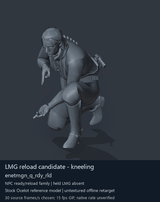
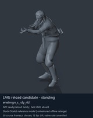

# LMG ready/reload candidates - page 1

[Library](../README.md) · [Grouped directory](../browse/README.md) · [This source family](../browse/lmg-reloads.md) · [Switch mode](browse-lmg-reloads-1-stills.md)

**Animated references** · 2 clips · 3.00 MiB downloaded.

Images reuse existing files. A small display width does not reduce download size. Animated previews use full existing GIFs where no separate thumbnail exists. Open one clip for its larger titled GIF and original technical data.

Source-family grouping uses only recorded virtual directories; it does not establish an action, weapon, actor, rig or native compatibility. Existing descriptions and tags below are unchanged. Per-clip visual review may be pending; chosen preview speed is separate from unmeasured native timing.

| Preview | Animation | Category | Tags | Virtual GANI directory / file | MTAR / container location | Description | Frames / data |
| --- | --- | --- | --- | --- | --- | --- | --- |
|  | [LMG reload candidate - kneeling](../clips/mgsv-tpp-soldier_common-313cdbcc7c1d9.md) <code>enetmgn_q_rdy_rld</code> | LMG ready/reload candidates | <code>enemy soldier</code> <code>light machine gun</code> <code>reload</code> <code>kneeling</code> | <code>/Assets/tpp/motion/SI_game/fani/bodies/enet/enetmgn</code> <code>enetmgn_q_rdy_rld.gani</code> | MTAR: <code>/Assets/tpp/motion/mtar/soldier2/Soldier_common.mtar</code> Outer DAT / FPK origins: historical; see full data | Kneeling light-machine-gun reload motion; the reference holds no weapon. | 337 raw 11.23 s chosen; native rate unknown [Full data](../clips/mgsv-tpp-soldier_common-313cdbcc7c1d9.md#technical-data) |
|  | [LMG reload candidate - standing](../clips/mgsv-tpp-soldier_common-380f6573688d2.md) <code>enetmgn_s_rdy_rld</code> | LMG ready/reload candidates | <code>enemy soldier</code> <code>light machine gun</code> <code>reload</code> <code>standing</code> | <code>/Assets/tpp/motion/SI_game/fani/bodies/enet/enetmgn</code> <code>enetmgn_s_rdy_rld.gani</code> | MTAR: <code>/Assets/tpp/motion/mtar/soldier2/Soldier_common.mtar</code> Outer DAT / FPK origins: historical; see full data | Standing light-machine-gun reload motion; the reference holds no weapon. | 337 raw 11.23 s chosen; native rate unknown [Full data](../clips/mgsv-tpp-soldier_common-380f6573688d2.md#technical-data) |

[Source descriptions, confidence and credits](../description-sources.md) · [Complete JSON](../catalogue.json) · [CSV](../catalogue.csv)
