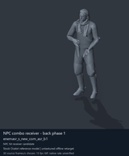
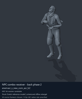
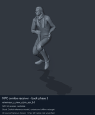
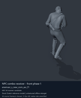

# NPC receiving and reaction candidates - page 1

[Library](../README.md) · [Grouped directory](../browse/README.md) · [This source family](../browse/npc-receivers.md) · [Switch mode](browse-npc-receivers-1-stills.md)

**Animated references** · 4 clips · 1.12 MiB downloaded.

Images reuse existing files. A small display width does not reduce download size. Animated previews use full existing GIFs where no separate thumbnail exists. Open one clip for its larger titled GIF and original technical data.

Source-family grouping uses only recorded virtual directories; it does not establish an action, weapon, actor, rig or native compatibility. Existing descriptions and tags below are unchanged. Per-clip visual review may be pending; chosen preview speed is separate from unmeasured native timing.

| Preview | Animation | Category | Tags | Virtual GANI directory / file | MTAR / container location | Description | Frames / data |
| --- | --- | --- | --- | --- | --- | --- | --- |
|  | [NPC combo receiver - back phase 1](../clips/mgsv-tpp-soldier_common-eb18706e40a.md) <code>enemasr_s_new_com_asr_b1</code> | NPC receiving and reaction candidates | <code>CQC</code> <code>enemy soldier</code> <code>hit reaction</code> <code>combo</code> <code>back</code> <code>phase 1</code> | <code>/Assets/tpp/motion/SI_game/fani/bodies/enem/enemasr</code> <code>enemasr_s_new_com_asr_b1.gani</code> | MTAR: <code>/Assets/tpp/motion/mtar/soldier2/Soldier_common.mtar</code> Outer DAT / FPK origins: historical; see full data | Receiving/hit-reaction movement 1 in the back CQC combo. | 87 raw 2.9 s chosen; native rate unknown [Full data](../clips/mgsv-tpp-soldier_common-eb18706e40a.md#technical-data) |
|  | [NPC combo receiver - back phase 2](../clips/mgsv-tpp-soldier_common-3996cc2687e1f.md) <code>enemasr_s_new_com_asr_b2</code> | NPC receiving and reaction candidates | <code>CQC</code> <code>enemy soldier</code> <code>hit reaction</code> <code>combo</code> <code>back</code> <code>phase 2</code> | <code>/Assets/tpp/motion/SI_game/fani/bodies/enem/enemasr</code> <code>enemasr_s_new_com_asr_b2.gani</code> | MTAR: <code>/Assets/tpp/motion/mtar/soldier2/Soldier_common.mtar</code> Outer DAT / FPK origins: historical; see full data | Receiving/hit-reaction movement 2 in the back CQC combo. | 98 raw 3.27 s chosen; native rate unknown [Full data](../clips/mgsv-tpp-soldier_common-3996cc2687e1f.md#technical-data) |
|  | [NPC combo receiver - back phase 3](../clips/mgsv-tpp-soldier_common-369dec61164bd.md) <code>enemasr_s_new_com_asr_b3</code> | NPC receiving and reaction candidates | <code>CQC</code> <code>enemy soldier</code> <code>hit reaction</code> <code>combo</code> <code>back</code> <code>phase 3</code> | <code>/Assets/tpp/motion/SI_game/fani/bodies/enem/enemasr</code> <code>enemasr_s_new_com_asr_b3.gani</code> | MTAR: <code>/Assets/tpp/motion/mtar/soldier2/Soldier_common.mtar</code> Outer DAT / FPK origins: historical; see full data | Receiving/hit-reaction movement 3 in the back CQC combo. | 120 raw 4.0 s chosen; native rate unknown [Full data](../clips/mgsv-tpp-soldier_common-369dec61164bd.md#technical-data) |
|  | [NPC combo receiver - front phase 1](../clips/mgsv-tpp-soldier_common-2cf6595afc1aa.md) <code>enemasr_s_new_com_asr_f1</code> | NPC receiving and reaction candidates | <code>CQC</code> <code>enemy soldier</code> <code>hit reaction</code> <code>combo</code> <code>front</code> <code>phase 1</code> | <code>/Assets/tpp/motion/SI_game/fani/bodies/enem/enemasr</code> <code>enemasr_s_new_com_asr_f1.gani</code> | MTAR: <code>/Assets/tpp/motion/mtar/soldier2/Soldier_common.mtar</code> Outer DAT / FPK origins: historical; see full data | Receiving/hit-reaction movement 1 in the front CQC combo. | 65 raw 2.17 s chosen; native rate unknown [Full data](../clips/mgsv-tpp-soldier_common-2cf6595afc1aa.md#technical-data) |

[Source descriptions, confidence and credits](../description-sources.md) · [Complete JSON](../catalogue.json) · [CSV](../catalogue.csv)
