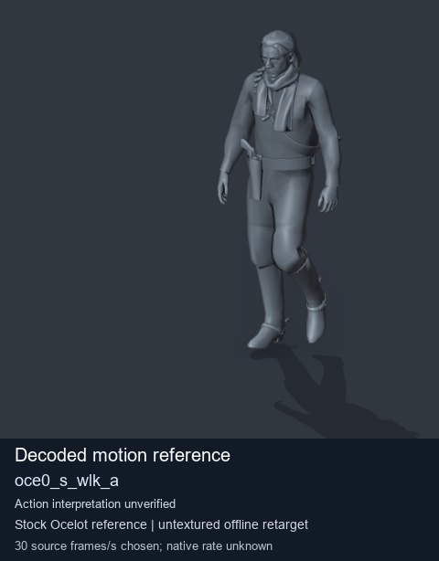
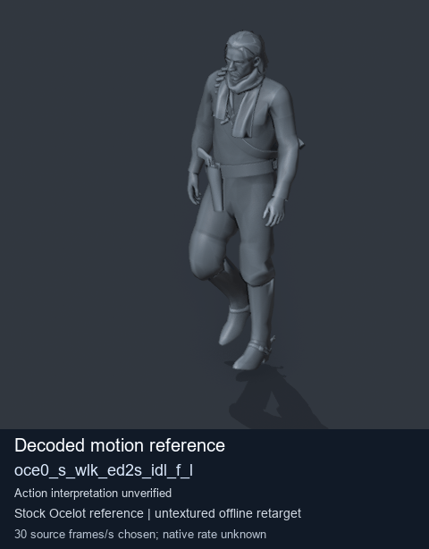
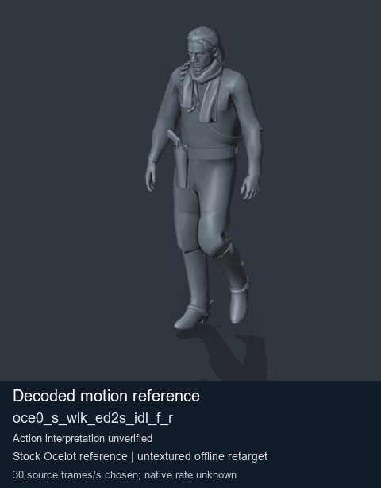
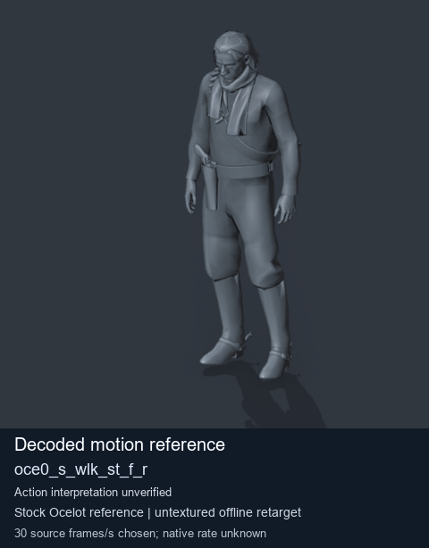

# Ocelot-package locomotion references - page 1

[Library](../README.md) · [Grouped directory](../browse/README.md) · [This source family](../browse/ocelot-locomotion.md) · [Switch mode](browse-ocelot-locomotion-1-stills.md)

**Animated references** · 4 clips · 12.05 MiB downloaded.

Images reuse existing files. A small display width does not reduce download size. Animated previews use full existing GIFs where no separate thumbnail exists. Open one clip for its larger titled GIF and original technical data.

Source-family grouping uses only recorded virtual directories; it does not establish an action, weapon, actor, rig or native compatibility. Existing descriptions and tags below are unchanged. Per-clip visual review may be pending; chosen preview speed is separate from unmeasured native timing.

| Preview | Animation | Category | Tags | Virtual GANI directory / file | MTAR / container location | Description | Frames / data |
| --- | --- | --- | --- | --- | --- | --- | --- |
|  | [Forward walking](../clips/mgsv-tpp-ocelot2_layers-payloadsha256-27a37f57dc2ddbdaac20d0b5db6a0eac6827136555282e420187358674d7362e.md) <code>oce0_s_wlk_a</code> | Ocelot-package locomotion references | <code>walking</code> <code>forward</code> <code>locomotion</code> <code>relaxed arms</code> <code>Ocelot package</code> | <code>/Assets/tpp/motion/SI_game/fani/bodies/oce0/oce0</code> <code>oce0_s_wlk_a.gani</code> | MTAR: <code>/Assets/tpp/motion/mtar/ocelot2/Ocelot2_layers.mtar</code> Outer DAT / FPK origins: historical; see full data | Walks forward with relaxed arms; root motion retained. | 96 raw 3.2 s chosen; native rate unknown [Full data](../clips/mgsv-tpp-ocelot2_layers-payloadsha256-27a37f57dc2ddbdaac20d0b5db6a0eac6827136555282e420187358674d7362e.md#technical-data) |
|  | [Walk-to-idle transition (left variant)](../clips/mgsv-tpp-ocelot2_layers-payloadsha256-2cf45c6fc1c77616e0c30f9b17abbe8a979557fa7a4cbf5314d96b00018e9dce.md) <code>oce0_s_wlk_ed2s_idl_f_l</code> | Ocelot-package locomotion references | <code>walking</code> <code>walk to idle</code> <code>left variant</code> <code>locomotion</code> <code>Ocelot package</code> | <code>/Assets/tpp/motion/SI_game/fani/bodies/oce0/oce0</code> <code>oce0_s_wlk_ed2s_idl_f_l.gani</code> | MTAR: <code>/Assets/tpp/motion/mtar/ocelot2/Ocelot2_layers.mtar</code> Outer DAT / FPK origins: historical; see full data | Walk-to-idle transition (left variant). | 100 raw 3.33 s chosen; native rate unknown [Full data](../clips/mgsv-tpp-ocelot2_layers-payloadsha256-2cf45c6fc1c77616e0c30f9b17abbe8a979557fa7a4cbf5314d96b00018e9dce.md#technical-data) |
|  | [Walk-to-idle transition (right variant)](../clips/mgsv-tpp-ocelot2_layers-payloadsha256-7dd141331aa8cc98e51d1cbf561f08594171903c7bad66e0cc17ec3523ff4290.md) <code>oce0_s_wlk_ed2s_idl_f_r</code> | Ocelot-package locomotion references | <code>walking</code> <code>walk to idle</code> <code>right variant</code> <code>locomotion</code> <code>Ocelot package</code> | <code>/Assets/tpp/motion/SI_game/fani/bodies/oce0/oce0</code> <code>oce0_s_wlk_ed2s_idl_f_r.gani</code> | MTAR: <code>/Assets/tpp/motion/mtar/ocelot2/Ocelot2_layers.mtar</code> Outer DAT / FPK origins: historical; see full data | Walk-to-idle transition (right variant). | 100 raw 3.33 s chosen; native rate unknown [Full data](../clips/mgsv-tpp-ocelot2_layers-payloadsha256-7dd141331aa8cc98e51d1cbf561f08594171903c7bad66e0cc17ec3523ff4290.md#technical-data) |
|  | [Starts walking forward](../clips/mgsv-tpp-ocelot2_layers-payloadsha256-e5e1e88d787f3f134ab51a7b3b8c1aa445ad8950a04d91c7ee6ec7acae274d52.md) <code>oce0_s_wlk_st_f_r</code> | Ocelot-package locomotion references | <code>walking</code> <code>start</code> <code>forward</code> <code>locomotion</code> <code>Ocelot package</code> | <code>/Assets/tpp/motion/SI_game/fani/bodies/oce0/oce0</code> <code>oce0_s_wlk_st_f_r.gani</code> | MTAR: <code>/Assets/tpp/motion/mtar/ocelot2/Ocelot2_layers.mtar</code> Outer DAT / FPK origins: historical; see full data | Starts walking forward. | 103 raw 3.43 s chosen; native rate unknown [Full data](../clips/mgsv-tpp-ocelot2_layers-payloadsha256-e5e1e88d787f3f134ab51a7b3b8c1aa445ad8950a04d91c7ee6ec7acae274d52.md#technical-data) |

[Source descriptions, confidence and credits](../description-sources.md) · [Complete JSON](../catalogue.json) · [CSV](../catalogue.csv)
