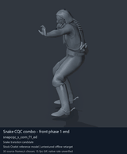
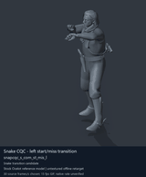
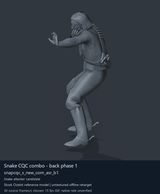
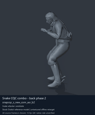

# Snake CQC combo and transition candidates - page 1

[Library](../README.md) · [Grouped directory](../browse/README.md) · [This source family](../browse/snake-cqc.md) · [Switch mode](browse-snake-cqc-1-stills.md)

**Animated references** · 4 clips · 0.83 MiB downloaded.

Images reuse existing files. A small display width does not reduce download size. Animated previews use full existing GIFs where no separate thumbnail exists. Open one clip for its larger titled GIF and original technical data.

Source-family grouping uses only recorded virtual directories; it does not establish an action, weapon, actor, rig or native compatibility. Existing descriptions and tags below are unchanged. Per-clip visual review may be pending; chosen preview speed is separate from unmeasured native timing.

| Preview | Animation | Category | Tags | Virtual GANI directory / file | MTAR / container location | Description | Frames / data |
| --- | --- | --- | --- | --- | --- | --- | --- |
|  | [Snake CQC combo - front phase 1 end](../clips/mgsv-tpp-player2_cqc-16b0a2fb40a09.md) <code>snapcqc_s_com_f1_ed</code> | Snake CQC combo and transition candidates | <code>CQC</code> <code>Snake</code> <code>player</code> <code>combo</code> <code>transition</code> <code>ending</code> | <code>/Assets/tpp/motion/SI_game/fani/bodies/snap/snapcqc</code> <code>snapcqc_s_com_f1_ed.gani</code> | MTAR: <code>/Assets/tpp/motion/mtar/player2/player2_cqc.mtar</code> Outer DAT / FPK origins: historical; see full data | Short ending movement for the first front CQC combo segment. | 30 raw 1.0 s chosen; native rate unknown [Full data](../clips/mgsv-tpp-player2_cqc-16b0a2fb40a09.md#technical-data) |
|  | [Snake CQC - left start/miss transition](../clips/mgsv-tpp-player2_cqc-e831dda3d332.md) <code>snapcqc_s_com_st_mis_l</code> | Snake CQC combo and transition candidates | <code>CQC</code> <code>Snake</code> <code>player</code> <code>combo</code> <code>transition</code> | <code>/Assets/tpp/motion/SI_game/fani/bodies/snap/snapcqc</code> <code>snapcqc_s_com_st_mis_l.gani</code> | MTAR: <code>/Assets/tpp/motion/mtar/player2/player2_cqc.mtar</code> Outer DAT / FPK origins: historical; see full data | Leftward start/miss transition for a CQC attack. | 75 raw 2.5 s chosen; native rate unknown [Full data](../clips/mgsv-tpp-player2_cqc-e831dda3d332.md#technical-data) |
|  | [Snake CQC combo - back phase 1](../clips/mgsv-tpp-player2_resident-36c8fbcb8b28a.md) <code>snapcqc_s_new_com_asr_b1</code> | Snake CQC combo and transition candidates | <code>CQC</code> <code>Snake</code> <code>player</code> <code>combo</code> <code>back</code> <code>phase 1</code> | <code>/Assets/tpp/motion/SI_game/fani/bodies/snap/snapcqc</code> <code>snapcqc_s_new_com_asr_b1.gani</code> | MTAR: <code>/Assets/tpp/motion/mtar/player2/player2_resident.mtar</code> Outer DAT / FPK origins: historical; see full data | Attack segment 1 of Snake&#x27;s back CQC combo. | 60 raw 2.0 s chosen; native rate unknown [Full data](../clips/mgsv-tpp-player2_resident-36c8fbcb8b28a.md#technical-data) |
|  | [Snake CQC combo - back phase 2](../clips/mgsv-tpp-player2_cqc-2a144c68bf5f2.md) <code>snapcqc_s_new_com_asr_b2</code> | Snake CQC combo and transition candidates | <code>CQC</code> <code>Snake</code> <code>player</code> <code>combo</code> <code>back</code> <code>phase 2</code> | <code>/Assets/tpp/motion/SI_game/fani/bodies/snap/snapcqc</code> <code>snapcqc_s_new_com_asr_b2.gani</code> | MTAR: <code>/Assets/tpp/motion/mtar/player2/player2_cqc.mtar</code> Outer DAT / FPK origins: historical; see full data | Attack segment 2 of Snake&#x27;s back CQC combo. | 85 raw 2.83 s chosen; native rate unknown [Full data](../clips/mgsv-tpp-player2_cqc-2a144c68bf5f2.md#technical-data) |

[Source descriptions, confidence and credits](../description-sources.md) · [Complete JSON](../catalogue.json) · [CSV](../catalogue.csv)
