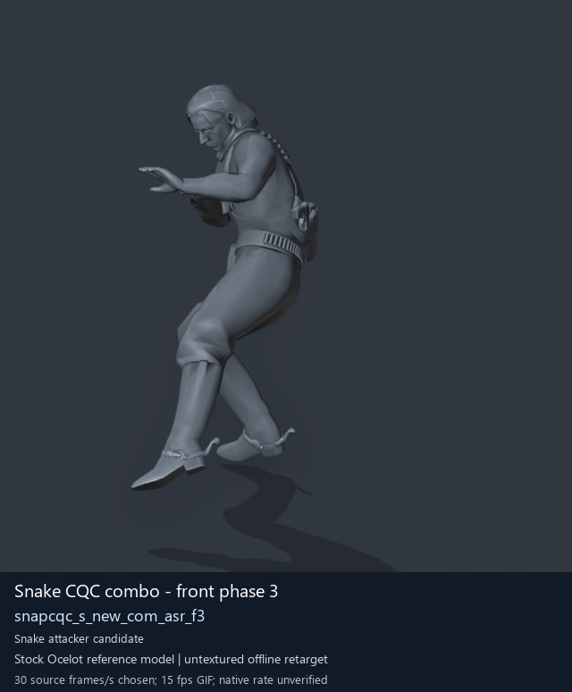
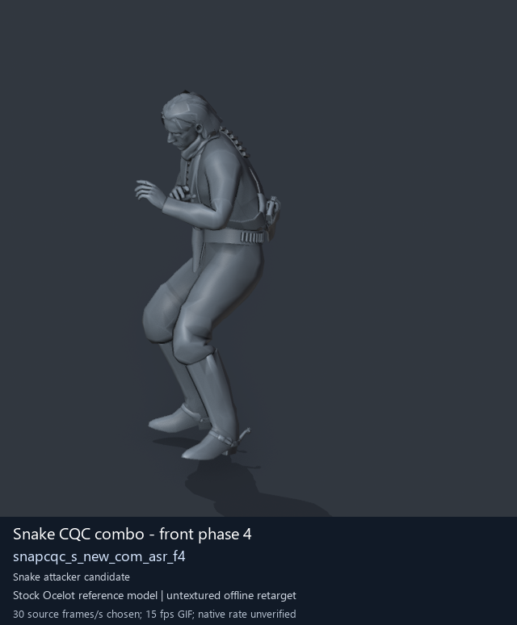
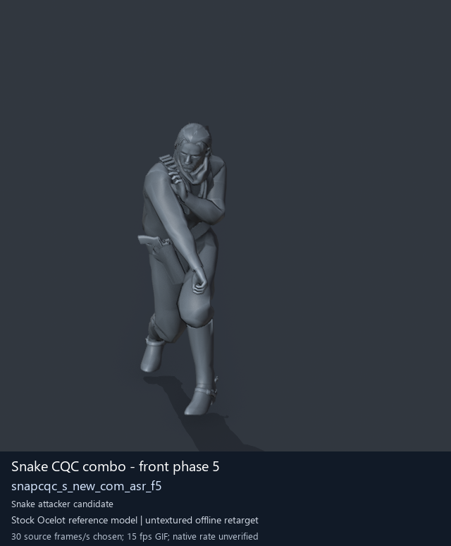

# Snake CQC combo and transition candidates - page 3

[Library](../README.md) · [Grouped directory](../browse/README.md) · [This source family](../browse/snake-cqc.md) · [Switch mode](browse-snake-cqc-3.md)

**Still images: no GIFs loaded** · 3 clips · 0.33 MiB downloaded.

Images reuse existing files. A small display width does not reduce download size. Open one clip for its larger titled GIF and original technical data.

Source-family grouping uses only recorded virtual directories; it does not establish an action, weapon, actor, rig or native compatibility. Existing descriptions and tags below are unchanged. Per-clip visual review may be pending; chosen preview speed is separate from unmeasured native timing.

| Preview | Animation | Category | Tags | Virtual GANI directory / file | MTAR / container location | Description | Frames / data |
| --- | --- | --- | --- | --- | --- | --- | --- |
|  | [Snake CQC combo - front phase 3](../clips/mgsv-tpp-player2_cqc-138b1932095af.md) <code>snapcqc_s_new_com_asr_f3</code> | Snake CQC combo and transition candidates | <code>CQC</code> <code>Snake</code> <code>player</code> <code>combo</code> <code>front</code> <code>phase 3</code> | <code>/Assets/tpp/motion/SI_game/fani/bodies/snap/snapcqc</code> <code>snapcqc_s_new_com_asr_f3.gani</code> | MTAR: <code>/Assets/tpp/motion/mtar/player2/player2_cqc.mtar</code> Outer DAT / FPK origins: historical; see full data | Attack segment 3 of Snake&#x27;s front CQC combo. | 83 raw 2.77 s chosen; native rate unknown [Full data](../clips/mgsv-tpp-player2_cqc-138b1932095af.md#technical-data) |
|  | [Snake CQC combo - front phase 4](../clips/mgsv-tpp-player2_cqc-2471f88c4999c.md) <code>snapcqc_s_new_com_asr_f4</code> | Snake CQC combo and transition candidates | <code>CQC</code> <code>Snake</code> <code>player</code> <code>combo</code> <code>front</code> <code>phase 4</code> | <code>/Assets/tpp/motion/SI_game/fani/bodies/snap/snapcqc</code> <code>snapcqc_s_new_com_asr_f4.gani</code> | MTAR: <code>/Assets/tpp/motion/mtar/player2/player2_cqc.mtar</code> Outer DAT / FPK origins: historical; see full data | Attack segment 4 of Snake&#x27;s front CQC combo. | 85 raw 2.83 s chosen; native rate unknown [Full data](../clips/mgsv-tpp-player2_cqc-2471f88c4999c.md#technical-data) |
|  | [Snake CQC combo - front phase 5](../clips/mgsv-tpp-player2_resident-1a1c4551b3706.md) <code>snapcqc_s_new_com_asr_f5</code> | Snake CQC combo and transition candidates | <code>CQC</code> <code>Snake</code> <code>player</code> <code>combo</code> <code>front</code> <code>phase 5</code> | <code>/Assets/tpp/motion/SI_game/fani/bodies/snap/snapcqc</code> <code>snapcqc_s_new_com_asr_f5.gani</code> | MTAR: <code>/Assets/tpp/motion/mtar/player2/player2_resident.mtar</code> Outer DAT / FPK origins: historical; see full data | Attack segment 5 of Snake&#x27;s front CQC combo. | 105 raw 3.5 s chosen; native rate unknown [Full data](../clips/mgsv-tpp-player2_resident-1a1c4551b3706.md#technical-data) |

[Source descriptions, confidence and credits](../description-sources.md) · [Complete JSON](../catalogue.json) · [CSV](../catalogue.csv)
