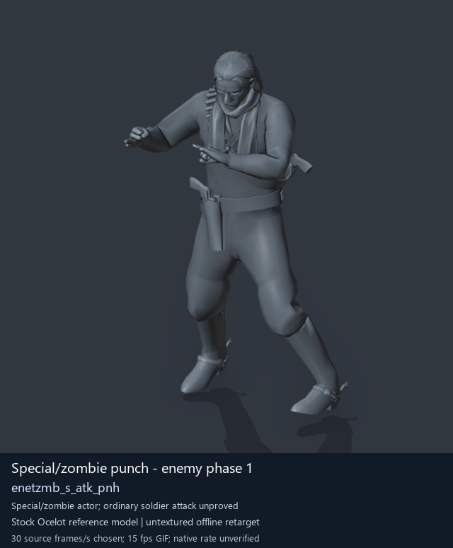
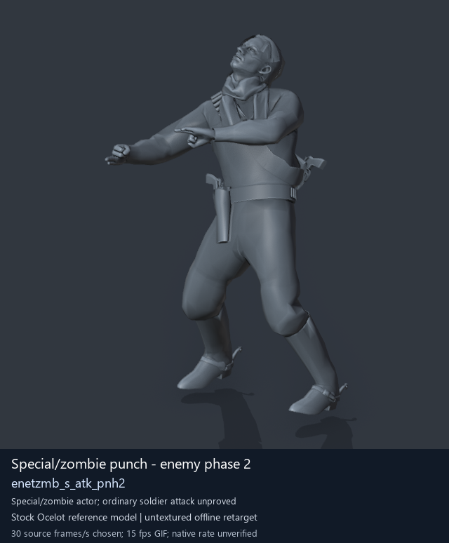
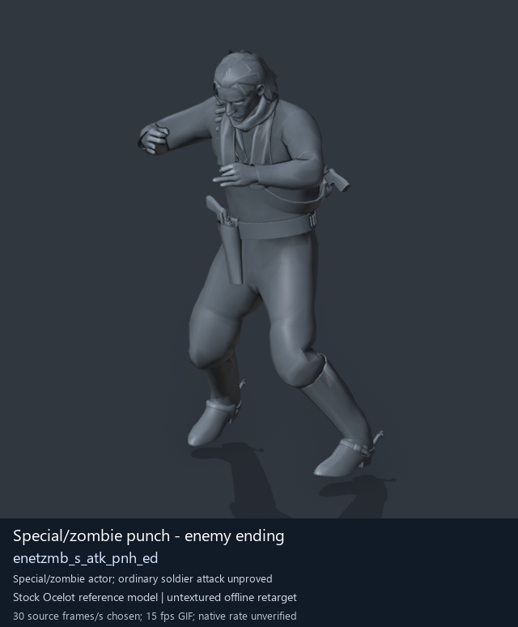
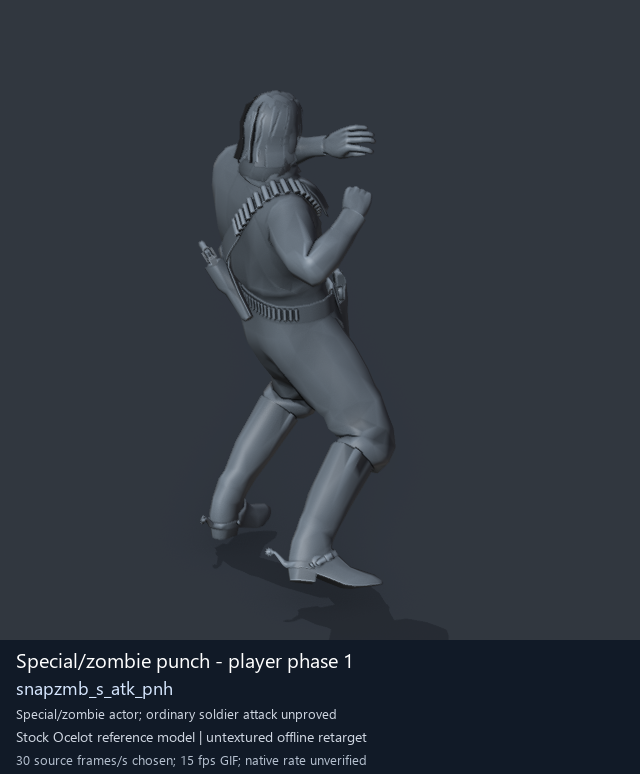

# Special / zombie actor candidates - page 1

[Library](../README.md) · [Grouped directory](../browse/README.md) · [This source family](../browse/special-actors.md) · [Switch mode](browse-special-actors-1.md)

**Still images: no GIFs loaded** · 4 clips · 0.55 MiB downloaded.

Images reuse existing files. A small display width does not reduce download size. Open one clip for its larger titled GIF and original technical data.

Source-family grouping uses only recorded virtual directories; it does not establish an action, weapon, actor, rig or native compatibility. Existing descriptions and tags below are unchanged. Per-clip visual review may be pending; chosen preview speed is separate from unmeasured native timing.

| Preview | Animation | Category | Tags | Virtual GANI directory / file | MTAR / container location | Description | Frames / data |
| --- | --- | --- | --- | --- | --- | --- | --- |
|  | [Special/zombie punch - enemy phase 1](../clips/mgsv-tpp-soldier_common-17e48d5c5ad12.md) <code>enetzmb_s_atk_pnh</code> | Special / zombie actor candidates | <code>zombie motion</code> <code>punch</code> <code>melee</code> <code>enemy</code> | <code>/Assets/tpp/motion/SI_game/fani/bodies/enet/enetzmb</code> <code>enetzmb_s_atk_pnh.gani</code> | MTAR: <code>/Assets/tpp/motion/mtar/soldier2/Soldier_common.mtar</code> Outer DAT / FPK origins: historical; see full data | A punch from the enemy zombie-motion set. | 60 raw 2.0 s chosen; native rate unknown [Full data](../clips/mgsv-tpp-soldier_common-17e48d5c5ad12.md#technical-data) |
|  | [Special/zombie punch - enemy phase 2](../clips/mgsv-tpp-soldier_common-244c2b65d1149.md) <code>enetzmb_s_atk_pnh2</code> | Special / zombie actor candidates | <code>zombie motion</code> <code>punch</code> <code>melee</code> <code>enemy</code> | <code>/Assets/tpp/motion/SI_game/fani/bodies/enet/enetzmb</code> <code>enetzmb_s_atk_pnh2.gani</code> | MTAR: <code>/Assets/tpp/motion/mtar/soldier2/Soldier_common.mtar</code> Outer DAT / FPK origins: historical; see full data | The second punch movement in the enemy zombie-motion set. | 43 raw 1.43 s chosen; native rate unknown [Full data](../clips/mgsv-tpp-soldier_common-244c2b65d1149.md#technical-data) |
|  | [Special/zombie punch - enemy ending](../clips/mgsv-tpp-soldier_common-3f61b4434967.md) <code>enetzmb_s_atk_pnh_ed</code> | Special / zombie actor candidates | <code>zombie motion</code> <code>punch</code> <code>melee</code> <code>enemy</code> <code>ending</code> | <code>/Assets/tpp/motion/SI_game/fani/bodies/enet/enetzmb</code> <code>enetzmb_s_atk_pnh_ed.gani</code> | MTAR: <code>/Assets/tpp/motion/mtar/soldier2/Soldier_common.mtar</code> Outer DAT / FPK origins: historical; see full data | Ending movement after the enemy zombie-style punch. | 15 raw 0.5 s chosen; native rate unknown [Full data](../clips/mgsv-tpp-soldier_common-3f61b4434967.md#technical-data) |
|  | [Special/zombie punch - player phase 1](../clips/mgsv-tpp-player2_resident-18dfe32fab367.md) <code>snapzmb_s_atk_pnh</code> | Special / zombie actor candidates | <code>zombie motion</code> <code>punch</code> <code>melee</code> <code>player</code> | <code>/Assets/tpp/motion/SI_game/fani/bodies/snap/snapzmb</code> <code>snapzmb_s_atk_pnh.gani</code> | MTAR: <code>/Assets/tpp/motion/mtar/player2/player2_resident.mtar</code> Outer DAT / FPK origins: historical; see full data | A punch from the player zombie-motion set. | 60 raw 2.0 s chosen; native rate unknown [Full data](../clips/mgsv-tpp-player2_resident-18dfe32fab367.md#technical-data) |

[Source descriptions, confidence and credits](../description-sources.md) · [Complete JSON](../catalogue.json) · [CSV](../catalogue.csv)
