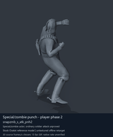
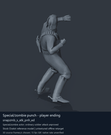

# Special / zombie actor candidates - page 2

[Library](../README.md) · [Grouped directory](../browse/README.md) · [This source family](../browse/special-actors.md) · [Switch mode](browse-special-actors-2-stills.md)

**Animated references** · 2 clips · 0.22 MiB downloaded.

Images reuse existing files. A small display width does not reduce download size. Animated previews use full existing GIFs where no separate thumbnail exists. Open one clip for its larger titled GIF and original technical data.

Source-family grouping uses only recorded virtual directories; it does not establish an action, weapon, actor, rig or native compatibility. Existing descriptions and tags below are unchanged. Per-clip visual review may be pending; chosen preview speed is separate from unmeasured native timing.

| Preview | Animation | Category | Tags | Virtual GANI directory / file | MTAR / container location | Description | Frames / data |
| --- | --- | --- | --- | --- | --- | --- | --- |
|  | [Special/zombie punch - player phase 2](../clips/mgsv-tpp-player2_resident-29553c4699ca8.md) <code>snapzmb_s_atk_pnh2</code> | Special / zombie actor candidates | <code>zombie motion</code> <code>punch</code> <code>melee</code> <code>player</code> | <code>/Assets/tpp/motion/SI_game/fani/bodies/snap/snapzmb</code> <code>snapzmb_s_atk_pnh2.gani</code> | MTAR: <code>/Assets/tpp/motion/mtar/player2/player2_resident.mtar</code> Outer DAT / FPK origins: historical; see full data | The second punch movement in the player zombie-motion set. | 43 raw 1.43 s chosen; native rate unknown [Full data](../clips/mgsv-tpp-player2_resident-29553c4699ca8.md#technical-data) |
|  | [Special/zombie punch - player ending](../clips/mgsv-tpp-player2_resident-34ff0e1541984.md) <code>snapzmb_s_atk_pnh_ed</code> | Special / zombie actor candidates | <code>zombie motion</code> <code>punch</code> <code>melee</code> <code>player</code> <code>ending</code> | <code>/Assets/tpp/motion/SI_game/fani/bodies/snap/snapzmb</code> <code>snapzmb_s_atk_pnh_ed.gani</code> | MTAR: <code>/Assets/tpp/motion/mtar/player2/player2_resident.mtar</code> Outer DAT / FPK origins: historical; see full data | Ending movement after the player zombie-style punch. | 15 raw 0.5 s chosen; native rate unknown [Full data](../clips/mgsv-tpp-player2_resident-34ff0e1541984.md#technical-data) |

[Source descriptions, confidence and credits](../description-sources.md) · [Complete JSON](../catalogue.json) · [CSV](../catalogue.csv)
