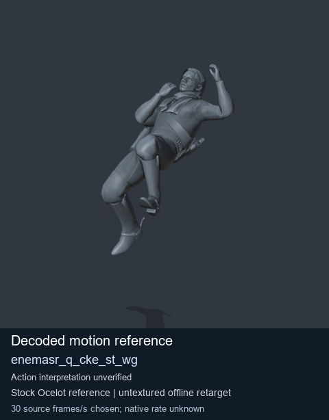
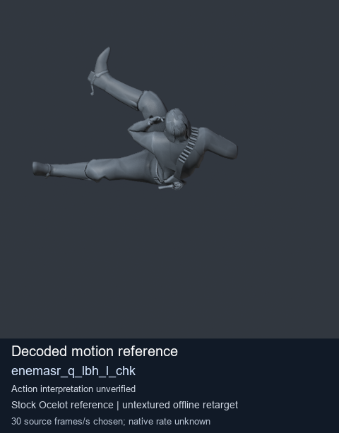
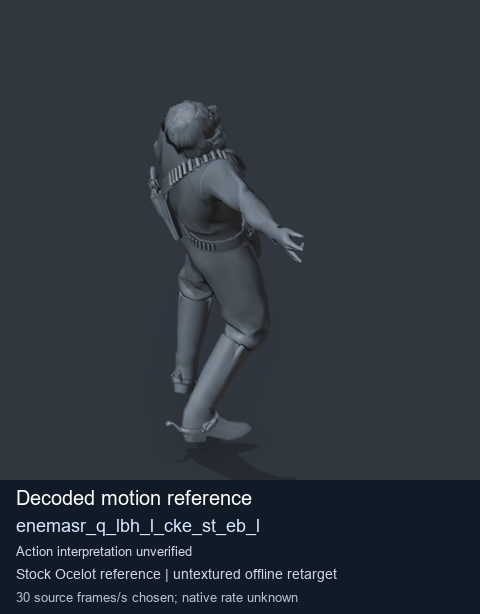
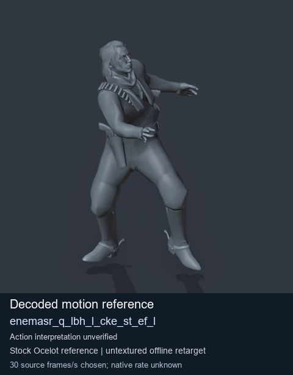

# Stock Soldier_common motion references / /Assets/tpp/motion/SI_game/fani/bodies/enem/enemasr - page 10

[Library](../README.md) · [Grouped directory](../browse/README.md) · [This source family](../browse/stock-soldier-enemasr-9a765a73.md) · [Switch mode](browse-stock-soldier-enemasr-9a765a73-10.md)

**Still images: no GIFs loaded** · 4 clips · 0.31 MiB downloaded.

Images reuse existing files. A small display width does not reduce download size. Open one clip for its larger titled GIF and original technical data.

Source-family grouping uses only recorded virtual directories; it does not establish an action, weapon, actor, rig or native compatibility. Existing descriptions and tags below are unchanged. Per-clip visual review may be pending; chosen preview speed is separate from unmeasured native timing.

| Preview | Animation | Category | Tags | Virtual GANI directory / file | MTAR / container location | Description | Frames / data |
| --- | --- | --- | --- | --- | --- | --- | --- |
|  | [Stock motion reference: enemasr_q_cke_st_wg](../clips/mgsv-tpp-soldier_common-payloadsha256-c364d4b3a1de5c160e71377041a8288e3829cc2b757810bdadc37f6b48491981.md) <code>enemasr_q_cke_st_wg</code> | Stock Soldier_common motion references | <code>stock body motion</code> <code>Soldier_common</code> <code>source-derived label</code> <code>Ocelot reference mesh</code> | <code>/Assets/tpp/motion/SI_game/fani/bodies/enem/enemasr</code> <code>enemasr_q_cke_st_wg.gani</code> | Retained MTAR: <code>Soldier_common.mtar</code> DAT / FPK membership unverified | Decoded stock body-motion reference enemasr_q_cke_st_wg; action interpretation unverified. | 95 raw 3.17 s chosen; native rate unknown [Full data](../clips/mgsv-tpp-soldier_common-payloadsha256-c364d4b3a1de5c160e71377041a8288e3829cc2b757810bdadc37f6b48491981.md#technical-data) |
|  | [Stock reference: enemasr_q_lbh_l_chk](../clips/mgsv-tpp-soldier_common-payloadsha256-99b5f9354ffed3f192cc1446e1ff0b5018cab20904c50271b123ea6c07644127.md) <code>enemasr_q_lbh_l_chk</code> | Stock Soldier_common motion references | <code>stock animation reference</code> <code>Soldier_common</code> <code>source-derived label</code> <code>Ocelot reference mesh</code> | <code>/Assets/tpp/motion/SI_game/fani/bodies/enem/enemasr</code> <code>enemasr_q_lbh_l_chk.gani</code> | Retained MTAR: <code>Soldier_common.mtar</code> DAT / FPK membership unverified | Decoded stock reference enemasr_q_lbh_l_chk; action interpretation unverified. | 80 raw 2.67 s chosen; native rate unknown [Full data](../clips/mgsv-tpp-soldier_common-payloadsha256-99b5f9354ffed3f192cc1446e1ff0b5018cab20904c50271b123ea6c07644127.md#technical-data) |
|  | [Stock motion reference: enemasr_q_lbh_l_cke_st_eb_l](../clips/mgsv-tpp-soldier_common-payloadsha256-e1ab62c70e502e0fa0c36b6e756e895718a760ea1eac1f3d4390cad8cf015440.md) <code>enemasr_q_lbh_l_cke_st_eb_l</code> | Stock Soldier_common motion references | <code>stock body motion</code> <code>Soldier_common</code> <code>source-derived label</code> <code>Ocelot reference mesh</code> | <code>/Assets/tpp/motion/SI_game/fani/bodies/enem/enemasr</code> <code>enemasr_q_lbh_l_cke_st_eb_l.gani</code> | Retained MTAR: <code>Soldier_common.mtar</code> DAT / FPK membership unverified | Decoded stock body-motion reference enemasr_q_lbh_l_cke_st_eb_l; action interpretation unverified. | 49 raw 1.63 s chosen; native rate unknown [Full data](../clips/mgsv-tpp-soldier_common-payloadsha256-e1ab62c70e502e0fa0c36b6e756e895718a760ea1eac1f3d4390cad8cf015440.md#technical-data) |
|  | [Stock reference: enemasr_q_lbh_l_cke_st_ef_l](../clips/mgsv-tpp-soldier_common-payloadsha256-b64bd902ac99a894419c689ce905817ed8bca5e4426dccd24115cd3b725049f1.md) <code>enemasr_q_lbh_l_cke_st_ef_l</code> | Stock Soldier_common motion references | <code>stock animation reference</code> <code>Soldier_common</code> <code>source-derived label</code> <code>Ocelot reference mesh</code> | <code>/Assets/tpp/motion/SI_game/fani/bodies/enem/enemasr</code> <code>enemasr_q_lbh_l_cke_st_ef_l.gani</code> | Retained MTAR: <code>Soldier_common.mtar</code> DAT / FPK membership unverified | Decoded stock reference enemasr_q_lbh_l_cke_st_ef_l; action interpretation unverified. | 49 raw 1.63 s chosen; native rate unknown [Full data](../clips/mgsv-tpp-soldier_common-payloadsha256-b64bd902ac99a894419c689ce905817ed8bca5e4426dccd24115cd3b725049f1.md#technical-data) |

[Source descriptions, confidence and credits](../description-sources.md) · [Complete JSON](../catalogue.json) · [CSV](../catalogue.csv)
