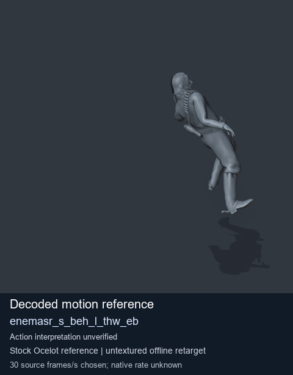
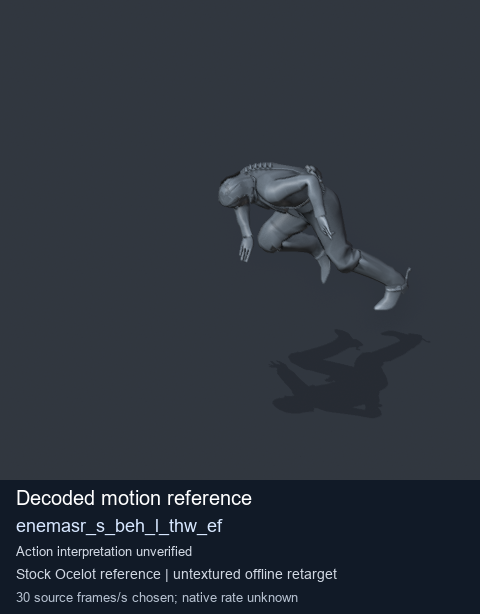
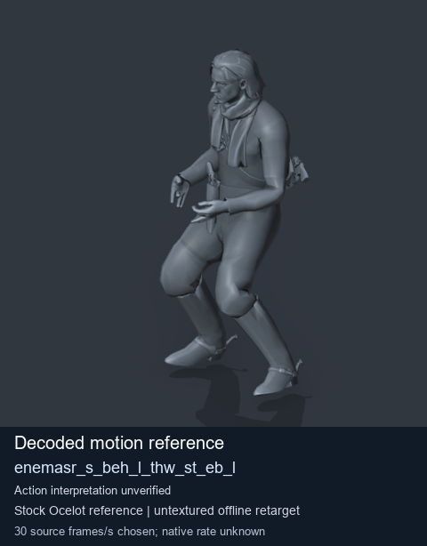
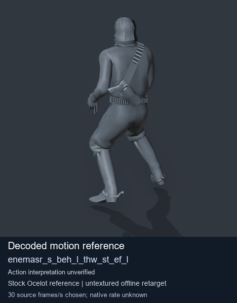

# Stock Soldier_common motion references / /Assets/tpp/motion/SI_game/fani/bodies/enem/enemasr - page 13

[Library](../README.md) · [Grouped directory](../browse/README.md) · [This source family](../browse/stock-soldier-enemasr-9a765a73.md) · [Switch mode](browse-stock-soldier-enemasr-9a765a73-13.md)

**Still images: no GIFs loaded** · 4 clips · 0.32 MiB downloaded.

Images reuse existing files. A small display width does not reduce download size. Open one clip for its larger titled GIF and original technical data.

Source-family grouping uses only recorded virtual directories; it does not establish an action, weapon, actor, rig or native compatibility. Existing descriptions and tags below are unchanged. Per-clip visual review may be pending; chosen preview speed is separate from unmeasured native timing.

| Preview | Animation | Category | Tags | Virtual GANI directory / file | MTAR / container location | Description | Frames / data |
| --- | --- | --- | --- | --- | --- | --- | --- |
|  | [Stock motion reference: enemasr_s_beh_l_thw_eb](../clips/mgsv-tpp-soldier_common-payloadsha256-093e20d5b3bfebde7f6bf9b034fea97e074bb5259186f56f32fe3d6fa8592c0d.md) <code>enemasr_s_beh_l_thw_eb</code> | Stock Soldier_common motion references | <code>stock body motion</code> <code>Soldier_common</code> <code>source-derived label</code> <code>Ocelot reference mesh</code> | <code>/Assets/tpp/motion/SI_game/fani/bodies/enem/enemasr</code> <code>enemasr_s_beh_l_thw_eb.gani</code> | Retained MTAR: <code>Soldier_common.mtar</code> DAT / FPK membership unverified | Decoded stock body-motion reference enemasr_s_beh_l_thw_eb; action interpretation unverified. | 130 raw 4.33 s chosen; native rate unknown [Full data](../clips/mgsv-tpp-soldier_common-payloadsha256-093e20d5b3bfebde7f6bf9b034fea97e074bb5259186f56f32fe3d6fa8592c0d.md#technical-data) |
|  | [Stock reference: enemasr_s_beh_l_thw_ef](../clips/mgsv-tpp-soldier_common-payloadsha256-5791d16b285cb7af21e6a613162f63b0a82a180601e7c940af88bad44fc235cf.md) <code>enemasr_s_beh_l_thw_ef</code> | Stock Soldier_common motion references | <code>stock animation reference</code> <code>Soldier_common</code> <code>source-derived label</code> <code>Ocelot reference mesh</code> | <code>/Assets/tpp/motion/SI_game/fani/bodies/enem/enemasr</code> <code>enemasr_s_beh_l_thw_ef.gani</code> | Retained MTAR: <code>Soldier_common.mtar</code> DAT / FPK membership unverified | Decoded stock reference enemasr_s_beh_l_thw_ef; action interpretation unverified. | 100 raw 3.33 s chosen; native rate unknown [Full data](../clips/mgsv-tpp-soldier_common-payloadsha256-5791d16b285cb7af21e6a613162f63b0a82a180601e7c940af88bad44fc235cf.md#technical-data) |
|  | [Stock reference: enemasr_s_beh_l_thw_st_eb_l](../clips/mgsv-tpp-soldier_common-payloadsha256-d51966fe87f2d7832404cbf3393d526bfe398b7150ab127a9538d2fba321d1d9.md) <code>enemasr_s_beh_l_thw_st_eb_l</code> | Stock Soldier_common motion references | <code>stock animation reference</code> <code>Soldier_common</code> <code>source-derived label</code> <code>Ocelot reference mesh</code> | <code>/Assets/tpp/motion/SI_game/fani/bodies/enem/enemasr</code> <code>enemasr_s_beh_l_thw_st_eb_l.gani</code> | Retained MTAR: <code>Soldier_common.mtar</code> DAT / FPK membership unverified | Decoded stock reference enemasr_s_beh_l_thw_st_eb_l; action interpretation unverified. | 23 raw 0.77 s chosen; native rate unknown [Full data](../clips/mgsv-tpp-soldier_common-payloadsha256-d51966fe87f2d7832404cbf3393d526bfe398b7150ab127a9538d2fba321d1d9.md#technical-data) |
|  | [Stock reference: enemasr_s_beh_l_thw_st_ef_l](../clips/mgsv-tpp-soldier_common-payloadsha256-802f133cb7eb5495031193e850e5d881a50f474772ead77cbd491f243d74a511.md) <code>enemasr_s_beh_l_thw_st_ef_l</code> | Stock Soldier_common motion references | <code>stock animation reference</code> <code>Soldier_common</code> <code>source-derived label</code> <code>Ocelot reference mesh</code> | <code>/Assets/tpp/motion/SI_game/fani/bodies/enem/enemasr</code> <code>enemasr_s_beh_l_thw_st_ef_l.gani</code> | Retained MTAR: <code>Soldier_common.mtar</code> DAT / FPK membership unverified | Decoded stock reference enemasr_s_beh_l_thw_st_ef_l; action interpretation unverified. | 20 raw 0.67 s chosen; native rate unknown [Full data](../clips/mgsv-tpp-soldier_common-payloadsha256-802f133cb7eb5495031193e850e5d881a50f474772ead77cbd491f243d74a511.md#technical-data) |

[Source descriptions, confidence and credits](../description-sources.md) · [Complete JSON](../catalogue.json) · [CSV](../catalogue.csv)
