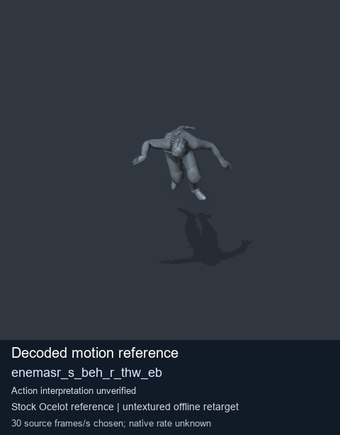
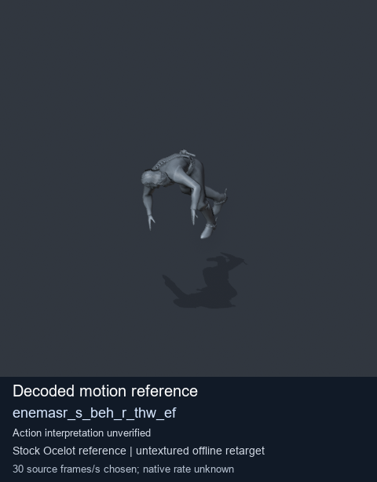
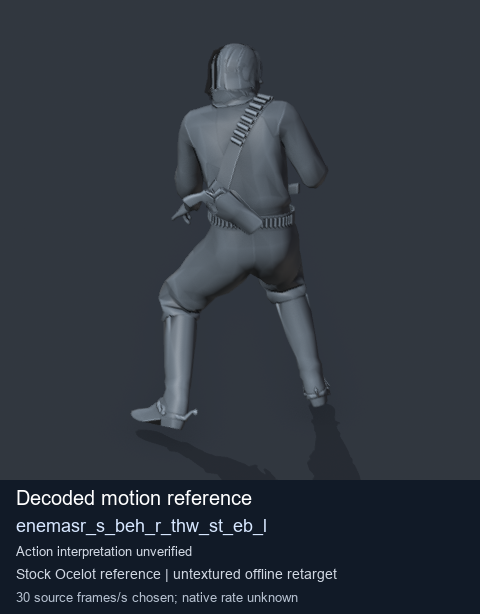
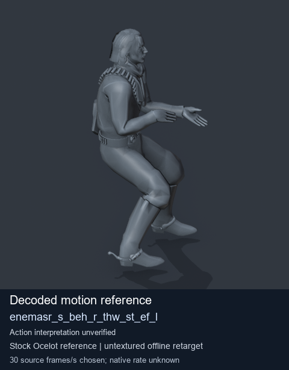

# Stock Soldier_common motion references / /Assets/tpp/motion/SI_game/fani/bodies/enem/enemasr - page 15

[Library](../README.md) · [Grouped directory](../browse/README.md) · [This source family](../browse/stock-soldier-enemasr-9a765a73.md) · [Switch mode](browse-stock-soldier-enemasr-9a765a73-15.md)

**Still images: no GIFs loaded** · 4 clips · 0.31 MiB downloaded.

Images reuse existing files. A small display width does not reduce download size. Open one clip for its larger titled GIF and original technical data.

Source-family grouping uses only recorded virtual directories; it does not establish an action, weapon, actor, rig or native compatibility. Existing descriptions and tags below are unchanged. Per-clip visual review may be pending; chosen preview speed is separate from unmeasured native timing.

| Preview | Animation | Category | Tags | Virtual GANI directory / file | MTAR / container location | Description | Frames / data |
| --- | --- | --- | --- | --- | --- | --- | --- |
|  | [Stock motion reference: enemasr_s_beh_r_thw_eb](../clips/mgsv-tpp-soldier_common-payloadsha256-deb43f47f39fe0fb14bc7bb4c96edb66e3410d352994f982ce629d8db0c65193.md) <code>enemasr_s_beh_r_thw_eb</code> | Stock Soldier_common motion references | <code>stock body motion</code> <code>Soldier_common</code> <code>source-derived label</code> <code>Ocelot reference mesh</code> | <code>/Assets/tpp/motion/SI_game/fani/bodies/enem/enemasr</code> <code>enemasr_s_beh_r_thw_eb.gani</code> | Retained MTAR: <code>Soldier_common.mtar</code> DAT / FPK membership unverified | Decoded stock body-motion reference enemasr_s_beh_r_thw_eb; action interpretation unverified. | 112 raw 3.73 s chosen; native rate unknown [Full data](../clips/mgsv-tpp-soldier_common-payloadsha256-deb43f47f39fe0fb14bc7bb4c96edb66e3410d352994f982ce629d8db0c65193.md#technical-data) |
|  | [Stock motion reference: enemasr_s_beh_r_thw_ef](../clips/mgsv-tpp-soldier_common-payloadsha256-503aee6ae5b3f79a64680534a033867534ab23260e6483b284926ece9b5eae34.md) <code>enemasr_s_beh_r_thw_ef</code> | Stock Soldier_common motion references | <code>stock body motion</code> <code>Soldier_common</code> <code>source-derived label</code> <code>Ocelot reference mesh</code> | <code>/Assets/tpp/motion/SI_game/fani/bodies/enem/enemasr</code> <code>enemasr_s_beh_r_thw_ef.gani</code> | Retained MTAR: <code>Soldier_common.mtar</code> DAT / FPK membership unverified | Decoded stock body-motion reference enemasr_s_beh_r_thw_ef; action interpretation unverified. | 107 raw 3.57 s chosen; native rate unknown [Full data](../clips/mgsv-tpp-soldier_common-payloadsha256-503aee6ae5b3f79a64680534a033867534ab23260e6483b284926ece9b5eae34.md#technical-data) |
|  | [Stock reference: enemasr_s_beh_r_thw_st_eb_l](../clips/mgsv-tpp-soldier_common-payloadsha256-207d0d3f5d064fad7268fec99bf7bd0060017cb73ec332e3ffd741c69101ad53.md) <code>enemasr_s_beh_r_thw_st_eb_l</code> | Stock Soldier_common motion references | <code>stock animation reference</code> <code>Soldier_common</code> <code>source-derived label</code> <code>Ocelot reference mesh</code> | <code>/Assets/tpp/motion/SI_game/fani/bodies/enem/enemasr</code> <code>enemasr_s_beh_r_thw_st_eb_l.gani</code> | Retained MTAR: <code>Soldier_common.mtar</code> DAT / FPK membership unverified | Decoded stock reference enemasr_s_beh_r_thw_st_eb_l; action interpretation unverified. | 23 raw 0.77 s chosen; native rate unknown [Full data](../clips/mgsv-tpp-soldier_common-payloadsha256-207d0d3f5d064fad7268fec99bf7bd0060017cb73ec332e3ffd741c69101ad53.md#technical-data) |
|  | [Stock motion reference: enemasr_s_beh_r_thw_st_ef_l](../clips/mgsv-tpp-soldier_common-payloadsha256-950c73d873e76af03d7d8e6cc8e74c5f46a33fbde4300f91d878682642637e56.md) <code>enemasr_s_beh_r_thw_st_ef_l</code> | Stock Soldier_common motion references | <code>stock body motion</code> <code>Soldier_common</code> <code>source-derived label</code> <code>Ocelot reference mesh</code> | <code>/Assets/tpp/motion/SI_game/fani/bodies/enem/enemasr</code> <code>enemasr_s_beh_r_thw_st_ef_l.gani</code> | Retained MTAR: <code>Soldier_common.mtar</code> DAT / FPK membership unverified | Decoded stock body-motion reference enemasr_s_beh_r_thw_st_ef_l; action interpretation unverified. | 21 raw 0.7 s chosen; native rate unknown [Full data](../clips/mgsv-tpp-soldier_common-payloadsha256-950c73d873e76af03d7d8e6cc8e74c5f46a33fbde4300f91d878682642637e56.md#technical-data) |

[Source descriptions, confidence and credits](../description-sources.md) · [Complete JSON](../catalogue.json) · [CSV](../catalogue.csv)
