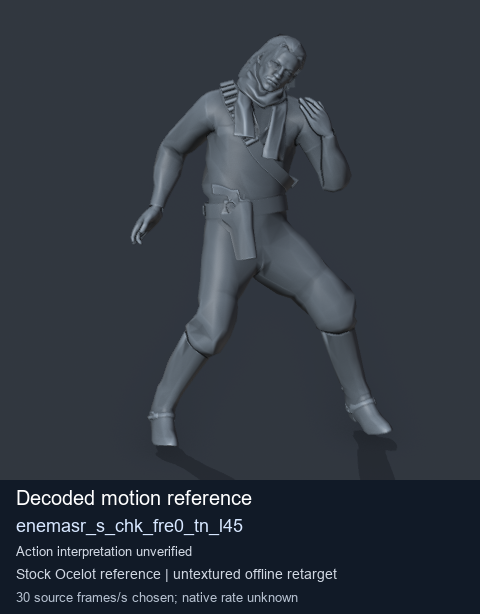
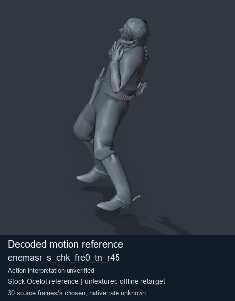
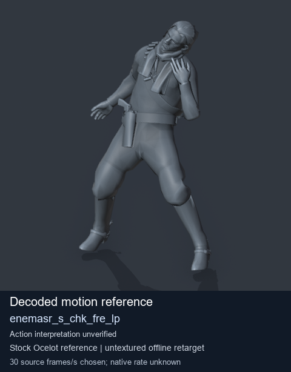
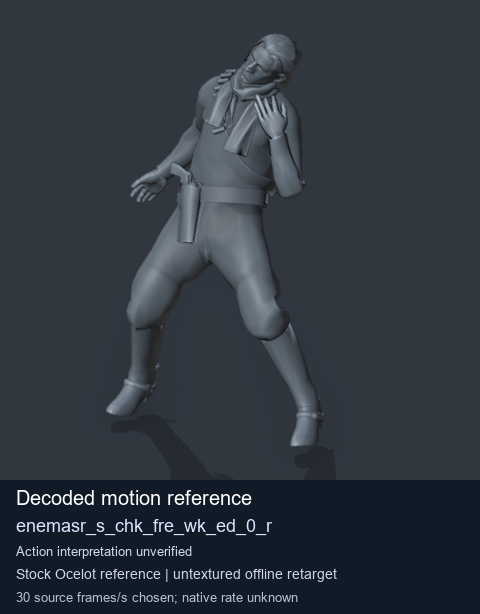

# Stock Soldier_common motion references / /Assets/tpp/motion/SI_game/fani/bodies/enem/enemasr - page 16

[Library](../README.md) · [Grouped directory](../browse/README.md) · [This source family](../browse/stock-soldier-enemasr-9a765a73.md) · [Switch mode](browse-stock-soldier-enemasr-9a765a73-16.md)

**Still images: no GIFs loaded** · 4 clips · 0.40 MiB downloaded.

Images reuse existing files. A small display width does not reduce download size. Open one clip for its larger titled GIF and original technical data.

Source-family grouping uses only recorded virtual directories; it does not establish an action, weapon, actor, rig or native compatibility. Existing descriptions and tags below are unchanged. Per-clip visual review may be pending; chosen preview speed is separate from unmeasured native timing.

| Preview | Animation | Category | Tags | Virtual GANI directory / file | MTAR / container location | Description | Frames / data |
| --- | --- | --- | --- | --- | --- | --- | --- |
|  | [Stock reference: enemasr_s_chk_fre0_tn_l45](../clips/mgsv-tpp-soldier_common-payloadsha256-a0c86b7ed4d185892c511990dcece03ddcc45aba5045c69c16d5f0c1d15f9bd1.md) <code>enemasr_s_chk_fre0_tn_l45</code> | Stock Soldier_common motion references | <code>stock animation reference</code> <code>Soldier_common</code> <code>source-derived label</code> <code>Ocelot reference mesh</code> | <code>/Assets/tpp/motion/SI_game/fani/bodies/enem/enemasr</code> <code>enemasr_s_chk_fre0_tn_l45.gani</code> | Retained MTAR: <code>Soldier_common.mtar</code> DAT / FPK membership unverified | Decoded stock reference enemasr_s_chk_fre0_tn_l45; action interpretation unverified. | 40 raw 1.33 s chosen; native rate unknown [Full data](../clips/mgsv-tpp-soldier_common-payloadsha256-a0c86b7ed4d185892c511990dcece03ddcc45aba5045c69c16d5f0c1d15f9bd1.md#technical-data) |
|  | [Stock reference: enemasr_s_chk_fre0_tn_r45](../clips/mgsv-tpp-soldier_common-payloadsha256-3bdcbfd05dddc4930457b25ee817af3d53c7e1efe3c08f2555c5f8f7cd11a0c4.md) <code>enemasr_s_chk_fre0_tn_r45</code> | Stock Soldier_common motion references | <code>stock animation reference</code> <code>Soldier_common</code> <code>source-derived label</code> <code>Ocelot reference mesh</code> | <code>/Assets/tpp/motion/SI_game/fani/bodies/enem/enemasr</code> <code>enemasr_s_chk_fre0_tn_r45.gani</code> | Retained MTAR: <code>Soldier_common.mtar</code> DAT / FPK membership unverified | Decoded stock reference enemasr_s_chk_fre0_tn_r45; action interpretation unverified. | 40 raw 1.33 s chosen; native rate unknown [Full data](../clips/mgsv-tpp-soldier_common-payloadsha256-3bdcbfd05dddc4930457b25ee817af3d53c7e1efe3c08f2555c5f8f7cd11a0c4.md#technical-data) |
|  | [Stock motion reference: enemasr_s_chk_fre_lp](../clips/mgsv-tpp-soldier_common-payloadsha256-85367a9203c8da1893bea00519aadb143e6dfbe8bc943492fb1f339a832aee83.md) <code>enemasr_s_chk_fre_lp</code> | Stock Soldier_common motion references | <code>stock body motion</code> <code>Soldier_common</code> <code>source-derived label</code> <code>Ocelot reference mesh</code> | <code>/Assets/tpp/motion/SI_game/fani/bodies/enem/enemasr</code> <code>enemasr_s_chk_fre_lp.gani</code> | Retained MTAR: <code>Soldier_common.mtar</code> DAT / FPK membership unverified | Decoded stock body-motion reference enemasr_s_chk_fre_lp; action interpretation unverified. | 120 raw 4.0 s chosen; native rate unknown [Full data](../clips/mgsv-tpp-soldier_common-payloadsha256-85367a9203c8da1893bea00519aadb143e6dfbe8bc943492fb1f339a832aee83.md#technical-data) |
|  | [Stock motion reference: enemasr_s_chk_fre_wk_ed_0_r](../clips/mgsv-tpp-soldier_common-payloadsha256-c6de2b8f0e32364b3d3aee50cd1807e171f334245d1dbbabadb817ad1aaea778.md) <code>enemasr_s_chk_fre_wk_ed_0_r</code> | Stock Soldier_common motion references | <code>stock body motion</code> <code>Soldier_common</code> <code>source-derived label</code> <code>Ocelot reference mesh</code> | <code>/Assets/tpp/motion/SI_game/fani/bodies/enem/enemasr</code> <code>enemasr_s_chk_fre_wk_ed_0_r.gani</code> | Retained MTAR: <code>Soldier_common.mtar</code> DAT / FPK membership unverified | Decoded stock body-motion reference enemasr_s_chk_fre_wk_ed_0_r; action interpretation unverified. | 30 raw 1.0 s chosen; native rate unknown [Full data](../clips/mgsv-tpp-soldier_common-payloadsha256-c6de2b8f0e32364b3d3aee50cd1807e171f334245d1dbbabadb817ad1aaea778.md#technical-data) |

[Source descriptions, confidence and credits](../description-sources.md) · [Complete JSON](../catalogue.json) · [CSV](../catalogue.csv)
