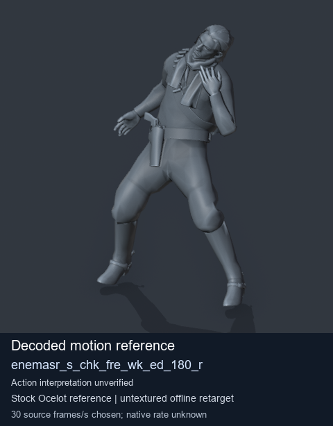
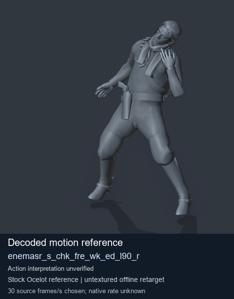
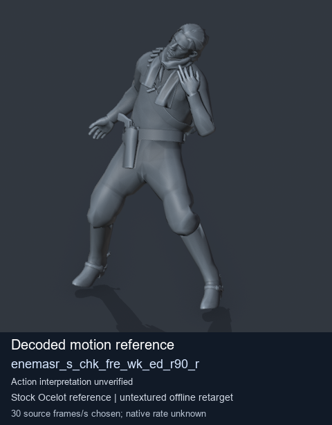
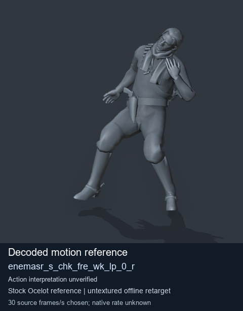

# Stock Soldier_common motion references / /Assets/tpp/motion/SI_game/fani/bodies/enem/enemasr - page 17

[Library](../README.md) · [Grouped directory](../browse/README.md) · [This source family](../browse/stock-soldier-enemasr-9a765a73.md) · [Switch mode](browse-stock-soldier-enemasr-9a765a73-17.md)

**Still images: no GIFs loaded** · 4 clips · 0.41 MiB downloaded.

Images reuse existing files. A small display width does not reduce download size. Open one clip for its larger titled GIF and original technical data.

Source-family grouping uses only recorded virtual directories; it does not establish an action, weapon, actor, rig or native compatibility. Existing descriptions and tags below are unchanged. Per-clip visual review may be pending; chosen preview speed is separate from unmeasured native timing.

| Preview | Animation | Category | Tags | Virtual GANI directory / file | MTAR / container location | Description | Frames / data |
| --- | --- | --- | --- | --- | --- | --- | --- |
|  | [Stock motion reference: enemasr_s_chk_fre_wk_ed_180_r](../clips/mgsv-tpp-soldier_common-payloadsha256-90ab638a30ed4960d8b1a6ad3f9913055b0d8a037627a84853bfd7ec769523b7.md) <code>enemasr_s_chk_fre_wk_ed_180_r</code> | Stock Soldier_common motion references | <code>stock body motion</code> <code>Soldier_common</code> <code>source-derived label</code> <code>Ocelot reference mesh</code> | <code>/Assets/tpp/motion/SI_game/fani/bodies/enem/enemasr</code> <code>enemasr_s_chk_fre_wk_ed_180_r.gani</code> | Retained MTAR: <code>Soldier_common.mtar</code> DAT / FPK membership unverified | Decoded stock body-motion reference enemasr_s_chk_fre_wk_ed_180_r; action interpretation unverified. | 40 raw 1.33 s chosen; native rate unknown [Full data](../clips/mgsv-tpp-soldier_common-payloadsha256-90ab638a30ed4960d8b1a6ad3f9913055b0d8a037627a84853bfd7ec769523b7.md#technical-data) |
|  | [Stock motion reference: enemasr_s_chk_fre_wk_ed_l90_r](../clips/mgsv-tpp-soldier_common-payloadsha256-33b57711ff3a8c6621680f517ef0f1f9d5ca2c47871c14ca5b473ec9bb9cf4fb.md) <code>enemasr_s_chk_fre_wk_ed_l90_r</code> | Stock Soldier_common motion references | <code>stock body motion</code> <code>Soldier_common</code> <code>source-derived label</code> <code>Ocelot reference mesh</code> | <code>/Assets/tpp/motion/SI_game/fani/bodies/enem/enemasr</code> <code>enemasr_s_chk_fre_wk_ed_l90_r.gani</code> | Retained MTAR: <code>Soldier_common.mtar</code> DAT / FPK membership unverified | Decoded stock body-motion reference enemasr_s_chk_fre_wk_ed_l90_r; action interpretation unverified. | 30 raw 1.0 s chosen; native rate unknown [Full data](../clips/mgsv-tpp-soldier_common-payloadsha256-33b57711ff3a8c6621680f517ef0f1f9d5ca2c47871c14ca5b473ec9bb9cf4fb.md#technical-data) |
|  | [Stock motion reference: enemasr_s_chk_fre_wk_ed_r90_r](../clips/mgsv-tpp-soldier_common-payloadsha256-fc482cdd5b1262b7e127b8166bc733ccf776f295f237bd5e062a7ddfc24d672f.md) <code>enemasr_s_chk_fre_wk_ed_r90_r</code> | Stock Soldier_common motion references | <code>stock body motion</code> <code>Soldier_common</code> <code>source-derived label</code> <code>Ocelot reference mesh</code> | <code>/Assets/tpp/motion/SI_game/fani/bodies/enem/enemasr</code> <code>enemasr_s_chk_fre_wk_ed_r90_r.gani</code> | Retained MTAR: <code>Soldier_common.mtar</code> DAT / FPK membership unverified | Decoded stock body-motion reference enemasr_s_chk_fre_wk_ed_r90_r; action interpretation unverified. | 30 raw 1.0 s chosen; native rate unknown [Full data](../clips/mgsv-tpp-soldier_common-payloadsha256-fc482cdd5b1262b7e127b8166bc733ccf776f295f237bd5e062a7ddfc24d672f.md#technical-data) |
|  | [Stock motion reference: enemasr_s_chk_fre_wk_lp_0_r](../clips/mgsv-tpp-soldier_common-payloadsha256-9be4789acc4f97c4fef136bb300ba61f0cc6daf9af1bf3055e9d2736da6fe047.md) <code>enemasr_s_chk_fre_wk_lp_0_r</code> | Stock Soldier_common motion references | <code>stock body motion</code> <code>Soldier_common</code> <code>source-derived label</code> <code>Ocelot reference mesh</code> | <code>/Assets/tpp/motion/SI_game/fani/bodies/enem/enemasr</code> <code>enemasr_s_chk_fre_wk_lp_0_r.gani</code> | Retained MTAR: <code>Soldier_common.mtar</code> DAT / FPK membership unverified | Decoded stock body-motion reference enemasr_s_chk_fre_wk_lp_0_r; action interpretation unverified. | 90 raw 3.0 s chosen; native rate unknown [Full data](../clips/mgsv-tpp-soldier_common-payloadsha256-9be4789acc4f97c4fef136bb300ba61f0cc6daf9af1bf3055e9d2736da6fe047.md#technical-data) |

[Source descriptions, confidence and credits](../description-sources.md) · [Complete JSON](../catalogue.json) · [CSV](../catalogue.csv)
