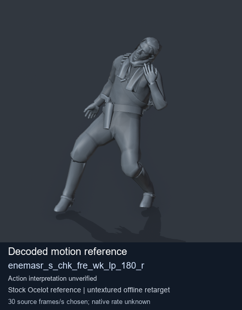
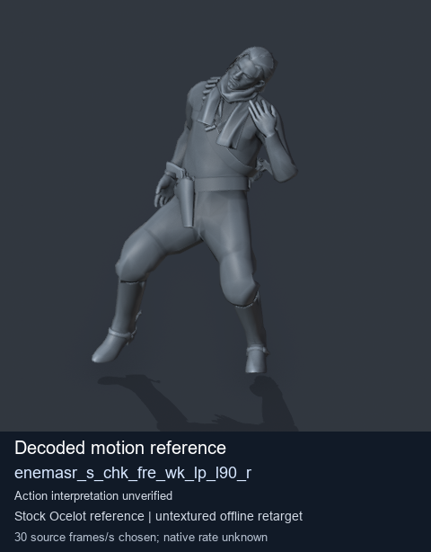
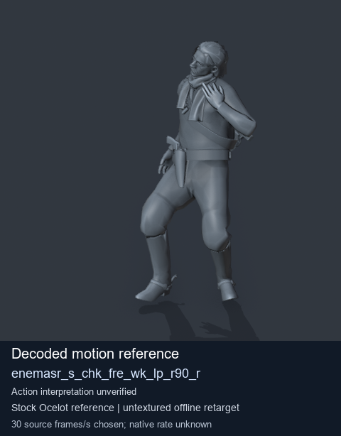
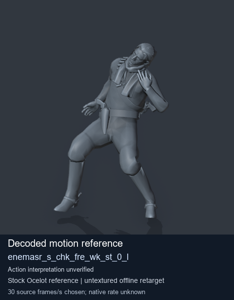

# Stock Soldier_common motion references / /Assets/tpp/motion/SI_game/fani/bodies/enem/enemasr - page 18

[Library](../README.md) · [Grouped directory](../browse/README.md) · [This source family](../browse/stock-soldier-enemasr-9a765a73.md) · [Switch mode](browse-stock-soldier-enemasr-9a765a73-18.md)

**Still images: no GIFs loaded** · 4 clips · 0.38 MiB downloaded.

Images reuse existing files. A small display width does not reduce download size. Open one clip for its larger titled GIF and original technical data.

Source-family grouping uses only recorded virtual directories; it does not establish an action, weapon, actor, rig or native compatibility. Existing descriptions and tags below are unchanged. Per-clip visual review may be pending; chosen preview speed is separate from unmeasured native timing.

| Preview | Animation | Category | Tags | Virtual GANI directory / file | MTAR / container location | Description | Frames / data |
| --- | --- | --- | --- | --- | --- | --- | --- |
|  | [Stock motion reference: enemasr_s_chk_fre_wk_lp_180_r](../clips/mgsv-tpp-soldier_common-payloadsha256-67efab071b2997676fa5dfab25f1185a0b114cacfa6a05acfba6f39adf6734b1.md) <code>enemasr_s_chk_fre_wk_lp_180_r</code> | Stock Soldier_common motion references | <code>stock body motion</code> <code>Soldier_common</code> <code>source-derived label</code> <code>Ocelot reference mesh</code> | <code>/Assets/tpp/motion/SI_game/fani/bodies/enem/enemasr</code> <code>enemasr_s_chk_fre_wk_lp_180_r.gani</code> | Retained MTAR: <code>Soldier_common.mtar</code> DAT / FPK membership unverified | Decoded stock body-motion reference enemasr_s_chk_fre_wk_lp_180_r; action interpretation unverified. | 90 raw 3.0 s chosen; native rate unknown [Full data](../clips/mgsv-tpp-soldier_common-payloadsha256-67efab071b2997676fa5dfab25f1185a0b114cacfa6a05acfba6f39adf6734b1.md#technical-data) |
|  | [Stock motion reference: enemasr_s_chk_fre_wk_lp_l90_r](../clips/mgsv-tpp-soldier_common-payloadsha256-75cbd171920679fa362bfc8233f6ceba584e0b6aa7dbabda9417d5b2ad5a0726.md) <code>enemasr_s_chk_fre_wk_lp_l90_r</code> | Stock Soldier_common motion references | <code>stock body motion</code> <code>Soldier_common</code> <code>source-derived label</code> <code>Ocelot reference mesh</code> | <code>/Assets/tpp/motion/SI_game/fani/bodies/enem/enemasr</code> <code>enemasr_s_chk_fre_wk_lp_l90_r.gani</code> | Retained MTAR: <code>Soldier_common.mtar</code> DAT / FPK membership unverified | Decoded stock body-motion reference enemasr_s_chk_fre_wk_lp_l90_r; action interpretation unverified. | 90 raw 3.0 s chosen; native rate unknown [Full data](../clips/mgsv-tpp-soldier_common-payloadsha256-75cbd171920679fa362bfc8233f6ceba584e0b6aa7dbabda9417d5b2ad5a0726.md#technical-data) |
|  | [Stock motion reference: enemasr_s_chk_fre_wk_lp_r90_r](../clips/mgsv-tpp-soldier_common-payloadsha256-2a38276d8a54e26f32ff4f8b5ac8caca587e99c5efaff82100b84b8c77f1d14f.md) <code>enemasr_s_chk_fre_wk_lp_r90_r</code> | Stock Soldier_common motion references | <code>stock body motion</code> <code>Soldier_common</code> <code>source-derived label</code> <code>Ocelot reference mesh</code> | <code>/Assets/tpp/motion/SI_game/fani/bodies/enem/enemasr</code> <code>enemasr_s_chk_fre_wk_lp_r90_r.gani</code> | Retained MTAR: <code>Soldier_common.mtar</code> DAT / FPK membership unverified | Decoded stock body-motion reference enemasr_s_chk_fre_wk_lp_r90_r; action interpretation unverified. | 90 raw 3.0 s chosen; native rate unknown [Full data](../clips/mgsv-tpp-soldier_common-payloadsha256-2a38276d8a54e26f32ff4f8b5ac8caca587e99c5efaff82100b84b8c77f1d14f.md#technical-data) |
|  | [Stock motion reference: enemasr_s_chk_fre_wk_st_0_l](../clips/mgsv-tpp-soldier_common-payloadsha256-3972e89bc0aa95c75e322ef4066003696b8372afcd87e27fe2a77ab0a5ba6a01.md) <code>enemasr_s_chk_fre_wk_st_0_l</code> | Stock Soldier_common motion references | <code>stock body motion</code> <code>Soldier_common</code> <code>source-derived label</code> <code>Ocelot reference mesh</code> | <code>/Assets/tpp/motion/SI_game/fani/bodies/enem/enemasr</code> <code>enemasr_s_chk_fre_wk_st_0_l.gani</code> | Retained MTAR: <code>Soldier_common.mtar</code> DAT / FPK membership unverified | Decoded stock body-motion reference enemasr_s_chk_fre_wk_st_0_l; action interpretation unverified. | 30 raw 1.0 s chosen; native rate unknown [Full data](../clips/mgsv-tpp-soldier_common-payloadsha256-3972e89bc0aa95c75e322ef4066003696b8372afcd87e27fe2a77ab0a5ba6a01.md#technical-data) |

[Source descriptions, confidence and credits](../description-sources.md) · [Complete JSON](../catalogue.json) · [CSV](../catalogue.csv)
