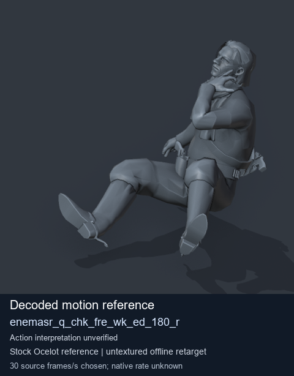
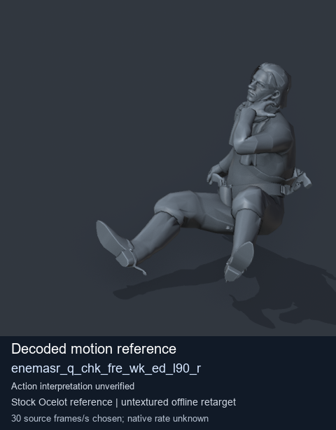
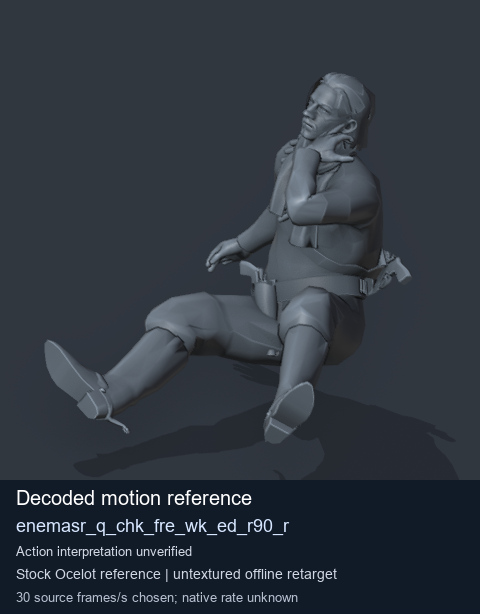
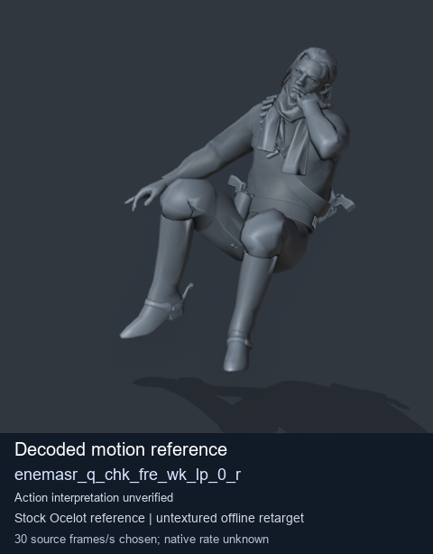

# Stock Soldier_common motion references / /Assets/tpp/motion/SI_game/fani/bodies/enem/enemasr - page 2

[Library](../README.md) · [Grouped directory](../browse/README.md) · [This source family](../browse/stock-soldier-enemasr-9a765a73.md) · [Switch mode](browse-stock-soldier-enemasr-9a765a73-2.md)

**Still images: no GIFs loaded** · 4 clips · 0.44 MiB downloaded.

Images reuse existing files. A small display width does not reduce download size. Open one clip for its larger titled GIF and original technical data.

Source-family grouping uses only recorded virtual directories; it does not establish an action, weapon, actor, rig or native compatibility. Existing descriptions and tags below are unchanged. Per-clip visual review may be pending; chosen preview speed is separate from unmeasured native timing.

| Preview | Animation | Category | Tags | Virtual GANI directory / file | MTAR / container location | Description | Frames / data |
| --- | --- | --- | --- | --- | --- | --- | --- |
|  | [Stock motion reference: enemasr_q_chk_fre_wk_ed_180_r](../clips/mgsv-tpp-soldier_common-payloadsha256-4bc5fb592bb9cb545a97c6e08e66ff68ad4e41479c99e5ff3a128817b9224dc0.md) <code>enemasr_q_chk_fre_wk_ed_180_r</code> | Stock Soldier_common motion references | <code>stock body motion</code> <code>Soldier_common</code> <code>source-derived label</code> <code>Ocelot reference mesh</code> | <code>/Assets/tpp/motion/SI_game/fani/bodies/enem/enemasr</code> <code>enemasr_q_chk_fre_wk_ed_180_r.gani</code> | Retained MTAR: <code>Soldier_common.mtar</code> DAT / FPK membership unverified | Decoded stock body-motion reference enemasr_q_chk_fre_wk_ed_180_r; action interpretation unverified. | 50 raw 1.67 s chosen; native rate unknown [Full data](../clips/mgsv-tpp-soldier_common-payloadsha256-4bc5fb592bb9cb545a97c6e08e66ff68ad4e41479c99e5ff3a128817b9224dc0.md#technical-data) |
|  | [Stock motion reference: enemasr_q_chk_fre_wk_ed_l90_r](../clips/mgsv-tpp-soldier_common-payloadsha256-2f6c288e9509d6c73440253760abe23710c7a45da5f35985590a0c749f367b95.md) <code>enemasr_q_chk_fre_wk_ed_l90_r</code> | Stock Soldier_common motion references | <code>stock body motion</code> <code>Soldier_common</code> <code>source-derived label</code> <code>Ocelot reference mesh</code> | <code>/Assets/tpp/motion/SI_game/fani/bodies/enem/enemasr</code> <code>enemasr_q_chk_fre_wk_ed_l90_r.gani</code> | Retained MTAR: <code>Soldier_common.mtar</code> DAT / FPK membership unverified | Decoded stock body-motion reference enemasr_q_chk_fre_wk_ed_l90_r; action interpretation unverified. | 40 raw 1.33 s chosen; native rate unknown [Full data](../clips/mgsv-tpp-soldier_common-payloadsha256-2f6c288e9509d6c73440253760abe23710c7a45da5f35985590a0c749f367b95.md#technical-data) |
|  | [Stock motion reference: enemasr_q_chk_fre_wk_ed_r90_r](../clips/mgsv-tpp-soldier_common-payloadsha256-23dbfd37f8499f04b3d7cea06ebdf569ff8d4d2617104514355cdae1533552cc.md) <code>enemasr_q_chk_fre_wk_ed_r90_r</code> | Stock Soldier_common motion references | <code>stock body motion</code> <code>Soldier_common</code> <code>source-derived label</code> <code>Ocelot reference mesh</code> | <code>/Assets/tpp/motion/SI_game/fani/bodies/enem/enemasr</code> <code>enemasr_q_chk_fre_wk_ed_r90_r.gani</code> | Retained MTAR: <code>Soldier_common.mtar</code> DAT / FPK membership unverified | Decoded stock body-motion reference enemasr_q_chk_fre_wk_ed_r90_r; action interpretation unverified. | 50 raw 1.67 s chosen; native rate unknown [Full data](../clips/mgsv-tpp-soldier_common-payloadsha256-23dbfd37f8499f04b3d7cea06ebdf569ff8d4d2617104514355cdae1533552cc.md#technical-data) |
|  | [Stock motion reference: enemasr_q_chk_fre_wk_lp_0_r](../clips/mgsv-tpp-soldier_common-payloadsha256-6bee5fec3160adbd73b0a98b2093712183497460617fef846c68db6ceddbbdfc.md) <code>enemasr_q_chk_fre_wk_lp_0_r</code> | Stock Soldier_common motion references | <code>stock body motion</code> <code>Soldier_common</code> <code>source-derived label</code> <code>Ocelot reference mesh</code> | <code>/Assets/tpp/motion/SI_game/fani/bodies/enem/enemasr</code> <code>enemasr_q_chk_fre_wk_lp_0_r.gani</code> | Retained MTAR: <code>Soldier_common.mtar</code> DAT / FPK membership unverified | Decoded stock body-motion reference enemasr_q_chk_fre_wk_lp_0_r; action interpretation unverified. | 90 raw 3.0 s chosen; native rate unknown [Full data](../clips/mgsv-tpp-soldier_common-payloadsha256-6bee5fec3160adbd73b0a98b2093712183497460617fef846c68db6ceddbbdfc.md#technical-data) |

[Source descriptions, confidence and credits](../description-sources.md) · [Complete JSON](../catalogue.json) · [CSV](../catalogue.csv)
