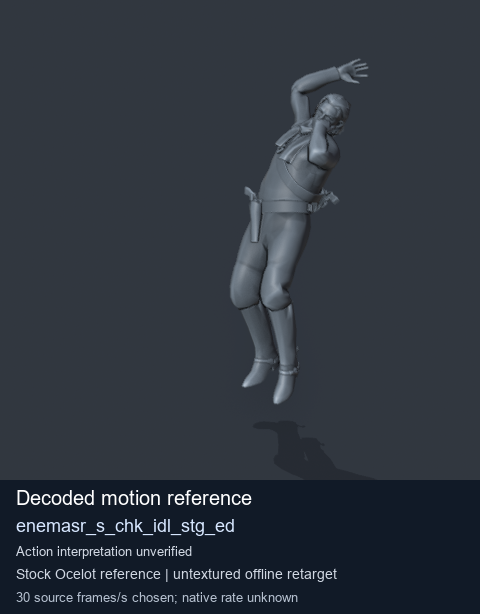
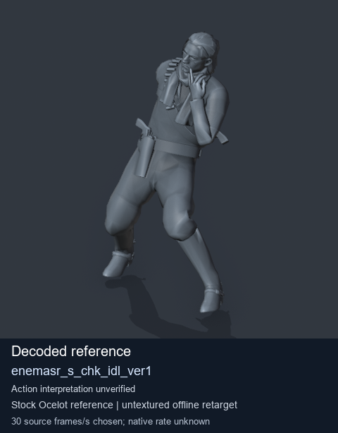

# Stock Soldier_common motion references / /Assets/tpp/motion/SI_game/fani/bodies/enem/enemasr - page 21

[Library](../README.md) · [Grouped directory](../browse/README.md) · [This source family](../browse/stock-soldier-enemasr-9a765a73.md) · [Switch mode](browse-stock-soldier-enemasr-9a765a73-21.md)

**Still images: no GIFs loaded** · 2 clips · 0.17 MiB downloaded.

Images reuse existing files. A small display width does not reduce download size. Open one clip for its larger titled GIF and original technical data.

Source-family grouping uses only recorded virtual directories; it does not establish an action, weapon, actor, rig or native compatibility. Existing descriptions and tags below are unchanged. Per-clip visual review may be pending; chosen preview speed is separate from unmeasured native timing.

| Preview | Animation | Category | Tags | Virtual GANI directory / file | MTAR / container location | Description | Frames / data |
| --- | --- | --- | --- | --- | --- | --- | --- |
|  | [Stock motion reference: enemasr_s_chk_idl_stg_ed](../clips/mgsv-tpp-soldier_common-payloadsha256-ea083385ad1a14839b146fc45d6edd097e06c076797732ce94d47ea045da4430.md) <code>enemasr_s_chk_idl_stg_ed</code> | Stock Soldier_common motion references | <code>stock body motion</code> <code>Soldier_common</code> <code>source-derived label</code> <code>Ocelot reference mesh</code> | <code>/Assets/tpp/motion/SI_game/fani/bodies/enem/enemasr</code> <code>enemasr_s_chk_idl_stg_ed.gani</code> | Retained MTAR: <code>Soldier_common.mtar</code> DAT / FPK membership unverified | Decoded stock body-motion reference enemasr_s_chk_idl_stg_ed; action interpretation unverified. | 166 raw 5.53 s chosen; native rate unknown [Full data](../clips/mgsv-tpp-soldier_common-payloadsha256-ea083385ad1a14839b146fc45d6edd097e06c076797732ce94d47ea045da4430.md#technical-data) |
|  | [Stock reference: enemasr_s_chk_idl_ver1](../clips/mgsv-tpp-soldier_common-payloadsha256-d3164955633689ebcfcf9ae9e46decc76009806c6d06ada2a8fc1b01c32fb103.md) <code>enemasr_s_chk_idl_ver1</code> | Stock Soldier_common motion references | <code>stock animation reference</code> <code>Soldier_common</code> <code>source-derived label</code> <code>Ocelot reference mesh</code> | <code>/Assets/tpp/motion/SI_game/fani/bodies/enem/enemasr</code> <code>enemasr_s_chk_idl_ver1.gani</code> | Retained MTAR: <code>Soldier_common.mtar</code> DAT / FPK membership unverified | Decoded stock reference enemasr_s_chk_idl_ver1; action interpretation unverified. | 314 raw 10.47 s chosen; native rate unknown [Full data](../clips/mgsv-tpp-soldier_common-payloadsha256-d3164955633689ebcfcf9ae9e46decc76009806c6d06ada2a8fc1b01c32fb103.md#technical-data) |

[Source descriptions, confidence and credits](../description-sources.md) · [Complete JSON](../catalogue.json) · [CSV](../catalogue.csv)
