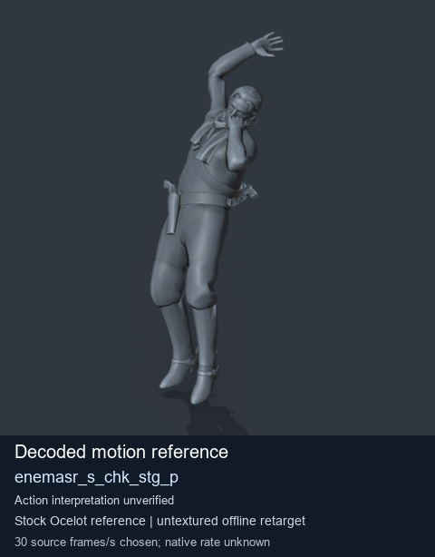
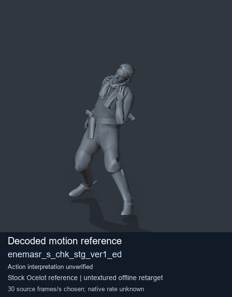
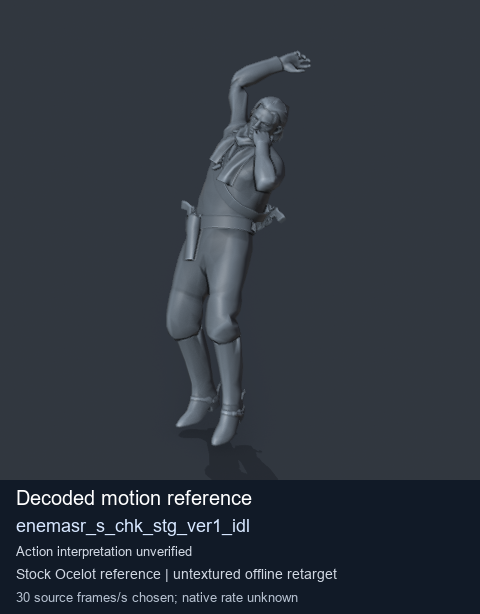
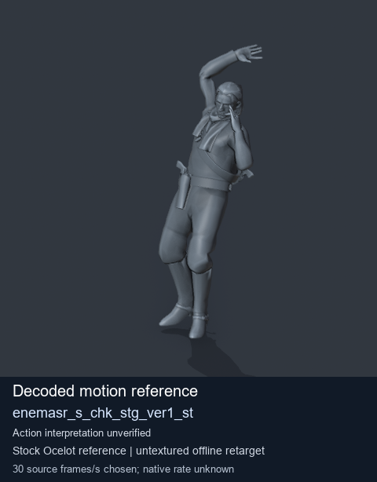

# Stock Soldier_common motion references / /Assets/tpp/motion/SI_game/fani/bodies/enem/enemasr - page 23

[Library](../README.md) · [Grouped directory](../browse/README.md) · [This source family](../browse/stock-soldier-enemasr-9a765a73.md) · [Switch mode](browse-stock-soldier-enemasr-9a765a73-23.md)

**Still images: no GIFs loaded** · 4 clips · 0.31 MiB downloaded.

Images reuse existing files. A small display width does not reduce download size. Open one clip for its larger titled GIF and original technical data.

Source-family grouping uses only recorded virtual directories; it does not establish an action, weapon, actor, rig or native compatibility. Existing descriptions and tags below are unchanged. Per-clip visual review may be pending; chosen preview speed is separate from unmeasured native timing.

| Preview | Animation | Category | Tags | Virtual GANI directory / file | MTAR / container location | Description | Frames / data |
| --- | --- | --- | --- | --- | --- | --- | --- |
|  | [Stock motion reference: enemasr_s_chk_stg_p](../clips/mgsv-tpp-soldier_common-payloadsha256-5bec5a6a10e2f340d6e5987e70c608a2bac30221b4cd8601ce9fd894e719797e.md) <code>enemasr_s_chk_stg_p</code> | Stock Soldier_common motion references | <code>stock body motion</code> <code>Soldier_common</code> <code>source-derived label</code> <code>Ocelot reference mesh</code> | <code>/Assets/tpp/motion/SI_game/fani/bodies/enem/enemasr</code> <code>enemasr_s_chk_stg_p.gani</code> | Retained MTAR: <code>Soldier_common.mtar</code> DAT / FPK membership unverified | Decoded stock body-motion reference enemasr_s_chk_stg_p; action interpretation unverified. | 25 raw 0.83 s chosen; native rate unknown [Full data](../clips/mgsv-tpp-soldier_common-payloadsha256-5bec5a6a10e2f340d6e5987e70c608a2bac30221b4cd8601ce9fd894e719797e.md#technical-data) |
|  | [Stock reference: enemasr_s_chk_stg_ver1_ed](../clips/mgsv-tpp-soldier_common-payloadsha256-a845542126fbf5031d140b3376b812cf0f2bad946dc698420f26c032dc513983.md) <code>enemasr_s_chk_stg_ver1_ed</code> | Stock Soldier_common motion references | <code>stock animation reference</code> <code>Soldier_common</code> <code>source-derived label</code> <code>Ocelot reference mesh</code> | <code>/Assets/tpp/motion/SI_game/fani/bodies/enem/enemasr</code> <code>enemasr_s_chk_stg_ver1_ed.gani</code> | Retained MTAR: <code>Soldier_common.mtar</code> DAT / FPK membership unverified | Decoded stock reference enemasr_s_chk_stg_ver1_ed; action interpretation unverified. | 40 raw 1.33 s chosen; native rate unknown [Full data](../clips/mgsv-tpp-soldier_common-payloadsha256-a845542126fbf5031d140b3376b812cf0f2bad946dc698420f26c032dc513983.md#technical-data) |
|  | [Stock reference: enemasr_s_chk_stg_ver1_idl](../clips/mgsv-tpp-soldier_common-payloadsha256-03d7569be5d1c9576abea6a29c4e51dd2c59b9e55ce03732ec3223db49685ded.md) <code>enemasr_s_chk_stg_ver1_idl</code> | Stock Soldier_common motion references | <code>stock animation reference</code> <code>Soldier_common</code> <code>source-derived label</code> <code>Ocelot reference mesh</code> | <code>/Assets/tpp/motion/SI_game/fani/bodies/enem/enemasr</code> <code>enemasr_s_chk_stg_ver1_idl.gani</code> | Retained MTAR: <code>Soldier_common.mtar</code> DAT / FPK membership unverified | Decoded stock reference enemasr_s_chk_stg_ver1_idl; action interpretation unverified. | 80 raw 2.67 s chosen; native rate unknown [Full data](../clips/mgsv-tpp-soldier_common-payloadsha256-03d7569be5d1c9576abea6a29c4e51dd2c59b9e55ce03732ec3223db49685ded.md#technical-data) |
|  | [Stock motion reference: enemasr_s_chk_stg_ver1_st](../clips/mgsv-tpp-soldier_common-payloadsha256-30787b90fdf3e8cf0b92f2734ea0e9ec7a9e8354844fd98fcd7d05f15f05ccee.md) <code>enemasr_s_chk_stg_ver1_st</code> | Stock Soldier_common motion references | <code>stock body motion</code> <code>Soldier_common</code> <code>source-derived label</code> <code>Ocelot reference mesh</code> | <code>/Assets/tpp/motion/SI_game/fani/bodies/enem/enemasr</code> <code>enemasr_s_chk_stg_ver1_st.gani</code> | Retained MTAR: <code>Soldier_common.mtar</code> DAT / FPK membership unverified | Decoded stock body-motion reference enemasr_s_chk_stg_ver1_st; action interpretation unverified. | 44 raw 1.47 s chosen; native rate unknown [Full data](../clips/mgsv-tpp-soldier_common-payloadsha256-30787b90fdf3e8cf0b92f2734ea0e9ec7a9e8354844fd98fcd7d05f15f05ccee.md#technical-data) |

[Source descriptions, confidence and credits](../description-sources.md) · [Complete JSON](../catalogue.json) · [CSV](../catalogue.csv)
