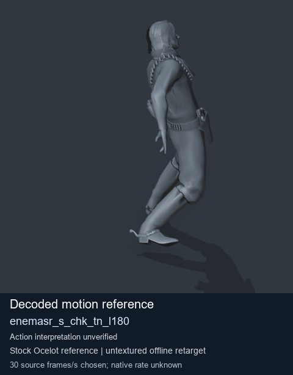
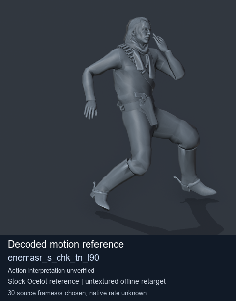
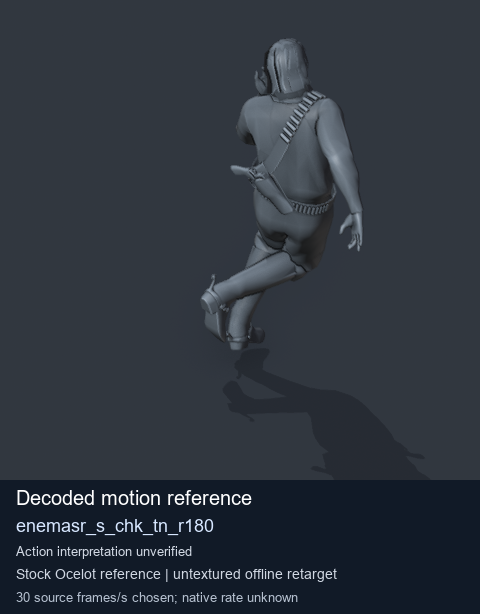
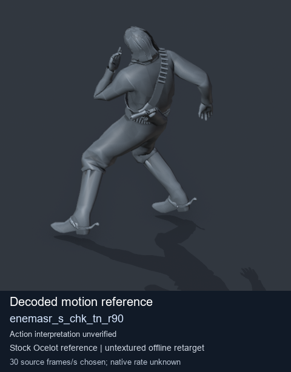

# Stock Soldier_common motion references / /Assets/tpp/motion/SI_game/fani/bodies/enem/enemasr - page 24

[Library](../README.md) · [Grouped directory](../browse/README.md) · [This source family](../browse/stock-soldier-enemasr-9a765a73.md) · [Switch mode](browse-stock-soldier-enemasr-9a765a73-24.md)

**Still images: no GIFs loaded** · 4 clips · 0.38 MiB downloaded.

Images reuse existing files. A small display width does not reduce download size. Open one clip for its larger titled GIF and original technical data.

Source-family grouping uses only recorded virtual directories; it does not establish an action, weapon, actor, rig or native compatibility. Existing descriptions and tags below are unchanged. Per-clip visual review may be pending; chosen preview speed is separate from unmeasured native timing.

| Preview | Animation | Category | Tags | Virtual GANI directory / file | MTAR / container location | Description | Frames / data |
| --- | --- | --- | --- | --- | --- | --- | --- |
|  | [Stock motion reference: enemasr_s_chk_tn_l180](../clips/mgsv-tpp-soldier_common-payloadsha256-00d2f0a1a34ccc626252e4d07e626e4a601e09747ec1050806f640b54d411640.md) <code>enemasr_s_chk_tn_l180</code> | Stock Soldier_common motion references | <code>stock body motion</code> <code>Soldier_common</code> <code>source-derived label</code> <code>Ocelot reference mesh</code> | <code>/Assets/tpp/motion/SI_game/fani/bodies/enem/enemasr</code> <code>enemasr_s_chk_tn_l180.gani</code> | Retained MTAR: <code>Soldier_common.mtar</code> DAT / FPK membership unverified | Decoded stock body-motion reference enemasr_s_chk_tn_l180; action interpretation unverified. | 49 raw 1.63 s chosen; native rate unknown [Full data](../clips/mgsv-tpp-soldier_common-payloadsha256-00d2f0a1a34ccc626252e4d07e626e4a601e09747ec1050806f640b54d411640.md#technical-data) |
|  | [Stock reference: enemasr_s_chk_tn_l90](../clips/mgsv-tpp-soldier_common-payloadsha256-2e58244ee345954f12ad34a0864c64cb182439a31d8666f6863188d0f6fa1a1a.md) <code>enemasr_s_chk_tn_l90</code> | Stock Soldier_common motion references | <code>stock animation reference</code> <code>Soldier_common</code> <code>source-derived label</code> <code>Ocelot reference mesh</code> | <code>/Assets/tpp/motion/SI_game/fani/bodies/enem/enemasr</code> <code>enemasr_s_chk_tn_l90.gani</code> | Retained MTAR: <code>Soldier_common.mtar</code> DAT / FPK membership unverified | Decoded stock reference enemasr_s_chk_tn_l90; action interpretation unverified. | 40 raw 1.33 s chosen; native rate unknown [Full data](../clips/mgsv-tpp-soldier_common-payloadsha256-2e58244ee345954f12ad34a0864c64cb182439a31d8666f6863188d0f6fa1a1a.md#technical-data) |
|  | [Stock motion reference: enemasr_s_chk_tn_r180](../clips/mgsv-tpp-soldier_common-payloadsha256-bec0835c2e86dcb6e2eaed6c7d3124a1225c81536747bb4685724635fea44c34.md) <code>enemasr_s_chk_tn_r180</code> | Stock Soldier_common motion references | <code>stock body motion</code> <code>Soldier_common</code> <code>source-derived label</code> <code>Ocelot reference mesh</code> | <code>/Assets/tpp/motion/SI_game/fani/bodies/enem/enemasr</code> <code>enemasr_s_chk_tn_r180.gani</code> | Retained MTAR: <code>Soldier_common.mtar</code> DAT / FPK membership unverified | Decoded stock body-motion reference enemasr_s_chk_tn_r180; action interpretation unverified. | 49 raw 1.63 s chosen; native rate unknown [Full data](../clips/mgsv-tpp-soldier_common-payloadsha256-bec0835c2e86dcb6e2eaed6c7d3124a1225c81536747bb4685724635fea44c34.md#technical-data) |
|  | [Stock reference: enemasr_s_chk_tn_r90](../clips/mgsv-tpp-soldier_common-payloadsha256-529c0ed7415c6edacbac79a549ef235ff1a6d99a799eb9916132974ae8203f36.md) <code>enemasr_s_chk_tn_r90</code> | Stock Soldier_common motion references | <code>stock animation reference</code> <code>Soldier_common</code> <code>source-derived label</code> <code>Ocelot reference mesh</code> | <code>/Assets/tpp/motion/SI_game/fani/bodies/enem/enemasr</code> <code>enemasr_s_chk_tn_r90.gani</code> | Retained MTAR: <code>Soldier_common.mtar</code> DAT / FPK membership unverified | Decoded stock reference enemasr_s_chk_tn_r90; action interpretation unverified. | 40 raw 1.33 s chosen; native rate unknown [Full data](../clips/mgsv-tpp-soldier_common-payloadsha256-529c0ed7415c6edacbac79a549ef235ff1a6d99a799eb9916132974ae8203f36.md#technical-data) |

[Source descriptions, confidence and credits](../description-sources.md) · [Complete JSON](../catalogue.json) · [CSV](../catalogue.csv)
