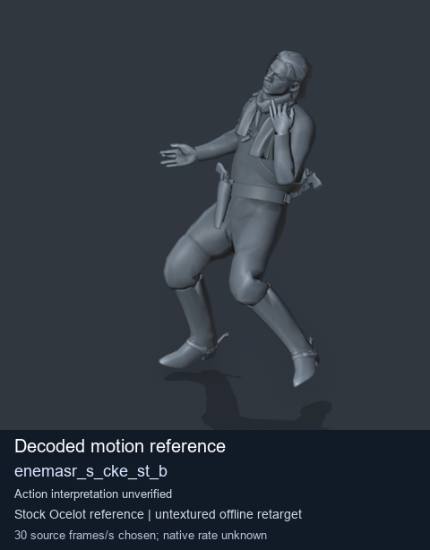
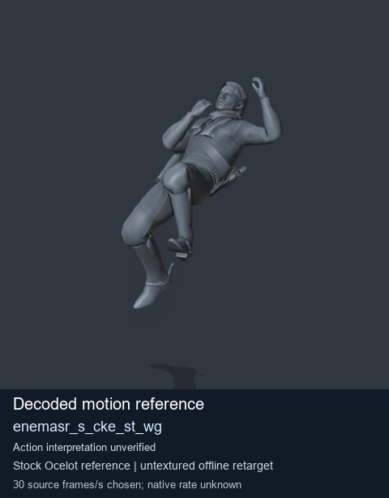
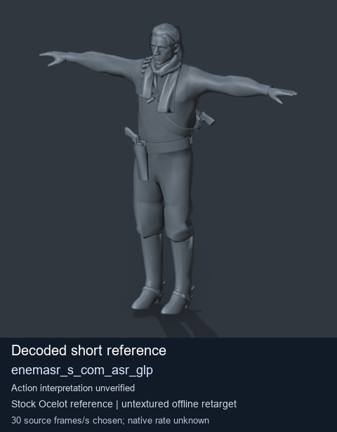
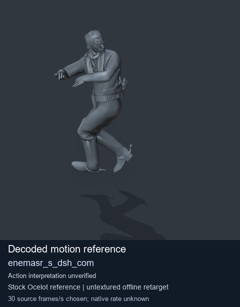

# Stock Soldier_common motion references / /Assets/tpp/motion/SI_game/fani/bodies/enem/enemasr - page 27

[Library](../README.md) · [Grouped directory](../browse/README.md) · [This source family](../browse/stock-soldier-enemasr-9a765a73.md) · [Switch mode](browse-stock-soldier-enemasr-9a765a73-27.md)

**Still images: no GIFs loaded** · 4 clips · 0.34 MiB downloaded.

Images reuse existing files. A small display width does not reduce download size. Open one clip for its larger titled GIF and original technical data.

Source-family grouping uses only recorded virtual directories; it does not establish an action, weapon, actor, rig or native compatibility. Existing descriptions and tags below are unchanged. Per-clip visual review may be pending; chosen preview speed is separate from unmeasured native timing.

| Preview | Animation | Category | Tags | Virtual GANI directory / file | MTAR / container location | Description | Frames / data |
| --- | --- | --- | --- | --- | --- | --- | --- |
|  | [Stock motion reference: enemasr_s_cke_st_b](../clips/mgsv-tpp-soldier_common-payloadsha256-3ad490eb5797aa856eac5c85c61b4ef5917eb1b79dd3890ff77ea9ef3ae030cd.md) <code>enemasr_s_cke_st_b</code> | Stock Soldier_common motion references | <code>stock body motion</code> <code>Soldier_common</code> <code>source-derived label</code> <code>Ocelot reference mesh</code> | <code>/Assets/tpp/motion/SI_game/fani/bodies/enem/enemasr</code> <code>enemasr_s_cke_st_b.gani</code> | Retained MTAR: <code>Soldier_common.mtar</code> DAT / FPK membership unverified | Decoded stock body-motion reference enemasr_s_cke_st_b; action interpretation unverified. | 67 raw 2.23 s chosen; native rate unknown [Full data](../clips/mgsv-tpp-soldier_common-payloadsha256-3ad490eb5797aa856eac5c85c61b4ef5917eb1b79dd3890ff77ea9ef3ae030cd.md#technical-data) |
|  | [Stock reference: enemasr_s_cke_st_wg](../clips/mgsv-tpp-soldier_common-payloadsha256-99192b9dc7520619c67c3c89d41da43d4628e8d1e96f457293093929849ed575.md) <code>enemasr_s_cke_st_wg</code> | Stock Soldier_common motion references | <code>stock animation reference</code> <code>Soldier_common</code> <code>source-derived label</code> <code>Ocelot reference mesh</code> | <code>/Assets/tpp/motion/SI_game/fani/bodies/enem/enemasr</code> <code>enemasr_s_cke_st_wg.gani</code> | Retained MTAR: <code>Soldier_common.mtar</code> DAT / FPK membership unverified | Decoded stock reference enemasr_s_cke_st_wg; action interpretation unverified. | 85 raw 2.83 s chosen; native rate unknown [Full data](../clips/mgsv-tpp-soldier_common-payloadsha256-99192b9dc7520619c67c3c89d41da43d4628e8d1e96f457293093929849ed575.md#technical-data) |
|  | [Stock reference: enemasr_s_com_asr_glp](../clips/mgsv-tpp-soldier_common-payloadsha256-17c03498e6cdb673c7f865eed8b690f6bbac9a8681be47917e3a96503df8f6ab.md) <code>enemasr_s_com_asr_glp</code> | Stock Soldier_common motion references | <code>stock animation reference</code> <code>Soldier_common</code> <code>source-derived label</code> <code>Ocelot reference mesh</code> | <code>/Assets/tpp/motion/SI_game/fani/bodies/enem/enemasr</code> <code>enemasr_s_com_asr_glp.gani</code> | Retained MTAR: <code>Soldier_common.mtar</code> DAT / FPK membership unverified | Decoded stock reference enemasr_s_com_asr_glp; action interpretation unverified. | 3 raw 0.1 s chosen; native rate unknown [Full data](../clips/mgsv-tpp-soldier_common-payloadsha256-17c03498e6cdb673c7f865eed8b690f6bbac9a8681be47917e3a96503df8f6ab.md#technical-data) |
|  | [Stock reference: enemasr_s_dsh_com](../clips/mgsv-tpp-soldier_common-payloadsha256-ec7909aa4cfd386d944f644d2d48bb5f592a0c69ff59068adebb6faa2e0743ff.md) <code>enemasr_s_dsh_com</code> | Stock Soldier_common motion references | <code>stock animation reference</code> <code>Soldier_common</code> <code>source-derived label</code> <code>Ocelot reference mesh</code> | <code>/Assets/tpp/motion/SI_game/fani/bodies/enem/enemasr</code> <code>enemasr_s_dsh_com.gani</code> | Retained MTAR: <code>Soldier_common.mtar</code> DAT / FPK membership unverified | Decoded stock reference enemasr_s_dsh_com; action interpretation unverified. | 141 raw 4.7 s chosen; native rate unknown [Full data](../clips/mgsv-tpp-soldier_common-payloadsha256-ec7909aa4cfd386d944f644d2d48bb5f592a0c69ff59068adebb6faa2e0743ff.md#technical-data) |

[Source descriptions, confidence and credits](../description-sources.md) · [Complete JSON](../catalogue.json) · [CSV](../catalogue.csv)
