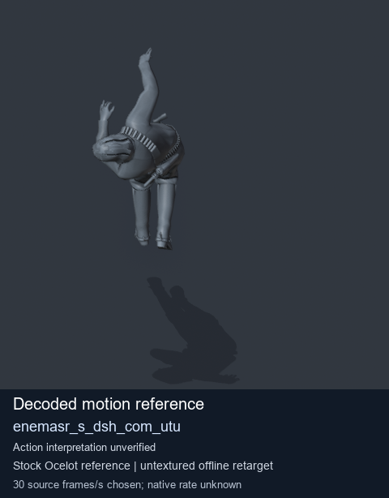
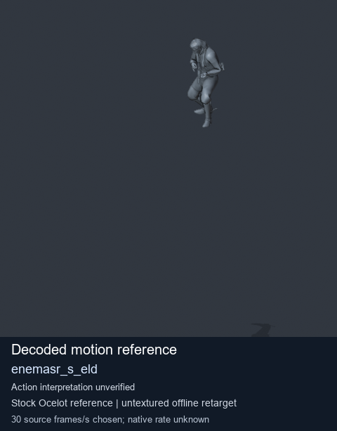
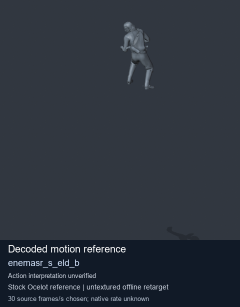
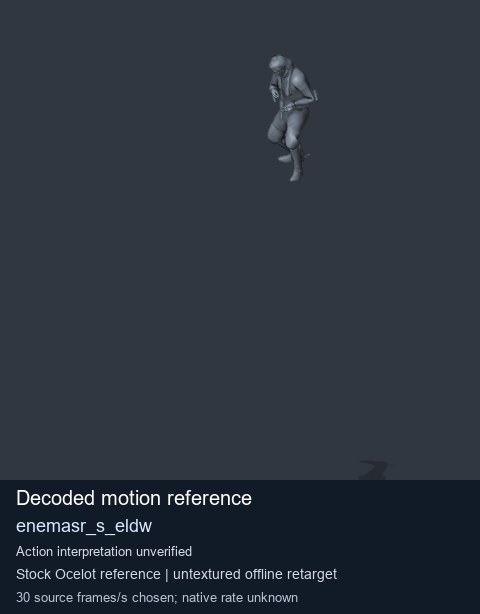

# Stock Soldier_common motion references / /Assets/tpp/motion/SI_game/fani/bodies/enem/enemasr - page 28

[Library](../README.md) · [Grouped directory](../browse/README.md) · [This source family](../browse/stock-soldier-enemasr-9a765a73.md) · [Switch mode](browse-stock-soldier-enemasr-9a765a73-28.md)

**Still images: no GIFs loaded** · 4 clips · 0.23 MiB downloaded.

Images reuse existing files. A small display width does not reduce download size. Open one clip for its larger titled GIF and original technical data.

Source-family grouping uses only recorded virtual directories; it does not establish an action, weapon, actor, rig or native compatibility. Existing descriptions and tags below are unchanged. Per-clip visual review may be pending; chosen preview speed is separate from unmeasured native timing.

| Preview | Animation | Category | Tags | Virtual GANI directory / file | MTAR / container location | Description | Frames / data |
| --- | --- | --- | --- | --- | --- | --- | --- |
|  | [Stock motion reference: enemasr_s_dsh_com_utu](../clips/mgsv-tpp-soldier_common-payloadsha256-0314dc7c68f6bebd3b582b5d754a9c3c3e9ed02e81065ebaa3e1a29eab34ac9b.md) <code>enemasr_s_dsh_com_utu</code> | Stock Soldier_common motion references | <code>stock body motion</code> <code>Soldier_common</code> <code>source-derived label</code> <code>Ocelot reference mesh</code> | <code>/Assets/tpp/motion/SI_game/fani/bodies/enem/enemasr</code> <code>enemasr_s_dsh_com_utu.gani</code> | Retained MTAR: <code>Soldier_common.mtar</code> DAT / FPK membership unverified | Decoded stock body-motion reference enemasr_s_dsh_com_utu; action interpretation unverified. | 130 raw 4.33 s chosen; native rate unknown [Full data](../clips/mgsv-tpp-soldier_common-payloadsha256-0314dc7c68f6bebd3b582b5d754a9c3c3e9ed02e81065ebaa3e1a29eab34ac9b.md#technical-data) |
|  | [Stock reference: enemasr_s_eld](../clips/mgsv-tpp-soldier_common-payloadsha256-76126dc7df087fd4e577f358c1f27c53010d310b5be277b9d7c710506c8b4ed9.md) <code>enemasr_s_eld</code> | Stock Soldier_common motion references | <code>stock animation reference</code> <code>Soldier_common</code> <code>source-derived label</code> <code>Ocelot reference mesh</code> | <code>/Assets/tpp/motion/SI_game/fani/bodies/enem/enemasr</code> <code>enemasr_s_eld.gani</code> | Retained MTAR: <code>Soldier_common.mtar</code> DAT / FPK membership unverified | Decoded stock reference enemasr_s_eld; action interpretation unverified. | 87 raw 2.9 s chosen; native rate unknown [Full data](../clips/mgsv-tpp-soldier_common-payloadsha256-76126dc7df087fd4e577f358c1f27c53010d310b5be277b9d7c710506c8b4ed9.md#technical-data) |
|  | [Stock motion reference: enemasr_s_eld_b](../clips/mgsv-tpp-soldier_common-payloadsha256-4d2e238650acba6ad07f412faae0c53600b34d2657529448acbcdd16e2e06b13.md) <code>enemasr_s_eld_b</code> | Stock Soldier_common motion references | <code>stock body motion</code> <code>Soldier_common</code> <code>source-derived label</code> <code>Ocelot reference mesh</code> | <code>/Assets/tpp/motion/SI_game/fani/bodies/enem/enemasr</code> <code>enemasr_s_eld_b.gani</code> | Retained MTAR: <code>Soldier_common.mtar</code> DAT / FPK membership unverified | Decoded stock body-motion reference enemasr_s_eld_b; action interpretation unverified. | 87 raw 2.9 s chosen; native rate unknown [Full data](../clips/mgsv-tpp-soldier_common-payloadsha256-4d2e238650acba6ad07f412faae0c53600b34d2657529448acbcdd16e2e06b13.md#technical-data) |
|  | [Stock motion reference: enemasr_s_eldw](../clips/mgsv-tpp-soldier_common-payloadsha256-9135d2a3ea2b1fc5db9157218f7bef2a73f5e0c2ece2647e070b79fb55c0a429.md) <code>enemasr_s_eldw</code> | Stock Soldier_common motion references | <code>stock body motion</code> <code>Soldier_common</code> <code>source-derived label</code> <code>Ocelot reference mesh</code> | <code>/Assets/tpp/motion/SI_game/fani/bodies/enem/enemasr</code> <code>enemasr_s_eldw.gani</code> | Retained MTAR: <code>Soldier_common.mtar</code> DAT / FPK membership unverified | Decoded stock body-motion reference enemasr_s_eldw; action interpretation unverified. | 87 raw 2.9 s chosen; native rate unknown [Full data](../clips/mgsv-tpp-soldier_common-payloadsha256-9135d2a3ea2b1fc5db9157218f7bef2a73f5e0c2ece2647e070b79fb55c0a429.md#technical-data) |

[Source descriptions, confidence and credits](../description-sources.md) · [Complete JSON](../catalogue.json) · [CSV](../catalogue.csv)
