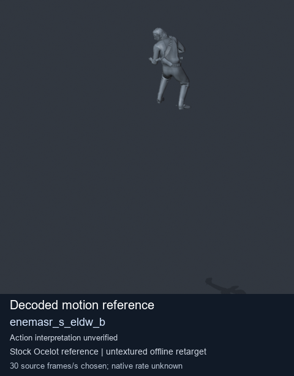
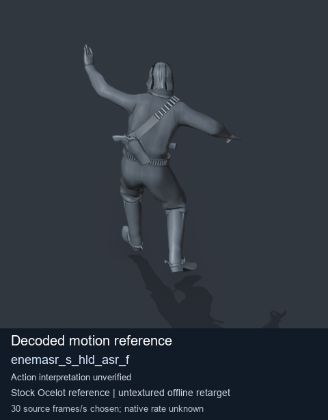
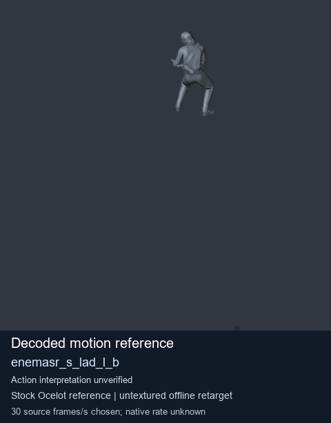
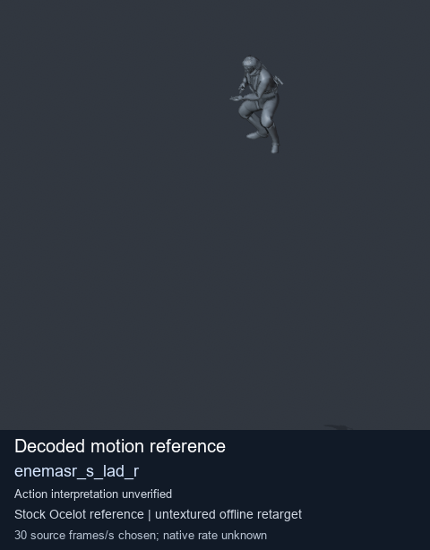

# Stock Soldier_common motion references / /Assets/tpp/motion/SI_game/fani/bodies/enem/enemasr - page 29

[Library](../README.md) · [Grouped directory](../browse/README.md) · [This source family](../browse/stock-soldier-enemasr-9a765a73.md) · [Switch mode](browse-stock-soldier-enemasr-9a765a73-29.md)

**Still images: no GIFs loaded** · 4 clips · 0.24 MiB downloaded.

Images reuse existing files. A small display width does not reduce download size. Open one clip for its larger titled GIF and original technical data.

Source-family grouping uses only recorded virtual directories; it does not establish an action, weapon, actor, rig or native compatibility. Existing descriptions and tags below are unchanged. Per-clip visual review may be pending; chosen preview speed is separate from unmeasured native timing.

| Preview | Animation | Category | Tags | Virtual GANI directory / file | MTAR / container location | Description | Frames / data |
| --- | --- | --- | --- | --- | --- | --- | --- |
|  | [Stock reference: enemasr_s_eldw_b](../clips/mgsv-tpp-soldier_common-payloadsha256-186e303584e3ab3e8acd447ee801e1c5c1bb320b8e01f2b050b3177a0f8cc8d0.md) <code>enemasr_s_eldw_b</code> | Stock Soldier_common motion references | <code>stock animation reference</code> <code>Soldier_common</code> <code>source-derived label</code> <code>Ocelot reference mesh</code> | <code>/Assets/tpp/motion/SI_game/fani/bodies/enem/enemasr</code> <code>enemasr_s_eldw_b.gani</code> | Retained MTAR: <code>Soldier_common.mtar</code> DAT / FPK membership unverified | Decoded stock reference enemasr_s_eldw_b; action interpretation unverified. | 87 raw 2.9 s chosen; native rate unknown [Full data](../clips/mgsv-tpp-soldier_common-payloadsha256-186e303584e3ab3e8acd447ee801e1c5c1bb320b8e01f2b050b3177a0f8cc8d0.md#technical-data) |
|  | [Stock reference: enemasr_s_hld_asr_f](../clips/mgsv-tpp-soldier_common-payloadsha256-1a3aba7393329e93165e0beb4d8b51d940dfdd8fbdc41f03226418bfa3ba5741.md) <code>enemasr_s_hld_asr_f</code> | Stock Soldier_common motion references | <code>stock animation reference</code> <code>Soldier_common</code> <code>source-derived label</code> <code>Ocelot reference mesh</code> | <code>/Assets/tpp/motion/SI_game/fani/bodies/enem/enemasr</code> <code>enemasr_s_hld_asr_f.gani</code> | Retained MTAR: <code>Soldier_common.mtar</code> DAT / FPK membership unverified | Decoded stock reference enemasr_s_hld_asr_f; action interpretation unverified. | 70 raw 2.33 s chosen; native rate unknown [Full data](../clips/mgsv-tpp-soldier_common-payloadsha256-1a3aba7393329e93165e0beb4d8b51d940dfdd8fbdc41f03226418bfa3ba5741.md#technical-data) |
|  | [Stock reference: enemasr_s_lad_l_b](../clips/mgsv-tpp-soldier_common-payloadsha256-c965f8fc85b67d766952fe0ac9582771e6940c5edfbee69d8b9c1cb7d5a7745a.md) <code>enemasr_s_lad_l_b</code> | Stock Soldier_common motion references | <code>stock animation reference</code> <code>Soldier_common</code> <code>source-derived label</code> <code>Ocelot reference mesh</code> | <code>/Assets/tpp/motion/SI_game/fani/bodies/enem/enemasr</code> <code>enemasr_s_lad_l_b.gani</code> | Retained MTAR: <code>Soldier_common.mtar</code> DAT / FPK membership unverified | Decoded stock reference enemasr_s_lad_l_b; action interpretation unverified. | 71 raw 2.37 s chosen; native rate unknown [Full data](../clips/mgsv-tpp-soldier_common-payloadsha256-c965f8fc85b67d766952fe0ac9582771e6940c5edfbee69d8b9c1cb7d5a7745a.md#technical-data) |
|  | [Stock reference: enemasr_s_lad_r](../clips/mgsv-tpp-soldier_common-payloadsha256-e1ecde307c4d269d2a3e83f947e95c827239e2da39064e596b212174d3f9c6f2.md) <code>enemasr_s_lad_r</code> | Stock Soldier_common motion references | <code>stock animation reference</code> <code>Soldier_common</code> <code>source-derived label</code> <code>Ocelot reference mesh</code> | <code>/Assets/tpp/motion/SI_game/fani/bodies/enem/enemasr</code> <code>enemasr_s_lad_r.gani</code> | Retained MTAR: <code>Soldier_common.mtar</code> DAT / FPK membership unverified | Decoded stock reference enemasr_s_lad_r; action interpretation unverified. | 71 raw 2.37 s chosen; native rate unknown [Full data](../clips/mgsv-tpp-soldier_common-payloadsha256-e1ecde307c4d269d2a3e83f947e95c827239e2da39064e596b212174d3f9c6f2.md#technical-data) |

[Source descriptions, confidence and credits](../description-sources.md) · [Complete JSON](../catalogue.json) · [CSV](../catalogue.csv)
