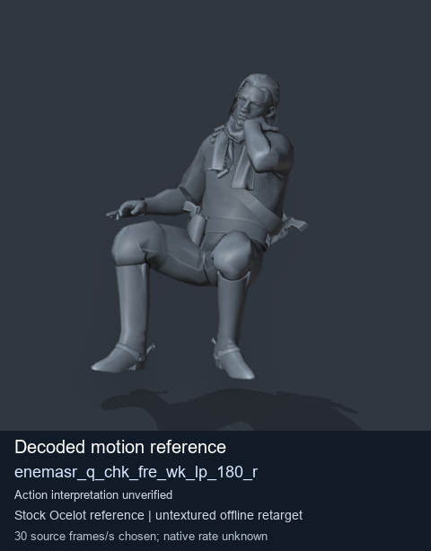
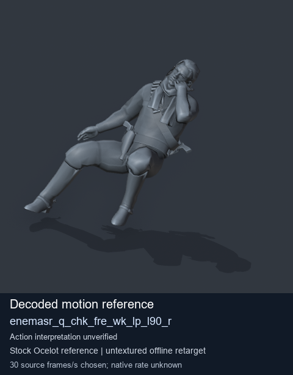
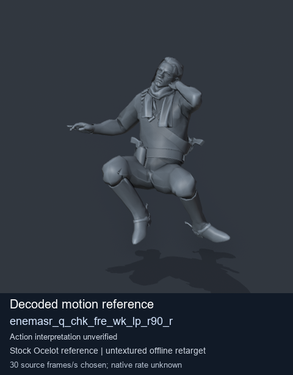
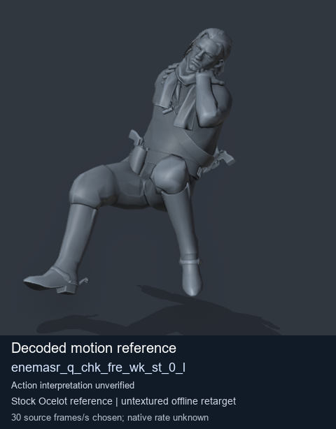

# Stock Soldier_common motion references / /Assets/tpp/motion/SI_game/fani/bodies/enem/enemasr - page 3

[Library](../README.md) · [Grouped directory](../browse/README.md) · [This source family](../browse/stock-soldier-enemasr-9a765a73.md) · [Switch mode](browse-stock-soldier-enemasr-9a765a73-3.md)

**Still images: no GIFs loaded** · 4 clips · 0.40 MiB downloaded.

Images reuse existing files. A small display width does not reduce download size. Open one clip for its larger titled GIF and original technical data.

Source-family grouping uses only recorded virtual directories; it does not establish an action, weapon, actor, rig or native compatibility. Existing descriptions and tags below are unchanged. Per-clip visual review may be pending; chosen preview speed is separate from unmeasured native timing.

| Preview | Animation | Category | Tags | Virtual GANI directory / file | MTAR / container location | Description | Frames / data |
| --- | --- | --- | --- | --- | --- | --- | --- |
|  | [Stock motion reference: enemasr_q_chk_fre_wk_lp_180_r](../clips/mgsv-tpp-soldier_common-payloadsha256-6f3760aaa0f8e124ca159f0871dd426c8b31eb34099947b0230b9b5f06839337.md) <code>enemasr_q_chk_fre_wk_lp_180_r</code> | Stock Soldier_common motion references | <code>stock body motion</code> <code>Soldier_common</code> <code>source-derived label</code> <code>Ocelot reference mesh</code> | <code>/Assets/tpp/motion/SI_game/fani/bodies/enem/enemasr</code> <code>enemasr_q_chk_fre_wk_lp_180_r.gani</code> | Retained MTAR: <code>Soldier_common.mtar</code> DAT / FPK membership unverified | Decoded stock body-motion reference enemasr_q_chk_fre_wk_lp_180_r; action interpretation unverified. | 90 raw 3.0 s chosen; native rate unknown [Full data](../clips/mgsv-tpp-soldier_common-payloadsha256-6f3760aaa0f8e124ca159f0871dd426c8b31eb34099947b0230b9b5f06839337.md#technical-data) |
|  | [Stock motion reference: enemasr_q_chk_fre_wk_lp_l90_r](../clips/mgsv-tpp-soldier_common-payloadsha256-412c8fbf2e7d0a06f2a08d6c9b4302173399ca2822fd018d9a45265d9c3509f5.md) <code>enemasr_q_chk_fre_wk_lp_l90_r</code> | Stock Soldier_common motion references | <code>stock body motion</code> <code>Soldier_common</code> <code>source-derived label</code> <code>Ocelot reference mesh</code> | <code>/Assets/tpp/motion/SI_game/fani/bodies/enem/enemasr</code> <code>enemasr_q_chk_fre_wk_lp_l90_r.gani</code> | Retained MTAR: <code>Soldier_common.mtar</code> DAT / FPK membership unverified | Decoded stock body-motion reference enemasr_q_chk_fre_wk_lp_l90_r; action interpretation unverified. | 90 raw 3.0 s chosen; native rate unknown [Full data](../clips/mgsv-tpp-soldier_common-payloadsha256-412c8fbf2e7d0a06f2a08d6c9b4302173399ca2822fd018d9a45265d9c3509f5.md#technical-data) |
|  | [Stock motion reference: enemasr_q_chk_fre_wk_lp_r90_r](../clips/mgsv-tpp-soldier_common-payloadsha256-6655c15438e06d59dc3c5fdcd941cddbfd689d0a41c748f8094cbd50b3755d5f.md) <code>enemasr_q_chk_fre_wk_lp_r90_r</code> | Stock Soldier_common motion references | <code>stock body motion</code> <code>Soldier_common</code> <code>source-derived label</code> <code>Ocelot reference mesh</code> | <code>/Assets/tpp/motion/SI_game/fani/bodies/enem/enemasr</code> <code>enemasr_q_chk_fre_wk_lp_r90_r.gani</code> | Retained MTAR: <code>Soldier_common.mtar</code> DAT / FPK membership unverified | Decoded stock body-motion reference enemasr_q_chk_fre_wk_lp_r90_r; action interpretation unverified. | 90 raw 3.0 s chosen; native rate unknown [Full data](../clips/mgsv-tpp-soldier_common-payloadsha256-6655c15438e06d59dc3c5fdcd941cddbfd689d0a41c748f8094cbd50b3755d5f.md#technical-data) |
|  | [Stock motion reference: enemasr_q_chk_fre_wk_st_0_l](../clips/mgsv-tpp-soldier_common-payloadsha256-590f78f34f2a0d634030918019b306195a87c18c133c003befa1569e3717087b.md) <code>enemasr_q_chk_fre_wk_st_0_l</code> | Stock Soldier_common motion references | <code>stock body motion</code> <code>Soldier_common</code> <code>source-derived label</code> <code>Ocelot reference mesh</code> | <code>/Assets/tpp/motion/SI_game/fani/bodies/enem/enemasr</code> <code>enemasr_q_chk_fre_wk_st_0_l.gani</code> | Retained MTAR: <code>Soldier_common.mtar</code> DAT / FPK membership unverified | Decoded stock body-motion reference enemasr_q_chk_fre_wk_st_0_l; action interpretation unverified. | 40 raw 1.33 s chosen; native rate unknown [Full data](../clips/mgsv-tpp-soldier_common-payloadsha256-590f78f34f2a0d634030918019b306195a87c18c133c003befa1569e3717087b.md#technical-data) |

[Source descriptions, confidence and credits](../description-sources.md) · [Complete JSON](../catalogue.json) · [CSV](../catalogue.csv)
