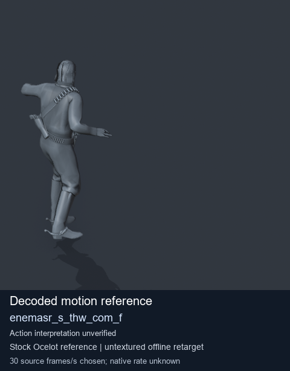
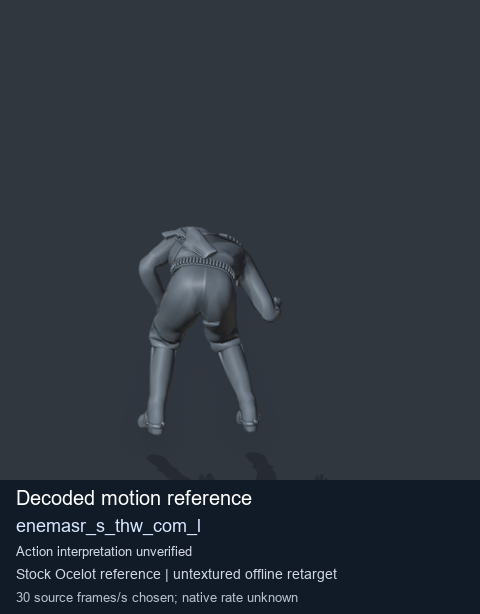
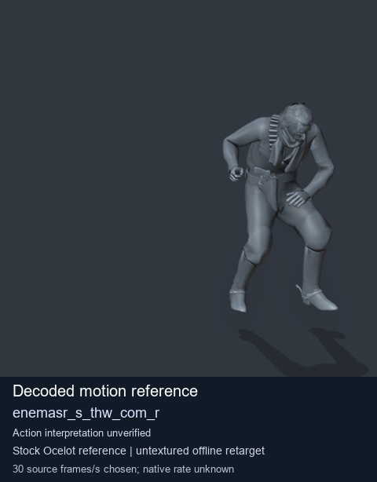
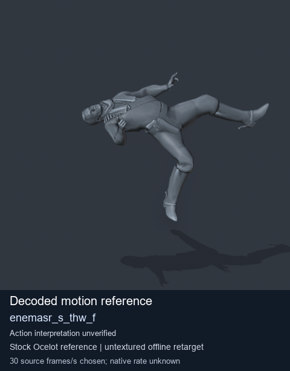

# Stock Soldier_common motion references / /Assets/tpp/motion/SI_game/fani/bodies/enem/enemasr - page 31

[Library](../README.md) · [Grouped directory](../browse/README.md) · [This source family](../browse/stock-soldier-enemasr-9a765a73.md) · [Switch mode](browse-stock-soldier-enemasr-9a765a73-31.md)

**Still images: no GIFs loaded** · 4 clips · 0.29 MiB downloaded.

Images reuse existing files. A small display width does not reduce download size. Open one clip for its larger titled GIF and original technical data.

Source-family grouping uses only recorded virtual directories; it does not establish an action, weapon, actor, rig or native compatibility. Existing descriptions and tags below are unchanged. Per-clip visual review may be pending; chosen preview speed is separate from unmeasured native timing.

| Preview | Animation | Category | Tags | Virtual GANI directory / file | MTAR / container location | Description | Frames / data |
| --- | --- | --- | --- | --- | --- | --- | --- |
|  | [Stock motion reference: enemasr_s_thw_com_f](../clips/mgsv-tpp-soldier_common-payloadsha256-18b38852d627d3f423dd109e5e1469a9e0e1adc21d29f1a457fad1279d5bfe27.md) <code>enemasr_s_thw_com_f</code> | Stock Soldier_common motion references | <code>stock body motion</code> <code>Soldier_common</code> <code>source-derived label</code> <code>Ocelot reference mesh</code> | <code>/Assets/tpp/motion/SI_game/fani/bodies/enem/enemasr</code> <code>enemasr_s_thw_com_f.gani</code> | Retained MTAR: <code>Soldier_common.mtar</code> DAT / FPK membership unverified | Decoded stock body-motion reference enemasr_s_thw_com_f; action interpretation unverified. | 130 raw 4.33 s chosen; native rate unknown [Full data](../clips/mgsv-tpp-soldier_common-payloadsha256-18b38852d627d3f423dd109e5e1469a9e0e1adc21d29f1a457fad1279d5bfe27.md#technical-data) |
|  | [Stock motion reference: enemasr_s_thw_com_l](../clips/mgsv-tpp-soldier_common-payloadsha256-88a192ccb3bc71487c9fd8301b0fba48412eaa4a2d08afe40395e1af2a446262.md) <code>enemasr_s_thw_com_l</code> | Stock Soldier_common motion references | <code>stock body motion</code> <code>Soldier_common</code> <code>source-derived label</code> <code>Ocelot reference mesh</code> | <code>/Assets/tpp/motion/SI_game/fani/bodies/enem/enemasr</code> <code>enemasr_s_thw_com_l.gani</code> | Retained MTAR: <code>Soldier_common.mtar</code> DAT / FPK membership unverified | Decoded stock body-motion reference enemasr_s_thw_com_l; action interpretation unverified. | 154 raw 5.13 s chosen; native rate unknown [Full data](../clips/mgsv-tpp-soldier_common-payloadsha256-88a192ccb3bc71487c9fd8301b0fba48412eaa4a2d08afe40395e1af2a446262.md#technical-data) |
|  | [Stock motion reference: enemasr_s_thw_com_r](../clips/mgsv-tpp-soldier_common-payloadsha256-8b7898169c45008aa4751ee906ce7d7acef3550bfe450f93c243c56742e3e56f.md) <code>enemasr_s_thw_com_r</code> | Stock Soldier_common motion references | <code>stock body motion</code> <code>Soldier_common</code> <code>source-derived label</code> <code>Ocelot reference mesh</code> | <code>/Assets/tpp/motion/SI_game/fani/bodies/enem/enemasr</code> <code>enemasr_s_thw_com_r.gani</code> | Retained MTAR: <code>Soldier_common.mtar</code> DAT / FPK membership unverified | Decoded stock body-motion reference enemasr_s_thw_com_r; action interpretation unverified. | 164 raw 5.47 s chosen; native rate unknown [Full data](../clips/mgsv-tpp-soldier_common-payloadsha256-8b7898169c45008aa4751ee906ce7d7acef3550bfe450f93c243c56742e3e56f.md#technical-data) |
|  | [Stock reference: enemasr_s_thw_f](../clips/mgsv-tpp-soldier_common-payloadsha256-d7f9ca2c679403c26d98667d99eae93756f8388f9856bfb8aba5e0ffc937a626.md) <code>enemasr_s_thw_f</code> | Stock Soldier_common motion references | <code>stock animation reference</code> <code>Soldier_common</code> <code>source-derived label</code> <code>Ocelot reference mesh</code> | <code>/Assets/tpp/motion/SI_game/fani/bodies/enem/enemasr</code> <code>enemasr_s_thw_f.gani</code> | Retained MTAR: <code>Soldier_common.mtar</code> DAT / FPK membership unverified | Decoded stock reference enemasr_s_thw_f; action interpretation unverified. | 134 raw 4.47 s chosen; native rate unknown [Full data](../clips/mgsv-tpp-soldier_common-payloadsha256-d7f9ca2c679403c26d98667d99eae93756f8388f9856bfb8aba5e0ffc937a626.md#technical-data) |

[Source descriptions, confidence and credits](../description-sources.md) · [Complete JSON](../catalogue.json) · [CSV](../catalogue.csv)
