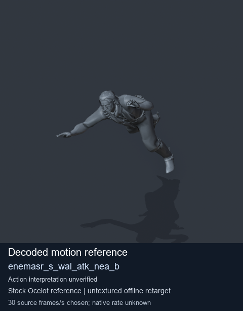
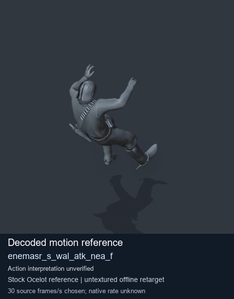
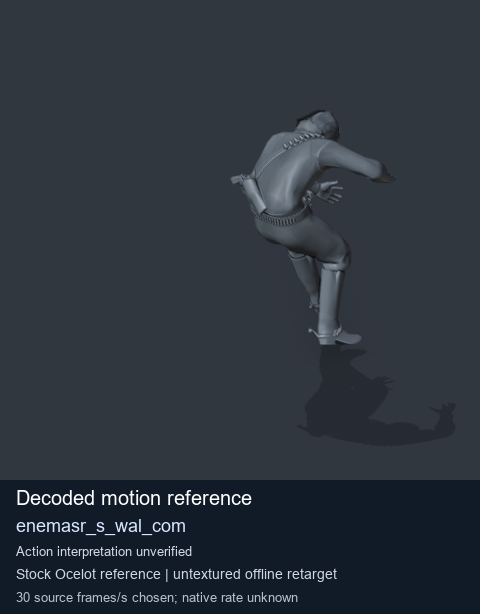
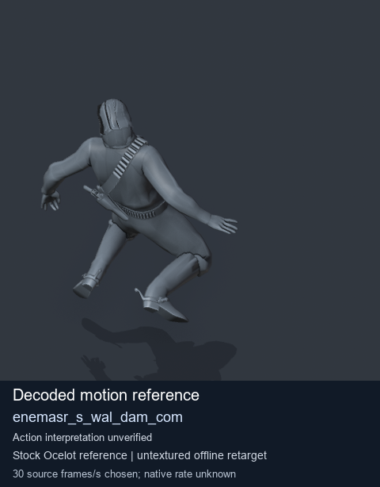

# Stock Soldier_common motion references / /Assets/tpp/motion/SI_game/fani/bodies/enem/enemasr - page 34

[Library](../README.md) · [Grouped directory](../browse/README.md) · [This source family](../browse/stock-soldier-enemasr-9a765a73.md) · [Switch mode](browse-stock-soldier-enemasr-9a765a73-34.md)

**Still images: no GIFs loaded** · 4 clips · 0.29 MiB downloaded.

Images reuse existing files. A small display width does not reduce download size. Open one clip for its larger titled GIF and original technical data.

Source-family grouping uses only recorded virtual directories; it does not establish an action, weapon, actor, rig or native compatibility. Existing descriptions and tags below are unchanged. Per-clip visual review may be pending; chosen preview speed is separate from unmeasured native timing.

| Preview | Animation | Category | Tags | Virtual GANI directory / file | MTAR / container location | Description | Frames / data |
| --- | --- | --- | --- | --- | --- | --- | --- |
|  | [Stock motion reference: enemasr_s_wal_atk_nea_b](../clips/mgsv-tpp-soldier_common-payloadsha256-32106e95d7fa61c4549c9098cadc64c70b47113a6e88ea4fce56b314e611f0e9.md) <code>enemasr_s_wal_atk_nea_b</code> | Stock Soldier_common motion references | <code>stock body motion</code> <code>Soldier_common</code> <code>source-derived label</code> <code>Ocelot reference mesh</code> | <code>/Assets/tpp/motion/SI_game/fani/bodies/enem/enemasr</code> <code>enemasr_s_wal_atk_nea_b.gani</code> | Retained MTAR: <code>Soldier_common.mtar</code> DAT / FPK membership unverified | Decoded stock body-motion reference enemasr_s_wal_atk_nea_b; action interpretation unverified. | 44 raw 1.47 s chosen; native rate unknown [Full data](../clips/mgsv-tpp-soldier_common-payloadsha256-32106e95d7fa61c4549c9098cadc64c70b47113a6e88ea4fce56b314e611f0e9.md#technical-data) |
|  | [Stock motion reference: enemasr_s_wal_atk_nea_f](../clips/mgsv-tpp-soldier_common-payloadsha256-a780bc73149cf1c657eac45b61a5f02fd6d3cc40b91ecc5cc6a4897d27221fdb.md) <code>enemasr_s_wal_atk_nea_f</code> | Stock Soldier_common motion references | <code>stock body motion</code> <code>Soldier_common</code> <code>source-derived label</code> <code>Ocelot reference mesh</code> | <code>/Assets/tpp/motion/SI_game/fani/bodies/enem/enemasr</code> <code>enemasr_s_wal_atk_nea_f.gani</code> | Retained MTAR: <code>Soldier_common.mtar</code> DAT / FPK membership unverified | Decoded stock body-motion reference enemasr_s_wal_atk_nea_f; action interpretation unverified. | 41 raw 1.37 s chosen; native rate unknown [Full data](../clips/mgsv-tpp-soldier_common-payloadsha256-a780bc73149cf1c657eac45b61a5f02fd6d3cc40b91ecc5cc6a4897d27221fdb.md#technical-data) |
|  | [Stock reference: enemasr_s_wal_com](../clips/mgsv-tpp-soldier_common-payloadsha256-091f19a6cfc4577ff9ef2675d991597a9b0f1f38e47362196ea70659ea5fb55e.md) <code>enemasr_s_wal_com</code> | Stock Soldier_common motion references | <code>stock animation reference</code> <code>Soldier_common</code> <code>source-derived label</code> <code>Ocelot reference mesh</code> | <code>/Assets/tpp/motion/SI_game/fani/bodies/enem/enemasr</code> <code>enemasr_s_wal_com.gani</code> | Retained MTAR: <code>Soldier_common.mtar</code> DAT / FPK membership unverified | Decoded stock reference enemasr_s_wal_com; action interpretation unverified. | 57 raw 1.9 s chosen; native rate unknown [Full data](../clips/mgsv-tpp-soldier_common-payloadsha256-091f19a6cfc4577ff9ef2675d991597a9b0f1f38e47362196ea70659ea5fb55e.md#technical-data) |
|  | [Stock reference: enemasr_s_wal_dam_com](../clips/mgsv-tpp-soldier_common-payloadsha256-d4dbd2d804c600195fe69b7c1a95e79095747e92654810afa6ebc8b628004ee6.md) <code>enemasr_s_wal_dam_com</code> | Stock Soldier_common motion references | <code>stock animation reference</code> <code>Soldier_common</code> <code>source-derived label</code> <code>Ocelot reference mesh</code> | <code>/Assets/tpp/motion/SI_game/fani/bodies/enem/enemasr</code> <code>enemasr_s_wal_dam_com.gani</code> | Retained MTAR: <code>Soldier_common.mtar</code> DAT / FPK membership unverified | Decoded stock reference enemasr_s_wal_dam_com; action interpretation unverified. | 139 raw 4.63 s chosen; native rate unknown [Full data](../clips/mgsv-tpp-soldier_common-payloadsha256-d4dbd2d804c600195fe69b7c1a95e79095747e92654810afa6ebc8b628004ee6.md#technical-data) |

[Source descriptions, confidence and credits](../description-sources.md) · [Complete JSON](../catalogue.json) · [CSV](../catalogue.csv)
