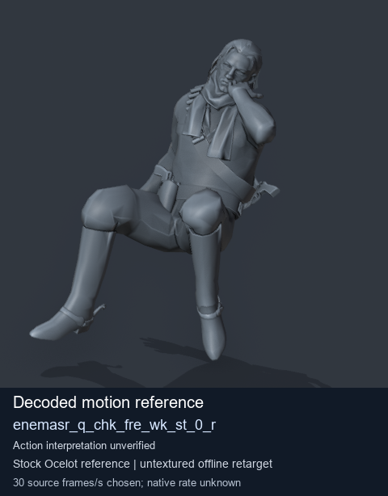
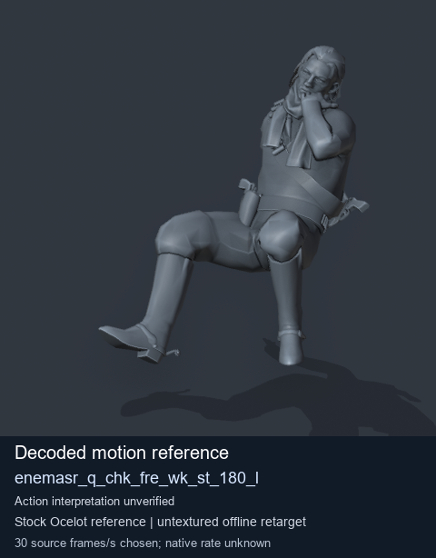
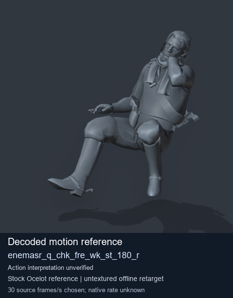
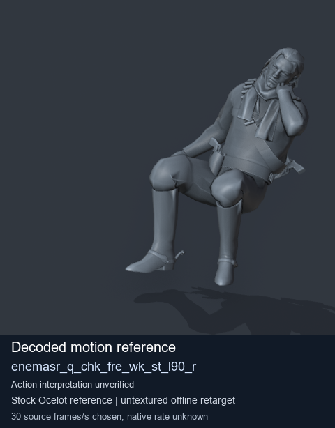

# Stock Soldier_common motion references / /Assets/tpp/motion/SI_game/fani/bodies/enem/enemasr - page 4

[Library](../README.md) · [Grouped directory](../browse/README.md) · [This source family](../browse/stock-soldier-enemasr-9a765a73.md) · [Switch mode](browse-stock-soldier-enemasr-9a765a73-4.md)

**Still images: no GIFs loaded** · 4 clips · 0.43 MiB downloaded.

Images reuse existing files. A small display width does not reduce download size. Open one clip for its larger titled GIF and original technical data.

Source-family grouping uses only recorded virtual directories; it does not establish an action, weapon, actor, rig or native compatibility. Existing descriptions and tags below are unchanged. Per-clip visual review may be pending; chosen preview speed is separate from unmeasured native timing.

| Preview | Animation | Category | Tags | Virtual GANI directory / file | MTAR / container location | Description | Frames / data |
| --- | --- | --- | --- | --- | --- | --- | --- |
|  | [Stock motion reference: enemasr_q_chk_fre_wk_st_0_r](../clips/mgsv-tpp-soldier_common-payloadsha256-e3e75cb0668e85207e7adb764f05286af3bdfd9b8b15619612b761d232f523ef.md) <code>enemasr_q_chk_fre_wk_st_0_r</code> | Stock Soldier_common motion references | <code>stock body motion</code> <code>Soldier_common</code> <code>source-derived label</code> <code>Ocelot reference mesh</code> | <code>/Assets/tpp/motion/SI_game/fani/bodies/enem/enemasr</code> <code>enemasr_q_chk_fre_wk_st_0_r.gani</code> | Retained MTAR: <code>Soldier_common.mtar</code> DAT / FPK membership unverified | Decoded stock body-motion reference enemasr_q_chk_fre_wk_st_0_r; action interpretation unverified. | 40 raw 1.33 s chosen; native rate unknown [Full data](../clips/mgsv-tpp-soldier_common-payloadsha256-e3e75cb0668e85207e7adb764f05286af3bdfd9b8b15619612b761d232f523ef.md#technical-data) |
|  | [Stock motion reference: enemasr_q_chk_fre_wk_st_180_l](../clips/mgsv-tpp-soldier_common-payloadsha256-a468f1329a1d7fb352b993dcc4a4b2f62b108816222fe0b7f6d5813ad8ecf3ae.md) <code>enemasr_q_chk_fre_wk_st_180_l</code> | Stock Soldier_common motion references | <code>stock body motion</code> <code>Soldier_common</code> <code>source-derived label</code> <code>Ocelot reference mesh</code> | <code>/Assets/tpp/motion/SI_game/fani/bodies/enem/enemasr</code> <code>enemasr_q_chk_fre_wk_st_180_l.gani</code> | Retained MTAR: <code>Soldier_common.mtar</code> DAT / FPK membership unverified | Decoded stock body-motion reference enemasr_q_chk_fre_wk_st_180_l; action interpretation unverified. | 40 raw 1.33 s chosen; native rate unknown [Full data](../clips/mgsv-tpp-soldier_common-payloadsha256-a468f1329a1d7fb352b993dcc4a4b2f62b108816222fe0b7f6d5813ad8ecf3ae.md#technical-data) |
|  | [Stock motion reference: enemasr_q_chk_fre_wk_st_180_r](../clips/mgsv-tpp-soldier_common-payloadsha256-99010a24150b1f11e46422a4a134790075b27af002d0d4a01facada6f31a0fb7.md) <code>enemasr_q_chk_fre_wk_st_180_r</code> | Stock Soldier_common motion references | <code>stock body motion</code> <code>Soldier_common</code> <code>source-derived label</code> <code>Ocelot reference mesh</code> | <code>/Assets/tpp/motion/SI_game/fani/bodies/enem/enemasr</code> <code>enemasr_q_chk_fre_wk_st_180_r.gani</code> | Retained MTAR: <code>Soldier_common.mtar</code> DAT / FPK membership unverified | Decoded stock body-motion reference enemasr_q_chk_fre_wk_st_180_r; action interpretation unverified. | 40 raw 1.33 s chosen; native rate unknown [Full data](../clips/mgsv-tpp-soldier_common-payloadsha256-99010a24150b1f11e46422a4a134790075b27af002d0d4a01facada6f31a0fb7.md#technical-data) |
|  | [Stock motion reference: enemasr_q_chk_fre_wk_st_l90_r](../clips/mgsv-tpp-soldier_common-payloadsha256-3f635a7e6302c4833ef8613483479115e3c550b828fe7ec0900a7cd39789b389.md) <code>enemasr_q_chk_fre_wk_st_l90_r</code> | Stock Soldier_common motion references | <code>stock body motion</code> <code>Soldier_common</code> <code>source-derived label</code> <code>Ocelot reference mesh</code> | <code>/Assets/tpp/motion/SI_game/fani/bodies/enem/enemasr</code> <code>enemasr_q_chk_fre_wk_st_l90_r.gani</code> | Retained MTAR: <code>Soldier_common.mtar</code> DAT / FPK membership unverified | Decoded stock body-motion reference enemasr_q_chk_fre_wk_st_l90_r; action interpretation unverified. | 30 raw 1.0 s chosen; native rate unknown [Full data](../clips/mgsv-tpp-soldier_common-payloadsha256-3f635a7e6302c4833ef8613483479115e3c550b828fe7ec0900a7cd39789b389.md#technical-data) |

[Source descriptions, confidence and credits](../description-sources.md) · [Complete JSON](../catalogue.json) · [CSV](../catalogue.csv)
