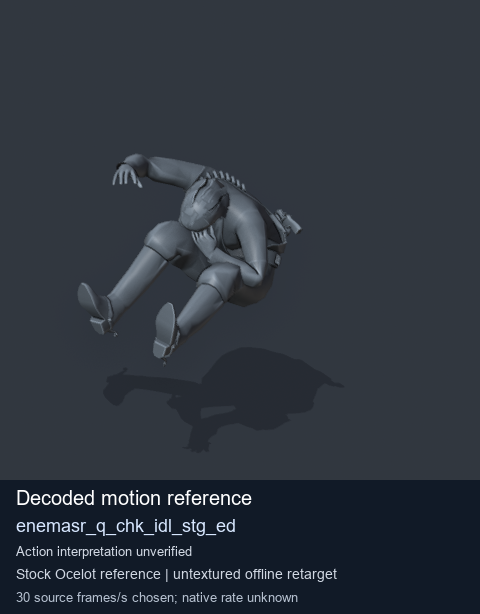
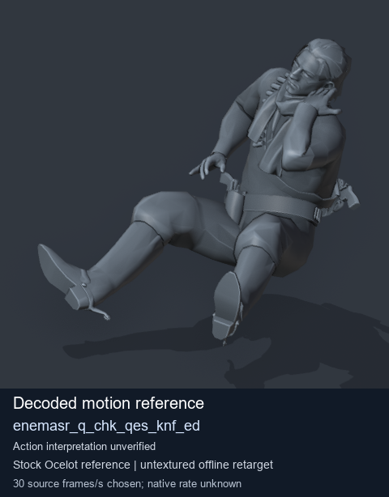
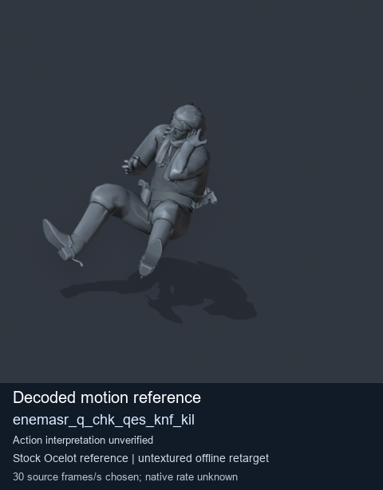

# Stock Soldier_common motion references / /Assets/tpp/motion/SI_game/fani/bodies/enem/enemasr - page 6

[Library](../README.md) · [Grouped directory](../browse/README.md) · [This source family](../browse/stock-soldier-enemasr-9a765a73.md) · [Switch mode](browse-stock-soldier-enemasr-9a765a73-6.md)

**Still images: no GIFs loaded** · 3 clips · 0.29 MiB downloaded.

Images reuse existing files. A small display width does not reduce download size. Open one clip for its larger titled GIF and original technical data.

Source-family grouping uses only recorded virtual directories; it does not establish an action, weapon, actor, rig or native compatibility. Existing descriptions and tags below are unchanged. Per-clip visual review may be pending; chosen preview speed is separate from unmeasured native timing.

| Preview | Animation | Category | Tags | Virtual GANI directory / file | MTAR / container location | Description | Frames / data |
| --- | --- | --- | --- | --- | --- | --- | --- |
|  | [Stock reference: enemasr_q_chk_idl_stg_ed](../clips/mgsv-tpp-soldier_common-payloadsha256-fae4cca7c7dc86c8b4c366a763e03588742d10220ba66befb68d3135180790db.md) <code>enemasr_q_chk_idl_stg_ed</code> | Stock Soldier_common motion references | <code>stock animation reference</code> <code>Soldier_common</code> <code>source-derived label</code> <code>Ocelot reference mesh</code> | <code>/Assets/tpp/motion/SI_game/fani/bodies/enem/enemasr</code> <code>enemasr_q_chk_idl_stg_ed.gani</code> | Retained MTAR: <code>Soldier_common.mtar</code> DAT / FPK membership unverified | Decoded stock reference enemasr_q_chk_idl_stg_ed; action interpretation unverified. | 205 raw 6.83 s chosen; native rate unknown [Full data](../clips/mgsv-tpp-soldier_common-payloadsha256-fae4cca7c7dc86c8b4c366a763e03588742d10220ba66befb68d3135180790db.md#technical-data) |
|  | [Stock motion reference: enemasr_q_chk_qes_knf_ed](../clips/mgsv-tpp-soldier_common-payloadsha256-d5d4feb12c158e7e9449f35e09bb8f381e93278b9278bb9b5586668c3a2998a3.md) <code>enemasr_q_chk_qes_knf_ed</code> | Stock Soldier_common motion references | <code>stock body motion</code> <code>Soldier_common</code> <code>source-derived label</code> <code>Ocelot reference mesh</code> | <code>/Assets/tpp/motion/SI_game/fani/bodies/enem/enemasr</code> <code>enemasr_q_chk_qes_knf_ed.gani</code> | Retained MTAR: <code>Soldier_common.mtar</code> DAT / FPK membership unverified | Decoded stock body-motion reference enemasr_q_chk_qes_knf_ed; action interpretation unverified. | 69 raw 2.3 s chosen; native rate unknown [Full data](../clips/mgsv-tpp-soldier_common-payloadsha256-d5d4feb12c158e7e9449f35e09bb8f381e93278b9278bb9b5586668c3a2998a3.md#technical-data) |
|  | [Stock reference: enemasr_q_chk_qes_knf_kil](../clips/mgsv-tpp-soldier_common-payloadsha256-a96a03b57ea78f36430d6570f876395006934fb73fb0065bf6593031222a1133.md) <code>enemasr_q_chk_qes_knf_kil</code> | Stock Soldier_common motion references | <code>stock animation reference</code> <code>Soldier_common</code> <code>source-derived label</code> <code>Ocelot reference mesh</code> | <code>/Assets/tpp/motion/SI_game/fani/bodies/enem/enemasr</code> <code>enemasr_q_chk_qes_knf_kil.gani</code> | Retained MTAR: <code>Soldier_common.mtar</code> DAT / FPK membership unverified | Decoded stock reference enemasr_q_chk_qes_knf_kil; action interpretation unverified. | 206 raw 6.87 s chosen; native rate unknown [Full data](../clips/mgsv-tpp-soldier_common-payloadsha256-a96a03b57ea78f36430d6570f876395006934fb73fb0065bf6593031222a1133.md#technical-data) |

[Source descriptions, confidence and credits](../description-sources.md) · [Complete JSON](../catalogue.json) · [CSV](../catalogue.csv)
