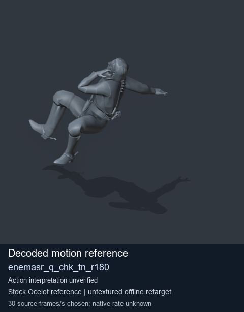
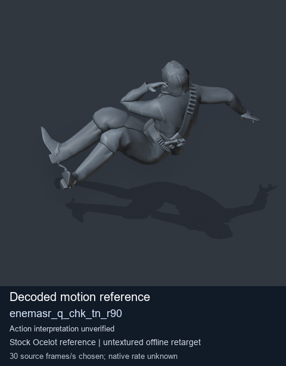
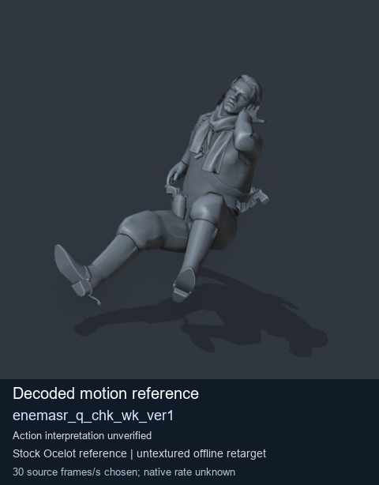
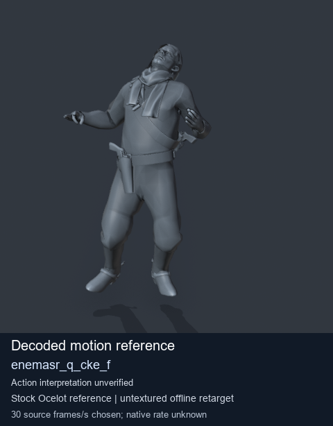

# Stock Soldier_common motion references / /Assets/tpp/motion/SI_game/fani/bodies/enem/enemasr - page 9

[Library](../README.md) · [Grouped directory](../browse/README.md) · [This source family](../browse/stock-soldier-enemasr-9a765a73.md) · [Switch mode](browse-stock-soldier-enemasr-9a765a73-9.md)

**Still images: no GIFs loaded** · 4 clips · 0.36 MiB downloaded.

Images reuse existing files. A small display width does not reduce download size. Open one clip for its larger titled GIF and original technical data.

Source-family grouping uses only recorded virtual directories; it does not establish an action, weapon, actor, rig or native compatibility. Existing descriptions and tags below are unchanged. Per-clip visual review may be pending; chosen preview speed is separate from unmeasured native timing.

| Preview | Animation | Category | Tags | Virtual GANI directory / file | MTAR / container location | Description | Frames / data |
| --- | --- | --- | --- | --- | --- | --- | --- |
|  | [Stock motion reference: enemasr_q_chk_tn_r180](../clips/mgsv-tpp-soldier_common-payloadsha256-535fded12368063db08c86ba5820535af7154d64849908a3188c972b1a9160eb.md) <code>enemasr_q_chk_tn_r180</code> | Stock Soldier_common motion references | <code>stock body motion</code> <code>Soldier_common</code> <code>source-derived label</code> <code>Ocelot reference mesh</code> | <code>/Assets/tpp/motion/SI_game/fani/bodies/enem/enemasr</code> <code>enemasr_q_chk_tn_r180.gani</code> | Retained MTAR: <code>Soldier_common.mtar</code> DAT / FPK membership unverified | Decoded stock body-motion reference enemasr_q_chk_tn_r180; action interpretation unverified. | 85 raw 2.83 s chosen; native rate unknown [Full data](../clips/mgsv-tpp-soldier_common-payloadsha256-535fded12368063db08c86ba5820535af7154d64849908a3188c972b1a9160eb.md#technical-data) |
|  | [Stock reference: enemasr_q_chk_tn_r90](../clips/mgsv-tpp-soldier_common-payloadsha256-0a4cb4c9b299c46229441a9c1d1552fe143f0cc38db67046962b31b7800b9da9.md) <code>enemasr_q_chk_tn_r90</code> | Stock Soldier_common motion references | <code>stock animation reference</code> <code>Soldier_common</code> <code>source-derived label</code> <code>Ocelot reference mesh</code> | <code>/Assets/tpp/motion/SI_game/fani/bodies/enem/enemasr</code> <code>enemasr_q_chk_tn_r90.gani</code> | Retained MTAR: <code>Soldier_common.mtar</code> DAT / FPK membership unverified | Decoded stock reference enemasr_q_chk_tn_r90; action interpretation unverified. | 61 raw 2.03 s chosen; native rate unknown [Full data](../clips/mgsv-tpp-soldier_common-payloadsha256-0a4cb4c9b299c46229441a9c1d1552fe143f0cc38db67046962b31b7800b9da9.md#technical-data) |
|  | [Stock motion reference: enemasr_q_chk_wk_ver1](../clips/mgsv-tpp-soldier_common-payloadsha256-f8d8d56e1075ba2a525fe1788188880ec11d8a97232262a0143009ddf85877ba.md) <code>enemasr_q_chk_wk_ver1</code> | Stock Soldier_common motion references | <code>stock body motion</code> <code>Soldier_common</code> <code>source-derived label</code> <code>Ocelot reference mesh</code> | <code>/Assets/tpp/motion/SI_game/fani/bodies/enem/enemasr</code> <code>enemasr_q_chk_wk_ver1.gani</code> | Retained MTAR: <code>Soldier_common.mtar</code> DAT / FPK membership unverified | Decoded stock body-motion reference enemasr_q_chk_wk_ver1; action interpretation unverified. | 81 raw 2.7 s chosen; native rate unknown [Full data](../clips/mgsv-tpp-soldier_common-payloadsha256-f8d8d56e1075ba2a525fe1788188880ec11d8a97232262a0143009ddf85877ba.md#technical-data) |
|  | [Stock reference: enemasr_q_cke_f](../clips/mgsv-tpp-soldier_common-payloadsha256-a145f164b2439a4e8c7a44016f11489e1984ed154af3637ee46208cdb2bd41c0.md) <code>enemasr_q_cke_f</code> | Stock Soldier_common motion references | <code>stock animation reference</code> <code>Soldier_common</code> <code>source-derived label</code> <code>Ocelot reference mesh</code> | <code>/Assets/tpp/motion/SI_game/fani/bodies/enem/enemasr</code> <code>enemasr_q_cke_f.gani</code> | Retained MTAR: <code>Soldier_common.mtar</code> DAT / FPK membership unverified | Decoded stock reference enemasr_q_cke_f; action interpretation unverified. | 82 raw 2.73 s chosen; native rate unknown [Full data](../clips/mgsv-tpp-soldier_common-payloadsha256-a145f164b2439a4e8c7a44016f11489e1984ed154af3637ee46208cdb2bd41c0.md#technical-data) |

[Source descriptions, confidence and credits](../description-sources.md) · [Complete JSON](../catalogue.json) · [CSV](../catalogue.csv)
