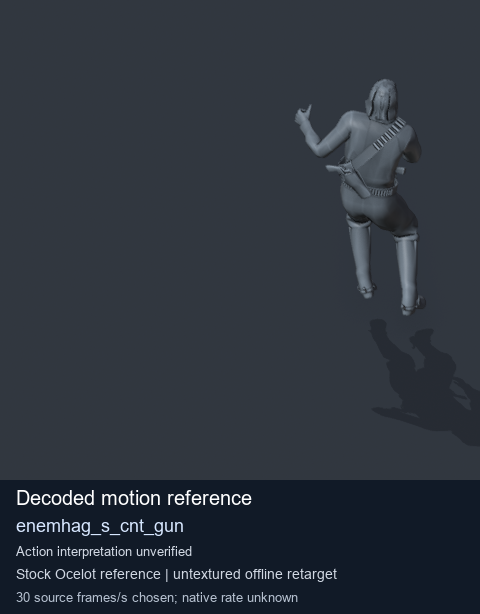
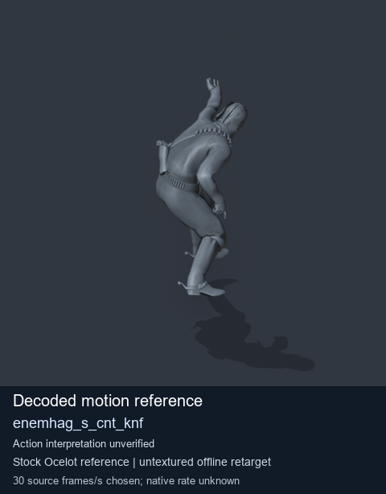
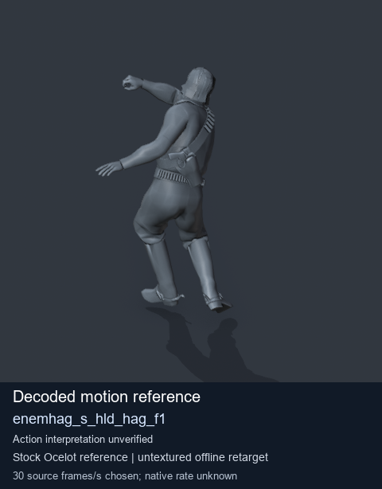

# Stock Soldier_common motion references / /Assets/tpp/motion/SI_game/fani/bodies/enem/enemhag - page 1

[Library](../README.md) · [Grouped directory](../browse/README.md) · [This source family](../browse/stock-soldier-enemhag-a00f00ef.md) · [Switch mode](browse-stock-soldier-enemhag-a00f00ef-1.md)

**Still images: no GIFs loaded** · 3 clips · 0.22 MiB downloaded.

Images reuse existing files. A small display width does not reduce download size. Open one clip for its larger titled GIF and original technical data.

Source-family grouping uses only recorded virtual directories; it does not establish an action, weapon, actor, rig or native compatibility. Existing descriptions and tags below are unchanged. Per-clip visual review may be pending; chosen preview speed is separate from unmeasured native timing.

| Preview | Animation | Category | Tags | Virtual GANI directory / file | MTAR / container location | Description | Frames / data |
| --- | --- | --- | --- | --- | --- | --- | --- |
|  | [Stock motion reference: enemhag_s_cnt_gun](../clips/mgsv-tpp-soldier_common-payloadsha256-04ca80895b292ab683443b93e3b50012625446298caf4e772d0253289bef4fe7.md) <code>enemhag_s_cnt_gun</code> | Stock Soldier_common motion references | <code>stock body motion</code> <code>Soldier_common</code> <code>source-derived label</code> <code>Ocelot reference mesh</code> | <code>/Assets/tpp/motion/SI_game/fani/bodies/enem/enemhag</code> <code>enemhag_s_cnt_gun.gani</code> | Retained MTAR: <code>Soldier_common.mtar</code> DAT / FPK membership unverified | Decoded stock body-motion reference enemhag_s_cnt_gun; action interpretation unverified. | 135 raw 4.5 s chosen; native rate unknown [Full data](../clips/mgsv-tpp-soldier_common-payloadsha256-04ca80895b292ab683443b93e3b50012625446298caf4e772d0253289bef4fe7.md#technical-data) |
|  | [Stock reference: enemhag_s_cnt_knf](../clips/mgsv-tpp-soldier_common-payloadsha256-79455e7e3bb927d11511cbd70c8537b4a65b9f80d0e17f493e8695190e3f6c6e.md) <code>enemhag_s_cnt_knf</code> | Stock Soldier_common motion references | <code>stock animation reference</code> <code>Soldier_common</code> <code>source-derived label</code> <code>Ocelot reference mesh</code> | <code>/Assets/tpp/motion/SI_game/fani/bodies/enem/enemhag</code> <code>enemhag_s_cnt_knf.gani</code> | Retained MTAR: <code>Soldier_common.mtar</code> DAT / FPK membership unverified | Decoded stock reference enemhag_s_cnt_knf; action interpretation unverified. | 182 raw 6.07 s chosen; native rate unknown [Full data](../clips/mgsv-tpp-soldier_common-payloadsha256-79455e7e3bb927d11511cbd70c8537b4a65b9f80d0e17f493e8695190e3f6c6e.md#technical-data) |
|  | [Stock reference: enemhag_s_hld_hag_f1](../clips/mgsv-tpp-soldier_common-payloadsha256-e5b22cdfd0c2177f13eeb635aa1bea68197db57419f442be3c77246d51e9f95b.md) <code>enemhag_s_hld_hag_f1</code> | Stock Soldier_common motion references | <code>stock animation reference</code> <code>Soldier_common</code> <code>source-derived label</code> <code>Ocelot reference mesh</code> | <code>/Assets/tpp/motion/SI_game/fani/bodies/enem/enemhag</code> <code>enemhag_s_hld_hag_f1.gani</code> | Retained MTAR: <code>Soldier_common.mtar</code> DAT / FPK membership unverified | Decoded stock reference enemhag_s_hld_hag_f1; action interpretation unverified. | 85 raw 2.83 s chosen; native rate unknown [Full data](../clips/mgsv-tpp-soldier_common-payloadsha256-e5b22cdfd0c2177f13eeb635aa1bea68197db57419f442be3c77246d51e9f95b.md#technical-data) |

[Source descriptions, confidence and credits](../description-sources.md) · [Complete JSON](../catalogue.json) · [CSV](../catalogue.csv)
