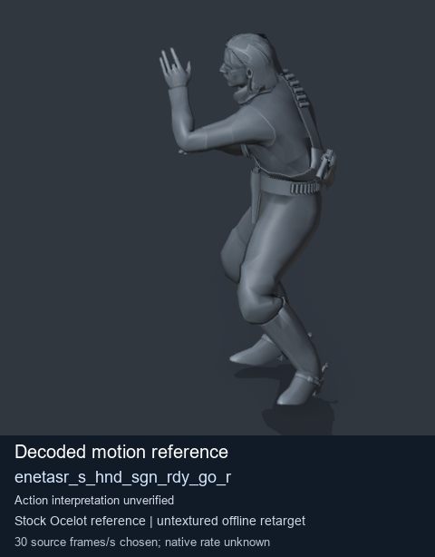
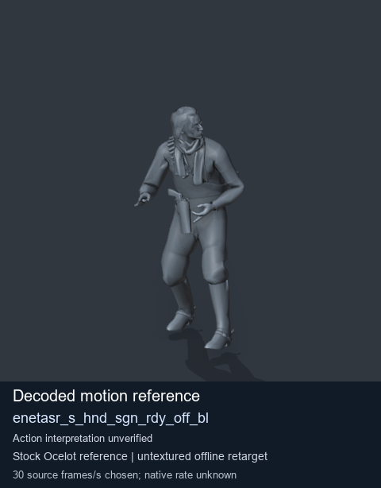
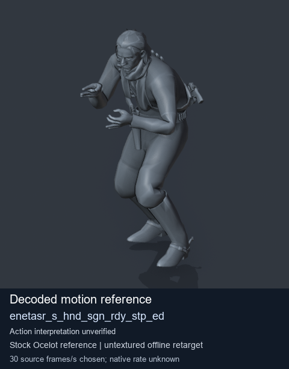

# Stock Soldier_common motion references / /Assets/tpp/motion/SI_game/fani/bodies/enet/enetasr - page 103

[Library](../README.md) · [Grouped directory](../browse/README.md) · [This source family](../browse/stock-soldier-enetasr-dd428991.md) · [Switch mode](browse-stock-soldier-enetasr-dd428991-103.md)

**Still images: no GIFs loaded** · 3 clips · 0.26 MiB downloaded.

Images reuse existing files. A small display width does not reduce download size. Open one clip for its larger titled GIF and original technical data.

Source-family grouping uses only recorded virtual directories; it does not establish an action, weapon, actor, rig or native compatibility. Existing descriptions and tags below are unchanged. Per-clip visual review may be pending; chosen preview speed is separate from unmeasured native timing.

| Preview | Animation | Category | Tags | Virtual GANI directory / file | MTAR / container location | Description | Frames / data |
| --- | --- | --- | --- | --- | --- | --- | --- |
|  | [Stock motion reference: enetasr_s_hnd_sgn_rdy_go_r](../clips/mgsv-tpp-soldier_common-payloadsha256-d382d74d7160bd1307b601347a5194edaa70b80062f96025ee8421f3d16ba2ee.md) <code>enetasr_s_hnd_sgn_rdy_go_r</code> | Stock Soldier_common motion references | <code>stock body motion</code> <code>Soldier_common</code> <code>source-derived label</code> <code>Ocelot reference mesh</code> | <code>/Assets/tpp/motion/SI_game/fani/bodies/enet/enetasr</code> <code>enetasr_s_hnd_sgn_rdy_go_r.gani</code> | Retained MTAR: <code>Soldier_common.mtar</code> DAT / FPK membership unverified | Decoded stock body-motion reference enetasr_s_hnd_sgn_rdy_go_r; action interpretation unverified. | 90 raw 3.0 s chosen; native rate unknown [Full data](../clips/mgsv-tpp-soldier_common-payloadsha256-d382d74d7160bd1307b601347a5194edaa70b80062f96025ee8421f3d16ba2ee.md#technical-data) |
|  | [Stock reference: enetasr_s_hnd_sgn_rdy_off_bl](../clips/mgsv-tpp-soldier_common-payloadsha256-fe2e63932569c8b855f9f8d0cff05e54e0a561d94a80f52cc22e634234431157.md) <code>enetasr_s_hnd_sgn_rdy_off_bl</code> | Stock Soldier_common motion references | <code>stock animation reference</code> <code>Soldier_common</code> <code>source-derived label</code> <code>Ocelot reference mesh</code> | <code>/Assets/tpp/motion/SI_game/fani/bodies/enet/enetasr</code> <code>enetasr_s_hnd_sgn_rdy_off_bl.gani</code> | Retained MTAR: <code>Soldier_common.mtar</code> DAT / FPK membership unverified | Decoded stock reference enetasr_s_hnd_sgn_rdy_off_bl; action interpretation unverified. | 230 raw 7.67 s chosen; native rate unknown [Full data](../clips/mgsv-tpp-soldier_common-payloadsha256-fe2e63932569c8b855f9f8d0cff05e54e0a561d94a80f52cc22e634234431157.md#technical-data) |
|  | [Stock motion reference: enetasr_s_hnd_sgn_rdy_stp_ed](../clips/mgsv-tpp-soldier_common-payloadsha256-760c22003467ffc8821c326426927880fdfc6c7ff8d86c21acd83e040b5d91d7.md) <code>enetasr_s_hnd_sgn_rdy_stp_ed</code> | Stock Soldier_common motion references | <code>stock body motion</code> <code>Soldier_common</code> <code>source-derived label</code> <code>Ocelot reference mesh</code> | <code>/Assets/tpp/motion/SI_game/fani/bodies/enet/enetasr</code> <code>enetasr_s_hnd_sgn_rdy_stp_ed.gani</code> | Retained MTAR: <code>Soldier_common.mtar</code> DAT / FPK membership unverified | Decoded stock body-motion reference enetasr_s_hnd_sgn_rdy_stp_ed; action interpretation unverified. | 55 raw 1.83 s chosen; native rate unknown [Full data](../clips/mgsv-tpp-soldier_common-payloadsha256-760c22003467ffc8821c326426927880fdfc6c7ff8d86c21acd83e040b5d91d7.md#technical-data) |

[Source descriptions, confidence and credits](../description-sources.md) · [Complete JSON](../catalogue.json) · [CSV](../catalogue.csv)
