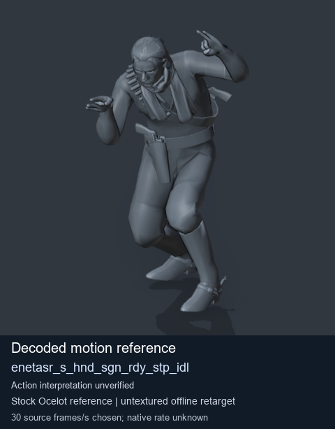
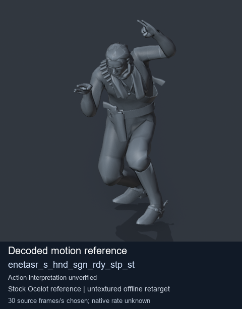
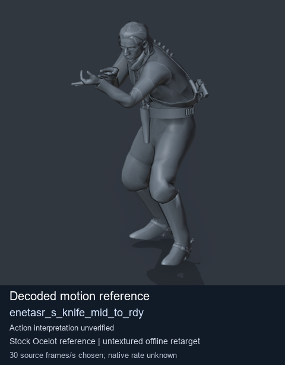
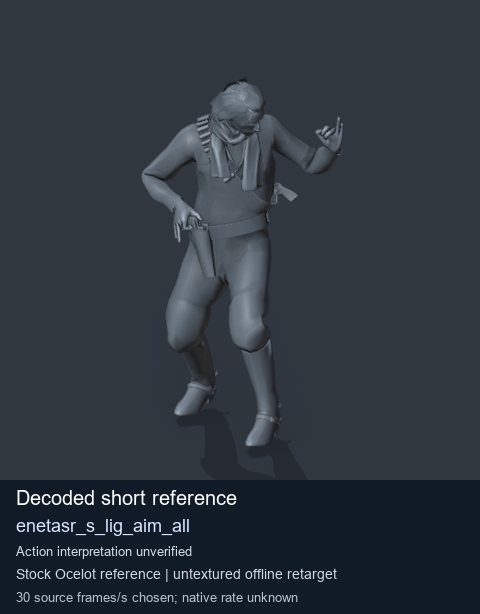

# Stock Soldier_common motion references / /Assets/tpp/motion/SI_game/fani/bodies/enet/enetasr - page 104

[Library](../README.md) · [Grouped directory](../browse/README.md) · [This source family](../browse/stock-soldier-enetasr-dd428991.md) · [Switch mode](browse-stock-soldier-enetasr-dd428991-104.md)

**Still images: no GIFs loaded** · 4 clips · 0.39 MiB downloaded.

Images reuse existing files. A small display width does not reduce download size. Open one clip for its larger titled GIF and original technical data.

Source-family grouping uses only recorded virtual directories; it does not establish an action, weapon, actor, rig or native compatibility. Existing descriptions and tags below are unchanged. Per-clip visual review may be pending; chosen preview speed is separate from unmeasured native timing.

| Preview | Animation | Category | Tags | Virtual GANI directory / file | MTAR / container location | Description | Frames / data |
| --- | --- | --- | --- | --- | --- | --- | --- |
|  | [Stock reference: enetasr_s_hnd_sgn_rdy_stp_idl](../clips/mgsv-tpp-soldier_common-payloadsha256-fa94ab4046b34f85238dc9c8c2f87f9e3afc0c77671f11739e3b527dbf84a449.md) <code>enetasr_s_hnd_sgn_rdy_stp_idl</code> | Stock Soldier_common motion references | <code>stock animation reference</code> <code>Soldier_common</code> <code>source-derived label</code> <code>Ocelot reference mesh</code> | <code>/Assets/tpp/motion/SI_game/fani/bodies/enet/enetasr</code> <code>enetasr_s_hnd_sgn_rdy_stp_idl.gani</code> | Retained MTAR: <code>Soldier_common.mtar</code> DAT / FPK membership unverified | Decoded stock reference enetasr_s_hnd_sgn_rdy_stp_idl; action interpretation unverified. | 209 raw 6.97 s chosen; native rate unknown [Full data](../clips/mgsv-tpp-soldier_common-payloadsha256-fa94ab4046b34f85238dc9c8c2f87f9e3afc0c77671f11739e3b527dbf84a449.md#technical-data) |
|  | [Stock motion reference: enetasr_s_hnd_sgn_rdy_stp_st](../clips/mgsv-tpp-soldier_common-payloadsha256-5d452d268cafd02d7583a7ea6e4d73f9e92625d098892cbf274540e7e864364a.md) <code>enetasr_s_hnd_sgn_rdy_stp_st</code> | Stock Soldier_common motion references | <code>stock body motion</code> <code>Soldier_common</code> <code>source-derived label</code> <code>Ocelot reference mesh</code> | <code>/Assets/tpp/motion/SI_game/fani/bodies/enet/enetasr</code> <code>enetasr_s_hnd_sgn_rdy_stp_st.gani</code> | Retained MTAR: <code>Soldier_common.mtar</code> DAT / FPK membership unverified | Decoded stock body-motion reference enetasr_s_hnd_sgn_rdy_stp_st; action interpretation unverified. | 89 raw 2.97 s chosen; native rate unknown [Full data](../clips/mgsv-tpp-soldier_common-payloadsha256-5d452d268cafd02d7583a7ea6e4d73f9e92625d098892cbf274540e7e864364a.md#technical-data) |
|  | [Stock reference: enetasr_s_knife_mid_to_rdy](../clips/mgsv-tpp-soldier_common-payloadsha256-e81a29d21632099f349d37bcf562578ee3f49d355104a5ef19eedd33d1e562c5.md) <code>enetasr_s_knife_mid_to_rdy</code> | Stock Soldier_common motion references | <code>stock animation reference</code> <code>Soldier_common</code> <code>source-derived label</code> <code>Ocelot reference mesh</code> | <code>/Assets/tpp/motion/SI_game/fani/bodies/enet/enetasr</code> <code>enetasr_s_knife_mid_to_rdy.gani</code> | Retained MTAR: <code>Soldier_common.mtar</code> DAT / FPK membership unverified | Decoded stock reference enetasr_s_knife_mid_to_rdy; action interpretation unverified. | 26 raw 0.87 s chosen; native rate unknown [Full data](../clips/mgsv-tpp-soldier_common-payloadsha256-e81a29d21632099f349d37bcf562578ee3f49d355104a5ef19eedd33d1e562c5.md#technical-data) |
|  | [Stock reference: enetasr_s_lig_aim_all](../clips/mgsv-tpp-soldier_common-payloadsha256-a1e4d2ed20d9989d2a2f30db5c3fd1117cd7579a437188bc1ec8418578aa7781.md) <code>enetasr_s_lig_aim_all</code> | Stock Soldier_common motion references | <code>stock animation reference</code> <code>Soldier_common</code> <code>source-derived label</code> <code>Ocelot reference mesh</code> | <code>/Assets/tpp/motion/SI_game/fani/bodies/enet/enetasr</code> <code>enetasr_s_lig_aim_all.gani</code> | Retained MTAR: <code>Soldier_common.mtar</code> DAT / FPK membership unverified | Decoded stock reference enetasr_s_lig_aim_all; action interpretation unverified. | 8 raw 0.27 s chosen; native rate unknown [Full data](../clips/mgsv-tpp-soldier_common-payloadsha256-a1e4d2ed20d9989d2a2f30db5c3fd1117cd7579a437188bc1ec8418578aa7781.md#technical-data) |

[Source descriptions, confidence and credits](../description-sources.md) · [Complete JSON](../catalogue.json) · [CSV](../catalogue.csv)
