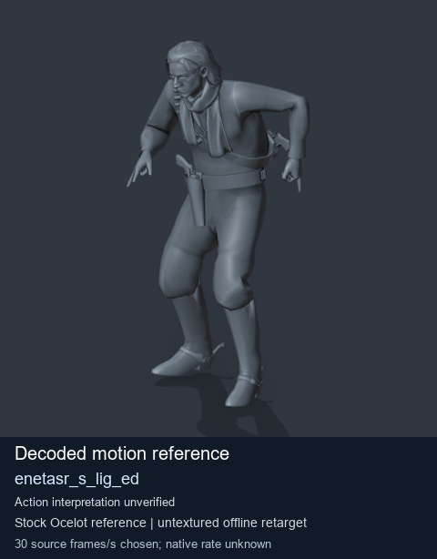
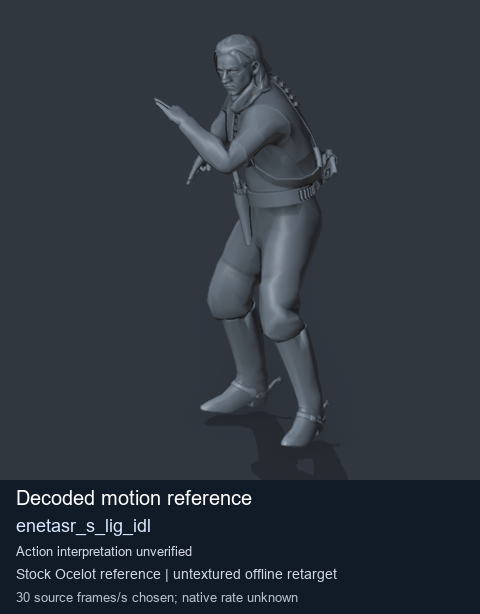
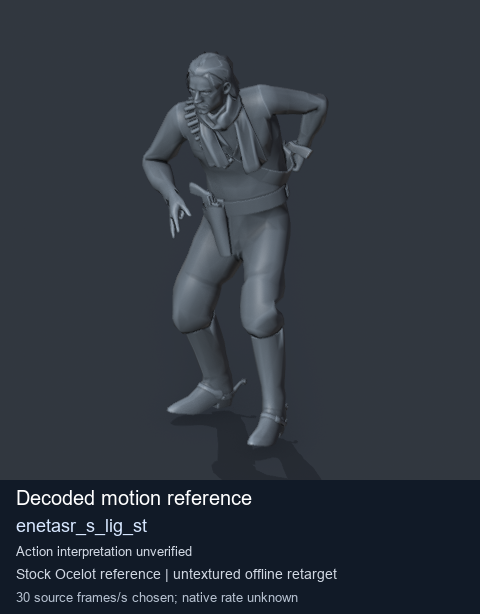
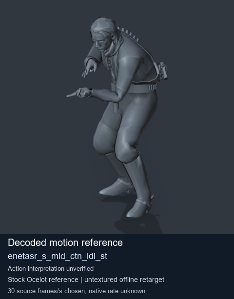

# Stock Soldier_common motion references / /Assets/tpp/motion/SI_game/fani/bodies/enet/enetasr - page 105

[Library](../README.md) · [Grouped directory](../browse/README.md) · [This source family](../browse/stock-soldier-enetasr-dd428991.md) · [Switch mode](browse-stock-soldier-enetasr-dd428991-105.md)

**Still images: no GIFs loaded** · 4 clips · 0.38 MiB downloaded.

Images reuse existing files. A small display width does not reduce download size. Open one clip for its larger titled GIF and original technical data.

Source-family grouping uses only recorded virtual directories; it does not establish an action, weapon, actor, rig or native compatibility. Existing descriptions and tags below are unchanged. Per-clip visual review may be pending; chosen preview speed is separate from unmeasured native timing.

| Preview | Animation | Category | Tags | Virtual GANI directory / file | MTAR / container location | Description | Frames / data |
| --- | --- | --- | --- | --- | --- | --- | --- |
|  | [Stock reference: enetasr_s_lig_ed](../clips/mgsv-tpp-soldier_common-payloadsha256-df4cb403a411dcdf7c8bad50b8de3745311f8db2c68058ac2cdc1f3c1c3a4a2b.md) <code>enetasr_s_lig_ed</code> | Stock Soldier_common motion references | <code>stock animation reference</code> <code>Soldier_common</code> <code>source-derived label</code> <code>Ocelot reference mesh</code> | <code>/Assets/tpp/motion/SI_game/fani/bodies/enet/enetasr</code> <code>enetasr_s_lig_ed.gani</code> | Retained MTAR: <code>Soldier_common.mtar</code> DAT / FPK membership unverified | Decoded stock reference enetasr_s_lig_ed; action interpretation unverified. | 68 raw 2.27 s chosen; native rate unknown [Full data](../clips/mgsv-tpp-soldier_common-payloadsha256-df4cb403a411dcdf7c8bad50b8de3745311f8db2c68058ac2cdc1f3c1c3a4a2b.md#technical-data) |
|  | [Stock reference: enetasr_s_lig_idl](../clips/mgsv-tpp-soldier_common-payloadsha256-8e7f7dce760952c2c1578cf7000c1c4bc29261baaa5376bac92c8a1de8657ee3.md) <code>enetasr_s_lig_idl</code> | Stock Soldier_common motion references | <code>stock animation reference</code> <code>Soldier_common</code> <code>source-derived label</code> <code>Ocelot reference mesh</code> | <code>/Assets/tpp/motion/SI_game/fani/bodies/enet/enetasr</code> <code>enetasr_s_lig_idl.gani</code> | Retained MTAR: <code>Soldier_common.mtar</code> DAT / FPK membership unverified | Decoded stock reference enetasr_s_lig_idl; action interpretation unverified. | 294 raw 9.8 s chosen; native rate unknown [Full data](../clips/mgsv-tpp-soldier_common-payloadsha256-8e7f7dce760952c2c1578cf7000c1c4bc29261baaa5376bac92c8a1de8657ee3.md#technical-data) |
|  | [Stock motion reference: enetasr_s_lig_st](../clips/mgsv-tpp-soldier_common-payloadsha256-56ebad6560acd949a9742e2f66404f3a10c82a5948389b4e3d321a6d0974ee28.md) <code>enetasr_s_lig_st</code> | Stock Soldier_common motion references | <code>stock body motion</code> <code>Soldier_common</code> <code>source-derived label</code> <code>Ocelot reference mesh</code> | <code>/Assets/tpp/motion/SI_game/fani/bodies/enet/enetasr</code> <code>enetasr_s_lig_st.gani</code> | Retained MTAR: <code>Soldier_common.mtar</code> DAT / FPK membership unverified | Decoded stock body-motion reference enetasr_s_lig_st; action interpretation unverified. | 68 raw 2.27 s chosen; native rate unknown [Full data](../clips/mgsv-tpp-soldier_common-payloadsha256-56ebad6560acd949a9742e2f66404f3a10c82a5948389b4e3d321a6d0974ee28.md#technical-data) |
|  | [Stock motion reference: enetasr_s_mid_ctn_idl_st](../clips/mgsv-tpp-soldier_common-payloadsha256-04a9cb3e4a6a96c1991e662ce04ee62152eb44df66102f76bef6881a0ba15bb5.md) <code>enetasr_s_mid_ctn_idl_st</code> | Stock Soldier_common motion references | <code>stock body motion</code> <code>Soldier_common</code> <code>source-derived label</code> <code>Ocelot reference mesh</code> | <code>/Assets/tpp/motion/SI_game/fani/bodies/enet/enetasr</code> <code>enetasr_s_mid_ctn_idl_st.gani</code> | Retained MTAR: <code>Soldier_common.mtar</code> DAT / FPK membership unverified | Decoded stock body-motion reference enetasr_s_mid_ctn_idl_st; action interpretation unverified. | 30 raw 1.0 s chosen; native rate unknown [Full data](../clips/mgsv-tpp-soldier_common-payloadsha256-04a9cb3e4a6a96c1991e662ce04ee62152eb44df66102f76bef6881a0ba15bb5.md#technical-data) |

[Source descriptions, confidence and credits](../description-sources.md) · [Complete JSON](../catalogue.json) · [CSV](../catalogue.csv)
