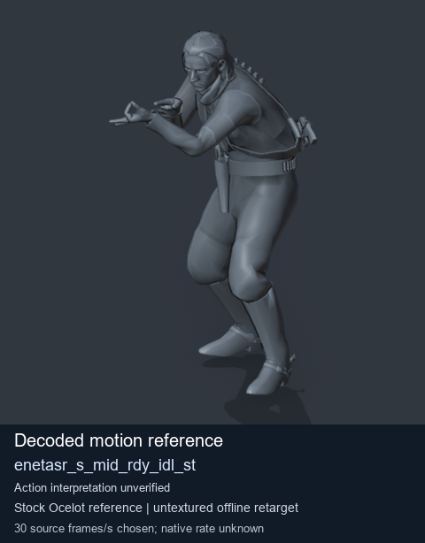
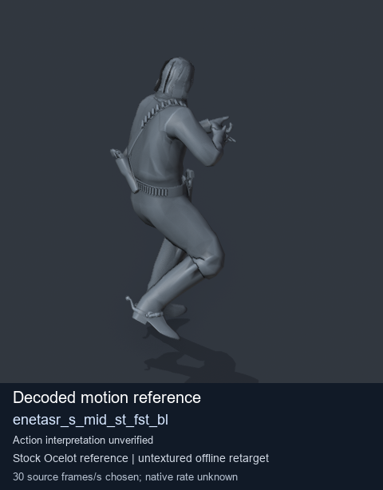
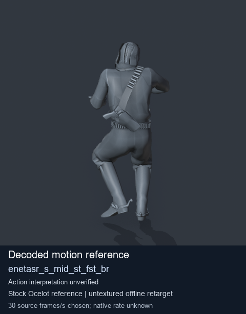
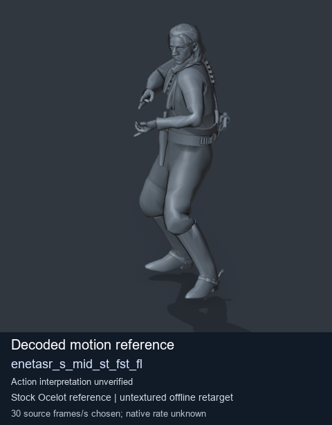

# Stock Soldier_common motion references / /Assets/tpp/motion/SI_game/fani/bodies/enet/enetasr - page 107

[Library](../README.md) · [Grouped directory](../browse/README.md) · [This source family](../browse/stock-soldier-enetasr-dd428991.md) · [Switch mode](browse-stock-soldier-enetasr-dd428991-107.md)

**Still images: no GIFs loaded** · 4 clips · 0.35 MiB downloaded.

Images reuse existing files. A small display width does not reduce download size. Open one clip for its larger titled GIF and original technical data.

Source-family grouping uses only recorded virtual directories; it does not establish an action, weapon, actor, rig or native compatibility. Existing descriptions and tags below are unchanged. Per-clip visual review may be pending; chosen preview speed is separate from unmeasured native timing.

| Preview | Animation | Category | Tags | Virtual GANI directory / file | MTAR / container location | Description | Frames / data |
| --- | --- | --- | --- | --- | --- | --- | --- |
|  | [Stock motion reference: enetasr_s_mid_rdy_idl_st](../clips/mgsv-tpp-soldier_common-payloadsha256-3aac87c85ca80eff54f90cdc074affc99be05921581090839fc425e5c9103c85.md) <code>enetasr_s_mid_rdy_idl_st</code> | Stock Soldier_common motion references | <code>stock body motion</code> <code>Soldier_common</code> <code>source-derived label</code> <code>Ocelot reference mesh</code> | <code>/Assets/tpp/motion/SI_game/fani/bodies/enet/enetasr</code> <code>enetasr_s_mid_rdy_idl_st.gani</code> | Retained MTAR: <code>Soldier_common.mtar</code> DAT / FPK membership unverified | Decoded stock body-motion reference enetasr_s_mid_rdy_idl_st; action interpretation unverified. | 30 raw 1.0 s chosen; native rate unknown [Full data](../clips/mgsv-tpp-soldier_common-payloadsha256-3aac87c85ca80eff54f90cdc074affc99be05921581090839fc425e5c9103c85.md#technical-data) |
|  | [Stock reference: enetasr_s_mid_st_fst_bl](../clips/mgsv-tpp-soldier_common-payloadsha256-2bc13e82f9fb0f506ff81ead0b8c625c510b311daaa5dd80a8ab5799bfdc9137.md) <code>enetasr_s_mid_st_fst_bl</code> | Stock Soldier_common motion references | <code>stock animation reference</code> <code>Soldier_common</code> <code>source-derived label</code> <code>Ocelot reference mesh</code> | <code>/Assets/tpp/motion/SI_game/fani/bodies/enet/enetasr</code> <code>enetasr_s_mid_st_fst_bl.gani</code> | Retained MTAR: <code>Soldier_common.mtar</code> DAT / FPK membership unverified | Decoded stock reference enetasr_s_mid_st_fst_bl; action interpretation unverified. | 46 raw 1.53 s chosen; native rate unknown [Full data](../clips/mgsv-tpp-soldier_common-payloadsha256-2bc13e82f9fb0f506ff81ead0b8c625c510b311daaa5dd80a8ab5799bfdc9137.md#technical-data) |
|  | [Stock reference: enetasr_s_mid_st_fst_br](../clips/mgsv-tpp-soldier_common-payloadsha256-ca2a9e06072e70803b5afc2843024cbf9d6b37822393983f9cddd93d4f3b586a.md) <code>enetasr_s_mid_st_fst_br</code> | Stock Soldier_common motion references | <code>stock animation reference</code> <code>Soldier_common</code> <code>source-derived label</code> <code>Ocelot reference mesh</code> | <code>/Assets/tpp/motion/SI_game/fani/bodies/enet/enetasr</code> <code>enetasr_s_mid_st_fst_br.gani</code> | Retained MTAR: <code>Soldier_common.mtar</code> DAT / FPK membership unverified | Decoded stock reference enetasr_s_mid_st_fst_br; action interpretation unverified. | 56 raw 1.87 s chosen; native rate unknown [Full data](../clips/mgsv-tpp-soldier_common-payloadsha256-ca2a9e06072e70803b5afc2843024cbf9d6b37822393983f9cddd93d4f3b586a.md#technical-data) |
|  | [Stock reference: enetasr_s_mid_st_fst_fl](../clips/mgsv-tpp-soldier_common-payloadsha256-8902c60ce5258986d639305ac6b4922482fe3c562119ee31ea94c4932ab02edd.md) <code>enetasr_s_mid_st_fst_fl</code> | Stock Soldier_common motion references | <code>stock animation reference</code> <code>Soldier_common</code> <code>source-derived label</code> <code>Ocelot reference mesh</code> | <code>/Assets/tpp/motion/SI_game/fani/bodies/enet/enetasr</code> <code>enetasr_s_mid_st_fst_fl.gani</code> | Retained MTAR: <code>Soldier_common.mtar</code> DAT / FPK membership unverified | Decoded stock reference enetasr_s_mid_st_fst_fl; action interpretation unverified. | 28 raw 0.93 s chosen; native rate unknown [Full data](../clips/mgsv-tpp-soldier_common-payloadsha256-8902c60ce5258986d639305ac6b4922482fe3c562119ee31ea94c4932ab02edd.md#technical-data) |

[Source descriptions, confidence and credits](../description-sources.md) · [Complete JSON](../catalogue.json) · [CSV](../catalogue.csv)
