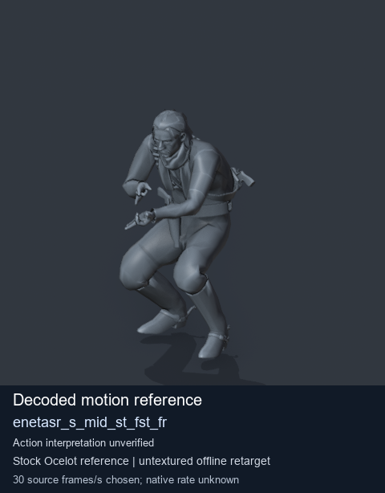
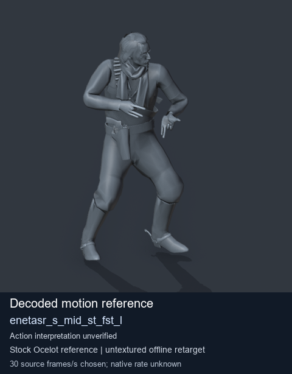
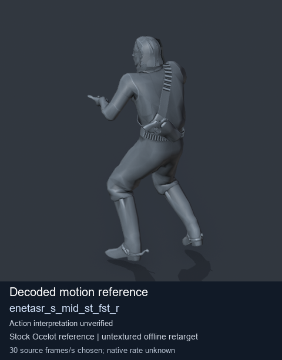
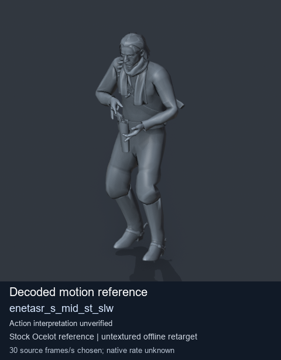

# Stock Soldier_common motion references / /Assets/tpp/motion/SI_game/fani/bodies/enet/enetasr - page 108

[Library](../README.md) · [Grouped directory](../browse/README.md) · [This source family](../browse/stock-soldier-enetasr-dd428991.md) · [Switch mode](browse-stock-soldier-enetasr-dd428991-108.md)

**Still images: no GIFs loaded** · 4 clips · 0.37 MiB downloaded.

Images reuse existing files. A small display width does not reduce download size. Open one clip for its larger titled GIF and original technical data.

Source-family grouping uses only recorded virtual directories; it does not establish an action, weapon, actor, rig or native compatibility. Existing descriptions and tags below are unchanged. Per-clip visual review may be pending; chosen preview speed is separate from unmeasured native timing.

| Preview | Animation | Category | Tags | Virtual GANI directory / file | MTAR / container location | Description | Frames / data |
| --- | --- | --- | --- | --- | --- | --- | --- |
|  | [Stock motion reference: enetasr_s_mid_st_fst_fr](../clips/mgsv-tpp-soldier_common-payloadsha256-bc24e04136bebd33b7090ceec5dd247666bdb50cc5a1002ed65a3fa5348b16c5.md) <code>enetasr_s_mid_st_fst_fr</code> | Stock Soldier_common motion references | <code>stock body motion</code> <code>Soldier_common</code> <code>source-derived label</code> <code>Ocelot reference mesh</code> | <code>/Assets/tpp/motion/SI_game/fani/bodies/enet/enetasr</code> <code>enetasr_s_mid_st_fst_fr.gani</code> | Retained MTAR: <code>Soldier_common.mtar</code> DAT / FPK membership unverified | Decoded stock body-motion reference enetasr_s_mid_st_fst_fr; action interpretation unverified. | 40 raw 1.33 s chosen; native rate unknown [Full data](../clips/mgsv-tpp-soldier_common-payloadsha256-bc24e04136bebd33b7090ceec5dd247666bdb50cc5a1002ed65a3fa5348b16c5.md#technical-data) |
|  | [Stock reference: enetasr_s_mid_st_fst_l](../clips/mgsv-tpp-soldier_common-payloadsha256-93588e3431d88431c98451ea63c655b8d22fc3596fe0fa192abb4995f60eeb55.md) <code>enetasr_s_mid_st_fst_l</code> | Stock Soldier_common motion references | <code>stock animation reference</code> <code>Soldier_common</code> <code>source-derived label</code> <code>Ocelot reference mesh</code> | <code>/Assets/tpp/motion/SI_game/fani/bodies/enet/enetasr</code> <code>enetasr_s_mid_st_fst_l.gani</code> | Retained MTAR: <code>Soldier_common.mtar</code> DAT / FPK membership unverified | Decoded stock reference enetasr_s_mid_st_fst_l; action interpretation unverified. | 40 raw 1.33 s chosen; native rate unknown [Full data](../clips/mgsv-tpp-soldier_common-payloadsha256-93588e3431d88431c98451ea63c655b8d22fc3596fe0fa192abb4995f60eeb55.md#technical-data) |
|  | [Stock reference: enetasr_s_mid_st_fst_r](../clips/mgsv-tpp-soldier_common-payloadsha256-01cd82d4c317330671678b778e16f9e6c93d05f863721f8a1c73a1e175633e6e.md) <code>enetasr_s_mid_st_fst_r</code> | Stock Soldier_common motion references | <code>stock animation reference</code> <code>Soldier_common</code> <code>source-derived label</code> <code>Ocelot reference mesh</code> | <code>/Assets/tpp/motion/SI_game/fani/bodies/enet/enetasr</code> <code>enetasr_s_mid_st_fst_r.gani</code> | Retained MTAR: <code>Soldier_common.mtar</code> DAT / FPK membership unverified | Decoded stock reference enetasr_s_mid_st_fst_r; action interpretation unverified. | 40 raw 1.33 s chosen; native rate unknown [Full data](../clips/mgsv-tpp-soldier_common-payloadsha256-01cd82d4c317330671678b778e16f9e6c93d05f863721f8a1c73a1e175633e6e.md#technical-data) |
|  | [Stock reference: enetasr_s_mid_st_slw](../clips/mgsv-tpp-soldier_common-payloadsha256-406573e5241ec7d7f18c692670a731c6bda16da373f7a683bcb8bb23556ed28b.md) <code>enetasr_s_mid_st_slw</code> | Stock Soldier_common motion references | <code>stock animation reference</code> <code>Soldier_common</code> <code>source-derived label</code> <code>Ocelot reference mesh</code> | <code>/Assets/tpp/motion/SI_game/fani/bodies/enet/enetasr</code> <code>enetasr_s_mid_st_slw.gani</code> | Retained MTAR: <code>Soldier_common.mtar</code> DAT / FPK membership unverified | Decoded stock reference enetasr_s_mid_st_slw; action interpretation unverified. | 44 raw 1.47 s chosen; native rate unknown [Full data](../clips/mgsv-tpp-soldier_common-payloadsha256-406573e5241ec7d7f18c692670a731c6bda16da373f7a683bcb8bb23556ed28b.md#technical-data) |

[Source descriptions, confidence and credits](../description-sources.md) · [Complete JSON](../catalogue.json) · [CSV](../catalogue.csv)
