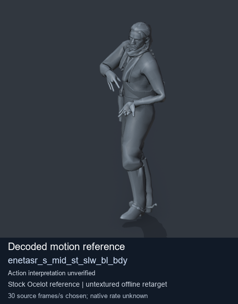
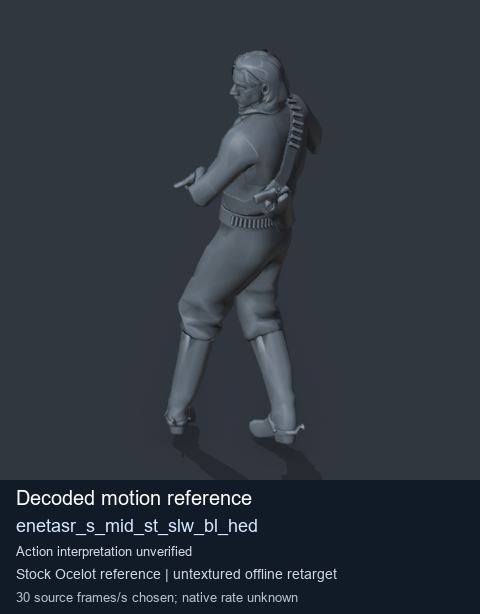
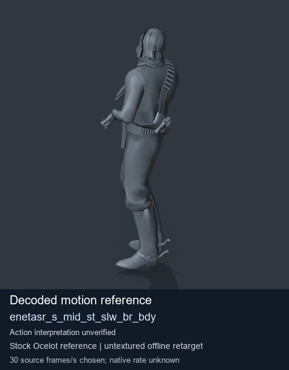
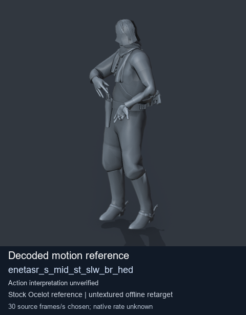

# Stock Soldier_common motion references / /Assets/tpp/motion/SI_game/fani/bodies/enet/enetasr - page 109

[Library](../README.md) · [Grouped directory](../browse/README.md) · [This source family](../browse/stock-soldier-enetasr-dd428991.md) · [Switch mode](browse-stock-soldier-enetasr-dd428991-109.md)

**Still images: no GIFs loaded** · 4 clips · 0.34 MiB downloaded.

Images reuse existing files. A small display width does not reduce download size. Open one clip for its larger titled GIF and original technical data.

Source-family grouping uses only recorded virtual directories; it does not establish an action, weapon, actor, rig or native compatibility. Existing descriptions and tags below are unchanged. Per-clip visual review may be pending; chosen preview speed is separate from unmeasured native timing.

| Preview | Animation | Category | Tags | Virtual GANI directory / file | MTAR / container location | Description | Frames / data |
| --- | --- | --- | --- | --- | --- | --- | --- |
|  | [Stock motion reference: enetasr_s_mid_st_slw_bl_bdy](../clips/mgsv-tpp-soldier_common-payloadsha256-c0149b60e50dcaa7dda6d0ef9aaad52f3a58a8628f826d12dfececd75d0d6ea1.md) <code>enetasr_s_mid_st_slw_bl_bdy</code> | Stock Soldier_common motion references | <code>stock body motion</code> <code>Soldier_common</code> <code>source-derived label</code> <code>Ocelot reference mesh</code> | <code>/Assets/tpp/motion/SI_game/fani/bodies/enet/enetasr</code> <code>enetasr_s_mid_st_slw_bl_bdy.gani</code> | Retained MTAR: <code>Soldier_common.mtar</code> DAT / FPK membership unverified | Decoded stock body-motion reference enetasr_s_mid_st_slw_bl_bdy; action interpretation unverified. | 120 raw 4.0 s chosen; native rate unknown [Full data](../clips/mgsv-tpp-soldier_common-payloadsha256-c0149b60e50dcaa7dda6d0ef9aaad52f3a58a8628f826d12dfececd75d0d6ea1.md#technical-data) |
|  | [Stock reference: enetasr_s_mid_st_slw_bl_hed](../clips/mgsv-tpp-soldier_common-payloadsha256-c279d1528f8e914afcb5928aebee7066050c09d91c2c67afa7ef2c588f7f7407.md) <code>enetasr_s_mid_st_slw_bl_hed</code> | Stock Soldier_common motion references | <code>stock animation reference</code> <code>Soldier_common</code> <code>source-derived label</code> <code>Ocelot reference mesh</code> | <code>/Assets/tpp/motion/SI_game/fani/bodies/enet/enetasr</code> <code>enetasr_s_mid_st_slw_bl_hed.gani</code> | Retained MTAR: <code>Soldier_common.mtar</code> DAT / FPK membership unverified | Decoded stock reference enetasr_s_mid_st_slw_bl_hed; action interpretation unverified. | 25 raw 0.83 s chosen; native rate unknown [Full data](../clips/mgsv-tpp-soldier_common-payloadsha256-c279d1528f8e914afcb5928aebee7066050c09d91c2c67afa7ef2c588f7f7407.md#technical-data) |
|  | [Stock reference: enetasr_s_mid_st_slw_br_bdy](../clips/mgsv-tpp-soldier_common-payloadsha256-0797195dd1f9dae20b5858c78e99b21f703018d8839fd5a6eba3575791501fcf.md) <code>enetasr_s_mid_st_slw_br_bdy</code> | Stock Soldier_common motion references | <code>stock animation reference</code> <code>Soldier_common</code> <code>source-derived label</code> <code>Ocelot reference mesh</code> | <code>/Assets/tpp/motion/SI_game/fani/bodies/enet/enetasr</code> <code>enetasr_s_mid_st_slw_br_bdy.gani</code> | Retained MTAR: <code>Soldier_common.mtar</code> DAT / FPK membership unverified | Decoded stock reference enetasr_s_mid_st_slw_br_bdy; action interpretation unverified. | 111 raw 3.7 s chosen; native rate unknown [Full data](../clips/mgsv-tpp-soldier_common-payloadsha256-0797195dd1f9dae20b5858c78e99b21f703018d8839fd5a6eba3575791501fcf.md#technical-data) |
|  | [Stock reference: enetasr_s_mid_st_slw_br_hed](../clips/mgsv-tpp-soldier_common-payloadsha256-d179c69cc107c69f546389cd32bd5f9c9fd8dd3216ae38ec1540a6bb9692e50e.md) <code>enetasr_s_mid_st_slw_br_hed</code> | Stock Soldier_common motion references | <code>stock animation reference</code> <code>Soldier_common</code> <code>source-derived label</code> <code>Ocelot reference mesh</code> | <code>/Assets/tpp/motion/SI_game/fani/bodies/enet/enetasr</code> <code>enetasr_s_mid_st_slw_br_hed.gani</code> | Retained MTAR: <code>Soldier_common.mtar</code> DAT / FPK membership unverified | Decoded stock reference enetasr_s_mid_st_slw_br_hed; action interpretation unverified. | 22 raw 0.73 s chosen; native rate unknown [Full data](../clips/mgsv-tpp-soldier_common-payloadsha256-d179c69cc107c69f546389cd32bd5f9c9fd8dd3216ae38ec1540a6bb9692e50e.md#technical-data) |

[Source descriptions, confidence and credits](../description-sources.md) · [Complete JSON](../catalogue.json) · [CSV](../catalogue.csv)
