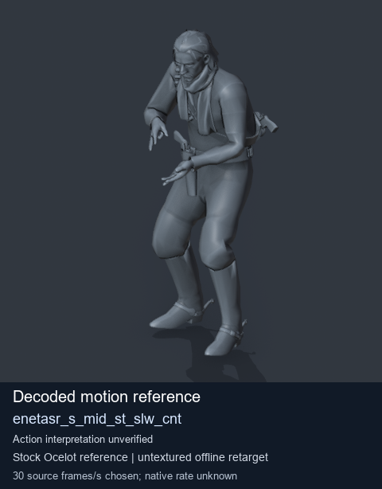
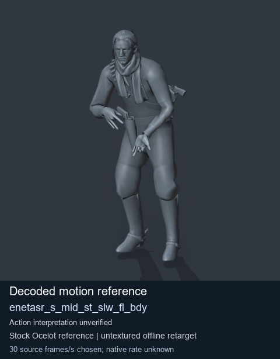
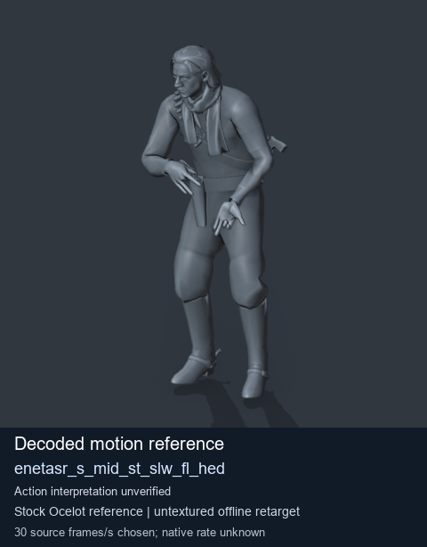
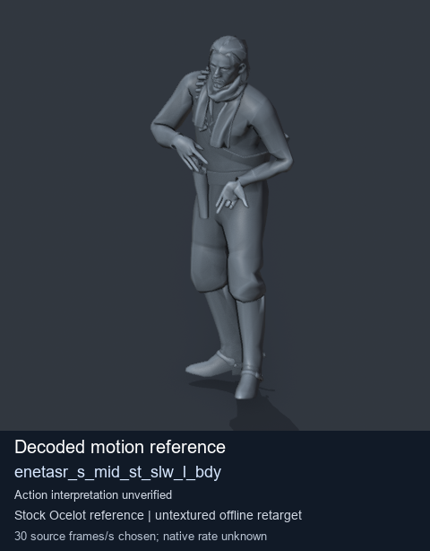

# Stock Soldier_common motion references / /Assets/tpp/motion/SI_game/fani/bodies/enet/enetasr - page 110

[Library](../README.md) · [Grouped directory](../browse/README.md) · [This source family](../browse/stock-soldier-enetasr-dd428991.md) · [Switch mode](browse-stock-soldier-enetasr-dd428991-110.md)

**Still images: no GIFs loaded** · 4 clips · 0.37 MiB downloaded.

Images reuse existing files. A small display width does not reduce download size. Open one clip for its larger titled GIF and original technical data.

Source-family grouping uses only recorded virtual directories; it does not establish an action, weapon, actor, rig or native compatibility. Existing descriptions and tags below are unchanged. Per-clip visual review may be pending; chosen preview speed is separate from unmeasured native timing.

| Preview | Animation | Category | Tags | Virtual GANI directory / file | MTAR / container location | Description | Frames / data |
| --- | --- | --- | --- | --- | --- | --- | --- |
|  | [Stock reference: enetasr_s_mid_st_slw_cnt](../clips/mgsv-tpp-soldier_common-payloadsha256-46e8e691feeb3c13a396fe6a63a22625d46969c033b97e16fab208b55d0c0b4a.md) <code>enetasr_s_mid_st_slw_cnt</code> | Stock Soldier_common motion references | <code>stock animation reference</code> <code>Soldier_common</code> <code>source-derived label</code> <code>Ocelot reference mesh</code> | <code>/Assets/tpp/motion/SI_game/fani/bodies/enet/enetasr</code> <code>enetasr_s_mid_st_slw_cnt.gani</code> | Retained MTAR: <code>Soldier_common.mtar</code> DAT / FPK membership unverified | Decoded stock reference enetasr_s_mid_st_slw_cnt; action interpretation unverified. | 43 raw 1.43 s chosen; native rate unknown [Full data](../clips/mgsv-tpp-soldier_common-payloadsha256-46e8e691feeb3c13a396fe6a63a22625d46969c033b97e16fab208b55d0c0b4a.md#technical-data) |
|  | [Stock motion reference: enetasr_s_mid_st_slw_fl_bdy](../clips/mgsv-tpp-soldier_common-payloadsha256-0d2b9e24760089c6b58a89304b97def084dd63fe1b0e7242252b2338f60384de.md) <code>enetasr_s_mid_st_slw_fl_bdy</code> | Stock Soldier_common motion references | <code>stock body motion</code> <code>Soldier_common</code> <code>source-derived label</code> <code>Ocelot reference mesh</code> | <code>/Assets/tpp/motion/SI_game/fani/bodies/enet/enetasr</code> <code>enetasr_s_mid_st_slw_fl_bdy.gani</code> | Retained MTAR: <code>Soldier_common.mtar</code> DAT / FPK membership unverified | Decoded stock body-motion reference enetasr_s_mid_st_slw_fl_bdy; action interpretation unverified. | 143 raw 4.77 s chosen; native rate unknown [Full data](../clips/mgsv-tpp-soldier_common-payloadsha256-0d2b9e24760089c6b58a89304b97def084dd63fe1b0e7242252b2338f60384de.md#technical-data) |
|  | [Stock reference: enetasr_s_mid_st_slw_fl_hed](../clips/mgsv-tpp-soldier_common-payloadsha256-2014df2bd0567253c911bba66466d43f7fdeab7f3c58fef763dea3f096cfe635.md) <code>enetasr_s_mid_st_slw_fl_hed</code> | Stock Soldier_common motion references | <code>stock animation reference</code> <code>Soldier_common</code> <code>source-derived label</code> <code>Ocelot reference mesh</code> | <code>/Assets/tpp/motion/SI_game/fani/bodies/enet/enetasr</code> <code>enetasr_s_mid_st_slw_fl_hed.gani</code> | Retained MTAR: <code>Soldier_common.mtar</code> DAT / FPK membership unverified | Decoded stock reference enetasr_s_mid_st_slw_fl_hed; action interpretation unverified. | 20 raw 0.67 s chosen; native rate unknown [Full data](../clips/mgsv-tpp-soldier_common-payloadsha256-2014df2bd0567253c911bba66466d43f7fdeab7f3c58fef763dea3f096cfe635.md#technical-data) |
|  | [Stock motion reference: enetasr_s_mid_st_slw_l_bdy](../clips/mgsv-tpp-soldier_common-payloadsha256-cf4bd660ecd761d3a18a6c1b5af162c82912ba10e51119c22e007e95cb2dca61.md) <code>enetasr_s_mid_st_slw_l_bdy</code> | Stock Soldier_common motion references | <code>stock body motion</code> <code>Soldier_common</code> <code>source-derived label</code> <code>Ocelot reference mesh</code> | <code>/Assets/tpp/motion/SI_game/fani/bodies/enet/enetasr</code> <code>enetasr_s_mid_st_slw_l_bdy.gani</code> | Retained MTAR: <code>Soldier_common.mtar</code> DAT / FPK membership unverified | Decoded stock body-motion reference enetasr_s_mid_st_slw_l_bdy; action interpretation unverified. | 95 raw 3.17 s chosen; native rate unknown [Full data](../clips/mgsv-tpp-soldier_common-payloadsha256-cf4bd660ecd761d3a18a6c1b5af162c82912ba10e51119c22e007e95cb2dca61.md#technical-data) |

[Source descriptions, confidence and credits](../description-sources.md) · [Complete JSON](../catalogue.json) · [CSV](../catalogue.csv)
