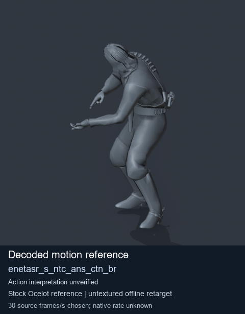
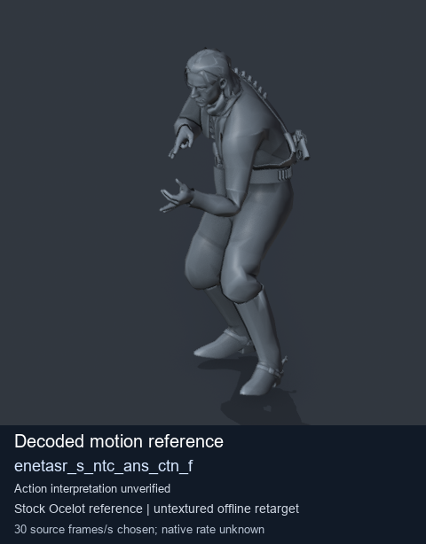
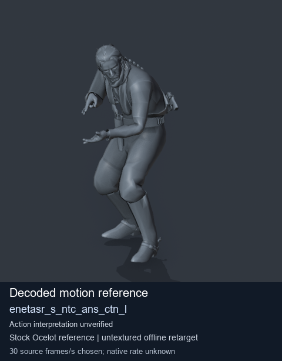
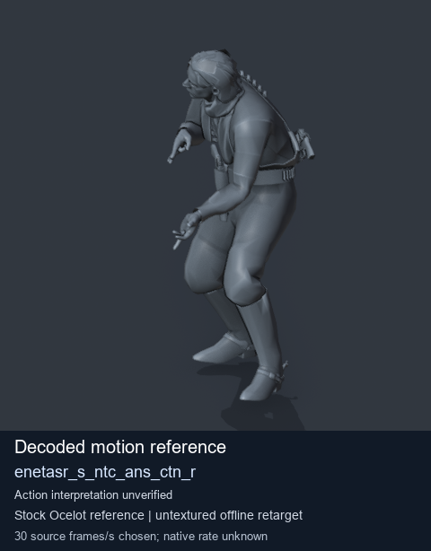

# Stock Soldier_common motion references / /Assets/tpp/motion/SI_game/fani/bodies/enet/enetasr - page 112

[Library](../README.md) · [Grouped directory](../browse/README.md) · [This source family](../browse/stock-soldier-enetasr-dd428991.md) · [Switch mode](browse-stock-soldier-enetasr-dd428991-112.md)

**Still images: no GIFs loaded** · 4 clips · 0.36 MiB downloaded.

Images reuse existing files. A small display width does not reduce download size. Open one clip for its larger titled GIF and original technical data.

Source-family grouping uses only recorded virtual directories; it does not establish an action, weapon, actor, rig or native compatibility. Existing descriptions and tags below are unchanged. Per-clip visual review may be pending; chosen preview speed is separate from unmeasured native timing.

| Preview | Animation | Category | Tags | Virtual GANI directory / file | MTAR / container location | Description | Frames / data |
| --- | --- | --- | --- | --- | --- | --- | --- |
|  | [Stock motion reference: enetasr_s_ntc_ans_ctn_br](../clips/mgsv-tpp-soldier_common-payloadsha256-2fb3521055b8392187bfee819394e79c83933696596ebc45c61ef668adaacfa0.md) <code>enetasr_s_ntc_ans_ctn_br</code> | Stock Soldier_common motion references | <code>stock body motion</code> <code>Soldier_common</code> <code>source-derived label</code> <code>Ocelot reference mesh</code> | <code>/Assets/tpp/motion/SI_game/fani/bodies/enet/enetasr</code> <code>enetasr_s_ntc_ans_ctn_br.gani</code> | Retained MTAR: <code>Soldier_common.mtar</code> DAT / FPK membership unverified | Decoded stock body-motion reference enetasr_s_ntc_ans_ctn_br; action interpretation unverified. | 140 raw 4.67 s chosen; native rate unknown [Full data](../clips/mgsv-tpp-soldier_common-payloadsha256-2fb3521055b8392187bfee819394e79c83933696596ebc45c61ef668adaacfa0.md#technical-data) |
|  | [Stock reference: enetasr_s_ntc_ans_ctn_f](../clips/mgsv-tpp-soldier_common-payloadsha256-f1017d451dffe076cf6a0ab8d04612cf88eacf25f3426b9f286debc558467142.md) <code>enetasr_s_ntc_ans_ctn_f</code> | Stock Soldier_common motion references | <code>stock animation reference</code> <code>Soldier_common</code> <code>source-derived label</code> <code>Ocelot reference mesh</code> | <code>/Assets/tpp/motion/SI_game/fani/bodies/enet/enetasr</code> <code>enetasr_s_ntc_ans_ctn_f.gani</code> | Retained MTAR: <code>Soldier_common.mtar</code> DAT / FPK membership unverified | Decoded stock reference enetasr_s_ntc_ans_ctn_f; action interpretation unverified. | 130 raw 4.33 s chosen; native rate unknown [Full data](../clips/mgsv-tpp-soldier_common-payloadsha256-f1017d451dffe076cf6a0ab8d04612cf88eacf25f3426b9f286debc558467142.md#technical-data) |
|  | [Stock reference: enetasr_s_ntc_ans_ctn_l](../clips/mgsv-tpp-soldier_common-payloadsha256-9f8fed68c42d57905025d35fb60557334913dca152dd27868ffb9cf018fe246a.md) <code>enetasr_s_ntc_ans_ctn_l</code> | Stock Soldier_common motion references | <code>stock animation reference</code> <code>Soldier_common</code> <code>source-derived label</code> <code>Ocelot reference mesh</code> | <code>/Assets/tpp/motion/SI_game/fani/bodies/enet/enetasr</code> <code>enetasr_s_ntc_ans_ctn_l.gani</code> | Retained MTAR: <code>Soldier_common.mtar</code> DAT / FPK membership unverified | Decoded stock reference enetasr_s_ntc_ans_ctn_l; action interpretation unverified. | 130 raw 4.33 s chosen; native rate unknown [Full data](../clips/mgsv-tpp-soldier_common-payloadsha256-9f8fed68c42d57905025d35fb60557334913dca152dd27868ffb9cf018fe246a.md#technical-data) |
|  | [Stock reference: enetasr_s_ntc_ans_ctn_r](../clips/mgsv-tpp-soldier_common-payloadsha256-38ea7d304d8af7747266bf50face12398fa73961ab947c10890b4ff1281ada3e.md) <code>enetasr_s_ntc_ans_ctn_r</code> | Stock Soldier_common motion references | <code>stock animation reference</code> <code>Soldier_common</code> <code>source-derived label</code> <code>Ocelot reference mesh</code> | <code>/Assets/tpp/motion/SI_game/fani/bodies/enet/enetasr</code> <code>enetasr_s_ntc_ans_ctn_r.gani</code> | Retained MTAR: <code>Soldier_common.mtar</code> DAT / FPK membership unverified | Decoded stock reference enetasr_s_ntc_ans_ctn_r; action interpretation unverified. | 130 raw 4.33 s chosen; native rate unknown [Full data](../clips/mgsv-tpp-soldier_common-payloadsha256-38ea7d304d8af7747266bf50face12398fa73961ab947c10890b4ff1281ada3e.md#technical-data) |

[Source descriptions, confidence and credits](../description-sources.md) · [Complete JSON](../catalogue.json) · [CSV](../catalogue.csv)
