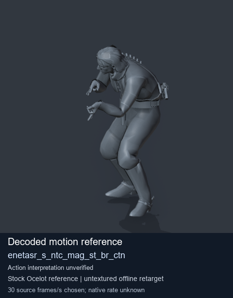
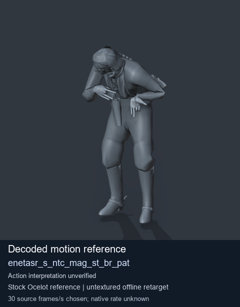
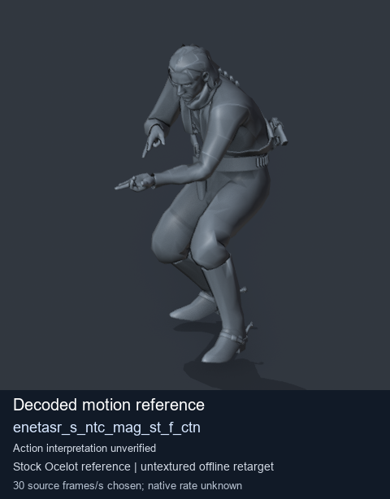
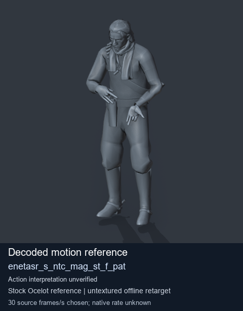

# Stock Soldier_common motion references / /Assets/tpp/motion/SI_game/fani/bodies/enet/enetasr - page 116

[Library](../README.md) · [Grouped directory](../browse/README.md) · [This source family](../browse/stock-soldier-enetasr-dd428991.md) · [Switch mode](browse-stock-soldier-enetasr-dd428991-116.md)

**Still images: no GIFs loaded** · 4 clips · 0.36 MiB downloaded.

Images reuse existing files. A small display width does not reduce download size. Open one clip for its larger titled GIF and original technical data.

Source-family grouping uses only recorded virtual directories; it does not establish an action, weapon, actor, rig or native compatibility. Existing descriptions and tags below are unchanged. Per-clip visual review may be pending; chosen preview speed is separate from unmeasured native timing.

| Preview | Animation | Category | Tags | Virtual GANI directory / file | MTAR / container location | Description | Frames / data |
| --- | --- | --- | --- | --- | --- | --- | --- |
|  | [Stock reference: enetasr_s_ntc_mag_st_br_ctn](../clips/mgsv-tpp-soldier_common-payloadsha256-aca13f89d9c1b2e1bd53ab288c7517e83e91b6822f098ef0143ef8218bdf6c38.md) <code>enetasr_s_ntc_mag_st_br_ctn</code> | Stock Soldier_common motion references | <code>stock animation reference</code> <code>Soldier_common</code> <code>source-derived label</code> <code>Ocelot reference mesh</code> | <code>/Assets/tpp/motion/SI_game/fani/bodies/enet/enetasr</code> <code>enetasr_s_ntc_mag_st_br_ctn.gani</code> | Retained MTAR: <code>Soldier_common.mtar</code> DAT / FPK membership unverified | Decoded stock reference enetasr_s_ntc_mag_st_br_ctn; action interpretation unverified. | 55 raw 1.83 s chosen; native rate unknown [Full data](../clips/mgsv-tpp-soldier_common-payloadsha256-aca13f89d9c1b2e1bd53ab288c7517e83e91b6822f098ef0143ef8218bdf6c38.md#technical-data) |
|  | [Stock reference: enetasr_s_ntc_mag_st_br_pat](../clips/mgsv-tpp-soldier_common-payloadsha256-342dab9b4251afa0d662dfd8269f786c9f8fadd02250fa64cb525793cd7d207f.md) <code>enetasr_s_ntc_mag_st_br_pat</code> | Stock Soldier_common motion references | <code>stock animation reference</code> <code>Soldier_common</code> <code>source-derived label</code> <code>Ocelot reference mesh</code> | <code>/Assets/tpp/motion/SI_game/fani/bodies/enet/enetasr</code> <code>enetasr_s_ntc_mag_st_br_pat.gani</code> | Retained MTAR: <code>Soldier_common.mtar</code> DAT / FPK membership unverified | Decoded stock reference enetasr_s_ntc_mag_st_br_pat; action interpretation unverified. | 117 raw 3.9 s chosen; native rate unknown [Full data](../clips/mgsv-tpp-soldier_common-payloadsha256-342dab9b4251afa0d662dfd8269f786c9f8fadd02250fa64cb525793cd7d207f.md#technical-data) |
|  | [Stock reference: enetasr_s_ntc_mag_st_f_ctn](../clips/mgsv-tpp-soldier_common-payloadsha256-e3dfb595b7d57e73a6be0b40dc434ee5271b3f2fcaa0300ab5c6b2998893f521.md) <code>enetasr_s_ntc_mag_st_f_ctn</code> | Stock Soldier_common motion references | <code>stock animation reference</code> <code>Soldier_common</code> <code>source-derived label</code> <code>Ocelot reference mesh</code> | <code>/Assets/tpp/motion/SI_game/fani/bodies/enet/enetasr</code> <code>enetasr_s_ntc_mag_st_f_ctn.gani</code> | Retained MTAR: <code>Soldier_common.mtar</code> DAT / FPK membership unverified | Decoded stock reference enetasr_s_ntc_mag_st_f_ctn; action interpretation unverified. | 43 raw 1.43 s chosen; native rate unknown [Full data](../clips/mgsv-tpp-soldier_common-payloadsha256-e3dfb595b7d57e73a6be0b40dc434ee5271b3f2fcaa0300ab5c6b2998893f521.md#technical-data) |
|  | [Stock reference: enetasr_s_ntc_mag_st_f_pat](../clips/mgsv-tpp-soldier_common-payloadsha256-ac996e4f189c3cd70708603aaff1f0ce32b2672fa49a803027c54d0090390675.md) <code>enetasr_s_ntc_mag_st_f_pat</code> | Stock Soldier_common motion references | <code>stock animation reference</code> <code>Soldier_common</code> <code>source-derived label</code> <code>Ocelot reference mesh</code> | <code>/Assets/tpp/motion/SI_game/fani/bodies/enet/enetasr</code> <code>enetasr_s_ntc_mag_st_f_pat.gani</code> | Retained MTAR: <code>Soldier_common.mtar</code> DAT / FPK membership unverified | Decoded stock reference enetasr_s_ntc_mag_st_f_pat; action interpretation unverified. | 80 raw 2.67 s chosen; native rate unknown [Full data](../clips/mgsv-tpp-soldier_common-payloadsha256-ac996e4f189c3cd70708603aaff1f0ce32b2672fa49a803027c54d0090390675.md#technical-data) |

[Source descriptions, confidence and credits](../description-sources.md) · [Complete JSON](../catalogue.json) · [CSV](../catalogue.csv)
