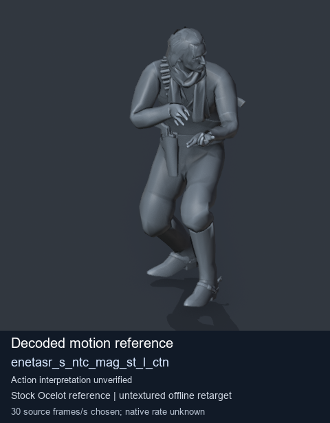
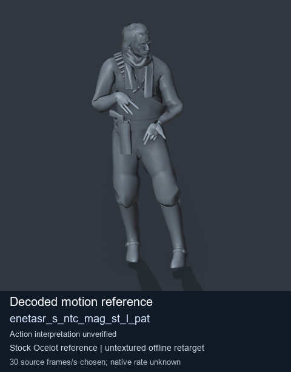
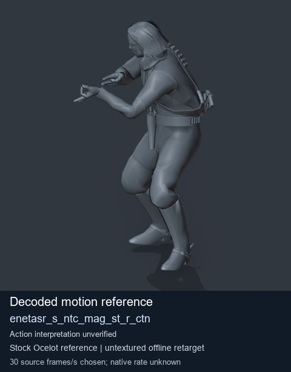
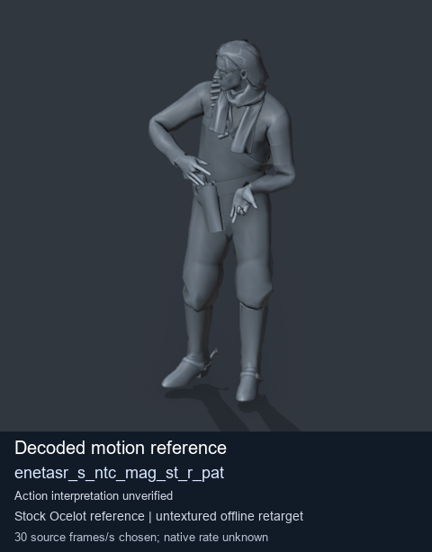

# Stock Soldier_common motion references / /Assets/tpp/motion/SI_game/fani/bodies/enet/enetasr - page 117

[Library](../README.md) · [Grouped directory](../browse/README.md) · [This source family](../browse/stock-soldier-enetasr-dd428991.md) · [Switch mode](browse-stock-soldier-enetasr-dd428991-117.md)

**Still images: no GIFs loaded** · 4 clips · 0.38 MiB downloaded.

Images reuse existing files. A small display width does not reduce download size. Open one clip for its larger titled GIF and original technical data.

Source-family grouping uses only recorded virtual directories; it does not establish an action, weapon, actor, rig or native compatibility. Existing descriptions and tags below are unchanged. Per-clip visual review may be pending; chosen preview speed is separate from unmeasured native timing.

| Preview | Animation | Category | Tags | Virtual GANI directory / file | MTAR / container location | Description | Frames / data |
| --- | --- | --- | --- | --- | --- | --- | --- |
|  | [Stock motion reference: enetasr_s_ntc_mag_st_l_ctn](../clips/mgsv-tpp-soldier_common-payloadsha256-b0aad206614ead0ad237c78c64e111f6b995ccbf28c0505f9dea9a629a33fec7.md) <code>enetasr_s_ntc_mag_st_l_ctn</code> | Stock Soldier_common motion references | <code>stock body motion</code> <code>Soldier_common</code> <code>source-derived label</code> <code>Ocelot reference mesh</code> | <code>/Assets/tpp/motion/SI_game/fani/bodies/enet/enetasr</code> <code>enetasr_s_ntc_mag_st_l_ctn.gani</code> | Retained MTAR: <code>Soldier_common.mtar</code> DAT / FPK membership unverified | Decoded stock body-motion reference enetasr_s_ntc_mag_st_l_ctn; action interpretation unverified. | 36 raw 1.2 s chosen; native rate unknown [Full data](../clips/mgsv-tpp-soldier_common-payloadsha256-b0aad206614ead0ad237c78c64e111f6b995ccbf28c0505f9dea9a629a33fec7.md#technical-data) |
|  | [Stock reference: enetasr_s_ntc_mag_st_l_pat](../clips/mgsv-tpp-soldier_common-payloadsha256-7437ab38e2c7a3c86696f38913f73ff464fd7459133088a1c4f40048e4bfc4b6.md) <code>enetasr_s_ntc_mag_st_l_pat</code> | Stock Soldier_common motion references | <code>stock animation reference</code> <code>Soldier_common</code> <code>source-derived label</code> <code>Ocelot reference mesh</code> | <code>/Assets/tpp/motion/SI_game/fani/bodies/enet/enetasr</code> <code>enetasr_s_ntc_mag_st_l_pat.gani</code> | Retained MTAR: <code>Soldier_common.mtar</code> DAT / FPK membership unverified | Decoded stock reference enetasr_s_ntc_mag_st_l_pat; action interpretation unverified. | 80 raw 2.67 s chosen; native rate unknown [Full data](../clips/mgsv-tpp-soldier_common-payloadsha256-7437ab38e2c7a3c86696f38913f73ff464fd7459133088a1c4f40048e4bfc4b6.md#technical-data) |
|  | [Stock motion reference: enetasr_s_ntc_mag_st_r_ctn](../clips/mgsv-tpp-soldier_common-payloadsha256-4f206283b6eed7d90d69ade2dd22b06d3cc525c21187673f14badfe4e4497c50.md) <code>enetasr_s_ntc_mag_st_r_ctn</code> | Stock Soldier_common motion references | <code>stock body motion</code> <code>Soldier_common</code> <code>source-derived label</code> <code>Ocelot reference mesh</code> | <code>/Assets/tpp/motion/SI_game/fani/bodies/enet/enetasr</code> <code>enetasr_s_ntc_mag_st_r_ctn.gani</code> | Retained MTAR: <code>Soldier_common.mtar</code> DAT / FPK membership unverified | Decoded stock body-motion reference enetasr_s_ntc_mag_st_r_ctn; action interpretation unverified. | 30 raw 1.0 s chosen; native rate unknown [Full data](../clips/mgsv-tpp-soldier_common-payloadsha256-4f206283b6eed7d90d69ade2dd22b06d3cc525c21187673f14badfe4e4497c50.md#technical-data) |
|  | [Stock reference: enetasr_s_ntc_mag_st_r_pat](../clips/mgsv-tpp-soldier_common-payloadsha256-91f5d5369984f42e1f60476df3369093ae7a51dcc36d4683ecf60eef4f457a49.md) <code>enetasr_s_ntc_mag_st_r_pat</code> | Stock Soldier_common motion references | <code>stock animation reference</code> <code>Soldier_common</code> <code>source-derived label</code> <code>Ocelot reference mesh</code> | <code>/Assets/tpp/motion/SI_game/fani/bodies/enet/enetasr</code> <code>enetasr_s_ntc_mag_st_r_pat.gani</code> | Retained MTAR: <code>Soldier_common.mtar</code> DAT / FPK membership unverified | Decoded stock reference enetasr_s_ntc_mag_st_r_pat; action interpretation unverified. | 80 raw 2.67 s chosen; native rate unknown [Full data](../clips/mgsv-tpp-soldier_common-payloadsha256-91f5d5369984f42e1f60476df3369093ae7a51dcc36d4683ecf60eef4f457a49.md#technical-data) |

[Source descriptions, confidence and credits](../description-sources.md) · [Complete JSON](../catalogue.json) · [CSV](../catalogue.csv)
