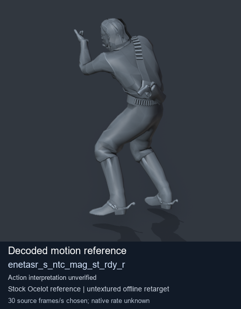
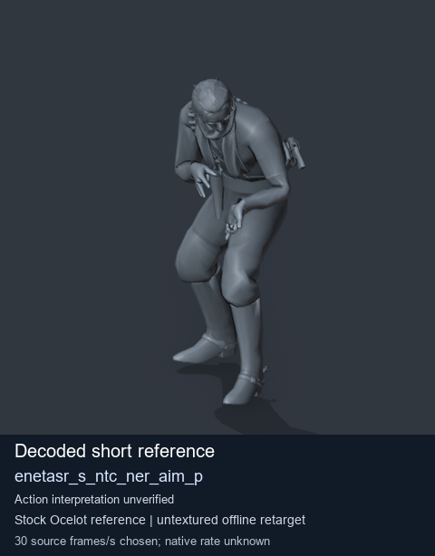
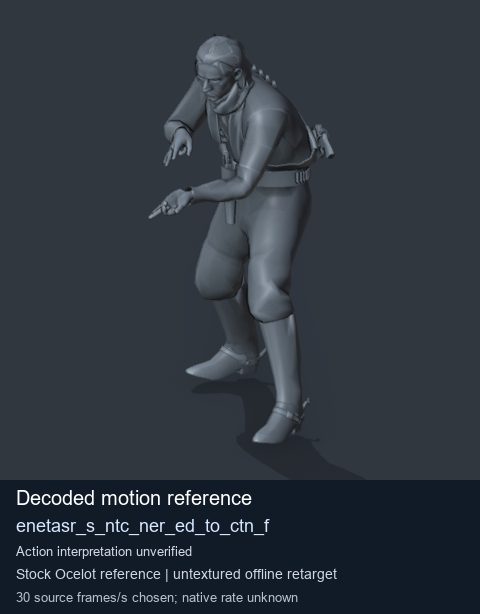
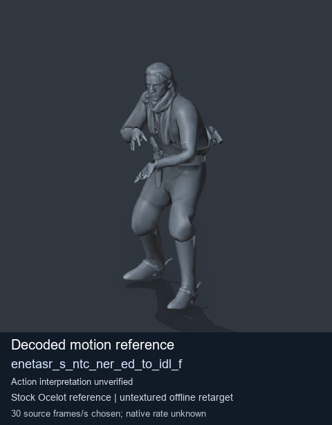

# Stock Soldier_common motion references / /Assets/tpp/motion/SI_game/fani/bodies/enet/enetasr - page 119

[Library](../README.md) · [Grouped directory](../browse/README.md) · [This source family](../browse/stock-soldier-enetasr-dd428991.md) · [Switch mode](browse-stock-soldier-enetasr-dd428991-119.md)

**Still images: no GIFs loaded** · 4 clips · 0.37 MiB downloaded.

Images reuse existing files. A small display width does not reduce download size. Open one clip for its larger titled GIF and original technical data.

Source-family grouping uses only recorded virtual directories; it does not establish an action, weapon, actor, rig or native compatibility. Existing descriptions and tags below are unchanged. Per-clip visual review may be pending; chosen preview speed is separate from unmeasured native timing.

| Preview | Animation | Category | Tags | Virtual GANI directory / file | MTAR / container location | Description | Frames / data |
| --- | --- | --- | --- | --- | --- | --- | --- |
|  | [Stock motion reference: enetasr_s_ntc_mag_st_rdy_r](../clips/mgsv-tpp-soldier_common-payloadsha256-373e35186502161ed492e26fb7fa798f0f625f42a14926fc03ab67876f2c6d38.md) <code>enetasr_s_ntc_mag_st_rdy_r</code> | Stock Soldier_common motion references | <code>stock body motion</code> <code>Soldier_common</code> <code>source-derived label</code> <code>Ocelot reference mesh</code> | <code>/Assets/tpp/motion/SI_game/fani/bodies/enet/enetasr</code> <code>enetasr_s_ntc_mag_st_rdy_r.gani</code> | Retained MTAR: <code>Soldier_common.mtar</code> DAT / FPK membership unverified | Decoded stock body-motion reference enetasr_s_ntc_mag_st_rdy_r; action interpretation unverified. | 45 raw 1.5 s chosen; native rate unknown [Full data](../clips/mgsv-tpp-soldier_common-payloadsha256-373e35186502161ed492e26fb7fa798f0f625f42a14926fc03ab67876f2c6d38.md#technical-data) |
|  | [Stock reference: enetasr_s_ntc_ner_aim_p](../clips/mgsv-tpp-soldier_common-payloadsha256-d7c16808a5ce8e11b34b3c8032a34349aad410db485d1a8917e65890840ed4c4.md) <code>enetasr_s_ntc_ner_aim_p</code> | Stock Soldier_common motion references | <code>stock animation reference</code> <code>Soldier_common</code> <code>source-derived label</code> <code>Ocelot reference mesh</code> | <code>/Assets/tpp/motion/SI_game/fani/bodies/enet/enetasr</code> <code>enetasr_s_ntc_ner_aim_p.gani</code> | Retained MTAR: <code>Soldier_common.mtar</code> DAT / FPK membership unverified | Decoded stock reference enetasr_s_ntc_ner_aim_p; action interpretation unverified. | 8 raw 0.27 s chosen; native rate unknown [Full data](../clips/mgsv-tpp-soldier_common-payloadsha256-d7c16808a5ce8e11b34b3c8032a34349aad410db485d1a8917e65890840ed4c4.md#technical-data) |
|  | [Stock reference: enetasr_s_ntc_ner_ed_to_ctn_f](../clips/mgsv-tpp-soldier_common-payloadsha256-bc25ee08c46954e14bf4c96ca0e1d7e63d284701b60620686c8f936dd3492564.md) <code>enetasr_s_ntc_ner_ed_to_ctn_f</code> | Stock Soldier_common motion references | <code>stock animation reference</code> <code>Soldier_common</code> <code>source-derived label</code> <code>Ocelot reference mesh</code> | <code>/Assets/tpp/motion/SI_game/fani/bodies/enet/enetasr</code> <code>enetasr_s_ntc_ner_ed_to_ctn_f.gani</code> | Retained MTAR: <code>Soldier_common.mtar</code> DAT / FPK membership unverified | Decoded stock reference enetasr_s_ntc_ner_ed_to_ctn_f; action interpretation unverified. | 54 raw 1.8 s chosen; native rate unknown [Full data](../clips/mgsv-tpp-soldier_common-payloadsha256-bc25ee08c46954e14bf4c96ca0e1d7e63d284701b60620686c8f936dd3492564.md#technical-data) |
|  | [Stock motion reference: enetasr_s_ntc_ner_ed_to_idl_f](../clips/mgsv-tpp-soldier_common-payloadsha256-fb6cbe8120838f56b6a9ab42a5bdc2c99541099f33f6dcc5fcc795b8be0e87fb.md) <code>enetasr_s_ntc_ner_ed_to_idl_f</code> | Stock Soldier_common motion references | <code>stock body motion</code> <code>Soldier_common</code> <code>source-derived label</code> <code>Ocelot reference mesh</code> | <code>/Assets/tpp/motion/SI_game/fani/bodies/enet/enetasr</code> <code>enetasr_s_ntc_ner_ed_to_idl_f.gani</code> | Retained MTAR: <code>Soldier_common.mtar</code> DAT / FPK membership unverified | Decoded stock body-motion reference enetasr_s_ntc_ner_ed_to_idl_f; action interpretation unverified. | 169 raw 5.63 s chosen; native rate unknown [Full data](../clips/mgsv-tpp-soldier_common-payloadsha256-fb6cbe8120838f56b6a9ab42a5bdc2c99541099f33f6dcc5fcc795b8be0e87fb.md#technical-data) |

[Source descriptions, confidence and credits](../description-sources.md) · [Complete JSON](../catalogue.json) · [CSV](../catalogue.csv)
