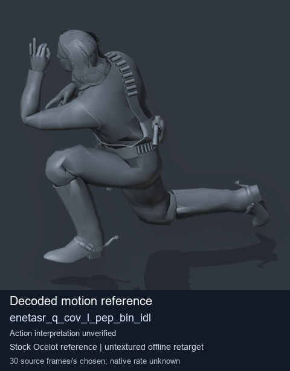
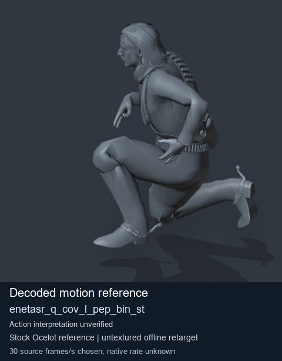
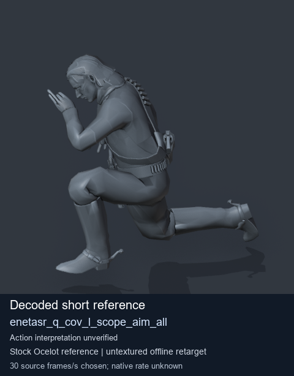
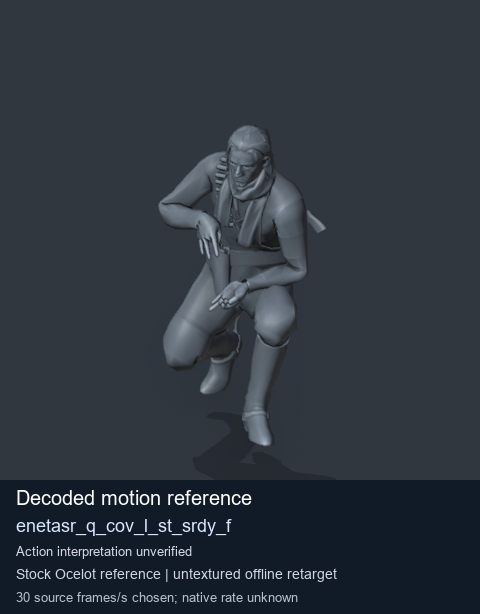

# Stock Soldier_common motion references / /Assets/tpp/motion/SI_game/fani/bodies/enet/enetasr - page 12

[Library](../README.md) · [Grouped directory](../browse/README.md) · [This source family](../browse/stock-soldier-enetasr-dd428991.md) · [Switch mode](browse-stock-soldier-enetasr-dd428991-12.md)

**Still images: no GIFs loaded** · 4 clips · 0.46 MiB downloaded.

Images reuse existing files. A small display width does not reduce download size. Open one clip for its larger titled GIF and original technical data.

Source-family grouping uses only recorded virtual directories; it does not establish an action, weapon, actor, rig or native compatibility. Existing descriptions and tags below are unchanged. Per-clip visual review may be pending; chosen preview speed is separate from unmeasured native timing.

| Preview | Animation | Category | Tags | Virtual GANI directory / file | MTAR / container location | Description | Frames / data |
| --- | --- | --- | --- | --- | --- | --- | --- |
|  | [Stock reference: enetasr_q_cov_l_pep_bin_idl](../clips/mgsv-tpp-soldier_common-payloadsha256-849248a61e59998d37dd681a58e135061f69163d6c07048336ece9b7dcbc92ff.md) <code>enetasr_q_cov_l_pep_bin_idl</code> | Stock Soldier_common motion references | <code>stock animation reference</code> <code>Soldier_common</code> <code>source-derived label</code> <code>Ocelot reference mesh</code> | <code>/Assets/tpp/motion/SI_game/fani/bodies/enet/enetasr</code> <code>enetasr_q_cov_l_pep_bin_idl.gani</code> | Retained MTAR: <code>Soldier_common.mtar</code> DAT / FPK membership unverified | Decoded stock reference enetasr_q_cov_l_pep_bin_idl; action interpretation unverified. | 192 raw 6.4 s chosen; native rate unknown [Full data](../clips/mgsv-tpp-soldier_common-payloadsha256-849248a61e59998d37dd681a58e135061f69163d6c07048336ece9b7dcbc92ff.md#technical-data) |
|  | [Stock reference: enetasr_q_cov_l_pep_bin_st](../clips/mgsv-tpp-soldier_common-payloadsha256-5251a23d5205b689892c5f56a2be3b06ddfaadb866eb04224620738601060d0b.md) <code>enetasr_q_cov_l_pep_bin_st</code> | Stock Soldier_common motion references | <code>stock animation reference</code> <code>Soldier_common</code> <code>source-derived label</code> <code>Ocelot reference mesh</code> | <code>/Assets/tpp/motion/SI_game/fani/bodies/enet/enetasr</code> <code>enetasr_q_cov_l_pep_bin_st.gani</code> | Retained MTAR: <code>Soldier_common.mtar</code> DAT / FPK membership unverified | Decoded stock reference enetasr_q_cov_l_pep_bin_st; action interpretation unverified. | 108 raw 3.6 s chosen; native rate unknown [Full data](../clips/mgsv-tpp-soldier_common-payloadsha256-5251a23d5205b689892c5f56a2be3b06ddfaadb866eb04224620738601060d0b.md#technical-data) |
|  | [Stock reference: enetasr_q_cov_l_scope_aim_all](../clips/mgsv-tpp-soldier_common-payloadsha256-56b7f45b50959d40d7ca7b37a65debc206aef0ac1eaaa4ec537d4ecc1d499862.md) <code>enetasr_q_cov_l_scope_aim_all</code> | Stock Soldier_common motion references | <code>stock animation reference</code> <code>Soldier_common</code> <code>source-derived label</code> <code>Ocelot reference mesh</code> | <code>/Assets/tpp/motion/SI_game/fani/bodies/enet/enetasr</code> <code>enetasr_q_cov_l_scope_aim_all.gani</code> | Retained MTAR: <code>Soldier_common.mtar</code> DAT / FPK membership unverified | Decoded stock reference enetasr_q_cov_l_scope_aim_all; action interpretation unverified. | 8 raw 0.27 s chosen; native rate unknown [Full data](../clips/mgsv-tpp-soldier_common-payloadsha256-56b7f45b50959d40d7ca7b37a65debc206aef0ac1eaaa4ec537d4ecc1d499862.md#technical-data) |
|  | [Stock reference: enetasr_q_cov_l_st_srdy_f](../clips/mgsv-tpp-soldier_common-payloadsha256-00164eb402dc90b7243bf0543e4abf4a4b6a2c80e20973e35101cdf7b421e92a.md) <code>enetasr_q_cov_l_st_srdy_f</code> | Stock Soldier_common motion references | <code>stock animation reference</code> <code>Soldier_common</code> <code>source-derived label</code> <code>Ocelot reference mesh</code> | <code>/Assets/tpp/motion/SI_game/fani/bodies/enet/enetasr</code> <code>enetasr_q_cov_l_st_srdy_f.gani</code> | Retained MTAR: <code>Soldier_common.mtar</code> DAT / FPK membership unverified | Decoded stock reference enetasr_q_cov_l_st_srdy_f; action interpretation unverified. | 64 raw 2.13 s chosen; native rate unknown [Full data](../clips/mgsv-tpp-soldier_common-payloadsha256-00164eb402dc90b7243bf0543e4abf4a4b6a2c80e20973e35101cdf7b421e92a.md#technical-data) |

[Source descriptions, confidence and credits](../description-sources.md) · [Complete JSON](../catalogue.json) · [CSV](../catalogue.csv)
