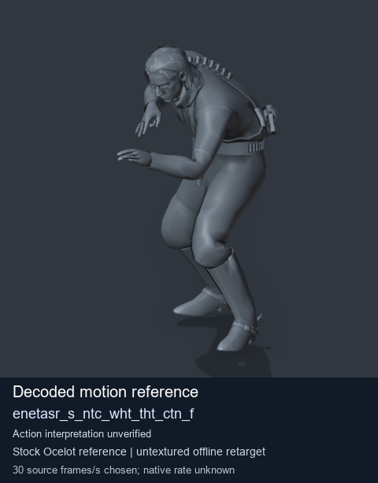
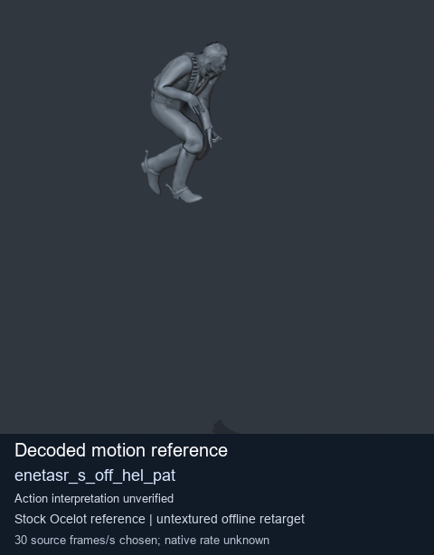
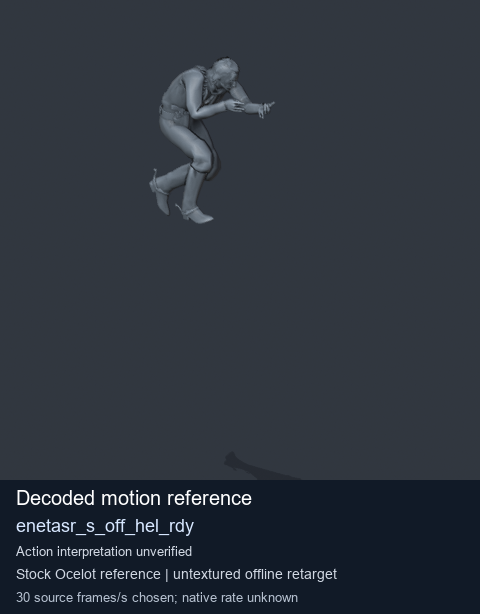

# Stock Soldier_common motion references / /Assets/tpp/motion/SI_game/fani/bodies/enet/enetasr - page 125

[Library](../README.md) · [Grouped directory](../browse/README.md) · [This source family](../browse/stock-soldier-enetasr-dd428991.md) · [Switch mode](browse-stock-soldier-enetasr-dd428991-125.md)

**Still images: no GIFs loaded** · 3 clips · 0.21 MiB downloaded.

Images reuse existing files. A small display width does not reduce download size. Open one clip for its larger titled GIF and original technical data.

Source-family grouping uses only recorded virtual directories; it does not establish an action, weapon, actor, rig or native compatibility. Existing descriptions and tags below are unchanged. Per-clip visual review may be pending; chosen preview speed is separate from unmeasured native timing.

| Preview | Animation | Category | Tags | Virtual GANI directory / file | MTAR / container location | Description | Frames / data |
| --- | --- | --- | --- | --- | --- | --- | --- |
|  | [Stock reference: enetasr_s_ntc_wht_tht_ctn_f](../clips/mgsv-tpp-soldier_common-payloadsha256-c9b84632fb1b1b3ab807eb2978555e75273000439b4ea77e34a1e08e32c19be7.md) <code>enetasr_s_ntc_wht_tht_ctn_f</code> | Stock Soldier_common motion references | <code>stock animation reference</code> <code>Soldier_common</code> <code>source-derived label</code> <code>Ocelot reference mesh</code> | <code>/Assets/tpp/motion/SI_game/fani/bodies/enet/enetasr</code> <code>enetasr_s_ntc_wht_tht_ctn_f.gani</code> | Retained MTAR: <code>Soldier_common.mtar</code> DAT / FPK membership unverified | Decoded stock reference enetasr_s_ntc_wht_tht_ctn_f; action interpretation unverified. | 230 raw 7.67 s chosen; native rate unknown [Full data](../clips/mgsv-tpp-soldier_common-payloadsha256-c9b84632fb1b1b3ab807eb2978555e75273000439b4ea77e34a1e08e32c19be7.md#technical-data) |
|  | [Stock motion reference: enetasr_s_off_hel_pat](../clips/mgsv-tpp-soldier_common-payloadsha256-3724ba3e7810603cd560df5d0b60522f92716e2df76f45e3467cfee88cc18aac.md) <code>enetasr_s_off_hel_pat</code> | Stock Soldier_common motion references | <code>stock body motion</code> <code>Soldier_common</code> <code>source-derived label</code> <code>Ocelot reference mesh</code> | <code>/Assets/tpp/motion/SI_game/fani/bodies/enet/enetasr</code> <code>enetasr_s_off_hel_pat.gani</code> | Retained MTAR: <code>Soldier_common.mtar</code> DAT / FPK membership unverified | Decoded stock body-motion reference enetasr_s_off_hel_pat; action interpretation unverified. | 145 raw 4.83 s chosen; native rate unknown [Full data](../clips/mgsv-tpp-soldier_common-payloadsha256-3724ba3e7810603cd560df5d0b60522f92716e2df76f45e3467cfee88cc18aac.md#technical-data) |
|  | [Stock reference: enetasr_s_off_hel_rdy](../clips/mgsv-tpp-soldier_common-payloadsha256-8be184361c16b8c3081660f692ea6edb39b22c883a580a281419a6a3fb04d6ab.md) <code>enetasr_s_off_hel_rdy</code> | Stock Soldier_common motion references | <code>stock animation reference</code> <code>Soldier_common</code> <code>source-derived label</code> <code>Ocelot reference mesh</code> | <code>/Assets/tpp/motion/SI_game/fani/bodies/enet/enetasr</code> <code>enetasr_s_off_hel_rdy.gani</code> | Retained MTAR: <code>Soldier_common.mtar</code> DAT / FPK membership unverified | Decoded stock reference enetasr_s_off_hel_rdy; action interpretation unverified. | 140 raw 4.67 s chosen; native rate unknown [Full data](../clips/mgsv-tpp-soldier_common-payloadsha256-8be184361c16b8c3081660f692ea6edb39b22c883a580a281419a6a3fb04d6ab.md#technical-data) |

[Source descriptions, confidence and credits](../description-sources.md) · [Complete JSON](../catalogue.json) · [CSV](../catalogue.csv)
